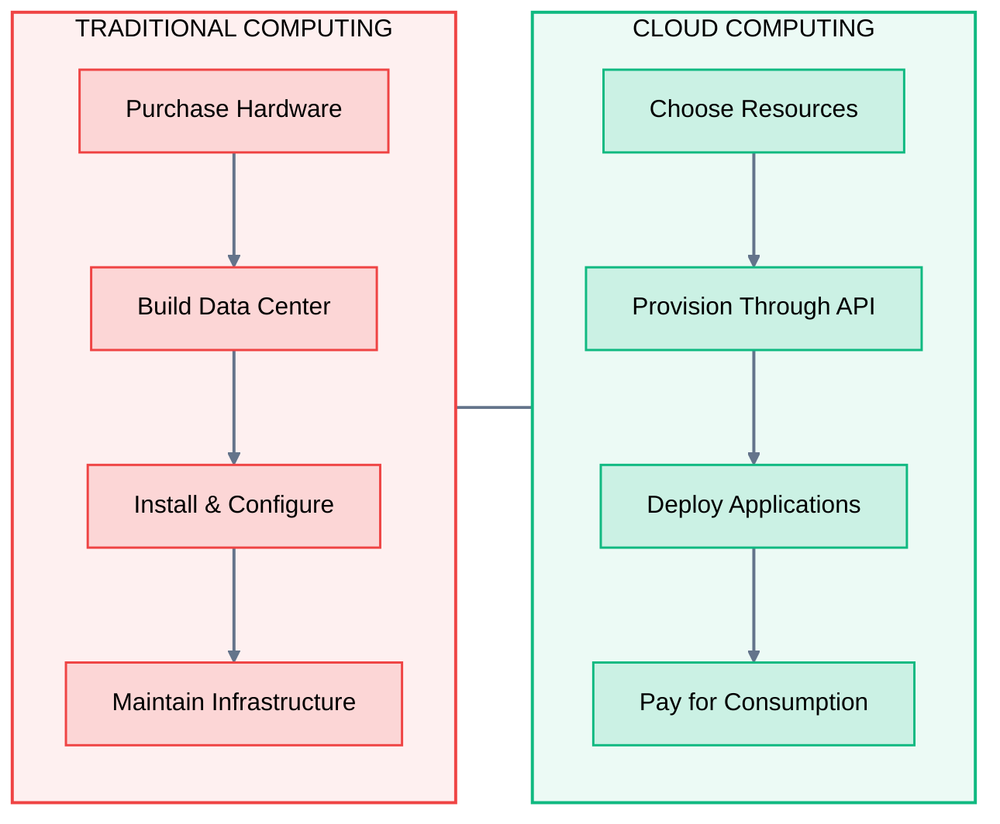
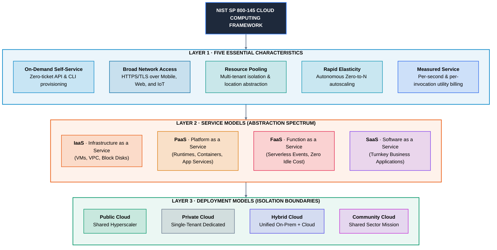
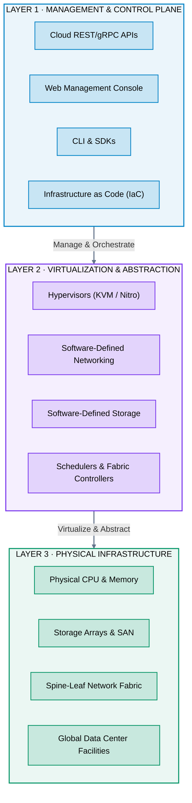
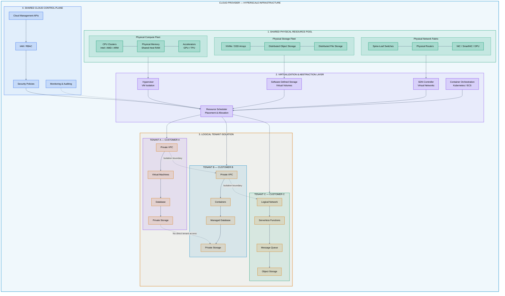
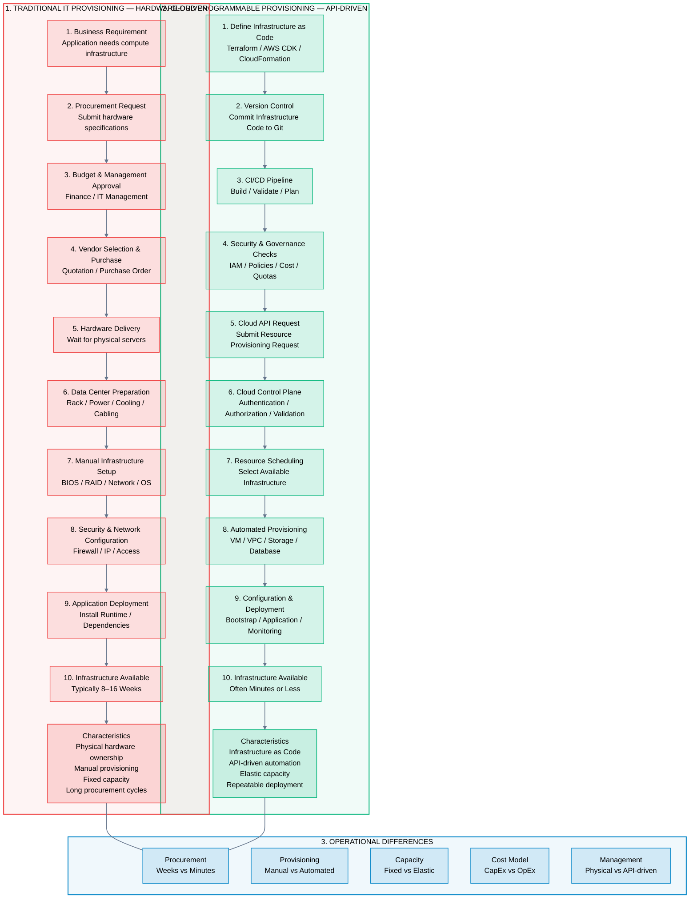
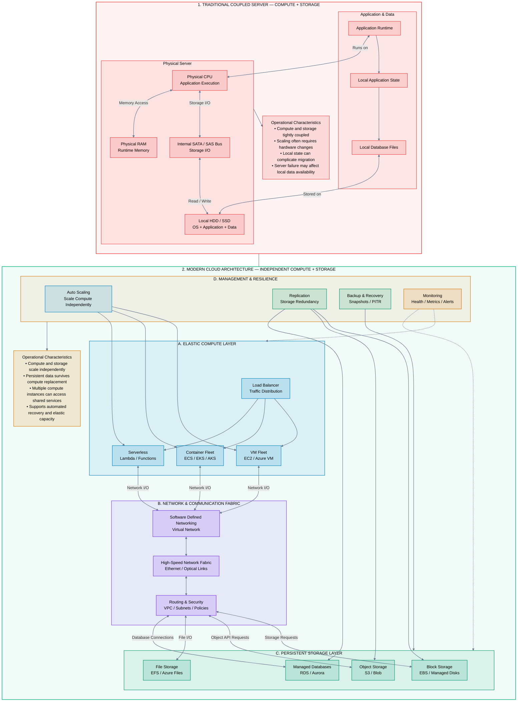
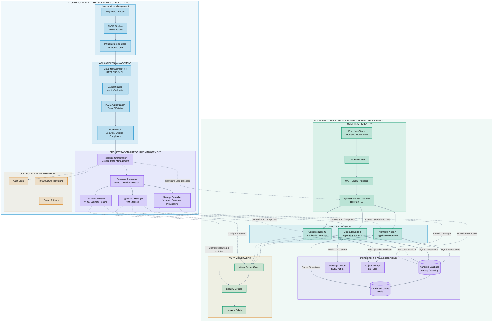

# 01 · What is Cloud Computing?

## 1. The Fundamental Idea

**Cloud Computing is the delivery of computing resources as services over a network, enabling organizations to provision, consume, scale, and release infrastructure on demand.**

- Instead of purchasing and maintaining physical infrastructure, organizations consume computing resources from cloud providers through self-service interfaces, APIs, and automated platforms.
- Think of cloud computing as an **electricity utility for computing**.
- You don't build a power station to operate your home. You connect to the electricity grid and pay for the energy you consume.

Cloud computing follows a similar principle.

### From Physical Ownership to Computing as a Utility


**The fundamental shift:** From owning computing infrastructure to consuming computing capabilities.

---

## 2. The Industry Definition – NIST SP 800-145

The **National Institute of Standards and Technology (NIST)** defines cloud computing through the globally recognized **SP 800-145 framework**, establishing that any authentic cloud platform is composed of **5 Essential Characteristics**, **3 Service Models**, and **4 Deployment Models**.

> [!NOTE] Official NIST SP 800-145 Definition
> *"Cloud computing is a model for enabling ubiquitous, convenient, on-demand network access to a shared pool of configurable computing resources (e.g., networks, servers, storage, applications, and services) that can be rapidly provisioned and released with minimal management effort or service provider interaction."*
> — **NIST Special Publication 800-145**



## 3. The Three Architectural Layers

A cloud provider is not simply a collection of virtual machines running inside a data center.

It is a complete infrastructure platform built upon physical resources, virtualization, and software-driven management.

### Cloud Infrastructure – Three Core Layers



---

## 4. Cloud Resource Abstraction – From Hardware to Services

One of the most important concepts in cloud computing is **abstraction**.

A customer does not need to know which physical server chassis, storage rack, or network switch handles their workload. The provider exposes logical, software-defined resources instead.

### The 3-Tier Abstraction Model

```mermaid

flowchart TB

    %% ==========================================
    %% LAYER 1 - CUSTOMER VIEW
    %% ==========================================

    subgraph CUSTOMER["1. CUSTOMER VIEW — LOGICAL CLOUD RESOURCES"]
        direction TB

        subgraph C_COMPUTE["Compute Resources"]
            direction LR
            EC2["Virtual Machines<br/>EC2 / Azure VM / GCE"]
            CONTAINER["Containers<br/>ECS / EKS / AKS / GKE"]
            SERVERLESS["Serverless Functions<br/>Lambda / Azure Functions"]
        end

        subgraph C_NETWORK["Network Resources"]
            direction LR
            VPC["Virtual Network<br/>VPC / VNet"]
            SUBNET["Subnets<br/>Public / Private"]
            SG["Security Groups<br/>NACL / Firewall Rules"]
            LB["Load Balancers<br/>ALB / NLB"]
        end

        subgraph C_STORAGE["Storage Resources"]
            direction LR
            BLOCK["Block Storage<br/>EBS / Managed Disks"]
            FILE["File Storage<br/>EFS / Azure Files"]
            OBJECT["Object Storage<br/>S3 / Blob Storage"]
        end

        subgraph C_DATA["Data Services"]
            direction LR
            DB["Managed Databases<br/>RDS / Cloud SQL"]
            CACHE["Managed Cache<br/>ElastiCache / Redis"]
            QUEUE["Messaging<br/>SQS / Pub/Sub"]
        end
    end

    %% ==========================================
    %% LAYER 2 - CLOUD ABSTRACTION
    %% ==========================================

    subgraph CLOUD["2. CLOUD PROVIDER — ABSTRACTION & CONTROL PLANE"]
        direction TB

        subgraph COMPUTE["Compute Virtualization"]
            direction LR
            HYP["Hypervisor<br/>KVM / Xen / Nitro"]
            VM_MGR["VM Lifecycle Manager<br/>Create / Start / Stop"]
            CPU_SCHED["vCPU Scheduler<br/>CPU Allocation"]
            MEM["Memory Manager<br/>RAM Allocation / Isolation"]
            CONT["Container Runtime<br/>containerd / CRI-O"]
        end

        subgraph NETWORK["Network Virtualization"]
            direction LR
            SDN["SDN Controller<br/>Network Control Plane"]
            VSW["Virtual Switch<br/>vSwitch / OVS"]
            OVERLAY["Network Overlay<br/>VXLAN / Geneve"]
            ROUTER["Virtual Routing<br/>Route Tables / NAT"]
            POLICY["Network Policy Engine<br/>Security / Isolation"]
        end

        subgraph STORAGE["Storage Virtualization"]
            direction LR
            VOL_MGR["Volume Manager<br/>Provision / Attach / Detach"]
            SDS["Software Defined Storage<br/>Distributed Storage Fabric"]
            REPL["Replication Engine<br/>Data Redundancy"]
            CACHE_MGR["Storage Cache<br/>Read / Write Optimization"]
            OBJ_MGR["Object Storage Engine<br/>Metadata / Object Placement"]
        end

        subgraph CONTROL["Cloud Control Plane"]
            direction LR
            API["Cloud API Gateway<br/>Management API"]
            SCHED["Resource Scheduler<br/>Host / Rack Placement"]
            PROV["Provisioning Engine<br/>Infrastructure Lifecycle"]
            IAM["Identity & Access<br/>IAM / RBAC / Policies"]
            MON["Monitoring & Telemetry<br/>Metrics / Logs / Events"]
        end
    end

    %% ==========================================
    %% LAYER 3 - PHYSICAL INFRASTRUCTURE
    %% ==========================================

    subgraph HARDWARE["3. PROVIDER VIEW — PHYSICAL DATA CENTER INFRASTRUCTURE"]
        direction TB

        subgraph COMPUTE_HW["Physical Compute"]
            direction LR
            CPU["Bare Metal Servers<br/>x86 / ARM CPUs"]
            RAM["Physical Memory<br/>DDR4 / DDR5 RAM"]
            GPU["Accelerators<br/>GPU / TPU / FPGA"]
            NIC["Server Network Cards<br/>NIC / SmartNIC / DPU"]
        end

        subgraph NETWORK_HW["Physical Network Fabric"]
            direction LR
            TOR["Top-of-Rack Switches<br/>ToR"]
            SPINE["Spine Switches<br/>High-Speed Switching"]
            CORE["Core / Border Routers<br/>WAN Connectivity"]
            OPTICAL["Optical Links<br/>100G / 400G / 800G"]
        end

        subgraph STORAGE_HW["Physical Storage"]
            direction LR
            NVME["NVMe SSDs<br/>High Performance"]
            SSD["Enterprise SSD Arrays<br/>Flash Storage"]
            HDD["High Capacity HDD<br/>Bulk Storage"]
            SAN["Storage Network<br/>NVMe-oF / Fibre Channel"]
        end

        subgraph FACILITY["Data Center Facility"]
            direction LR
            POWER["Power Infrastructure<br/>Grid / UPS / Generators"]
            COOL["Cooling Infrastructure<br/>CRAC / Chillers"]
            RACK["Server Racks<br/>Power Distribution / Cabling"]
            PHYSSEC["Physical Security<br/>Access Control / CCTV"]
        end
    end

    %% ==========================================
    %% CUSTOMER TO ABSTRACTION MAPPING
    %% ==========================================

    EC2 --> HYP
    EC2 --> VM_MGR
    CONTAINER --> CONT
    SERVERLESS --> VM_MGR

    VPC --> SDN
    SUBNET --> VSW
    SG --> POLICY
    LB --> ROUTER

    BLOCK --> VOL_MGR
    FILE --> SDS
    OBJECT --> OBJ_MGR

    DB --> SDS
    CACHE --> CACHE_MGR
    QUEUE --> API

    %% ==========================================
    %% COMPUTE ABSTRACTION TO HARDWARE
    %% ==========================================

    HYP --> CPU
    CPU_SCHED --> CPU
    MEM --> RAM
    CONT --> HYP
    VM_MGR --> SCHED
    CPU_SCHED --> SCHED

    %% ==========================================
    %% NETWORK ABSTRACTION TO HARDWARE
    %% ==========================================

    SDN --> TOR
    VSW --> NIC
    OVERLAY --> TOR
    ROUTER --> SPINE
    POLICY --> SDN
    TOR --> SPINE
    SPINE --> CORE
    CORE --> OPTICAL

    %% ==========================================
    %% STORAGE ABSTRACTION TO HARDWARE
    %% ==========================================

    VOL_MGR --> SDS
    SDS --> NVME
    SDS --> SSD
    OBJ_MGR --> HDD
    REPL --> SAN
    CACHE_MGR --> NVME
    SAN --> SSD

    %% ==========================================
    %% CONTROL PLANE RELATIONSHIPS
    %% ==========================================

    API --> PROV
    IAM --> API
    PROV --> SCHED
    SCHED --> CPU
    SCHED --> SPINE
    SCHED --> NVME
    MON --> PROV

    %% ==========================================
    %% PHYSICAL FACILITY SUPPORT
    %% ==========================================

    POWER --> RACK
    COOL --> RACK
    PHYSSEC --> RACK
    RACK --> CPU
    RACK --> SPINE
    RACK --> NVME

    %% ==========================================
    %% STYLING
    %% ==========================================

    style CUSTOMER fill:#0284c7,fill-opacity:0.07,stroke:#0284c7,stroke-width:2px,color:inherit
    style CLOUD fill:#7c3aed,fill-opacity:0.07,stroke:#7c3aed,stroke-width:2px,color:inherit
    style HARDWARE fill:#059669,fill-opacity:0.07,stroke:#059669,stroke-width:2px,color:inherit

    classDef custNode fill:#0284c7,fill-opacity:0.15,stroke:#0284c7,stroke-width:1.5px,color:inherit
    classDef cloudNode fill:#7c3aed,fill-opacity:0.15,stroke:#7c3aed,stroke-width:1.5px,color:inherit
    classDef hwNode fill:#059669,fill-opacity:0.15,stroke:#059669,stroke-width:1.5px,color:inherit

    class EC2,CONTAINER,SERVERLESS,VPC,SUBNET,SG,LB,BLOCK,FILE,OBJECT,DB,CACHE,QUEUE custNode

    class HYP,VM_MGR,CPU_SCHED,MEM,CONT,SDN,VSW,OVERLAY,ROUTER,POLICY,VOL_MGR,SDS,REPL,CACHE_MGR,OBJ_MGR,API,SCHED,PROV,IAM,MON cloudNode

    class CPU,RAM,GPU,NIC,TOR,SPINE,CORE,OPTICAL,NVME,SSD,HDD,SAN,POWER,COOL,RACK,PHYSSEC hwNode

    linkStyle default stroke:#64748b,stroke-width:1.5px

```



### Why does abstraction matter?

1. **Hardware Sharing:** Physical servers are multi-tenanted efficiently across thousands of customers.
2. **Programmatic Control:** Infrastructure states are altered purely through software APIs.
3. **Hardware Decoupling:** Workloads survive underlying machine failures and maintenance transparently.
4. **Elastic Scaling:** Add or remove instances without purchasing or unboxing physical hardware.
5. **Operational Resilience:** Providers handle hardware degradation and disk replacement behind the scenes.

---

## 5. Multi-Tenancy – Sharing Infrastructure Securely

Cloud providers serve millions of workloads simultaneously across large shared hardware clusters. This is **multi-tenancy**.



> [!IMPORTANT] Isolation Guarantee
> **Shared infrastructure does NOT mean shared customer data.** Isolation is strictly enforced across five layers:
> - **Hardware Boundary:** Intel VT-x/AMD-V virtualization flags and custom security chips (e.g., AWS Nitro).
> - **Network Boundary:** Encapsulated SDN overlays (Geneve, VXLAN) providing isolated VPC route tables.
> - **Storage Boundary:** Cryptographic volume separation governed by dedicated Customer Managed Keys (KMS).
> - **Identity Boundary:** Strict IAM evaluation denying all cross-account transactions by default.
> - **Hypervisor Boundary:** MicroVM sandboxes (Firecracker / gVisor) isolating tenant runtimes.

---

## 6. Programmable Infrastructure – The API Control Plane

Traditional IT infrastructure required physical procurement tickets and manual administrative configuration. Cloud infrastructure turns every component into a **programmable software API**.

### Traditional vs Programmable Provisioning



### Example: Declarative Infrastructure as Code (Terraform)

```hcl
# Automated declarative infrastructure
resource "aws_instance" "web_app" {
  ami           = "ami-0c55b159cbfafe1f0"
  instance_type = "t3.medium"

  vpc_security_group_ids = [aws_security_group.web_sg.id]
  subnet_id              = aws_subnet.private_app.id

  tags = {
    Environment = "production"
    Application = "customer-portal"
  }
}
```

**Leading Infrastructure as Code (IaC) Ecosystems:**
- **Terraform / OpenTofu:** Declarative cross-cloud orchestration.
- **AWS Cloud Development Kit (CDK):** Object-oriented infrastructure using TypeScript/Python.
- **Azure Bicep / ARM:** Native domain-specific declarative language for Microsoft Azure.
- **Google Cloud Deployment Manager / Config Connector:** Kubernetes-native resource management.
- **Pulumi:** Imperative/declarative models using Go, Node, or Python.

---

## 7. Compute and Storage Decoupling

In traditional bare-metal computing, compute and storage were physically soldered into the same chassis. If CPU spiked, disks could not be shared. If a disk failed, the entire machine went down.

Modern cloud computing **decouples compute from persistent storage** over high-speed networks.



### Architectural Trade-Off Analysis

| Dimension | Ephemeral Compute Layer | Persistent Storage Layer |
| :--- | :--- | :--- |
| **Primary Function** | Executes business logic & algorithms | Guarantees data durability & ACID compliance |
| **Lifecycle** | Ephemeral, disposable, auto-scalable | Durable, independent, multi-year retention |
| **Resilience Strategy** | "Cattle" model (terminate and replace) | Multi-AZ synchronous block/object replication |
| **Hyperscale Examples** | AWS EC2, Azure VMs, Cloud Run | AWS EBS, S3, Azure Blob, Google Cloud SQL |

---

## 8. Control Plane vs Data Plane

Every cloud infrastructure component operates across two distinct planes:



### Operational Distinction

| Architectural Dimension | Control Plane (Management) | Data Plane (Runtime) |
| :--- | :--- | :--- |
| **Core Objective** | Provision, reconfigure, and tear down resources | Route packets, execute code, process queries |
| **Latency Tolerance** | Seconds to minutes acceptable | Sub-millisecond strict SLA required |
| **Availability Dependency** | High consistency prioritised over latency | High availability & partition tolerance (AP) |
| **Outage Impact** | Cannot launch *new* servers or change security rules | Running applications experience downtime |
| **Real-World Example** | `aws ec2 run-instances` API call | Customer HTTP traffic traversing the ALB |

> [!TIP] Architectural Resilience Insight
> In well-architected cloud services, **control plane outages do NOT crash running data plane workloads**. If the AWS EC2 API control plane becomes temporarily unavailable, existing running EC2 instances and databases continue serving end-user traffic without interruption.

---

## 9. Cloud Computing vs Traditional Hosted Virtualization

Not every virtualized data center is authentic cloud computing. A private VMware vSphere cluster in a corporate basement without automated self-service APIs is simply hosted virtualization ("Cloud-Washing").

| Capability Criteria | Hosted Virtualization / Legacy Colo | True Cloud Computing |
| :--- | :--- | :--- |
| **Provisioning Velocity** | Days to weeks via sysadmin tickets | Seconds via programmatic API / IaC |
| **Elasticity Mechanics** | Fixed by purchased physical host limits | Autonomous, virtually infinite horizontal scale |
| **Resource Pooling** | Dedicated or statically sliced hardware | Elastic multi-tenant pool with automated rebalancing |
| **Billing Granularity** | Fixed 3–5 year hardware lease contracts | Sub-second pay-per-use utility consumption |
| **Network Fabric** | Physical switches & manual VLAN tagging | Programmable Software-Defined Networking (VPC) |
| **API Automation** | Ad-hoc scripts or vendor portals | Idempotent, declarative global REST/gRPC APIs |

---

## 10. The Complete Cloud Computing Model

Uniting all infrastructure tiers into a single cohesive architecture:

```mermaid

flowchart TB

    %% ==========================================
    %% USERS
    %% ==========================================

    USER["DEVELOPERS · CLOUD ARCHITECTS · OPERATORS"]

    %% ==========================================
    %% LAYER 1 - ACCESS
    %% ==========================================

    subgraph ACCESS["1. SERVICE ACCESS & AUTOMATION LAYER"]
        direction TB

        subgraph INTERFACES["Management Interfaces"]
            direction LR
            PORTAL["Web Console<br/>AWS / Azure / GCP"]
            CLI["CLI & SDKs<br/>AWS CLI / Azure CLI / gcloud"]
            API_CLIENT["REST APIs<br/>HTTP / JSON"]
        end

        subgraph AUTOMATION["Infrastructure Automation"]
            direction LR
            IAC["Infrastructure as Code<br/>Terraform / CDK / Bicep"]
            GIT["Version Control<br/>Git / GitHub"]
            CICD["CI/CD Pipeline<br/>GitHub Actions / Jenkins"]
        end

        PORTAL --> API_CLIENT
        CLI --> API_CLIENT
        IAC --> GIT --> CICD
        CICD --> API_CLIENT
    end

    %% ==========================================
    %% LAYER 2 - CONTROL PLANE
    %% ==========================================

    subgraph CONTROL["2. CLOUD CONTROL PLANE — MANAGEMENT & ORCHESTRATION"]
        direction TB

        subgraph ENTRY["API & REQUEST MANAGEMENT"]
            direction LR
            GATEWAY["Cloud API Gateway"]
            AUTH["Authentication<br/>Identity Validation"]
            IAM["IAM / RBAC<br/>Authorization"]
            POLICY["Policy Engine<br/>Governance / Compliance"]
        end

        subgraph ORCHESTRATION["RESOURCE ORCHESTRATION"]
            direction LR
            ORCH["Fabric Orchestrator<br/>Desired State"]
            SCHED["Resource Scheduler<br/>Capacity / Placement"]
            PROV["Provisioning Engine<br/>Create / Update / Delete"]
            LIFECYCLE["Lifecycle Manager<br/>Start / Stop / Scale"]
        end

        subgraph MANAGEMENT["MANAGEMENT SERVICES"]
            direction LR
            MON["Monitoring & Telemetry"]
            AUDIT["Audit Logs"]
            BILL["Billing & Metering"]
            QUOTA["Quota Management"]
        end

        GATEWAY --> AUTH --> IAM --> POLICY
        POLICY --> ORCH
        ORCH --> SCHED --> PROV --> LIFECYCLE

        ORCH -.-> MON
        ORCH -.-> AUDIT
        PROV -.-> BILL
        SCHED -.-> QUOTA
    end

    %% ==========================================
    %% LAYER 3 - CLOUD SERVICE ENGINES
    %% ==========================================

    subgraph SERVICES["3. CLOUD SERVICE LAYER — SERVICE ENGINES"]
        direction TB

        subgraph COMPUTE["COMPUTE SERVICES"]
            direction LR
            EC2["Virtual Machines<br/>EC2 / Azure VM / GCE"]
            CONTAINERS["Containers<br/>ECS / EKS / AKS / GKE"]
            SERVERLESS["Serverless<br/>Lambda / Functions"]
            GPU["Accelerated Computing<br/>GPU / AI Instances"]
        end

        subgraph NETWORK["NETWORK SERVICES"]
            direction LR
            VPC["Virtual Networks<br/>VPC / VNet"]
            LB["Load Balancers<br/>ALB / NLB"]
            DNS["DNS & Traffic Management"]
            FIREWALL["Firewall / WAF<br/>Security Groups"]
        end

        subgraph STORAGE["STORAGE SERVICES"]
            direction LR
            BLOCK["Block Storage<br/>EBS / Managed Disks"]
            OBJECT["Object Storage<br/>S3 / Blob"]
            FILE["File Storage<br/>EFS / Azure Files"]
            BACKUP["Backup & Snapshots"]
        end

        subgraph DATA_AI["DATA & AI SERVICES"]
            direction LR
            DATABASE["Managed Databases<br/>RDS / Aurora / Cloud SQL"]
            ANALYTICS["Analytics Engines<br/>Snowflake / Databricks"]
            QUEUE["Messaging<br/>SQS / Kafka / Pub/Sub"]
            AIML["AI / ML Platforms<br/>SageMaker / Vertex AI"]
        end
    end

    %% ==========================================
    %% LAYER 4 - SOFTWARE DEFINED ABSTRACTION
    %% ==========================================

    subgraph VIRTUAL["4. SOFTWARE-DEFINED ABSTRACTION & VIRTUALIZATION"]
        direction TB

        subgraph V_COMPUTE["COMPUTE VIRTUALIZATION"]
            direction LR
            HYP["Hypervisor<br/>Nitro / KVM / Hyper-V"]
            VM_MGR["Virtual Machine Manager"]
            CONT_RT["Container Runtime<br/>containerd / CRI-O"]
            GPU_V["GPU Virtualization / Allocation"]
        end

        subgraph V_NETWORK["NETWORK VIRTUALIZATION"]
            direction LR
            SDN["SDN Control & Data Plane"]
            OVERLAY["Overlay Networking<br/>VXLAN / Geneve"]
            VSW["Virtual Switches<br/>OVS / vSwitch"]
            ROUTING["Virtual Routing<br/>NAT / Segmentation"]
        end

        subgraph V_STORAGE["STORAGE VIRTUALIZATION"]
            direction LR
            SDS["Software Defined Storage"]
            VOL["Virtual Volume Manager"]
            DIST["Distributed Storage Engine"]
            REPL["Replication & Erasure Coding"]
        end
    end

    %% ==========================================
    %% LAYER 5 - PHYSICAL INFRASTRUCTURE
    %% ==========================================

    subgraph PHYSICAL["5. GLOBAL PHYSICAL INFRASTRUCTURE"]
        direction TB

        subgraph HARDWARE["COMPUTE HARDWARE"]
            direction LR
            CPU["Bare Metal Servers<br/>Intel / AMD / ARM"]
            RAM["Physical Memory<br/>DDR4 / DDR5"]
            GPU_HW["GPU / TPU / FPGA"]
            NIC["NIC / SmartNIC / DPU"]
        end

        subgraph FABRIC["NETWORK HARDWARE"]
            direction LR
            TOR["Top-of-Rack Switches"]
            SPINE["Spine Switches"]
            CORE["Core / Border Routers"]
            OPTICAL["Optical Fiber<br/>100G / 400G / 800G"]
        end

        subgraph DISKS["STORAGE HARDWARE"]
            direction LR
            NVME["NVMe SSD"]
            SSD["Enterprise SSD Arrays"]
            HDD["High Capacity HDD"]
            SAN["Storage Network<br/>NVMe-oF / Fibre Channel"]
        end

        subgraph FACILITY["DATA CENTER FACILITY"]
            direction LR
            POWER["Dual Power Feeds<br/>UPS / Generators"]
            COOLING["Cooling Systems<br/>CRAC / Chillers"]
            RACK["Server Racks<br/>Power Distribution"]
            SECURITY["Physical Security<br/>Access / CCTV"]
        end
    end

    %% ==========================================
    %% LAYER CONNECTIONS
    %% ==========================================

    USER --> ACCESS
    API_CLIENT --> GATEWAY

    LIFECYCLE -.->|"Provision & Configure"| SERVICES

    EC2 --> HYP
    CONTAINERS --> CONT_RT
    SERVERLESS --> HYP
    GPU --> GPU_V

    VPC --> SDN
    LB --> ROUTING
    FIREWALL --> OVERLAY

    BLOCK --> VOL
    OBJECT --> SDS
    FILE --> DIST
    DATABASE --> SDS

    HYP --> CPU
    VM_MGR --> RAM
    CONT_RT --> CPU
    GPU_V --> GPU_HW

    SDN --> NIC
    OVERLAY --> TOR
    VSW --> SPINE
    ROUTING --> CORE

    VOL --> NVME
    SDS --> SSD
    DIST --> HDD
    REPL --> SAN

    CPU --> RACK
    SPINE --> RACK
    NVME --> RACK

    POWER --> RACK
    COOLING --> RACK
    SECURITY --> RACK

    %% ==========================================
    %% STYLING
    %% ==========================================

    style ACCESS fill:#0284c7,fill-opacity:0.06,stroke:#0284c7,stroke-width:2px,color:inherit
    style CONTROL fill:#7c3aed,fill-opacity:0.06,stroke:#7c3aed,stroke-width:2px,color:inherit
    style SERVICES fill:#2563eb,fill-opacity:0.06,stroke:#2563eb,stroke-width:2px,color:inherit
    style VIRTUAL fill:#d97706,fill-opacity:0.06,stroke:#d97706,stroke-width:2px,color:inherit
    style PHYSICAL fill:#059669,fill-opacity:0.06,stroke:#059669,stroke-width:2px,color:inherit

    style INTERFACES fill:#0284c7,fill-opacity:0.09,stroke:#0284c7,color:inherit
    style AUTOMATION fill:#0284c7,fill-opacity:0.09,stroke:#0284c7,color:inherit
    style ENTRY fill:#7c3aed,fill-opacity:0.09,stroke:#7c3aed,color:inherit
    style ORCHESTRATION fill:#7c3aed,fill-opacity:0.09,stroke:#7c3aed,color:inherit
    style MANAGEMENT fill:#7c3aed,fill-opacity:0.09,stroke:#7c3aed,color:inherit

    style COMPUTE fill:#2563eb,fill-opacity:0.09,stroke:#2563eb,color:inherit
    style NETWORK fill:#2563eb,fill-opacity:0.09,stroke:#2563eb,color:inherit
    style STORAGE fill:#2563eb,fill-opacity:0.09,stroke:#2563eb,color:inherit
    style DATA_AI fill:#2563eb,fill-opacity:0.09,stroke:#2563eb,color:inherit

    style V_COMPUTE fill:#d97706,fill-opacity:0.09,stroke:#d97706,color:inherit
    style V_NETWORK fill:#d97706,fill-opacity:0.09,stroke:#d97706,color:inherit
    style V_STORAGE fill:#d97706,fill-opacity:0.09,stroke:#d97706,color:inherit

    style HARDWARE fill:#059669,fill-opacity:0.09,stroke:#059669,color:inherit
    style FABRIC fill:#059669,fill-opacity:0.09,stroke:#059669,color:inherit
    style DISKS fill:#059669,fill-opacity:0.09,stroke:#059669,color:inherit
    style FACILITY fill:#059669,fill-opacity:0.09,stroke:#059669,color:inherit

    classDef accessNode fill:#0284c7,fill-opacity:0.15,stroke:#0284c7,stroke-width:1.5px,color:inherit
    classDef controlNode fill:#7c3aed,fill-opacity:0.15,stroke:#7c3aed,stroke-width:1.5px,color:inherit
    classDef serviceNode fill:#2563eb,fill-opacity:0.15,stroke:#2563eb,stroke-width:1.5px,color:inherit
    classDef virtualNode fill:#d97706,fill-opacity:0.15,stroke:#d97706,stroke-width:1.5px,color:inherit
    classDef physicalNode fill:#059669,fill-opacity:0.15,stroke:#059669,stroke-width:1.5px,color:inherit

    class PORTAL,CLI,API_CLIENT,IAC,GIT,CICD accessNode
    class GATEWAY,AUTH,IAM,POLICY,ORCH,SCHED,PROV,LIFECYCLE,MON,AUDIT,BILL,QUOTA controlNode
    class EC2,CONTAINERS,SERVERLESS,GPU,VPC,LB,DNS,FIREWALL,BLOCK,OBJECT,FILE,BACKUP,DATABASE,ANALYTICS,QUEUE,AIML serviceNode
    class HYP,VM_MGR,CONT_RT,GPU_V,SDN,OVERLAY,VSW,ROUTING,SDS,VOL,DIST,REPL virtualNode
    class CPU,RAM,GPU_HW,NIC,TOR,SPINE,CORE,OPTICAL,NVME,SSD,HDD,SAN,POWER,COOLING,RACK,SECURITY physicalNode

    linkStyle default stroke:#64748b,stroke-width:1.5px

```



---

## 11. Key Takeaways

| Core Concept | Architectural Principle |
| :--- | :--- |
| **Cloud Computing** | Delivery of computing resources as on-demand, network-accessible utility services. |
| **NIST 5 Characteristics** | On-Demand Self-Service, Broad Network Access, Resource Pooling, Rapid Elasticity, Measured Service. |
| **Abstraction** | Decoupling application workloads from underlying physical server hardware and facilities. |
| **Multi-Tenancy** | Sharing physical clusters safely via cryptographic, network, and hypervisor isolation barriers. |
| **API Control Plane** | Infrastructure defined and orchestrated as declarative code (IaC) rather than physical hardware changes. |
| **Decoupling State** | Stateless ephemeral compute paired with durable, highly replicated storage fabrics. |
| **Dual Planes** | Control Plane (orchestrates configuration) vs Data Plane (transits live customer workload traffic). |

---

## 12. Knowledge Check

1. Why is cloud computing compared to an electrical power grid?
2. What are the five essential characteristics specified by NIST SP 800-145?
3. What is the fundamental difference between physical bare-metal infrastructure and logical cloud resources?
4. How do cloud providers enforce tenant isolation on shared multi-tenant physical hardware?
5. What is the operational distinction between the Control Plane and the Data Plane?
6. Why does modern cloud architecture decouple compute instances from persistent storage volumes?
7. What are the key limitations of traditional step-function capacity planning compared to cloud elasticity?
8. Can an existing cloud workload survive an active control-plane API outage? Why?
9. What distinguishes true cloud computing from legacy hosted virtualization?
10. How does Infrastructure as Code (IaC) prevent configuration drift in enterprise deployments?

---

## 13. Next Chapter

Continue your foundational cloud curriculum:

> ➡️ **Next Module**: [[02_Evolution_of_Computing_OnPrem_to_Cloud|02 · Evolution of Computing – On-Premises to Cloud]]  
> *Exploring the historical progression from Mainframes and Client-Server architectures to Type-1 Hypervisors, Microservices, and Serverless computing.*

---

### Authoritative References

- [NIST SP 800-145: The NIST Definition of Cloud Computing](https://csrc.nist.gov/pubs/sp/800/145/final)
- [NIST Cloud Computing Technology Roadmap](https://www.nist.gov/programs-projects/nist-cloud-computing-program)
- [AWS Well-Architected Framework: Reliability Pillar](https://docs.aws.amazon.com/wellarchitected/latest/reliability-pillar/)
- [Microsoft Azure Cloud Architecture Center](https://learn.microsoft.com/en-us/azure/architecture/)
- [Google Cloud Architecture Framework](https://cloud.google.com/architecture/framework)
