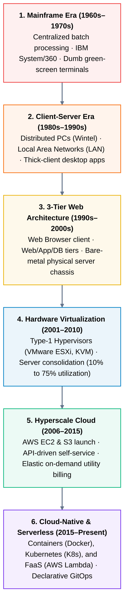
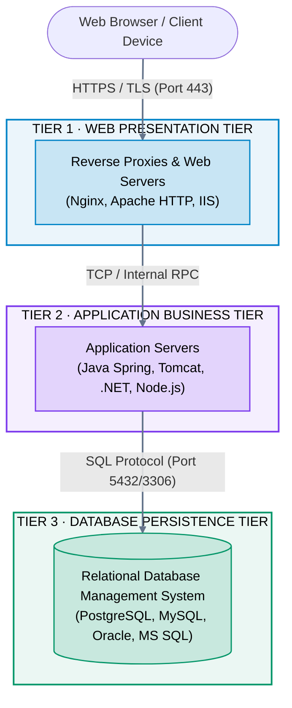
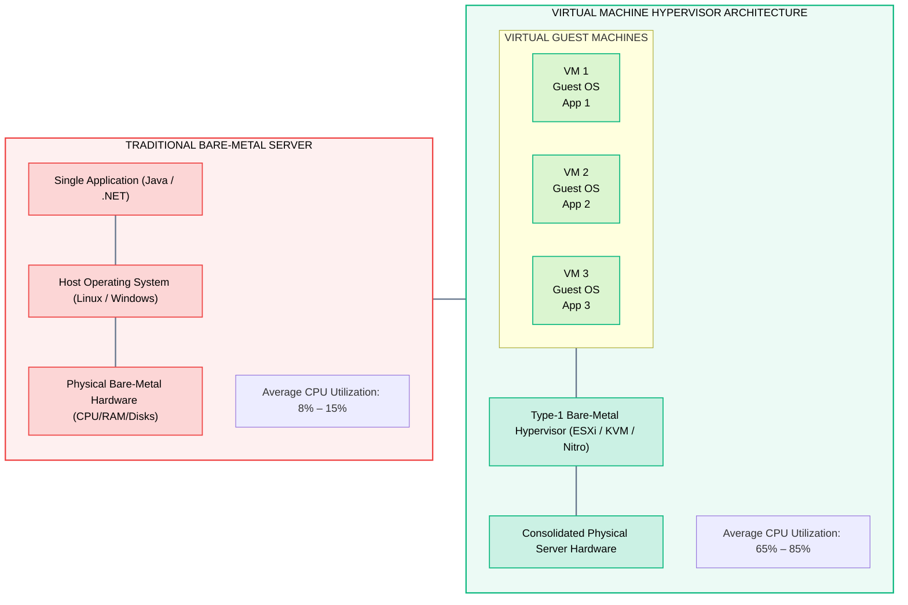
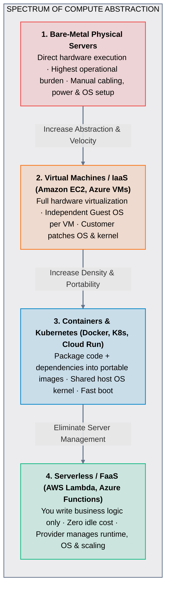
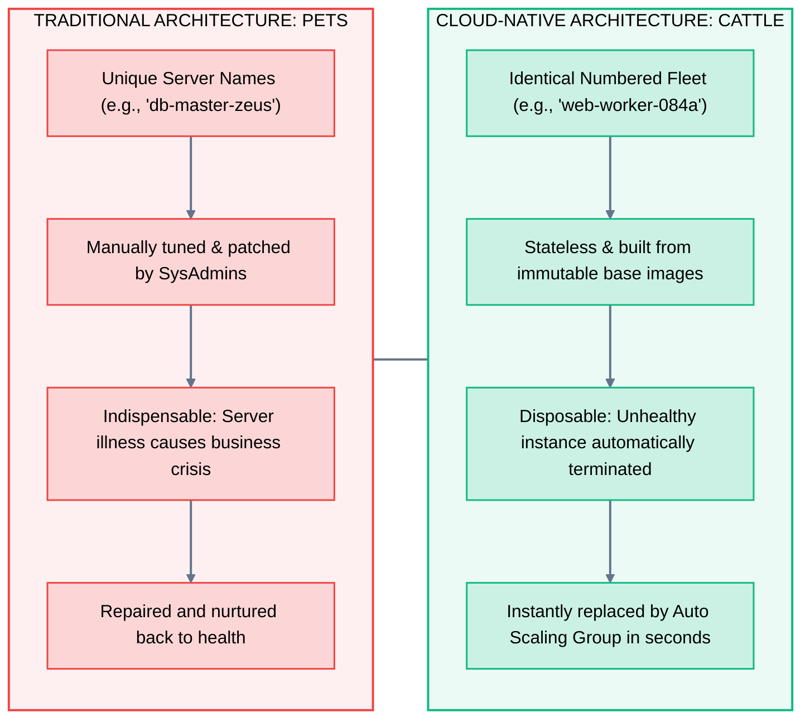

# 02 · Evolution of Computing – On-Premises to Cloud

> **Status**: Comprehensive Reference  
> **Parent**: [[Overview\|Overview]] | [[00-Foundations/01-cloud-computing/README\|Module Index]]  
> **Topics**: Mainframes, Client-Server Era, 3-Tier Web Architectures, Type-1 Hypervisors, Containers, Cloud-Native & Serverless Paradigm

---

## 1. The Historical Progression of Compute Architectures

The evolution of enterprise computing over the last six decades is a relentless drive toward **higher hardware utilization**, **rapid developer iteration**, and **complete infrastructure decoupling**.

---

## 2. Deep Dive: Key Architectural Transitions

### Phase 1: The Mainframe Era (Centralized Monolithic)
- **Architecture**: A central, massive mainframe computer (such as the IBM System/360 or 370) executing all computations and persistent data storage.
- **Client Access**: Dumb terminals (e.g., IBM 3270) with zero local CPU or memory, connected via serial cables or SNA protocols.
- **Key Limitations**: Multi-million dollar capital cost, proprietary single-vendor lock-in, rigid batch processing queues, and specialized chilled-water facilities.

---

### Phase 2: The Client-Server Architecture (Distributed Desktop)
In the 1980s, the advent of affordable personal computers (PCs) shifted presentation and business logic onto desktop client workstations connected to central database servers over Local Area Networks (LANs).

```mermaid
flowchart LR
    subgraph CLIENTS["THICK-CLIENT WORKSTATIONS"]
        direction TB
        C1["Desktop PC 1<br/>(Local UI & Business Logic)"]
        C2["Desktop PC 2<br/>(Local UI & Business Logic)"]
        C3["Desktop PC 3<br/>(Local UI & Business Logic)"]
    end

    subgraph NETWORK["LOCAL AREA NETWORK (LAN)"]
        direction TB
        SW["Ethernet Hubs / Switches"]
    end

    subgraph SERVERS["CENTRAL BACKEND"]
        direction TB
        DB[("Relational Database<br/>(Oracle / SQL Server / DB2)")]
        FILE["Central File Server"]
    end

    CLIENTS <===> NETWORK <===> SERVERS

    style CLIENTS fill:#0284c7,fill-opacity:0.08,stroke:#0284c7,stroke-width:2px,color:inherit
    style NETWORK fill:#64748b,fill-opacity:0.08,stroke:#64748b,stroke-width:1.5px,color:inherit
    style SERVERS fill:#059669,fill-opacity:0.08,stroke:#059669,stroke-width:2px,color:inherit

    classDef cNode fill:#0284c7,fill-opacity:0.15,stroke:#0284c7,stroke-width:1.5px,color:inherit
    class C1,C2,C3 cNode

    classDef sNode fill:#059669,fill-opacity:0.15,stroke:#059669,stroke-width:1.5px,color:inherit
    class DB,FILE sNode

    linkStyle default stroke:#64748b,stroke-width:2px
```

- **Operational Bottlenecks**:
  - **Thick-Client Deployment Nightmare**: Software updates required manual installation across thousands of corporate desktop PCs.
  - **Database Saturation**: Every desktop maintained an open, persistent database socket connection, easily exhausting server connection pools.

---

### Phase 3: The 3-Tier Web Architecture (Early Internet)
To resolve thick-client distribution problems, the software industry embraced the web browser as the universal thin client and decomposed applications into three dedicated tiers:

- **The Traditional Data Center Bottleneck**: Each tier ran on separate, physical bare-metal hardware. Scaling the Application Tier required purchasing new server blades, waiting 8–12 weeks for delivery, racking, cabling, and manual OS installation.

---

### Phase 4: Hardware Virtualization (The Pre-Cloud Foundation)

In the late 1990s and early 2000s, VMware and open-source hypervisors (Xen, KVM) unlocked hardware virtualization on commodity x86 processors:

> [!NOTE] The Missing Link in Early Virtualization
> Virtualization succeeded at **server consolidation** (reducing 10 physical racks to 1 rack), but it was **not yet cloud computing**:
> - Provisioning a VM still required filing an IT helpdesk ticket.
> - Storage allocations and network IP mappings were assigned manually by administrators.
> - Billing remained tied to static annual licensing and capital hardware deprecation.

---

### Phase 5: The Hyperscale Cloud Revolution (2006–Present)

In 2006, Amazon launched **Amazon S3** (Simple Storage Service) followed by **Amazon EC2** (Elastic Compute Cloud). Cloud computing integrated virtualization with four transformative engineering capabilities:
1. **API-Driven Self-Service**: Infrastructure provisioned purely via REST endpoints, CLI, and code.
2. **True Multi-Tenancy**: Dynamic pooling of global compute, storage, and networking resources.
3. **Infinite Perceived Elasticity**: Scale automatically from 1 instance to 10,000 instances in minutes.
4. **Sub-Second Utility Billing**: Metered pay-as-you-go pricing replacing capital commitments.

---

### Phase 6: Containers, Microservices & Serverless (Cloud-Native)

Modern engineering has moved upward from managing virtual machines to declarative container orchestration and event-driven functions:

---

## 3. Master Comparison: Compute Abstraction Layers

| Engineering Dimension | Bare Metal (Traditional) | Virtual Machines (IaaS) | Containers (Docker/K8s) | Serverless (FaaS) |
| :--- | :--- | :--- | :--- | :--- |
| **Isolation Boundary** | Physical air-gap | Hypervisor boundary (KVM/Nitro) | Linux kernel namespaces & cgroups | MicroVM sandbox (Firecracker/gVisor) |
| **Startup / Boot Time** | Minutes to hours | 30 seconds to 3 minutes | Milliseconds to seconds | Sub-second (< 100ms cold start) |
| **Operating System** | Managed by customer | Managed by customer (Guest OS) | Shared host OS kernel | 100% managed by cloud provider |
| **Resource Density** | 1 OS per machine | ~10–50 VMs per host | ~100–1,000 containers per host | Thousands of concurrent invocations |
| **Scaling Mechanism** | Physical racking & cabling | Auto Scaling Groups (VM fleet) | Horizontal Pod Autoscaler (HPA) | Autonomous per-request concurrency |
| **Billing Granularity** | 3–5 year CapEx depreciation | Per-second / Hourly running VM | Per-second pod/node allocation | Per-millisecond execution duration |
| **Portability** | Low (Tied to hardware drivers) | Moderate (AMI / VHD images) | High (OCI standard container image) | Moderate (Cloud event bindings) |

---

## 4. Architectural Mindset Shift: Pets vs. Cattle

The evolution from physical computing to cloud-native platforms is epitomized by Randy Bias's famous analogy:

- **Pets Mindset**: Servers are unique, handcrafted machines. When a server fails, engineers spend hours debugging hardware and restoring backups.
- **Cattle Mindset**: Servers are stateless, ephemeral commodities. When an instance fails health checks, the cloud fabric terminates it and provisions a replacement within seconds.

---

## 5. Key Takeaways

| Epoch / Paradigm | Architectural Significance |
| :--- | :--- |
| **Mainframe** | Centralized compute and monolithic batch processing with terminal interfaces. |
| **Client-Server** | Distributed computing over LANs; business logic coupled to desktop OS. |
| **3-Tier Web** | Browser thin-client decoupling presentation, business logic, and database persistence. |
| **Virtualization** | Consolidation of hardware resources via hypervisors, boosting CPU utilization from 10% to 75%. |
| **Cloud Computing** | Programmable self-service APIs, elastic auto-scaling, and per-second utility billing. |
| **Containers & FaaS** | Packaging apps into portable micro-units and executing code without managing server instances. |
| **Pets to Cattle** | Designing distributed systems that expect node failure and self-heal automatically. |

---

## 6. Knowledge Check

1. What was the primary operational bottleneck of the 1980s Client-Server architecture?
2. How did the 3-Tier Web architecture solve the thick-client software deployment challenge?
3. What is a Type-1 (Bare-Metal) Hypervisor, and how did it improve physical server utilization?
4. Why was early 2000s server virtualization not considered true cloud computing?
5. What are the key differences between a Virtual Machine and a Docker Container?
6. How does Function as a Service (FaaS) achieve zero cost when an application is idle?
7. Explain the "Pets vs. Cattle" analogy in cloud systems architecture.
8. What is a "cold start" in Serverless computing, and why does it occur?
9. Why does containerization offer faster boot times compared to virtual machines?
10. How does declarative GitOps improve deployment reliability in modern cloud-native environments?

---

## 7. Next Chapter

Continue your cloud computing learning journey:

> ➡️ **Next Module**: [[03_Traditional_Data_Center_Architecture|03 · Traditional Data Center Architecture]]  
> *Deep dive into physical data center design, electrical UPS grids, HVAC cooling chillers, 3-Tier hierarchical networking vs. Spine-Leaf Clos fabrics, Fibre Channel SAN storage, and Power Usage Effectiveness (PUE).*

---

### Authoritative References

- [NIST SP 800-145: The NIST Definition of Cloud Computing](https://csrc.nist.gov/pubs/sp/800/145/final)
- [The History of Virtualization – ACM Queue](https://queue.acm.org/)
- [AWS Well-Architected Framework: Evolution of Infrastructure](https://docs.aws.amazon.com/wellarchitected/latest/framework/)
- [Google Cloud: A Brief History of Cloud Architecture](https://cloud.google.com/architecture)
