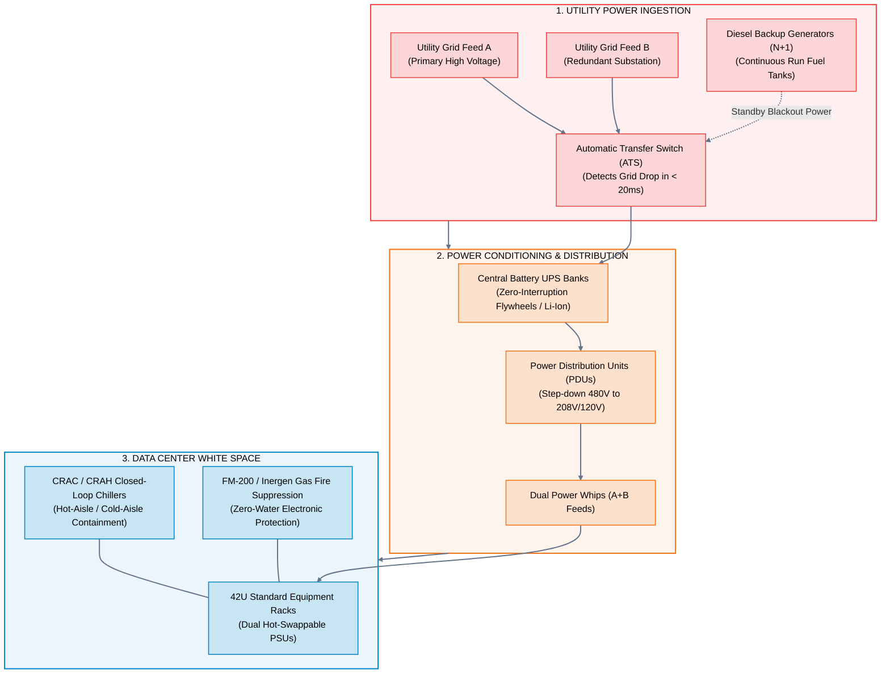
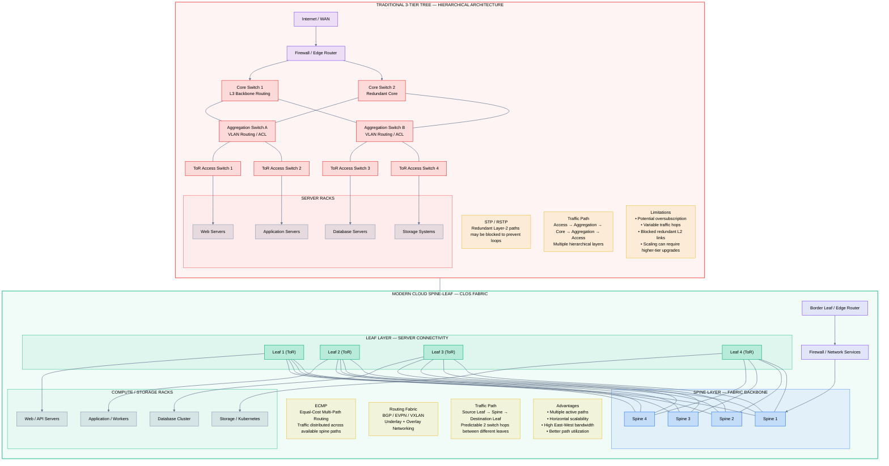
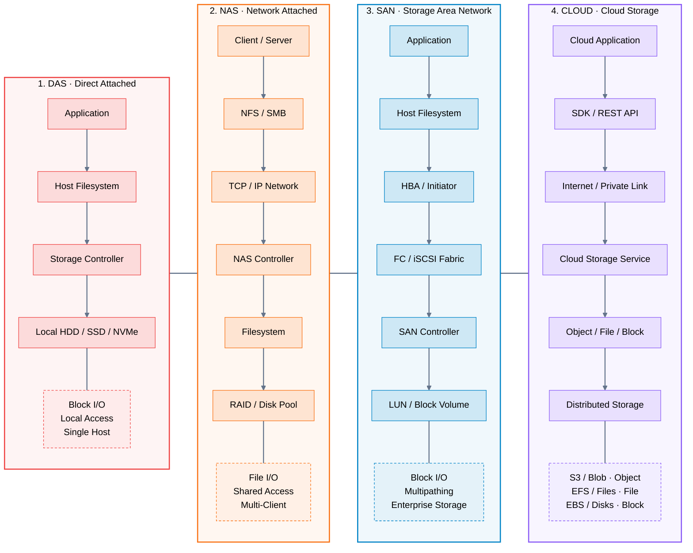
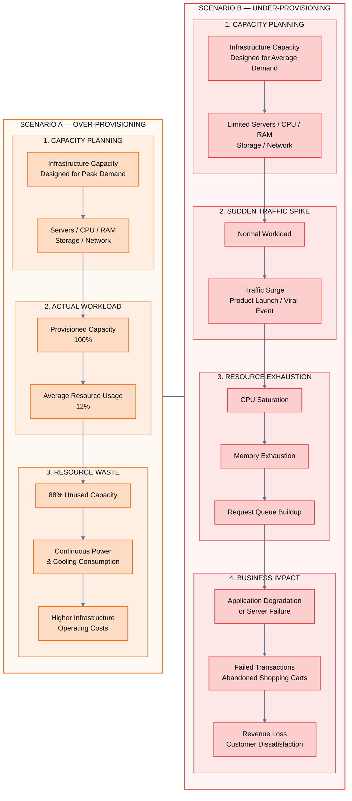
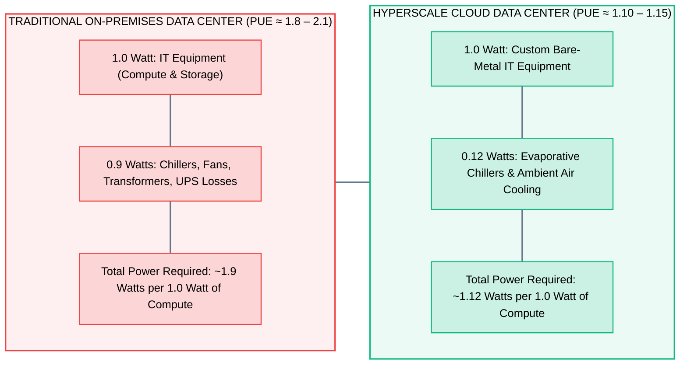

# 03 · Traditional Data Center Architecture

> **Status**: Comprehensive Reference  
> **Parent**: [[Overview\|Overview]] | [[00-Foundations/01-cloud-computing/README\|Module Index]]  
> **Topics**: Physical Facilities, Power & Cooling Systems, 3-Tier Network Hierarchy, Spine-Leaf (Clos) Networks, Storage Area Networks (SAN/NAS/DAS), Capacity Planning Dilemma, PUE Metrics

---

## 1. Physical Facility Architecture (Data Center Infrastructure)

A traditional enterprise data center is a capital-intensive physical installation engineered to maintain continuous electrical power, thermal equilibrium, physical security, and network transit for thousands of servers.

### The Uptime Institute Tier Classification

The industry standard framework for rating data center availability and physical redundancy:

| Tier Rating | Redundancy Architecture | Expected Uptime | Maximum Annual Downtime | Operational Characteristics |
| :--- | :--- | :--- | :--- | :--- |
| **Tier I** | Basic Capacity ($N$) | 99.671% | 28.8 hours / year | Single path for power and cooling; no redundancy; planned maintenance requires total shutdown. |
| **Tier II** | Redundant Components ($N+1$) | 99.741% | 22.0 hours / year | Adds redundant UPS and backup generators; maintenance still requires partial workload disruption. |
| **Tier III** | Concurrently Maintainable ($N+1$) | 99.982% | 1.6 hours / year | Dual power paths; redundant components can be serviced without shutting down IT workloads. |
| **Tier IV** | Fault Tolerant ($2(N+1)$) | 99.995% | 26.3 minutes / year | Fully autonomous redundant paths; automatically absorbs equipment failures with zero service impact. |

---

## 2. Network Topology: Hierarchical Tree vs. Cloud Spine-Leaf (Clos)

Traditional enterprise data centers historically utilized Cisco's **Core-Aggregation-Access** hierarchical tree. Hyperscale cloud architectures completely abandoned this topology in favor of **Spine-Leaf (Clos)** fabrics.

### Why Traditional Data Center Networking Failed at Scale:

1. **The Spanning Tree Protocol (STP) Bottleneck**:
   - Ethernet networks cannot tolerate physical forwarding loops.
   - To prevent broadcast storms, STP actively disables backup links, causing **50% of purchased network bandwidth to sit dormant**.
2. **North-South vs. East-West Traffic Inversion**:
   - *North-South Traffic*: Packets flowing between client users on the public internet and a data center server. The 3-tier tree was optimized for this pattern.
   - *East-West Traffic*: High-volume packet exchange between servers *inside* the data center (microservices, distributed databases, MapReduce, Kafka streaming).
   - In a 3-tier tree, East-West packets had to travel up to the Core switch and back down, creating massive congestion at the aggregation layer.
3. **The Spine-Leaf Solution**:
   - Every Leaf switch (Top-of-Rack) connects to **every** Spine switch.
   - Any server in the data center can communicate with any other server in **exactly two hops**.
   - Leverages **Layer 3 Equal-Cost Multi-Path (ECMP)** routing to use 100% of available physical bandwidth simultaneously.

---

## 3. Storage Architectures: DAS vs. NAS vs. SAN vs. Cloud

Data centers traditionally deployed three distinct storage topologies before the advent of software-defined cloud storage:

### Storage Topologies Comparison

| Storage Architecture | Access Protocol | Primary Abstraction | Network Fabric | Cost Profile | Cloud Modern Equivalent |
| :--- | :--- | :--- | :--- | :--- | :--- |
| **DAS** | SAS, SATA, NVMe | Raw Local Block | Internal Motherboard Bus | Low initial cost | EC2 Instance Store (Ephemeral NVMe) |
| **NAS** | NFS, SMB, CIFS | Shared File System | Standard TCP/IP Ethernet | Moderate | AWS EFS, Azure Files, Google Cloud Filestore |
| **SAN** | Fibre Channel, iSCSI | Raw Block Storage (LUNs) | Dedicated Optical FC Network | Extremely High CapEx | AWS EBS, Azure Managed Disks, Google PD |
| **Object Store** | REST / HTTPS (S3 API)| Unstructured Object / Key | Hyperscale Global IP Mesh | Ultra-Low (Utility) | Amazon S3, Azure Blob, Google Cloud Storage |

---

## 4. The Capacity Planning Dilemma: Peak vs. Waste

In traditional data center operations, infrastructure capacity is static and stepped. Engineering teams face an inescapable trade-off:

### The Inherent Flaws of On-Premises Capacity Planning:
1. **Procurement Lead Times**: 8 to 16 weeks to order, deliver, assemble, rack, cable, and configure hardware.
2. **Depreciation Lock-In**: Hardware purchases are capitalized as assets and depreciated over 3 to 5 years, preventing quick pivots to newer processor generations.
3. **The Elasticity Solution**: Cloud computing eliminates capacity planning by dynamically provisioning instances when load rises and terminating them when demand drops.

---

## 5. Facility Efficiency: Power Usage Effectiveness (PUE)

Data center facility efficiency is measured globally using the **Power Usage Effectiveness (PUE)** metric established by The Green Grid:

$$\text{PUE} = \frac{\text{Total Facility Energy Consumption}}{\text{IT Equipment Energy Consumption}} = \frac{\text{Servers + Storage + Network + Cooling + Power Losses}}{\text{Servers + Storage + Network}}$$

- **Ideal Theoretical PUE**: $1.0$ (Zero energy wasted on cooling or power transformation).
- **Hyperscaler Innovations**: Direct evaporative cooling, running servers at higher ambient temperatures (up to 27°C / 80°F), custom 48V DC power distribution racks, and locating facilities in colder geographic regions.

---

## 6. Key Takeaways

| Traditional Infrastructure Component | Operational Bottleneck | Cloud Computing Transformation |
| :--- | :--- | :--- |
| **Physical Facility** | Heavy CapEx, real estate leases, UPS battery maintenance. | Fully abstracted multi-region cloud utility. |
| **3-Tier Network (Core-Agg-Access)** | STP bandwidth blocking; choked by East-West traffic. | Non-blocking Spine-Leaf Clos fabric with Layer 3 ECMP. |
| **Storage Area Networks (SAN)** | Proprietary Fibre Channel fabrics and expensive arrays. | Software-defined distributed storage (EBS, S3, Blob). |
| **Capacity Planning** | Over-provisioning waste (88% idle) vs. under-provisioning crashes. | Real-time bi-directional auto-scaling (Zero-to-N). |
| **PUE & Sustainability** | High energy overhead ($\text{PUE} \approx 1.8 - 2.1$). | Hyperscale green data centers ($\text{PUE} \approx 1.12$). |

---

## 7. Knowledge Check

1. What is the role of an Automatic Transfer Switch (ATS) in physical data center resilience?
2. What distinguishes a Tier III data center from a Tier IV data center according to the Uptime Institute?
3. Why does Spanning Tree Protocol (STP) cause 50% of network capacity to sit idle in traditional 3-tier topologies?
4. What is the difference between North-South and East-West network traffic?
5. How does a Spine-Leaf (Clos) network guarantee deterministic latency between any two servers?
6. Compare Direct Attached Storage (DAS), Network Attached Storage (NAS), and Storage Area Networks (SAN).
7. Why did Fibre Channel SAN arrays fail to scale cost-effectively for hyperscale cloud workloads?
8. Explain the "over-provisioning trap" in traditional enterprise IT capacity planning.
9. What does a PUE of 2.0 mean in terms of data center electrical power consumption?
10. How do modern cloud providers achieve sub-1.15 PUE ratings in production data centers?

---

## 8. Next Chapter

Continue your cloud computing learning journey:

> ➡️ **Next Module**: [[04_Why_Cloud_Computing|04 · Why Cloud Computing? Business & Technical Drivers]]  
> *Exploring the core drivers of cloud adoption, eliminating undifferentiated heavy lifting, financial agility, global latency optimization, and identifying cloud anti-patterns.*

---

### Authoritative References

- [The Uptime Institute Data Center Tier Classification Standard](https://uptimeinstitute.com/tiers)
- [Cisco: Data Center Spine-and-Leaf Architecture Design Guide](https://www.cisco.com/)
- [The Green Grid: Power Usage Effectiveness (PUE) Metric Guide](https://www.thegreengrid.org/)
- [AWS Global Infrastructure Architecture](https://aws.amazon.com/about-aws/global-infrastructure/)
