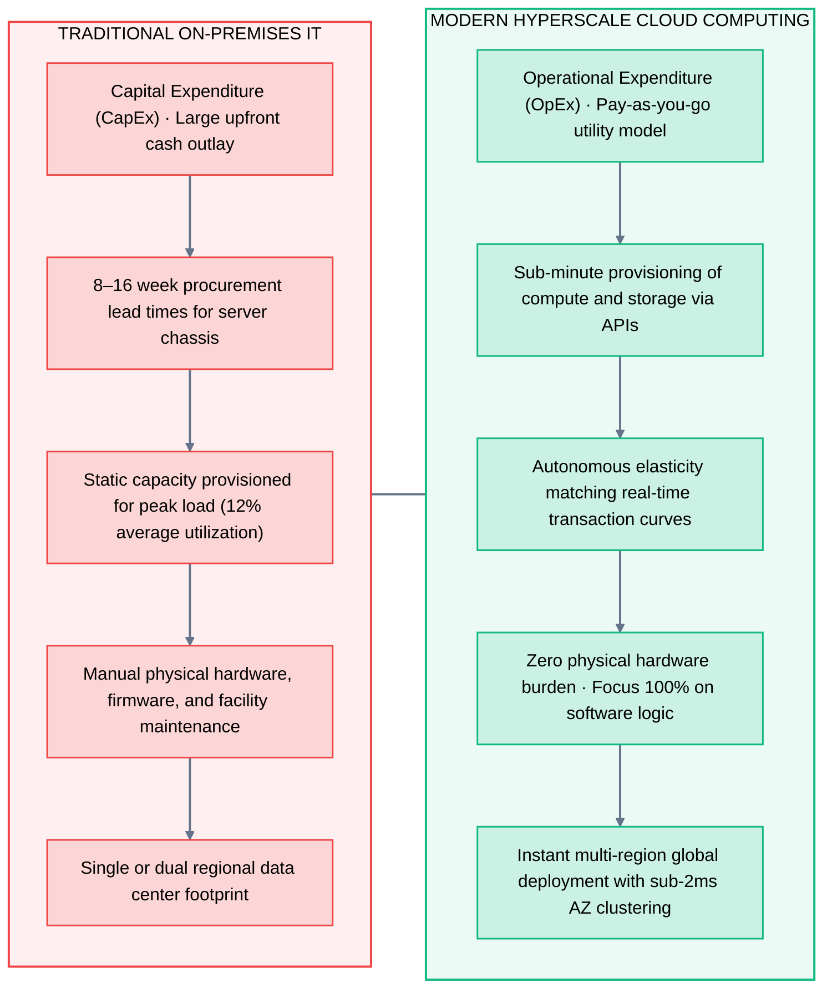
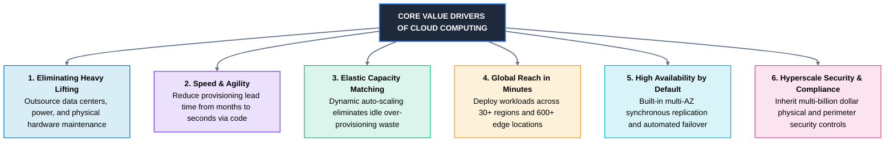
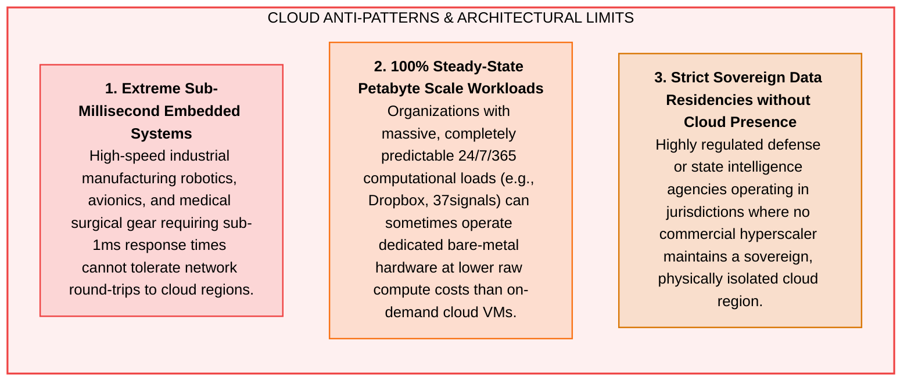

# 04 · Why Cloud Computing?

> **Status**: Comprehensive Reference  
> **Parent**: [[Overview\|Overview]] | [[00-Foundations/01-cloud-computing/README\|Module Index]]  
> **Topics**: Strategic Value Drivers, Eliminating "Undifferentiated Heavy Lifting", Elasticity, Instant Global Footprint, Multi-AZ Resilience, Cloud Anti-Patterns

---

## 1. Strategic Paradigm Shift: Traditional IT vs. Cloud Computing

The migration to cloud computing is not merely an infrastructure hosting replacement; it is a **fundamental organizational velocity accelerator**.



---

## 2. The 6 Core Drivers of Cloud Adoption



### 1. Eliminating "Undifferentiated Heavy Lifting"
- **Definition**: The operational grunt work that every organization must execute to keep IT systems operational (pouring data center concrete, replacing failed server power supplies, terminating fiber cables, upgrading SAN firmware, servicing diesel generators), but which **generates zero unique competitive advantage** for customers.
- **Architectural Value**: By offloading physical facility management to hyperscalers, software engineering teams devote 100% of their bandwidth to business logic, customer features, and proprietary product algorithms.

---

### 2. Speed, Agility & Rapid Experimentation
- In traditional IT, validating a machine learning hypothesis or deploying a microservice required capital budget approvals, vendor negotiations, and hardware racking taking months.
- In the cloud, an engineer provisions a 64-GPU training cluster with one declarative command:
  ```bash
  aws ec2 run-instances --image-id ami-0123456789 --instance-type p4d.24xlarge --count 8
  ```
  The cluster trains for 3 hours, produces the evaluation model, and is terminated immediately—incurring a minor hourly fee rather than a $250,000 capital purchase.

---

### 3. Elasticity & Dynamic Capacity Matching
- **Elasticity vs. Scalability**:
  - *Scalability*: A system's capacity to handle increased load by adding resources (often stepped and manual).
  - *Elasticity*: Autonomous, bi-directional scaling that expands and contracts in direct correlation with live transaction demand.

```mermaid
xychart-beta
    title "Cloud Dynamic Elasticity vs. Traditional Hardware Over-Provisioning"
    x-axis [00:00, 04:00, 08:00, 12:00, 16:00, 20:00, 24:00]
    y-axis "Compute Load (vCPUs)" 0 --> 1200
    line "Actual Demand Curve" [200, 150, 450, 1100, 950, 600, 250]
    line "Traditional Provisioned Hardware" [1200, 1200, 1200, 1200, 1200, 1200, 1200]
    line "Cloud Elastic Capacity Fleet" [220, 170, 480, 1150, 980, 620, 270]
```

- **Cost Impact**: In traditional data centers, paying for peak capacity means tolerating an average **88% idle compute waste**. Cloud elasticity matches the curve, ensuring organizations pay only for utilized capacity.

---

### 4. Instant Global Reach & Edge Low Latency
- Hyperscalers operate expansive global backbones connecting hundreds of physical data center clusters (**Regions**) with hundreds of Points of Presence (**Edge PoPs / CDNs**).
- An enterprise headquartered in London can deploy web services, API gateways, and distributed read replicas across North America, Tokyo, Singapore, and Sydney in minutes, delivering sub-15ms round-trip latency to international end users.

---

### 5. High Availability & Disaster Recovery by Default
- In on-premises IT, multi-datacenter active-active replication requires leasing floor space in two separate physical facilities, negotiating dark fiber interconnects, and purchasing duplicate SAN arrays.
- In the cloud, every region contains multiple discrete **Availability Zones (AZs)** engineered with independent power and cooling, connected via ultra-low-latency (< 2ms) optical rings. Synchronous replication and automated failover are built directly into managed database and storage services (AWS Aurora, Azure SQL, Google Cloud Spanner).

---

### 6. Hyperscale Security & Continuous Compliance
- Cloud providers invest billions of dollars annually in physical facility hardening, biometric access controls, dedicated Red Teams, and custom hardware root-of-trust controllers (e.g., AWS Nitro Security Chip, Google Titan Chip).
- Enterprise compliance certifications (SOC 1/2/3, ISO 27001, PCI-DSS Level 1, HIPAA, FedRAMP High) are inherited by the customer at the physical, hypervisor, and network fabric tiers.

---

## 3. Trade-offs & Cloud Anti-Patterns: When Is Cloud Suboptimal?

A disciplined systems architect must understand when public cloud computing is **not** the appropriate solution:



---

## 4. Key Takeaways

| Strategic Dimension | Traditional Enterprise IT | Cloud Computing Paradigm |
| :--- | :--- | :--- |
| **Capital Allocation** | Large upfront capital expense (CapEx) amortized over 3–5 years. | Dynamic, variable operational expenditure (OpEx). |
| **Infrastructure Sizing** | Over-provisioned for peak traffic; massive idle waste. | Elastic auto-scaling dynamically matching live demand. |
| **Deployment Lead Time** | Months to acquire, rack, cable, and configure hardware. | Seconds to provision complete production environments via code. |
| **Operational Focus** | Facility maintenance, cabling, hypervisor patching. | Pure product engineering, business logic, and customer value. |
| **Global Deployment** | Constrained to local physical data centers. | Instant global multi-region deployment across 30+ geographies. |
| **High Availability** | Prohibitive expense of duplicate standby facilities. | Built-in multi-AZ synchronous replication and failover. |

---

## 5. Knowledge Check

1. What is meant by the phrase "undifferentiated heavy lifting"? Give three concrete examples.
2. How does the economic shift from CapEx to OpEx lower the financial barrier to enterprise experimentation?
3. What is the fundamental technical difference between scalability and elasticity?
4. How do cloud providers solve the "88% idle capacity waste" problem inherent in traditional data centers?
5. How does deploying across multiple Availability Zones differ from deploying across multiple Regions?
6. Describe how edge locations (Points of Presence) improve web application performance for global end users.
7. What security responsibilities are inherited automatically by a customer when migrating to a public cloud?
8. Under what architectural circumstances might an organization choose to repatriate workloads to on-premises bare metal?
9. Why are ultra-low latency industrial control systems typically kept on-premises rather than in public cloud regions?
10. How does Infrastructure as Code (IaC) accelerate time-to-market compared to traditional IT provisioning?

---

## 6. Next Chapter

Continue your cloud computing learning journey:

> ➡️ **Next Module**: [[05_Cloud_Computing_Characteristics|05 · Cloud Computing Characteristics]]  
> *In-depth analysis of the 5 essential NIST characteristics (On-Demand Self-Service, Broad Network Access, Resource Pooling, Rapid Elasticity, Measured Service) and modern extended enterprise pillars.*

---

### Authoritative References

- [NIST SP 800-145: The NIST Definition of Cloud Computing](https://csrc.nist.gov/pubs/sp/800/145/final)
- [AWS Well-Architected Framework: Reliability and Cost Pillars](https://docs.aws.amazon.com/wellarchitected/latest/framework/)
- [The Economics of Cloud Migration – Harvard Business Review](https://hbr.org/)
- [Microsoft Azure Cloud Architecture Best Practices](https://learn.microsoft.com/en-us/azure/architecture/)
