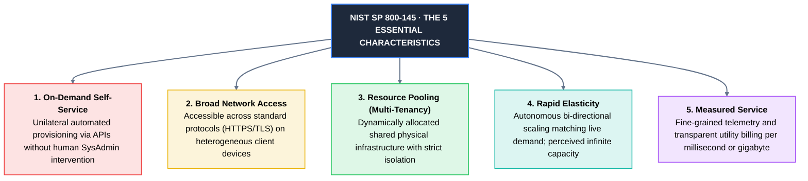
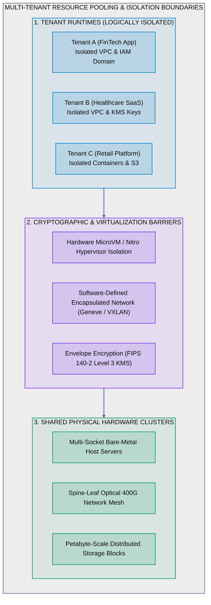

# 05 · Cloud Computing Characteristics

> **Status**: Comprehensive Reference  
> **Parent**: [[Overview\|Overview]] | [[00-Foundations/01-cloud-computing/README\|Module Index]]  
> **Topics**: NIST SP 800-145 5 Essential Characteristics, ISO/IEC 17788 Extended Pillars, Multi-Tenancy Isolation, Rapid Elasticity vs. Scalability, Metered Telemetry, The Cloud Acid Test

---

## 1. The NIST SP 800-145 Essential Characteristics

According to the official **NIST SP 800-145** standard, for any infrastructure platform or service to legitimately qualify as "cloud computing," it **must simultaneously exhibit all five of the following essential characteristics**:

---

## 2. Technical Deep Dive into the 5 Pillars

### 1. On-Demand Self-Service
- **Formal Definition**: A consumer can unilaterally provision computing capabilities, such as server runtime, network storage, and firewall policies, as needed automatically without requiring human interaction with each service provider.
- **Underlying Mechanics**:
  - All infrastructure primitives are exposed through idempotent REST, gRPC, and GraphQL control-plane endpoints.
  - Zero ticketing systems: Developers do not submit a JIRA ticket to an IT infrastructure team to allocate a subnet, route table, or database replica.
  - Declarative Infrastructure as Code (IaC) tooling (Terraform, AWS CDK, OpenTofu, Pulumi) provisions end-to-end environments autonomously.

---

### 2. Broad Network Access
- **Formal Definition**: Capabilities are available over the network and accessed through standardized mechanisms that promote use by heterogeneous thin or thick client platforms (e.g., mobile phones, tablets, laptops, workstations, and IoT sensor arrays).
- **Underlying Mechanics**:
  - Built upon open networking standards: HTTP/1.1, HTTP/2, HTTP/3 (QUIC), WebSockets, TLS 1.3, and standard TCP/UDP ports.
  - Accessible globally over the public internet, hybrid IPsec VPN tunnels, or dedicated carrier-grade private fiber backbones (AWS Direct Connect, Azure ExpressRoute, Google Cloud Interconnect).

---

### 3. Resource Pooling (Multi-Tenancy)
- **Formal Definition**: The provider’s computing resources are pooled to serve multiple consumers using a multi-tenant model, with different physical and virtual resources dynamically assigned and reassigned according to consumer demand.
- **Location Independence**: The customer generally has no control or knowledge over the exact physical rack, host chassis, or disk cylinder running their workload, but can specify location at higher abstraction boundaries (e.g., Geographic Region, Availability Zone, or Data Residency Jurisdiction).

---

### 4. Rapid Elasticity
- **Formal Definition**: Capabilities can be elastically provisioned and released, in some cases automatically, to scale rapidly outward and inward commensurate with demand.
- **Perceived Infinite Capacity**: To the consumer, available provisioning capacity appears virtually boundless and can be consumed in any quantity at any time.
- **Elastic Vectors**:
  - *Horizontal Scale-Out / Scale-In*: Dynamically launching and terminating stateless instance pods (e.g., expanding from 10 to 500 nodes during a traffic spike, then gracefully terminating 490 nodes when traffic subsides).
  - *Vertical Scale-Up / Scale-Down*: Reallocating instance CPU/RAM sizes dynamically (e.g., resizing from 4 vCPUs to 64 vCPUs).

---

### 5. Measured Service (Metered Utility)
- **Formal Definition**: Cloud systems automatically control and optimize resource usage by leveraging a metering capability at some level of abstraction appropriate to the type of service (e.g., storage capacity, compute duration, bandwidth, active user sessions).
- **Transparency & Accountability**: Resource consumption is tracked via continuous telemetry and reported in granular billing meters for both provider and consumer.
- **Sub-Second Utility Billing**:
  - Compute charged per millisecond of execution (AWS Lambda, Google Cloud Run).
  - Storage billed per gigabyte-month (Amazon S3, Azure Blob).
  - Data transfer billed per outbound gigabyte egress.

---

## 3. Extended Enterprise Characteristics (ISO/IEC 17788)

Beyond the 5 core NIST pillars, modern enterprise cloud standards recognize four essential operational characteristics:

| Extended Characteristic | Architectural Description | Production Cloud Mechanism |
| :--- | :--- | :--- |
| **Resiliency & Fault Tolerance** | Workloads automatically withstand host, rack, or entire data center outages with zero human intervention. | Multi-AZ auto-failover, self-healing container pods, regional disaster recovery. |
| **Declarative Programmability** | Infrastructure state is captured as code, versioned in Git repositories, and synchronized via CI/CD. | Terraform, AWS CDK, OpenTofu, Kubernetes declarative CRDs, ArgoCD GitOps. |
| **Pervasive Observability** | High-fidelity telemetry emits continuously from all network, compute, and application layers. | Distributed tracing (AWS X-Ray, OpenTelemetry), metric timeseries, structured logging. |
| **Zero-Trust Identity Perimeter** | Network perimeters are replaced by cryptographically verified identity tokens for every request. | AWS IAM roles, Azure Entra ID, GCP Workload Identity Federation, OAuth 2.0 / OIDC. |

---

## 4. The Cloud Acid Test: True Cloud vs. Cloud-Washing

Use this decision matrix to evaluate whether an enterprise IT offering is authentic cloud computing or legacy hosting re-branded ("Cloud-Washed"):

| Audit Criterion | Authentic Cloud Computing | Legacy "Cloud-Washed" IT |
| :--- | :--- | :--- |
| **Can you spin up 50 servers at 3:00 AM on a Sunday via API with zero human intervention?** | Yes. 100% automated control plane. | No. Requires submitting an IT ticket to the on-call sysadmin. |
| **Does billing immediately stop the second you terminate or delete an instance?** | Yes. Per-second or per-minute utility billing stops instantly. | No. Fixed monthly lease contracts or capital depreciation continue. |
| **Can your fleet auto-scale outward by 1,000% in 5 minutes to handle a traffic surge?** | Yes. Autonomous autoscaling triggers fire across pooled hardware. | No. Hardware ceiling reached; requires ordering additional server blades. |
| **Is the network software-defined and programmable entirely via code?** | Yes. VPC subnets, routing tables, and security firewalls deploy via code. | No. Physical network switches and VLANs require manual patch reconfiguration. |

---

## 5. Key Takeaways

| NIST Characteristic | Core Architectural Meaning |
| :--- | :--- |
| **On-Demand Self-Service** | 100% automated API/CLI provisioning without human administrative gates. |
| **Broad Network Access** | Universal access across standard protocols (HTTPS/TLS) on any client device. |
| **Resource Pooling** | Multi-tenant shared physical clusters protected by cryptographic and hypervisor barriers. |
| **Rapid Elasticity** | Bi-directional autoscaling that tracks live demand with perceived infinite capacity. |
| **Measured Service** | Transparent per-second and per-gigabyte utility metering and telemetry. |

---

## 6. Knowledge Check

1. Why must all five NIST characteristics be present for a platform to qualify as cloud computing?
2. What is the fundamental difference between an on-demand self-service API and a traditional IT service desk ticket?
3. How do cloud hyperscalers achieve physical resource pooling while guaranteeing tenant isolation?
4. Explain how multi-tenant network isolation is enforced within a Virtual Private Cloud (VPC).
5. What is the difference between rapid elasticity and traditional capacity planning?
6. How does measured service benefit both the cloud provider and the enterprise consumer?
7. What are the key differences between horizontal scaling (scale-out) and vertical scaling (scale-up)?
8. Name two extended characteristics defined by ISO/IEC 17788 and describe their operational importance.
9. What is "cloud-washing," and how can an architect identify it using the Cloud Acid Test?
10. Why is a zero-trust identity perimeter necessary in a multi-tenant cloud environment?

---

## 7. Next Chapter

Continue your cloud computing learning journey:

> ➡️ **Next Module**: [[06_Cloud_Service_Models_IaaS_PaaS_SaaS|06 · Cloud Service Models – IaaS, PaaS, SaaS & FaaS]]  
> *Deep dive into the cloud abstraction spectrum, comparing Infrastructure as a Service, Platform as a Service, Function as a Service (Serverless), and Software as a Service.*

---

### Authoritative References

- [NIST SP 800-145: The NIST Definition of Cloud Computing](https://csrc.nist.gov/pubs/sp/800/145/final)
- [ISO/IEC 17788: Information Technology – Cloud Computing Overview and Vocabulary](https://www.iso.org/standard/60544.html)
- [AWS Well-Architected Framework: Operational Excellence Pillar](https://docs.aws.amazon.com/wellarchitected/latest/framework/)
- [Microsoft Azure Well-Architected Framework](https://learn.microsoft.com/en-us/azure/well-architected/)
