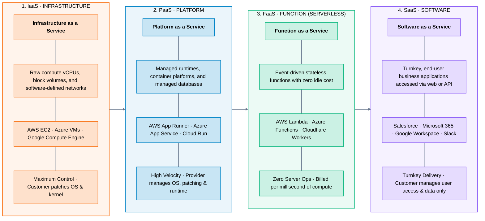
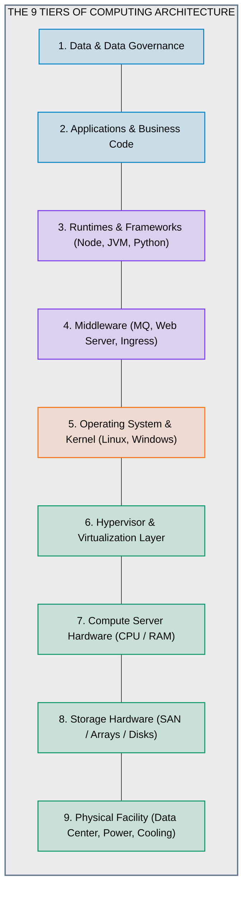
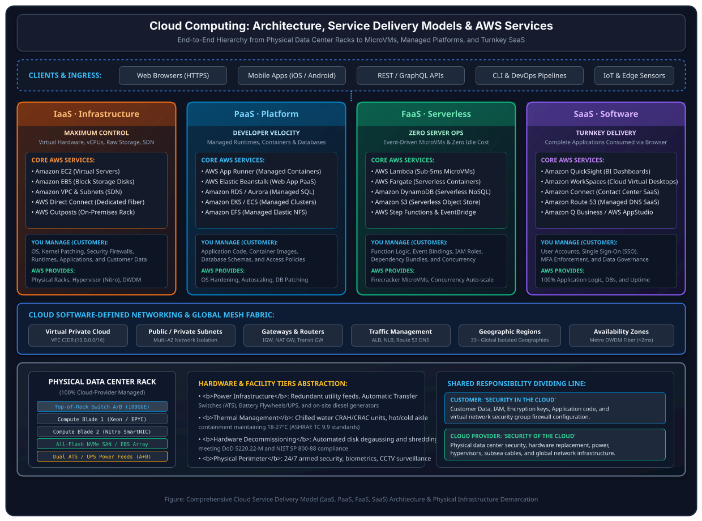
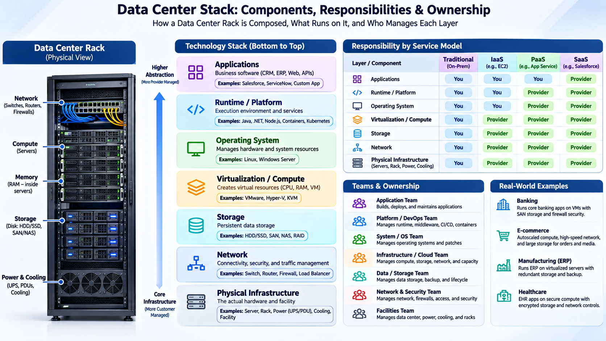

# 06 · Cloud Service Models – IaaS, PaaS, SaaS & FaaS

> **Status**: Comprehensive Reference  
> **Parent**: [[Overview\|Overview]] | [[00-Foundations/01-cloud-computing/README\|Module Index]]  
> **Topics**: The SPI Abstraction Spectrum, Infrastructure as a Service (IaaS), Platform as a Service (PaaS), Function as a Service (FaaS / Serverless), Software as a Service (SaaS), Technical Controls Matrix

---

## 1. The Cloud Abstraction Spectrum

Cloud service models represent a continuous spectrum balancing **operational control** against **developer velocity**. Moving from left to right offloads infrastructure management burden to the cloud provider, freeing engineering teams to focus on pure business logic.

---

## 2. Infrastructure Layer Responsibilities Across Models

The core distinction between service models is where the line of operational boundary falls between the **Customer** and the **Cloud Provider**:

### Responsibility Breakdown Across Layers:

| Architectural Tier | Traditional On-Premises | IaaS | PaaS | FaaS (Serverless) | SaaS |
| :--- | :--- | :--- | :--- | :--- | :--- |
| **Data & Access Governance** | Customer | Customer | Customer | Customer | Customer |
| **Application & Code** | Customer | Customer | Customer | Customer | Cloud Provider |
| **Runtimes & Frameworks** | Customer | Customer | Cloud Provider | Cloud Provider | Cloud Provider |
| **Middleware & Web Servers**| Customer | Customer | Cloud Provider | Cloud Provider | Cloud Provider |
| **Operating System & Kernel**| Customer | Customer | Cloud Provider | Cloud Provider | Cloud Provider |
| **Hypervisor & Isolation** | Customer | Cloud Provider | Cloud Provider | Cloud Provider | Cloud Provider |
| **Server Compute (CPU/RAM)**| Customer | Cloud Provider | Cloud Provider | Cloud Provider | Cloud Provider |
| **Storage Fabric & Disks** | Customer | Cloud Provider | Cloud Provider | Cloud Provider | Cloud Provider |
| **Physical Facility & Rack**| Customer | Cloud Provider | Cloud Provider | Cloud Provider | Cloud Provider |

---

### Master Architecture & Service Delivery Models Diagram

The full architectural hierarchy—connecting client ingress, the four service models, AWS building blocks, software-defined networking, and the physical server rack foundation—is illustrated in the vector architecture diagram below:

> **Draw.io Diagram Reference**:
> - **Vector Diagram**: [assets/cloud_service_models.drawio.svg](assets/cloud_service_models.drawio.svg)
> - **Editable Draw.io Source**: [assets/cloud_service_models.drawio](assets/cloud_service_models.drawio) *(Can be opened and edited directly inside Obsidian using the Draw.io plugin)*

---

### Physical Infrastructure Foundation: The Data Center Server Rack

In traditional on-premises environments, enterprise IT organizations are solely responsible for acquiring, assembling, wiring, powering, and cooling physical server racks:

*Figure: Enterprise Data Center Server Rack containing dual redundant Power Distribution Units (PDUs), Top-of-Rack (ToR) fiber switches, blade servers with multi-core CPUs and RAM, cable management trays, and SAN/NAS storage arrays.*

In the cloud computing paradigm, this entire physical rack tier—including power distribution, cooling, server chassis maintenance, physical cabling, and hardware lifecycle replacement—is **100% abstracted away and managed by the cloud provider**. The chosen cloud service model (IaaS, PaaS, FaaS, or SaaS) then determines how much of the software and platform stack above this physical foundation is handed over to the customer.

---

### AWS Services Across All Service Delivery Models

The table below maps core Amazon Web Services (AWS) offerings across the four cloud service delivery models, color-coded by abstraction tier:

| Domain / Pillar | IaaS · Infrastructure | PaaS · Platform | FaaS · Serverless | SaaS · Software |
| :--- | :--- | :--- | :--- | :--- |
| **Core Compute** | • **Amazon EC2** (Virtual Servers) • **AWS Outposts** (On-premise racks) • **EC2 Bare Metal** Instances | • **AWS App Runner** (Auto container runtimes) • **AWS Elastic Beanstalk** (Managed app platform) | • **AWS Lambda** (Event-driven microVMs) • **AWS Lambda@Edge** (CDN compute) | • **AWS AppStudio** (No-code enterprise apps) • **Amazon WorkSpaces** (Virtual Desktop SaaS) |
| **Container Platforms** | • **Amazon EC2** with self-managed Docker • Self-hosted Kubernetes (`kOps`, `kubeadm`) | • **Amazon ECS** (EC2 launch type) • **Amazon EKS** (EC2 managed node groups) | • **AWS Fargate** (Serverless microVM containers for ECS and EKS) | • **AWS App Runner** (Turnkey container-to-service deployment) |
| **Storage Systems** | • **Amazon EBS** (Elastic Block Store) • **EC2 Instance Store** (Direct NVMe) | • **Amazon EFS** (Elastic File System NFSv4) • **Amazon FSx** (Lustre, NetApp ONTAP, OpenZFS) | • **Amazon S3** (Serverless object store) • **Amazon S3 Express One Zone** (Sub-10ms) | • **AWS Backup** (Centralized policy-based backup console) |
| **Relational Database** | • **Amazon EC2** self-hosting PostgreSQL, MySQL, Oracle, or Microsoft SQL Server | • **Amazon RDS** (PostgreSQL, MySQL, MariaDB, Oracle, SQL Server) • **Amazon Aurora** (Multi-AZ cluster) | • **Amazon Aurora Serverless v2** (Auto-scaling ACUs based on live query demand) | • **AWS Database Migration Service** (Turnkey migration console) |
| **NoSQL & Cache** | • **Amazon EC2** self-hosting MongoDB, Redis, Apache Cassandra, or ScyllaDB | • **Amazon DocumentDB** (MongoDB API) • **Amazon Keyspaces** (Cassandra API) • **Amazon MemoryDB** (In-memory Redis) | • **Amazon DynamoDB** (Serverless key-value) • **Amazon DynamoDB Global Tables** (Multi-Region) | • **Amazon Timestream** (Time-series data SaaS) • **Amazon OpenSearch Serverless** |
| **Networking & CDN** | • **Amazon VPC** (Virtual Private Cloud) • **Subnets, Route Tables, Internet Gateways** • **AWS Direct Connect** (Dedicated fiber) | • **AWS Application Load Balancer** (ALB) • **AWS Network Load Balancer** (NLB) • **AWS Transit Gateway** | • **AWS API Gateway** (Serverless HTTP/WebSocket) • **Amazon CloudFront** (Global edge CDN) | • **Amazon Route 53** (Managed global DNS resolver SaaS) • **AWS Global Accelerator** |
| **Messaging & Queues** | • **Amazon EC2** self-hosting RabbitMQ, Apache Kafka, or ActiveMQ | • **Amazon MQ** (Managed ActiveMQ / RabbitMQ) • **Amazon MSK** (Managed Streaming for Kafka) | • **Amazon SQS** (Simple Queue Service FIFO/Std) • **Amazon SNS** (Pub/sub topic fan-out) • **Amazon EventBridge** (Serverless event bus) | • **Amazon Simple Email Service** (SES) • **Amazon Pinpoint** (Targeted customer push) |
| **Analytics & Big Data** | • **Amazon EC2** self-hosting Apache Hadoop, Apache Spark, or Presto clusters | • **Amazon EMR** (Managed Elastic MapReduce) • **Amazon Managed Service for Apache Flink** | • **Amazon Athena** (Interactive serverless SQL) • **Amazon Redshift Serverless** (Data warehouse) • **AWS Glue** (Serverless serverless ETL) | • **Amazon QuickSight** (Cloud-powered BI reporting & dashboards SaaS) |
| **Artificial Intelligence** | • **EC2 Accelerated Instances** (NVIDIA H100 / A100 GPUs, P4d/P5) • **AWS Trainium & Inferentia** | • **Amazon SageMaker Studio** (IDE platform) • **Amazon SageMaker Training Jobs & Endpoints** | • **Amazon Bedrock** (Serverless GenAI API for Claude, Llama 3, Titan) | • **Amazon Q Business** (Generative AI assistant) • **Amazon Rekognition** (Computer vision) • **Amazon Textract** (Document extraction) |
| **Developer Tools** | • **Amazon EC2** self-hosting Jenkins masters, GitLab runners, or SonarQube | • **AWS CodeBuild** (Ephemeral build containers) • **AWS CodePipeline** (CI/CD delivery platform) | • **AWS Step Functions** (Serverless distributed state machine workflows) | • **AWS CodeCatalyst** (Unified software development SaaS) • **AWS Cloud9** (Browser IDE SaaS) |
| **Business Applications** | • N/A (Standardized business apps belong to SaaS) | • N/A (Platform focus) | • N/A (Micro-service focus) | • **Amazon Connect** (Cloud Contact Center SaaS) • **Amazon WorkMail** (Corporate email) • **Amazon Wickr** (End-to-end encrypted chat) |

---

### AWS Service Implementations (IaC & SDK)

For complete Infrastructure as Code (AWS CDK TypeScript & Python, CloudFormation/SAM YAML) and SDK code implementations (Node.js/TypeScript v3 and Python boto3) for each service model, refer to the dedicated AWS service modules:

| Delivery Model | AWS Service Architecture | Implementation Guide & Code Blocks |
| :--- | :--- | :--- |
| **IaaS** | Amazon EC2 + GP3 EBS + Security Group | [[02-cloud-providers/aws/01-compute/ec2/README#5-infrastructure-as-code--sdk-implementations|EC2 IaC & SDK Reference]] |
| **PaaS** | AWS App Runner Managed Container API | [[02-cloud-providers/aws/01-compute/app-runner/README#3-infrastructure-as-code--sdk-implementations|App Runner IaC & SDK Reference]] |
| **FaaS** | AWS Lambda Serverless Worker + SQS | [[02-cloud-providers/aws/01-compute/lambda/README#5-infrastructure-as-code--sdk-implementations|Lambda IaC & SDK Reference]] |
| **SaaS / API** | Amazon Bedrock Generative AI & Guardrails | [[02-cloud-providers/aws/06-integration/bedrock/README#2-infrastructure-as-code--sdk-implementations|Bedrock IaC & SDK Reference]] |
| **SaaS / API** | Amazon SES Transactional Email Delivery | [[02-cloud-providers/aws/06-integration/ses/README#2-infrastructure-as-code--sdk-implementations|SES IaC & SDK Reference]] |

---

## 3. The Mental Models: Pizza & Transportation Analogies

### The Pizza-as-a-Service Model
- **Traditional On-Premises (Made from scratch at home)**: You buy the flour, make dough, buy an oven, cook it, provide tables, and serve soda.
- **IaaS (Take & Bake frozen pizza)**: The store provides the pre-made frozen pizza; you supply the oven, electricity, dining table, and drinks.
- **PaaS (Pizza Delivery to your house)**: The pizzeria bakes the pizza and delivers it hot to your door; you supply the dining table and plates.
- **SaaS (Dine out at a restaurant)**: You walk in, sit at the table, eat the meal, and pay the bill. The restaurant handles cooking, cleaning, furniture, and facility.

### The Transportation-as-a-Service Model
- **On-Premises**: Purchasing, fueling, repairing, and garaging your own car.
- **IaaS**: Car rental (Hertz/Avis). You drive and pay for gas, but the rental agency owns the vehicle chassis.
- **PaaS**: City public bus or train. You don't drive or maintain the bus; you simply buy a ticket and ride along fixed routes.
- **SaaS**: Calling an Uber/Lyft or hailing a taxi. You specify the destination and pay per ride. Zero mechanical concern.

---

## 4. Deep Dive into the 4 Service Delivery Models

### 1. Infrastructure as a Service (IaaS)
- **Core Primitives**: Raw virtual hardware resources: virtual central processing units (vCPUs), system RAM, block storage volumes (e.g., EBS), and software-defined network fabrics (VPC, Subnets, Route Tables, Firewalls).
- **Customer Controls**:
  - Operating system distribution (Ubuntu, RHEL, Windows Server) and kernel parameters.
  - Applying critical OS security patches and kernel updates.
  - Network firewall configuration (Security Groups, Network ACLs).
  - Web server configuration (Nginx, Apache) and language runtimes.
- **When to Choose IaaS**:
  - Legacy enterprise lift-and-shift migrations where applications require specific kernel drivers or customized file systems.
  - High-performance computing (HPC) requiring custom cluster networking or GPU accelerators.

---

### 2. Platform as a Service (PaaS)
- **Core Primitives**: Fully managed application execution environments. Developers supply application code (Node.js, Python, Java, Go, .NET) or container specifications (`Dockerfile`), and the platform provisions instances, routes HTTP traffic, manages SSL certificates, and auto-scales instances.
- **Provider Manages**:
  - OS patching, security vulnerabilities, and zero-day kernel mitigations.
  - Automated deployment rollouts, canary releases, and health checks.
  - Database engine updates and daily automated snapshot backups.
- **When to Choose PaaS**:
  - High-velocity development teams building web applications, microservices, and APIs who want to eliminate Linux sysadmin overhead.

---

### 3. Function as a Service (FaaS / Serverless)
- **Core Primitives**: Ephemeral, event-driven functions executed inside isolated microVM sandboxes (Firecracker, gVisor).
- **Core Architectural Pillars**:
  - **Zero Idle Cost**: If no requests arrive, billing is exactly $0.00.
  - **Automatic Concurrency**: Scales instantaneously from 0 to thousands of concurrent executions in fractions of a second.
  - **Event-Driven Triggers**: Invoked by HTTP requests (API Gateway), object storage uploads (S3 `ObjectCreated`), message queues (SQS, Kafka), or cron schedules.
- **When to Choose FaaS**:
  - Asynchronous background tasks, webhook processors, media transcoding pipelines, real-time telemetry ingestion, and event routers.

---

### 4. Software as a Service (SaaS)
- **Core Primitives**: Turnkey applications hosted, operated, and maintained entirely by third-party vendors, consumed over the internet via web browser, mobile client, or REST API.
- **Customer Controls**:
  - User identity management, Multi-Factor Authentication (MFA), and Role-Based Access Control (RBAC).
  - Data classification, retention policies, and enterprise integration tokens.
- **When to Choose SaaS**:
  - Standardized business operations where custom internal development provides no distinct competitive edge (Corporate Email, CRM, ERP, Collaboration, Payroll).

---

## 5. Master Technical Comparison Matrix

| Architectural Dimension | IaaS | PaaS | FaaS (Serverless) | SaaS |
| :--- | :--- | :--- | :--- | :--- |
| **Primary Abstraction** | Virtual Hardware / Host | Runtime Environment | Discrete Task / Function | Complete Application |
| **Target User** | Cloud Engineers, SysAdmins | Software Developers, DevOps | Software Developers, Data Eng | Business Users, IT Admins |
| **OS Access & Kernel Control** | Full root / sudo access | No OS shell access | Completely abstracted | Zero infrastructure access |
| **Scaling Mechanism** | Auto Scaling Groups (Minutes) | App instances / Pods (Seconds)| Instant microVM concurrency (ms)| Transparent provider scaling |
| **Billing Granularity** | Per-second running VM | Per-second container/instance | Per-millisecond execution duration| Per-user license / monthly seat |
| **Vendor Lock-in Risk** | Low (Portable VMs / Docker) | Moderate (Platform hooks) | Moderate-High (Event bindings) | High (Proprietary data formats) |
| **Hyperscale Examples** | AWS EC2, Azure VMs, GCP GCE | AWS App Runner, Cloud Run | AWS Lambda, Azure Functions | Salesforce, M365, Workday |

---

## 6. Key Takeaways

| Service Model | Primary Customer Value | Trade-Off |
| :--- | :--- | :--- |
| **IaaS** | Maximum architectural control, custom OS configurations, portability. | Highest operational maintenance and security patching burden. |
| **PaaS** | High development speed, automated scaling, zero OS administration. | Less control over low-level networking, kernel tuning, and OS packages. |
| **FaaS** | Zero idle costs, automatic concurrency, event-driven orchestration. | Execution time limits (e.g., 15m), potential cold-start latency. |
| **SaaS** | Instant business capabilities, zero infrastructure footprint. | Highest vendor lock-in, limited custom business logic integration. |

---

## 7. Knowledge Check

1. Explain the spectrum of abstraction vs. operational control from IaaS to SaaS.
2. In an IaaS deployment, who is responsible for applying Linux operating system kernel patches?
3. What is the fundamental difference between Platform as a Service (PaaS) and Function as a Service (FaaS)?
4. Why does FaaS incur zero cost when no incoming requests are being processed?
5. How does the "Pizza-as-a-Service" analogy illustrate the boundary between on-premises IT, IaaS, PaaS, and SaaS?
6. What customer security responsibilities remain even when using a turnkey SaaS application?
7. In what scenario would an engineering team deliberately choose IaaS over PaaS despite higher operational overhead?
8. What is a "cold start" in serverless architectures, and what triggers it?
9. Compare the vendor lock-in risk of an IaaS virtual machine deployment versus a SaaS platform.
10. Which cloud service model is best suited for an e-commerce image thumbnail generation pipeline, and why?

---

## 8. Next Chapter

Continue your cloud computing learning journey:

> **Next Module**: [[07_Cloud_Deployment_Models|07 · Cloud Deployment Models]]  
> *Exploring Public Cloud, Private Cloud, Hybrid Cloud interconnects (Direct Connect / ExpressRoute), Multi-Cloud hedging, and distributed edge architectures.*

---

### Authoritative References

- [NIST SP 800-145: The NIST Definition of Cloud Computing](https://csrc.nist.gov/pubs/sp/800/145/final)
- [AWS Serverless Architecture Foundations](https://aws.amazon.com/serverless/)
- [Microsoft Azure Service Model Comparison](https://learn.microsoft.com/en-us/azure/architecture/guide/technology-choices/compute-overview)
- [Google Cloud: Choosing the Right Compute Option](https://cloud.google.com/compute/docs)
