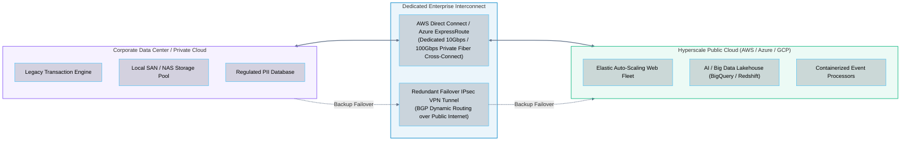
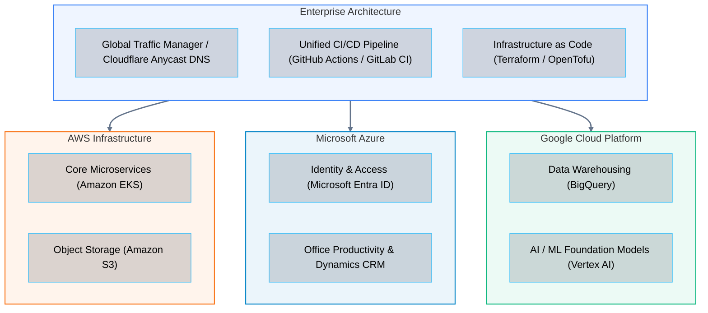

# 07 · Cloud Deployment Models

> **Status**: Comprehensive Reference  
> **Parent**: [[Overview|Overview]] | [[00-Foundations/01-cloud-computing/README|Module Index]]  
> **Topics**: Public Cloud, Private Cloud, Hybrid Cloud, Multi-Cloud, Community Cloud, Distributed Edge (AWS Outposts, Azure Stack, Anthos), Hybrid Interconnects

---

## 1. Overview of Deployment Topologies

Cloud deployment models define **where computing resources physically reside**, **who owns and manages the physical infrastructure**, and **how tenant boundaries and network perimeters are established**.

The National Institute of Standards and Technology (NIST SP 800-145) defines four primary deployment models: **Public**, **Private**, **Hybrid**, and **Community**. Modern enterprise architecture extends this classification to encompass **Multi-Cloud** and **Distributed Edge** environments.

```mermaid
flowchart LR
    direction LR

    subgraph PUB["1. Public Cloud"]
        direction TB
        PUB_T["<b>Public Cloud</b>"]
        PUB_D["Multi-tenant shared infrastructure owned and operated by a commercial cloud provider"]
        PUB_E["AWS · Microsoft Azure · Google Cloud"]
        PUB_B["Zero CapEx · Perceived infinite elasticity · Global distribution"]
        PUB_T --- PUB_D --- PUB_E --- PUB_B
    end

    subgraph PRIV["2. Private Cloud"]
        direction TB
        PRIV_T["<b>Private Cloud</b>"]
        PRIV_D["Dedicated single-tenant infrastructure provisioned for exclusive use by one organization"]
        PRIV_E["VMware Cloud Foundation · OpenStack · Nutanix"]
        PRIV_B["Physical isolation · Complete regulatory control · High upfront CapEx"]
        PRIV_T --- PRIV_D --- PRIV_E --- PRIV_B
    end

    subgraph HYB["3. Hybrid Cloud"]
        direction TB
        HYB_T["<b>Hybrid Cloud</b>"]
        HYB_D["Unified integration binding private data centers with public clouds via encrypted interconnects"]
        HYB_E["AWS Direct Connect · Azure ExpressRoute · IPsec Mesh"]
        HYB_B["Cloud bursting · Regulatory tiering · Phased legacy migration"]
        HYB_T --- HYB_D --- HYB_E --- HYB_B
    end

    subgraph MULTI["4. Multi-Cloud"]
        direction TB
        MULTI_T["<b>Multi-Cloud</b>"]
        MULTI_D["Strategic distribution of workloads across two or more independent hyperscale providers"]
        MULTI_E["AWS (Core APIs) + GCP (Analytics/AI) + Azure (Enterprise AD)"]
        MULTI_B["Vendor lock-in mitigation · DORA resilience · Tooling complexity"]
        MULTI_T --- MULTI_D --- MULTI_E --- MULTI_B
    end

    subgraph COMM["5. Community Cloud"]
        direction TB
        COMM_T["<b>Community Cloud</b>"]
        COMM_D["Infrastructure shared exclusively by organizations with shared compliance or mission goals"]
        COMM_E["AWS GovCloud · Azure Government · Banking / Healthcare consortia"]
        COMM_B["Shared compliance costs · Stricter vetting (FedRAMP, HIPAA)"]
        COMM_T --- COMM_D --- COMM_E --- COMM_B
    end

    style PUB fill:#0284c7,stroke:#0284c7,stroke-width:1.5px,fill-opacity:0.08
    style PRIV fill:#8b5cf6,stroke:#8b5cf6,stroke-width:1.5px,fill-opacity:0.08
    style HYB fill:#10b981,stroke:#10b981,stroke-width:1.5px,fill-opacity:0.08
    style MULTI fill:#f59e0b,stroke:#f59e0b,stroke-width:1.5px,fill-opacity:0.08
    style COMM fill:#ec4899,stroke:#ec4899,stroke-width:1.5px,fill-opacity:0.08

    classDef nodeStyle fill:#0f172a,stroke:#38bdf8,stroke-width:1px,fill-opacity:0.15,color:inherit;
    class PUB_T,PUB_D,PUB_E,PUB_B,PRIV_T,PRIV_D,PRIV_E,PRIV_B,HYB_T,HYB_D,HYB_E,HYB_B,MULTI_T,MULTI_D,MULTI_E,MULTI_B,COMM_T,COMM_D,COMM_E,COMM_B nodeStyle;
    linkStyle default stroke:#64748b,stroke-width:2px;
```

---

## 2. In-Depth Analysis of Deployment Models

### 1. Public Cloud
- **Definition**: Infrastructure owned, operated, and maintained by third-party commercial hyperscalers (Amazon Web Services, Microsoft Azure, Google Cloud). Resources are distributed over a global network and dynamically provisioned across multi-tenant pools separated by logical and cryptographic isolation.
- **Key Characteristics**:
  - Zero hardware purchase, rack leasing, or data center maintenance.
  - Perceived infinite scalability; rapid provisioning in seconds via declarative APIs.
  - Pay-as-you-go utility pricing (per-second or per-hour).
- **Core Advantages**: Maximum engineering velocity, elastic capacity matching, instantaneous global reach across 30+ geographic regions.
- **Trade-Offs**: Requires disciplined FinOps governance to prevent billing runaway; potential data egress fees; shared multi-tenant physical infrastructure requires reliance on hypervisor isolation mechanisms.

---

### 2. Private Cloud
- **Definition**: Cloud infrastructure provisioned for exclusive use by a single organization comprising multiple consumers (such as internal business units). It may be owned, managed, and operated on-premises by the organization, hosted by a third-party co-location facility, or contracted as a dedicated managed service.
- **Implementation Technologies**:
  - **VMware Cloud Foundation (VCF)**: Software-defined compute (vSphere/ESXi), storage (vSAN), and networking (NSX).
  - **OpenStack**: Open-source cloud operating system orchestrating compute (Nova), storage (Cinder/Swift), and networking (Neutron).
  - **Nutanix Cloud Platform**: Hyperconverged infrastructure (HCI) integrating storage, compute, and virtualization into scalable modular nodes.
- **Core Advantages**: Absolute physical control over hardware, physical air-gapping from the public Internet, predictable long-term costs for fixed 100% steady-state workloads.
- **Trade-Offs**: Heavy upfront capital expenditure (CapEx); long procurement cycles (months to acquire and cable servers); internal engineering team carries full burden of hardware failures, firmware upgrades, and capacity planning.

---

### 3. Hybrid Cloud (The Enterprise Architecture Standard)
- **Definition**: A composite infrastructure combining two or more distinct deployment models (typically private enterprise infrastructure and public hyperscalers) that remain unique entities, but are bound together by standardized networking, security protocols, and data synchronization.

#### Primary Hybrid Cloud Architectural Patterns

1. **Cloud Bursting**:
   - The application runs baseline steady-state traffic on private infrastructure. When traffic surges exceed local capacity (e.g., Black Friday retail sales), the system automatically provisions additional compute nodes in the public cloud.
   - **Architectural Requirement**: Stateless application tier and automated DNS/load balancer traffic steering.

2. **Data Residency and Tiered Compliance**:
   - Sensitive personal identifiable information (PII) or classified records remain strictly on-premises to satisfy national data sovereignty regulations (e.g., GDPR, HIPAA, banking secrecy laws).
   - Sanitized data, machine learning pipelines, and stateless frontend user interfaces run within public cloud regions.

3. **Disaster Recovery (DR) and Backup**:
   - On-premises primary site replicates continuous block snapshots or database transaction logs into cloud object storage (e.g., Amazon S3, Azure Blob Storage).
   - In the event of an on-premises data center outage, a Pilot Light or Warm Standby environment is brought online in the cloud within minutes.

---

### 4. Multi-Cloud Strategy

Multi-cloud involves the intentional, strategic distribution of workloads across **two or more independent public cloud hyperscalers** (e.g., AWS + Microsoft Azure + GCP).

#### Drivers for Multi-Cloud
- **Best-of-Breed Services**: Selecting GCP for analytical processing (BigQuery) and machine learning (Vertex AI), Microsoft Azure for enterprise identity integration (Entra ID), and AWS for mature global compute services.
- **Regulatory Resilience (DORA Compliance)**: European financial regulations (Digital Operational Resilience Act) mandate that systemic financial entities demonstrate operational resilience against catastrophic outages of any single hyperscaler.
- **Commercial Leverage**: Prevents total pricing lock-in by maintaining portable deployment manifests (e.g., Kubernetes Helm charts).

#### Operational Pitfalls of Multi-Cloud
> [!WARNING] The Multi-Cloud Complexity Tax
> Attempting true cross-cloud active-active deployments introduces significant challenges:
> 1. **Egress Costs**: Data transfer between AWS and Azure incurs public internet egress rates.
> 2. **Lowest Common Denominator Architecture**: Engineering teams avoid provider-native managed services (e.g., DynamoDB or BigQuery) in favor of self-hosting open-source tools to retain portability, increasing administrative overhead.
> 3. **IAM Sprawl**: Security teams must maintain separate, non-interchangeable IAM permission models across AWS policies, Azure RBAC roles, and GCP IAM bindings.

---

### 5. Community Cloud
- **Definition**: Cloud infrastructure provisioned for exclusive use by a specific community of consumers from organizations that have shared missions, regulatory mandates, or security requirements.
- **Examples**:
  - **AWS GovCloud & Azure Government**: Isolated physical regions restricted to vetted US government agencies, defense contractors, and educational institutions, compliant with ITAR, FedRAMP High, and DoD Impact Level 5.
  - **Healthcare Consortia Cloud**: Shared health record exchange platforms meeting strict HIPAA audit controls.

---

### 6. Distributed Cloud & Edge Infrastructure

Modern cloud architectures extend beyond centralized hyperscale facilities directly into corporate server rooms, local metropolitan hubs, and telecommunication cell towers:

1. **On-Premises Managed Cloud Appliances**:
   - **AWS Outposts / Azure Stack Hub / Google Distributed Cloud**: Physical server racks built, shipped, and maintained by the cloud provider, installed inside the customer's private data center. Connected back to the parent cloud region's control plane via private fiber.
2. **Local Metropolitan Zones**:
   - **AWS Local Zones / Azure Edge Zones**: Cloud compute and storage placed in major population centers outside primary regional data centers, delivering single-digit millisecond latency for video streaming, real-time gaming, and CAD workloads.
3. **5G Telco Edge Computing**:
   - **AWS Wavelength**: Embeds AWS compute and storage hardware inside 5G network data centers owned by telecommunication carriers (Verizon, Vodafone, KDDI). Eliminates Internet transit hops for mobile connected devices and autonomous vehicle telemetry.

---

## 3. Master Technical Comparison Matrix

| Deployment Model | Capital Cost (CapEx) | Operational Overhead | Security & Isolation Boundary | Scalability & Elasticity | Primary Architectural Use Case |
| :--- | :--- | :--- | :--- | :--- | :--- |
| **Public Cloud** | Zero CapEx (100% OpEx) | Lowest (Managed by provider) | Logical & Cryptographic multi-tenancy | Virtually infinite; dynamic API scaling | Web apps, modern SaaS platforms, microservices, big data |
| **Private Cloud** | Very High (Purchased hardware) | Highest (In-house sysadmins) | Physical hardware air-gapping | Bounded by racked physical hardware | Defense, strict data sovereignty, fixed predictable workloads |
| **Hybrid Cloud** | Mixed (CapEx + OpEx) | High (Dual operational tooling) | Segmented via dedicated private fiber | High (Bursting to public cloud) | Phased enterprise migrations, healthcare, core banking |
| **Multi-Cloud** | Variable OpEx | Very High (Tooling duplication) | Separate per-provider perimeters | High across multiple ecosystems | Regulatory risk hedging (DORA), best-of-breed services |
| **Community Cloud**| Shared CapEx/OpEx | Shared among community | Restricted to authorized organizations | Bounded by community capacity | Federal government (GovCloud), defense, healthcare research |
| **Distributed Edge**| Predictable subscription | Managed by provider remotely | On-premises hardware running cloud APIs | Limited by local appliance footprint | Sub-10ms latency, local industrial IoT, factory automation |

---

## 4. Key Takeaways

| Deployment Dimension | Critical Architectural Insight |
| :--- | :--- |
| **Public Cloud Supremacy** | Public cloud delivers the highest velocity and lowest time-to-market by converting infrastructure into software. |
| **The Hybrid Reality** | Most Global 2000 enterprises operate in a hybrid topology, requiring robust private interconnects (Direct Connect / ExpressRoute). |
| **Multi-Cloud Trade-Off** | Multi-cloud prevents single-vendor dependency but introduces steep tooling, networking, and security governance overhead. |
| **Edge Computing Shift** | Distributed cloud bridges the gap between cloud control planes and ultra-low latency edge requirements (sub-10ms). |

---

## 5. Knowledge Check

1. What are the four core cloud deployment models defined in NIST SP 800-145?
2. What is the fundamental difference between logical multi-tenancy in a public cloud and physical single-tenancy in a private cloud?
3. What is "cloud bursting," and what architectural requirements must an application satisfy to support it?
4. How do AWS Direct Connect and Azure ExpressRoute differ from a standard IPsec VPN over the public Internet?
5. Why is BGP (Border Gateway Protocol) commonly used in hybrid cloud networking architectures?
6. What is the primary difference between a hybrid cloud architecture and a multi-cloud architecture?
7. Explain the "multi-cloud complexity tax" regarding egress network pricing and IAM permissions.
8. What regulatory requirement (such as DORA in the EU) drives financial institutions toward multi-cloud architectures?
9. What is a Community Cloud, and what is one prominent production example of it?
10. How does AWS Outposts or Azure Stack Hub differ from traditional on-premises virtualization software like VMware ESXi?

---

## 6. Next Chapter

Continue your cloud computing learning journey:

> ➡️ **Next Module**: [[08_Cloud_Infrastructure_Components|08 · Cloud Infrastructure Components]]  
> *Exploring the global cloud infrastructure fabric (Regions, Availability Zones, Edge PoPs), Software-Defined Networking (VPCs, Subnets, Gateways), and cross-cloud service mappings.*

---

### Authoritative References

- [NIST SP 800-145: The NIST Definition of Cloud Computing](https://csrc.nist.gov/pubs/sp/800/145/final)
- [AWS Hybrid Cloud Architectures](https://aws.amazon.com/hybrid/)
- [Microsoft Azure Hybrid and Multicloud Solutions](https://azure.microsoft.com/en-us/solutions/hybrid/)
- [Google Cloud Distributed Cloud Architecture](https://cloud.google.com/distributed-cloud)
