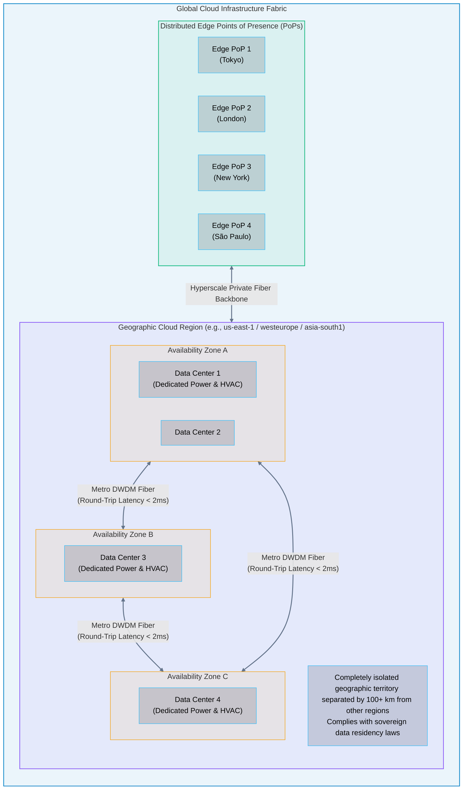
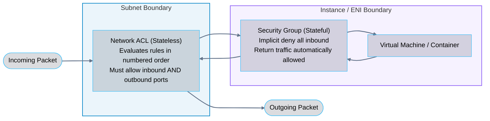

# 08 · Cloud Infrastructure Components

> **Status**: Comprehensive Reference  
> **Parent**: [[Overview|Overview]] | [[00-Foundations/01-cloud-computing/README|Module Index]]  
> **Topics**: Global Fabric, Regions, Availability Zones, Edge Locations / PoPs, Software-Defined Networking (SDN), VPC Architecture, Core Cloud Building Blocks, Cross-Cloud Service Mapping

---

## 1. The Global Cloud Infrastructure Hierarchy

Hyperscale cloud architecture is physically structured into three cascading layers of fault tolerance and geographic distribution: **Geographic Regions**, **Availability Zones (AZs)**, and **Edge Points of Presence (PoPs)**.



### 1. Geographic Regions
- **Definition**: A distinct physical location in the world containing at least two (and typically three or more) Availability Zones.
- **Isolation Boundary**: Regions are fully independent of one another. A catastrophic flood, earthquake, or power blackout in `us-east-1` (North Virginia) has zero physical impact on `us-west-2` (Oregon) or `eu-west-1` (Ireland).
- **Selection Criteria**:
  - **Data Sovereignty & Compliance**: Legal requirements (e.g., GDPR in the EU, HIPAA in the US) dictating that customer data must remain within national borders.
  - **Latency**: Deploying workloads geographically proximate to the majority of end users to minimize network round-trip time (RTT).
  - **Service Availability**: Hyperscalers roll out new cutting-edge services to primary tier-1 regions first.
  - **Pricing**: Electricity, real estate, and taxation vary; deploying in Ohio (`us-east-2`) is often cheaper than São Paulo (`sa-east-1`).

### 2. Availability Zones (AZs)
- **Definition**: One or more discrete physical data centers within a region, each equipped with redundant utility power feeds, on-site diesel generators, chilled water HVAC systems, and flood barriers.
- **Metro Interconnect**: AZs within a single region are separated by tens of kilometers (far enough to prevent a single local disaster from impacting multiple AZs) and linked via private, dedicated **Dense Wavelength Division Multiplexing (DWDM)** dark fiber networks with round-trip latency under **2 milliseconds**.
- **High Availability Mandate**: Architecting a workload across a single AZ leaves it vulnerable to data center failure. True enterprise high availability requires deploying compute and database replicas across a minimum of **two or three AZs**.

### 3. Edge Locations / Points of Presence (PoPs)
- **Definition**: Hundreds of caching and network termination points located in major metropolitan areas globally (e.g., 600+ PoPs worldwide).
- **Functionality**:
  - **Content Delivery Network (CDN)**: Caches static images, videos, and frontend web assets close to users (Amazon CloudFront, Azure Front Door, Google Cloud CDN).
  - **Anycast DNS Resolution**: Ultra-low-latency DNS queries via Amazon Route 53 or Google Cloud DNS.
  - **TLS Termination & DDoS Mitigation**: Terminates client SSL/TLS handshakes at the edge and filters Layer 3/4 SYN floods and UDP reflection attacks (AWS Shield, Cloudflare Magic Transit) before traffic reaches core regional compute.

---

## 2. Cloud Networking Layer (Software-Defined Perimeter)

The networking layer creates the private, isolated virtual perimeter inside the multi-tenant public cloud. This construct is known as a **Virtual Private Cloud (VPC)** in AWS/GCP or a **Virtual Network (VNet)** in Azure.

```mermaid
flowchart TD
    User([End-User Client]) -->|HTTPS / 443| IGW[Internet Gateway - IGW]
    IGW --> ALB[Application Load Balancer]

    subgraph VPC["Virtual Private Cloud (VPC CIDR: 10.0.0.0/16)"]
        direction TB

        subgraph PublicSubnet["Public Subnet (CIDR: 10.0.1.0/24)"]
            direction TB
            ALB
            NAT[NAT Gateway<br/>(Elastic IP)]
        end

        subgraph PrivateSubnet["Private Application Subnet (CIDR: 10.0.2.0/24)"]
            direction TB
            VM1["Compute Instance A<br/>(No Public IP)"]
            VM2["Compute Instance B<br/>(No Public IP)"]
        end

        subgraph DataSubnet["Isolated Database Subnet (CIDR: 10.0.3.0/24)"]
            direction TB
            RDS[(Primary Relational Database<br/>Encrypted at-rest)]
        end

        ALB -->|Forward Ingress HTTP Requests| VM1 & VM2
        VM1 & VM2 -->|Read / Write SQL Port 5432| RDS
        VM1 & VM2 -.->|Outbound OS Patch Requests| NAT
        NAT -.->|Outbound Egress Only| IGW
    end

    style VPC fill:#0284c7,stroke:#0284c7,stroke-width:1.5px,fill-opacity:0.08
    style PublicSubnet fill:#10b981,stroke:#10b981,stroke-width:1.5px,fill-opacity:0.08
    style PrivateSubnet fill:#f59e0b,stroke:#f59e0b,stroke-width:1.5px,fill-opacity:0.08
    style DataSubnet fill:#8b5cf6,stroke:#8b5cf6,stroke-width:1.5px,fill-opacity:0.08

    classDef nodeStyle fill:#0f172a,stroke:#38bdf8,stroke-width:1px,fill-opacity:0.15,color:inherit;
    class User,IGW,ALB,NAT,VM1,VM2,RDS nodeStyle;
    linkStyle default stroke:#64748b,stroke-width:2px;
```

### Core Software-Defined Networking Constructs

1. **Virtual Private Cloud (VPC / VNet)**:
   - A logically isolated section of the cloud defined by an IPv4 CIDR block (e.g., `10.0.0.0/16`, yielding 65,536 private IP addresses).
   - Provides complete control over IP address ranges, subnets, route tables, and network gateways.

2. **Subnets (Public vs. Private)**:
   - **Public Subnet**: Connected to an **Internet Gateway (IGW)** via its local route table (`0.0.0.0/0 -> igw-xxx`). Instances can receive public IPv4 addresses and accept ingress Internet traffic.
   - **Private Subnet**: Has no direct route to the Internet. Instances receive private IPs only. To download OS security updates without exposing ingress ports, outbound traffic is routed through a **NAT (Network Address Translation) Gateway** located in a public subnet.

3. **Stateful Security Groups vs. Stateless Network ACLs**:
   - **Security Group (Instance Level)**: A stateful virtual firewall assigned to virtual network interfaces (ENIs). If an inbound rule allows traffic on port 443, the outbound response is automatically permitted regardless of outbound rules.
   - **Network ACL (Subnet Level)**: A stateless packet filter evaluating ingress and egress traffic at the subnet boundary using numbered priority rules. Explicit inbound and outbound rules are required.



---

## 3. Core Cloud Building Blocks: Cross-Cloud Mapping

Every hyperscale cloud provider delivers equivalent services across the primary infrastructure pillars:

| Infrastructure Pillar | AWS Equivalent | Microsoft Azure Equivalent | Google Cloud (GCP) Equivalent | Architectural Function & Characteristics |
| :--- | :--- | :--- | :--- | :--- |
| **Virtual Compute** | Amazon EC2 | Azure Virtual Machines | Google Compute Engine (GCE) | Raw virtual machines on hypervisor with customizable vCPU/RAM |
| **Containers** | Amazon ECS / EKS | Azure AKS / Container Apps | Google GKE / Cloud Run | Managed Kubernetes and serverless container execution |
| **Serverless Compute** | AWS Lambda | Azure Functions | Cloud Functions / Cloud Run | Event-driven microVM code execution billed per millisecond |
| **Object Storage** | Amazon S3 | Azure Blob Storage | Google Cloud Storage (GCS) | Durable, HTTP-accessible unstructured storage for files and blobs |
| **Block Storage** | Amazon EBS | Azure Managed Disks | Persistent Disk (PD) | Low-latency network-attached SSD/HDD volumes for compute VMs |
| **Shared File Storage**| Amazon EFS / FSx | Azure Files / NetApp Files | Google Cloud Filestore | Distributed POSIX-compliant NFS/SMB file shares across instances |
| **Relational Database**| Amazon RDS / Aurora | Azure SQL / Flexible Server | Cloud SQL / Cloud Spanner | Managed transactional ACID engines (PostgreSQL, MySQL, SQL Server) |
| **NoSQL Database** | Amazon DynamoDB | Azure Cosmos DB | Cloud Bigtable / Firestore | Highly scalable, low-latency key-value and document data stores |
| **In-Memory Cache** | Amazon ElastiCache | Azure Cache for Redis | Cloud Memorystore | Ultra-low latency (sub-millisecond) Redis and Memcached stores |
| **Message Queuing** | Amazon SQS | Azure Service Bus | Cloud Pub/Sub | Asynchronous decoupled FIFO and standard message queues |
| **Pub/Sub Messaging** | Amazon SNS / EventBridge | Azure Event Grid | Cloud Pub/Sub | Event-driven fan-out pub-sub message broadcasting |
| **Data Warehouse** | Amazon Redshift | Azure Synapse Analytics | Google BigQuery | Columnar petabyte-scale analytical SQL query engines |
| **AI / ML Platform** | Amazon SageMaker | Azure OpenAI / AI Studio | Google Vertex AI | End-to-end model development, fine-tuning, training, and serving |
| **Identity & IAM** | AWS IAM | Microsoft Entra ID | Google Cloud IAM | Role-based access control, temporary credentials, OAuth/SAML |
| **Observability** | Amazon CloudWatch | Azure Monitor | Google Cloud Operations Suite | Metrics, distributed log collection, synthetics, and alerts |

---

## 4. Key Takeaways

| Architecture Layer | Core Engineering Principle |
| :--- | :--- |
| **Multi-AZ Resilience** | High availability requires deploying compute and data stores across at least two Availability Zones (AZs) separated by < 2ms latency. |
| **Defense-in-Depth Networking** | Secure topologies isolate databases in private subnets with no public IPs, routing egress updates through NAT Gateways. |
| **Stateful vs. Stateless Filtering**| Security Groups are stateful firewalls at the host ENI level; NACLs are stateless filters at the subnet boundary. |
| **Cross-Cloud Equivalence** | Core cloud primitives (compute, block storage, object storage, managed SQL, IAM) follow identical patterns across AWS, Azure, and GCP. |

---

## 5. Knowledge Check

1. What is the architectural difference between a Geographic Region and an Availability Zone (AZ)?
2. Why do hyperscalers mandate that Availability Zones within a region be connected with round-trip latency under 2 milliseconds?
3. What is the role of an Edge Location / Point of Presence (PoP), and how does it protect the core region from DDoS attacks?
4. What is a Virtual Private Cloud (VPC), and how does CIDR notation define its address space?
5. How does a public subnet differ from a private subnet in terms of route table entries?
6. Why should databases never be deployed into a public subnet?
7. Explain the fundamental difference between a stateful Security Group and a stateless Network ACL.
8. What is the purpose of a NAT Gateway in a secure multi-tier cloud network?
9. Compare Amazon EBS (Block Storage) with Amazon S3 (Object Storage) in terms of access protocols and performance.
10. In a multi-region deployment, what mechanism ensures data replication between regions that are thousands of kilometers apart?

---

## 6. Next Chapter

Continue your cloud computing learning journey:

> ➡️ **Next Module**: [[09_Cloud_Shared_Responsibility_Model|09 · Cloud Shared Responsibility Model]]  
> *Analyzing Security OF the Cloud versus Security IN the Cloud, the service-model responsibility matrix, and real-world cloud security misconfigurations.*

---

### Authoritative References

- [AWS Global Infrastructure Architecture](https://aws.amazon.com/about-aws/global-infrastructure/)
- [Microsoft Azure Geographies and Regions](https://azure.microsoft.com/en-us/explore/global-infrastructure/geographies/)
- [Google Cloud Regions and Zones](https://cloud.google.com/about/locations)
- [NIST SP 800-145: The NIST Definition of Cloud Computing](https://csrc.nist.gov/pubs/sp/800/145/final)
