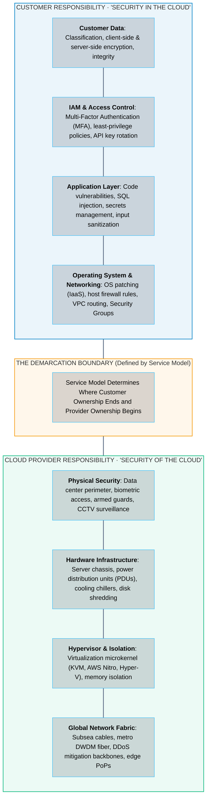
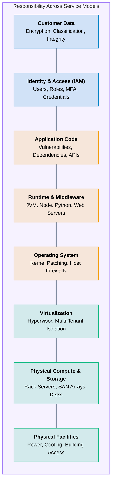
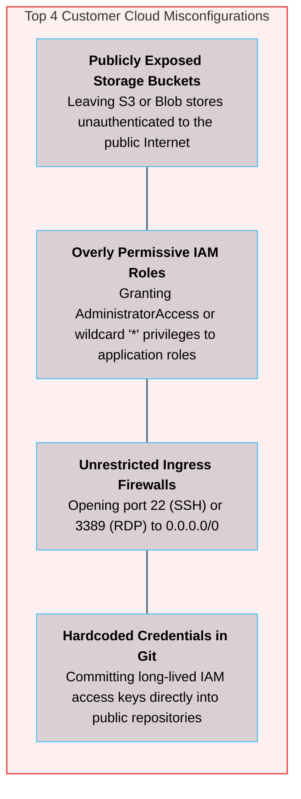

# 09 · Cloud Shared Responsibility Model

> **Status**: Comprehensive Reference  
> **Parent**: [[Overview|Overview]] | [[00-Foundations/01-cloud-computing/README|Module Index]]  
> **Topics**: Security OF the Cloud vs. Security IN the Cloud, Shared Responsibility Spectrum (IaaS, PaaS, FaaS, SaaS), Threat Boundaries, Real-World Cloud Breaches & Misconfiguration Pitfalls

---

## 1. The Core Principle: Security "OF" the Cloud vs. Security "IN" the Cloud

Security in the cloud is not unilateral; it is a legally binding, shared partnership governed by the **Shared Responsibility Model**. The division of responsibility between the cloud service provider (CSP) and the customer depends directly on the chosen service delivery tier.

> [!IMPORTANT] The Golden Rule of Cloud Security
> - **Security OF the Cloud**: The cloud provider is accountable for securing the facilities, physical hardware, hypervisors, and global network backbones that run cloud services.
> - **Security IN the Cloud**: The customer is accountable for protecting whatever they choose to deploy, configure, or store within the cloud environment (operating systems, network firewall rules, IAM roles, software dependencies, and data).

---

## 2. Shared Responsibility Stack Across Service Models

As an organization migrates from traditional on-premises infrastructure toward SaaS, the cloud provider assumes progressively more operational and security responsibilities:

### Detailed Ownership Breakdown by Service Model

| Architectural Layer | On-Premises | IaaS (e.g., EC2, Azure VM) | PaaS (e.g., App Service, Cloud Run) | FaaS (e.g., Lambda, Functions) | SaaS (e.g., M365, Salesforce) |
| :--- | :--- | :--- | :--- | :--- | :--- |
| **Data Classification & Security** | Customer | **Customer** | **Customer** | **Customer** | **Customer** |
| **Identity & Access Management (IAM)**| Customer | **Customer** | **Customer** | **Customer** | **Customer** |
| **Application Logic & Code** | Customer | **Customer** | **Customer** | **Customer** | Provider |
| **Runtime & Middleware** | Customer | **Customer** | Provider | Provider | Provider |
| **Operating System Patching** | Customer | **Customer** | Provider | Provider | Provider |
| **Hypervisor & Virtualization** | Customer | Provider | Provider | Provider | Provider |
| **Server & Storage Hardware** | Customer | Provider | Provider | Provider | Provider |
| **Physical Data Center Facility** | Customer | Provider | Provider | Provider | Provider |

---

### Detailed Service Tier Analysis

#### 1. Infrastructure as a Service (IaaS)
- **Customer Responsibilities**:
  - Operating system configuration, security patching, and vulnerability management.
  - Configuring stateful Security Groups and subnet Network ACLs.
  - Enabling disk encryption (e.g., AWS KMS with EBS encryption, Azure BitLocker).
  - Managing secure SSH/RDP bastion access and disabling public administration ports.
- **Provider Responsibilities**:
  - Physical facility security, biometrics, hardware replacement (swapping failed RAM/disks).
  - Hypervisor integrity (patching KVM, Xen, or AWS Nitro microcode against Spectre/Meltdown).
  - Sanitization of decommissioned storage media according to DoD 5220.22-M and NIST SP 800-88 guidelines.

#### 2. Platform as a Service (PaaS)
- **Customer Responsibilities**:
  - Hardening application business logic against OWASP Top 10 vulnerabilities (SQL injection, XSS).
  - Securely injecting environment variables, database connection strings, and API secrets.
  - Configuring TLS certificates and enforcing custom domain HTTPS redirects.
  - Role-based access control (RBAC) governing deployment permissions.
- **Provider Responsibilities**:
  - Patching underlying operating system kernels and web runtime engines (Node.js, Python, Java).
  - Provisioning network firewalls protecting platform containers.
  - Multi-tenant process isolation between containers running on shared nodes.

#### 3. Function as a Service (FaaS / Serverless)
- **Customer Responsibilities**:
  - Function code security and third-party dependency auditing (e.g., npm / pip supply chain attacks).
  - Granular IAM execution role policies restricting function permissions (least-privilege).
  - Setting concurrency limits to prevent denial-of-wallet cost spikes.
- **Provider Responsibilities**:
  - Complete microVM lifecycle management (provisioning Firecracker / gVisor sandboxes).
  - Operating system patching, runtime maintenance, autoscaling, and physical host resilience.

#### 4. Software as a Service (SaaS)
- **Customer Responsibilities**:
  - User identity lifecycle (onboarding, offboarding, federated Single Sign-On).
  - Enforcing Multi-Factor Authentication (MFA) and conditional access policies.
  - Data classification, file sharing permissions (preventing unauthorized external links).
- **Provider Responsibilities**:
  - 100% of the underlying infrastructure, database integrity, backups, disaster recovery, application patching, and network perimeters.

---

## 3. High-Profile Misconceptions and Real-World Breach Analysis

Gartner projects that **over 99% of cloud security failures through 2025 will be caused by customer misconfigurations**, not by vulnerabilities in the cloud provider's underlying infrastructure.

### Case Studies: Anatomy of Cloud Breaches

#### 1. Server-Side Request Forgery (SSRF) & Metadata Service Abuse
- **The Attack Vector**: An attacker exploited a misconfigured open-source Web Application Firewall (ModSecurity) running on an Amazon EC2 instance to execute a Server-Side Request Forgery (SSRF) attack.
- **The Exploitation**: The attacker directed the server to query the local AWS Instance Metadata Service (`http://169.254.169.254/latest/meta-data/iam/security-credentials/`). Because the instance had an overly permissive IAM role attached, the attacker obtained temporary AWS credentials with broad read access to hundreds of private Amazon S3 buckets.
- **Responsibility Breakdown**:
  - **AWS**: The cloud infrastructure operated as designed; the metadata service and IAM STS vended credentials correctly.
  - **Customer Failure**: The customer failed to enforce least-privilege IAM policies, allowed unrestricted SSRF in their WAF code, and had not enabled **IMDSv2** (which mandates a session-oriented PUT token, mitigating SSRF).

#### 2. Public Storage Exposure
- **The Attack Vector**: Organizations misconfigure S3 bucket policies or Azure Blob access tiers from "Private" to "Public Read," allowing unauthenticated web crawlers to index and download sensitive customer PII, database backups, or proprietary source code.
- **Responsibility Breakdown**:
  - **Provider**: AWS and Azure provide explicit configuration toggles, such as **S3 Block Public Access** enabled by default.
  - **Customer Failure**: An engineer manually disabled account-level protections or misconfigured bucket resource policies.

---

## 4. Key Takeaways

| Security Dimension | Critical Operational Principle |
| :--- | :--- |
| **Immutable Customer Data Ownership**| In every cloud service model (IaaS, PaaS, FaaS, SaaS), **Customer Data** and **Identity Management** remain 100% the customer's responsibility. |
| **Shift from Physical to Identity** | In the cloud, the traditional network perimeter is replaced by **IAM**. Least-privilege role policies and mandatory MFA are the primary line of defense. |
| **Abstraction Offload** | Moving to PaaS/Serverless transfers OS and runtime vulnerability patching to the cloud provider, reducing organizational attack surfaces. |
| **Root Cause of Breaches** | Modern cloud security breaches almost exclusively stem from customer misconfigurations (open S3 buckets, exposed ports, over-privileged IAM) rather than hypervisor exploits. |

---

## 5. Knowledge Check

1. What is the fundamental difference between "Security OF the Cloud" and "Security IN the Cloud"?
2. In an IaaS virtual machine deployment, who is responsible for applying Linux operating system security patches?
3. Which two responsibilities ALWAYS remain the customer's accountability regardless of whether IaaS, PaaS, or SaaS is chosen?
4. In a PaaS deployment like Azure App Service, who is responsible for patching vulnerabilities in the underlying Python or Node.js runtime?
5. How does the customer's responsibility change when moving from IaaS to Function as a Service (FaaS)?
6. Why does Gartner state that over 99% of cloud security failures are the customer's fault?
7. Explain how an SSRF vulnerability can be combined with the cloud Instance Metadata Service (IMDS) to compromise an account.
8. How does IMDSv2 mitigate metadata credential extraction compared to IMDSv1?
9. What is the principle of least privilege, and why is using `AdministratorAccess` on application roles a critical risk?
10. In a SaaS model such as Microsoft 365, what access controls must the enterprise IT department manage?

---

## 6. Next Chapter

Continue your cloud computing learning journey:

> ➡️ **Next Module**: [[10_Cloud_Economics_CapEx_vs_OpEx|10 · Cloud Economics – CapEx vs. OpEx in Cloud Computing]]  
> *Exploring Total Cost of Ownership (TCO), cloud pricing tiers (On-Demand, Reserved, Spot), the FinOps operational framework, and cloud unit economics.*

---

### Authoritative References

- [AWS Shared Responsibility Model](https://aws.amazon.com/compliance/shared-responsibility-model/)
- [Microsoft Azure Shared Responsibility in the Cloud](https://learn.microsoft.com/en-us/azure/security/fundamentals/shared-responsibility)
- [Google Cloud Shared Responsibility Matrix](https://cloud.google.com/architecture/framework/security/shared-responsibility-shared-fate)
- [NIST SP 800-145: The NIST Definition of Cloud Computing](https://csrc.nist.gov/pubs/sp/800/145/final)
