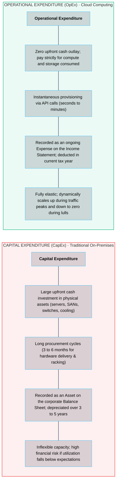
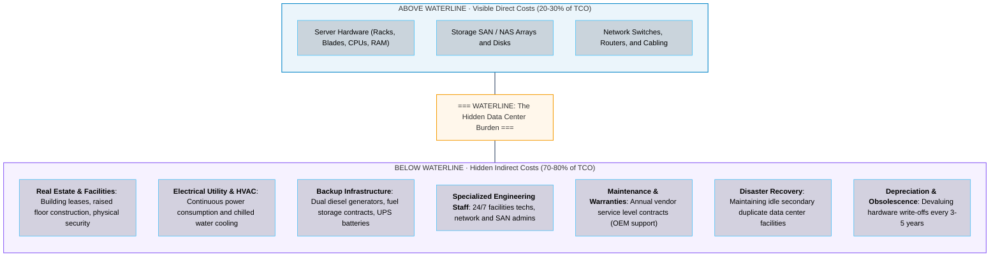
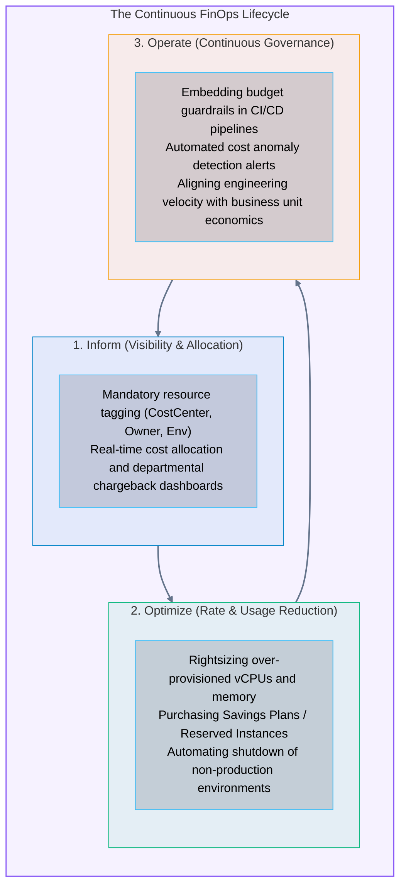

# 10 · Cloud Economics – CapEx vs. OpEx in Cloud Computing

> **Status**: Comprehensive Reference  
> **Parent**: [[Overview|Overview]] | [[00-Foundations/01-cloud-computing/README|Module Index]]  
> **Topics**: Capital vs. Operational Expense, Total Cost of Ownership (TCO), Pricing Models (On-Demand, Reserved, Spot), FinOps Lifecycle, Unit Economics

---

## 1. Financial Paradigm Shift: CapEx vs. OpEx

Migrating from an on-premises data center to the public cloud represents a fundamental transformation in corporate accounting and IT resource allocation: the transition from **Capital Expenditure (CapEx)** to **Operational Expenditure (OpEx)**.

---

## 2. Total Cost of Ownership (TCO): The "Iceberg" Model

A common financial mistake when evaluating cloud migrations is comparing only the raw hardware purchase invoice against the monthly cloud compute bill. In reality, physical hardware constitutes merely the tip of the data center cost iceberg:

### The Mathematical TCO Comparison

$$\text{TCO}_{\text{On-Prem}} = \text{Hardware Acquisition} + \text{Software Licensing} + \text{Power/Cooling} + \text{Real Estate} + \text{Facilities Operations} + \text{Hardware Maintenance}$$

$$\text{TCO}_{\text{Cloud}} = \sum (\text{Compute} + \text{Storage} + \text{Data Egress} + \text{Managed Platform Services}) - \text{Facilities/Hardware Overhead}$$

---

## 3. Cloud Purchasing & Pricing Models

Hyperscalers offer three primary procurement tiers designed to optimize costs across different workload profiles:

```mermaid
flowchart LR
    direction LR

    subgraph ON_DEMAND["1. On-Demand Pricing"]
        direction TB
        OD_T["<b>On-Demand</b>"]
        OD_D["Pay strictly by the second or hour with zero upfront commitment"]
        OD_U["Spiky, unpredictable traffic, dev/test environments, new feature rollouts"]
        OD_C["Highest hourly rate, but maximum architectural agility"]
        OD_T --- OD_D --- OD_U --- OD_C
    end

    subgraph COMMIT["2. Savings Plans / Reserved"]
        direction TB
        SP_T["<b>Savings Plans / RIs</b>"]
        SP_D["Commit to a steady-state spend ($/hr) for a 1-year or 3-year term"]
        SP_U["Core production databases, 24/7 API fleets, steady enterprise baselines"]
        SP_C["Discounts up to 72% compared to standard on-demand rates"]
        SP_T --- SP_D --- SP_U --- SP_C
    end

    subgraph SPOT["3. Spot / Preemptible Instances"]
        direction TB
        ST_T["<b>Spot / Preemptible</b>"]
        ST_D["Bid on spare, unused hyperscaler capacity at steep discounts"]
        ST_U["Stateless containerized batch jobs, CI/CD runners, distributed ML training"]
        ST_C["Discounts up to 90%, but instances can be reclaimed with 2-minute notice"]
        ST_T --- ST_D --- ST_U --- ST_C
    end

    style ON_DEMAND fill:#0284c7,stroke:#0284c7,stroke-width:1.5px,fill-opacity:0.08
    style COMMIT fill:#10b981,stroke:#10b981,stroke-width:1.5px,fill-opacity:0.08
    style SPOT fill:#f59e0b,stroke:#f59e0b,stroke-width:1.5px,fill-opacity:0.08

    classDef nodeStyle fill:#0f172a,stroke:#38bdf8,stroke-width:1px,fill-opacity:0.15,color:inherit;
    class OD_T,OD_D,OD_U,OD_C,SP_T,SP_D,SP_U,SP_C,ST_T,ST_D,ST_U,ST_C nodeStyle;
    linkStyle default stroke:#64748b,stroke-width:2px;
```

### Detailed Purchasing Breakdown

1. **On-Demand Instances**:
   - Compute instances are billed from the exact second they boot until they are terminated.
   - No long-term contractual commitments or cancellation fees.
   - Optimal for short-lived experimental workloads, automated testing pipelines, and unpredictable traffic bursts.

2. **Reserved Instances (RIs) & Savings Plans**:
   - In exchange for committing to a fixed hourly baseline spend (e.g., $100/hour) for 1 or 3 years, cloud providers offer massive discounts (up to **72%**).
   - **Compute Savings Plans** automatically apply across instance families, operating systems, and AWS regions, offering flexibility as architectures evolve.

3. **Spot Instances (AWS Spot / Azure Spot / GCP Preemptible)**:
   - Hyperscale data centers maintain large excess capacity buffers to handle global traffic spikes. This idle capacity is auctioned at discounts up to **90%**.
   - **The Interruption Mechanism**: If an on-demand customer requires the capacity, the cloud provider sends a termination notice (**2 minutes** on AWS, **30 seconds** on Azure/GCP) and reclaims the VM. Workloads must be architected to be stateless and resilient to sudden termination.

---

## 4. The FinOps Framework (Cloud Financial Operations)

FinOps is an operational framework and cultural shift that unites engineering, finance, and product teams to achieve data-driven cloud financial governance:

### Unit Economics in the Cloud

Modern cloud engineering organizations evaluate spend not in absolute dollar amounts, but through **Cloud Unit Economics**:

$$\text{Cloud Unit Cost} = \frac{\text{Total Cloud Spend Within Period}}{\text{Total Key Business Metric Delivered}}$$

#### Concrete Industry Examples:
- **E-Commerce**: Cost per order successfully processed (e.g., $0.04 per transaction).
- **Video Streaming**: Cost per subscriber streaming hour delivered (e.g., $0.008 per hour).
- **Fintech SaaS**: Cost per loan application scored and evaluated.

If total cloud spend increases by 30% while business transaction volume doubles, unit economics have improved, demonstrating positive operational leverage.

---

## 5. Key Takeaways

| Economic Concept | Strategic Engineering Takeaway |
| :--- | :--- |
| **CapEx to OpEx Shift** | Converts rigid, depreciating hardware investments into flexible, pay-as-you-go operational expenses. |
| **The TCO Iceberg** | Hardware invoices account for only 20-30% of true on-premises costs; power, cooling, real estate, and facilities staff make up the majority. |
| **Blended Procurement** | Production architectures combine **Savings Plans** for steady-state baselines, **On-Demand** for unpredictable spikes, and **Spot** for batch processing. |
| **FinOps Cultural Shift** | Engineering decisions are financial decisions; real-time tagging and unit economics align architecture with business value. |

---

## 6. Knowledge Check

1. Explain the accounting difference between Capital Expenditure (CapEx) and Operational Expenditure (OpEx).
2. Why is comparing an on-premises server purchase invoice directly against a cloud monthly bill an incomplete TCO comparison?
3. What hidden indirect costs comprise the submerged base of the "TCO Iceberg"?
4. In what scenario is On-Demand compute pricing the most cost-effective choice?
5. How do Compute Savings Plans differ from standard Reserved Instances in terms of flexibility?
6. What is the fundamental operational trade-off of using Spot / Preemptible Instances?
7. How much termination warning time does AWS give an EC2 Spot instance before reclamation?
8. What are the three iterative phases of the FinOps lifecycle?
9. Define "Cloud Unit Economics" and provide a formula for an e-commerce platform.
10. Why is resource tagging (e.g., `CostCenter`, `Environment`, `Owner`) the essential prerequisite for FinOps governance?

---

## 7. Next Steps & Master Curriculum Completion

Congratulations on completing the foundational curriculum for **Module 01: Cloud Computing Fundamentals & Architecture**!

> **Master Overview**: Return to [[Overview|Master Cloud Computing Overview]]  
> **Curriculum Index**: Review the entire module directory in [[00-Foundations/01-cloud-computing/README|Module Index]]  
> **Interactive Architecture Blueprint**: Explore the full visual system in [cloud_architecture_service_models.html](file:///home/vikram/learning/cloud/Cloud_Learning/Overview/cloud_architecture_service_models.html)

---

### Authoritative References

- [FinOps Foundation: What is FinOps?](https://www.finops.org/introduction/what-is-finops/)
- [AWS Pricing and Cloud Financial Management](https://aws.amazon.com/financial-management/)
- [Microsoft Cost Management & FinOps Framework](https://learn.microsoft.com/en-us/azure/cost-management-billing/)
- [Google Cloud: Understanding Cloud Billing & Architecture TCO](https://cloud.google.com/billing/docs)
