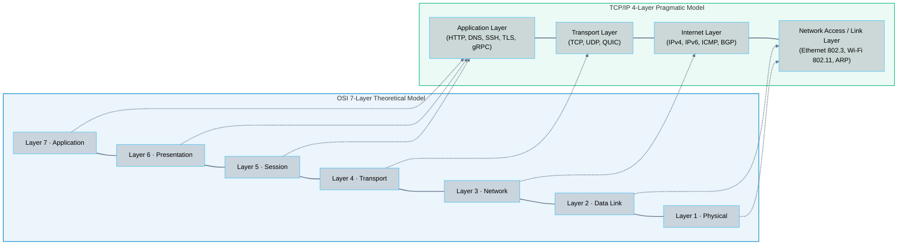

# 01 · OSI and TCP/IP Networking Models

> **Status**: Comprehensive Reference  
> **Parent**: [[Overview|Overview]] | [[00-Foundations/05-networking-fundamentals/README|Networking Index]]  
> **Topics**: 7-Layer OSI Model, 4-Layer TCP/IP Model, Data Encapsulation & Decapsulation, Protocol Data Units (PDUs), Headers & Payloads, Cloud Network Abstractions

---

## 1. The Need for Network Layering Abstractions

Modern computer networking is built on modular abstraction layers. By decomposing network communication into standardized boundaries, software engineers and hardware vendors can innovate independently:
- A web browser does not need to know whether the physical physical link is 100Gbps fiber, 5G wireless, or copper twisted-pair.
- A physical router does not need to parse encrypted application JSON payloads; it only inspects Layer 3 IP headers.

Two primary architectural models govern modern data communication:
1. **The Open Systems Interconnection (OSI) Reference Model**: A theoretical 7-layer framework published by the International Organization for Standardization (ISO 7498-1).
2. **The TCP/IP Suite (Internet Protocol Suite)**: The pragmatic, 4-layer production implementation designed by DARPA and standardized by the IETF (RFC 1122), which powers the global Internet.



---

## 2. In-Depth Layer Breakdown: OSI vs. TCP/IP

### Layer 7: Application Layer
- **OSI / TCP/IP Function**: The interface directly exposed to user software applications. Handles protocols that exchange business data between networked applications.
- **Key Protocols**: HTTP/1.1, HTTP/2, HTTP/3, DNS, SSH, SMTP, FTP, DHCP, gRPC, WebSocket.
- **Protocol Data Unit (PDU)**: **Data / Message**.
- **Cloud Context**: Application Load Balancers (AWS ALB, Azure App Gateway, GCP HTTPS Load Balancer) operate at this layer, inspecting HTTP request headers, host headers, cookie paths, and URL routing rules.

### Layer 6: Presentation Layer (OSI)
- **Function**: Translates, formats, and encrypts data between application formats and standardized network wire formats.
- **Responsibilities**:
  - Serialization: JSON, Protocol Buffers, XML, Avro.
  - Encryption & Security: TLS/SSL encryption and decryption handshakes.
  - Compression: Gzip, Brotli, zstd.
- **TCP/IP Mapping**: Absorbed directly into the TCP/IP **Application Layer**.

### Layer 5: Session Layer (OSI)
- **Function**: Establishes, manages, coordinates, and terminates persistent logical connections (dialogues) between applications.
- **Responsibilities**: Session checkpointing, RPC synchronization, socket keep-alives.
- **TCP/IP Mapping**: Absorbed directly into the TCP/IP **Application Layer** and **Transport Layer**.

### Layer 4: Transport Layer
- **Function**: Provides host-to-host process-level communication, flow control, connection management, error recovery, and multiplexing using logical port numbers.
- **Key Protocols**:
  - **TCP (Transmission Control Protocol)**: Connection-oriented, guaranteed in-order delivery, flow control, congestion avoidance.
  - **UDP (User Datagram Protocol)**: Connectionless, lightweight, low-latency, unordered delivery without retransmissions.
  - **QUIC**: Modern UDP-based encrypted transport protocol underpinning HTTP/3.
- **Addressing Mechanism**: **Port Numbers** (e.g., port 443 for HTTPS, port 53 for DNS, port 22 for SSH).
- **Protocol Data Unit (PDU)**: **Segment** (TCP) or **Datagram** (UDP).
- **Cloud Context**: Network Load Balancers (AWS NLB, Azure Load Balancer, GCP Network LB) operate at Layer 4, forwarding raw TCP/UDP packets with sub-millisecond latency.

### Layer 3: Network / Internet Layer
- **Function**: Logical addressing and routing of packets across heterogeneous, interconnected network boundaries (inter-networking).
- **Key Protocols**: IPv4, IPv6, ICMP (ping/traceroute), IGMP, IPsec, BGP, OSPF.
- **Addressing Mechanism**: **IP Address** (e.g., `192.168.1.1` or `2001:0db8::1`).
- **Protocol Data Unit (PDU)**: **Packet**.
- **Cloud Context**: Virtual Private Clouds (VPCs), Subnets, Route Tables, and Virtual Gateways operate at Layer 3.

### Layer 2: Data Link Layer
- **Function**: Physical node-to-node frame delivery across a single shared physical medium (Local Area Network / broadcast domain). Detects and corrects errors occurring at the physical layer.
- **Sublayers**:
  - **LLC (Logical Link Control)**: Multiplexes network protocols and handles flow control.
  - **MAC (Media Access Control)**: Hardware interface control, frame delimiting, collision avoidance (CSMA/CD on legacy coax).
- **Addressing Mechanism**: **MAC Address** (Media Access Control, 48-bit hex string, e.g., `00:1A:2B:3C:4D:5E`).
- **Protocol Data Unit (PDU)**: **Frame**.
- **Cloud Context**: Cloud hypervisors implement software-defined Layer 2 virtual switches (e.g., Open vSwitch) connecting Elastic Network Interfaces (ENIs).

### Layer 1: Physical Layer
- **Function**: Transmits unstructured raw bitstreams (`0`s and `1`s) over physical communication channels using electrical voltages, radio frequencies, or light pulses.
- **Key Hardware & Media**: Cat6/Cat6a copper twisted pair (RJ45), Single-mode and Multi-mode fiber optics (LC/SC connectors), SFP28/QSFP transceiver modules, 802.11 radio transceivers.
- **Protocol Data Unit (PDU)**: **Bits**.

---

## 3. Data Encapsulation and Decapsulation

When an application transmits data over a network, the payload cascades downward through the protocol stack. Each layer prepends its own control metadata (**Header**) and sometimes appends an error-checking **Trailer**. This sequence is known as **Encapsulation**.

Upon arrival at the destination host, the process is reversed in **Decapsulation**.

```mermaid
flowchart TD
    subgraph EncapsulationProcess["Downward Flow: Sender Encapsulation"]
        direction TB
        E_APP["Application Layer: Raw Application Data (e.g., HTTP GET /api/v1/orders)"]
        E_TRANS["Transport Layer: [TCP Header | Port 443 | Sequence #] + Application Data => <b>Segment</b>"]
        E_NET["Network Layer: [IP Header | Source IP | Dest IP] + TCP Segment => <b>Packet</b>"]
        E_LINK["Data Link Layer: [Ethernet Header | MACs] + IP Packet + [CRC Trailer] => <b>Frame</b>"]
        E_PHYS["Physical Layer: Encoding Frame into Optical Pulses or Electrical Signals => <b>Bits</b>"]

        E_APP ==> E_TRANS ==> E_NET ==> E_LINK ==> E_PHYS
    end

    subgraph PhysicalWire["Physical Medium (Fiber Optic / Copper)"]
        direction LR
        WIRE["Raw Photons / Electrical Pulses Transmitted Across Fiber Backbone"]
    end

    subgraph DecapsulationProcess["Upward Flow: Receiver Decapsulation"]
        direction TB
        D_PHYS["Physical Layer: Decoding Signals into Binary Frames => <b>Bits</b>"]
        D_LINK["Data Link Layer: Verifies CRC, strips Ethernet Header => <b>Packet</b>"]
        D_NET["Network Layer: Verifies Dest IP, strips IP Header => <b>Segment</b>"]
        D_TRANS["Transport Layer: Reassembles TCP sequence, strips TCP Header => <b>Data</b>"]
        D_APP["Application Layer: Web server receives HTTP GET payload => <b>Application</b>"]

        D_PHYS ==> D_LINK ==> D_NET ==> D_TRANS ==> D_APP
    end

    E_PHYS --> WIRE --> D_PHYS

    style EncapsulationProcess fill:#0284c7,stroke:#0284c7,stroke-width:1.5px,fill-opacity:0.08
    style PhysicalWire fill:#f59e0b,stroke:#f59e0b,stroke-width:1.5px,fill-opacity:0.08
    style DecapsulationProcess fill:#10b981,stroke:#10b981,stroke-width:1.5px,fill-opacity:0.08

    classDef nodeStyle fill:#0f172a,stroke:#38bdf8,stroke-width:1px,fill-opacity:0.15,color:inherit;
    class E_APP,E_TRANS,E_NET,E_LINK,E_PHYS,WIRE,D_PHYS,D_LINK,D_NET,D_TRANS,D_APP nodeStyle;
    linkStyle default stroke:#64748b,stroke-width:2px;
```



### Visualizing the Encapsulated Frame Structure

```
┌──────────────────────────────────────────────────────────────────────────────────────────────────┐
│                                   LAYER 2 ETHERNET FRAME                                         │
├─────────────────┬─────────────────────────────────────────────────────────────┬──────────────────┤
│ Ethernet Header │                    IP PACKET (PAYLOAD)                      │ Ethernet Trailer │
│ (14 Bytes)      ├───────────┬─────────────────────────────────────────────────┤ (FCS / CRC-32)   │
│ Src/Dst MAC,    │ IP Header │               TCP SEGMENT (PAYLOAD)             │ (4 Bytes)        │
│ EtherType       │(20 Bytes) ├────────────┬────────────────────────────────────┤                  │
│                 │Src/Dst IP │ TCP Header │      APPLICATION DATA (PAYLOAD)    │                  │
│                 │           │ (20 Bytes) │ (HTTP Request / TLS Encrypted PDU) │                  │
│                 │           │ Ports, Seq │                                    │                  │
└─────────────────┴───────────┴────────────┴────────────────────────────────────┴──────────────────┘
```

---

## 4. Master Comparison Matrix: OSI vs. TCP/IP Layers

| OSI Layer | TCP/IP Layer | PDU Name | Addressing Mechanism | Typical Protocols | Hardware / Cloud Construct |
| :--- | :--- | :--- | :--- | :--- | :--- |
| **7. Application** | Application | Message / Data | URLs, URIs, Hostnames | HTTP, HTTPS, DNS, gRPC, SSH | AWS ALB, Cloudflare WAF, API Gateway |
| **6. Presentation**| Application | Message / Data | Format MIME types | TLS, SSL, JSON, Protobuf | TLS Termination, CDN Gzip engines |
| **5. Session** | Application | Message / Data | Session IDs, Tokens | RPC, Sockets, NetBIOS | Client session state stores (Redis) |
| **4. Transport** | Transport | Segment (TCP) / Datagram (UDP) | Port Numbers (0-65535) | TCP, UDP, QUIC, SCTP | AWS NLB, Azure Load Balancer |
| **3. Network** | Internet | Packet | IP Addresses (IPv4/IPv6) | IPv4, IPv6, ICMP, BGP, IPsec | Routers, AWS VPC Route Tables, IGW |
| **2. Data Link** | Network Access | Frame | MAC Addresses (48-bit) | Ethernet 802.3, ARP, VLAN 802.1Q | Network Switches, AWS ENI, VXLAN Bridges |
| **1. Physical** | Network Access | Bits | Electrical / Optical signals | 100GBASE-LR4, Cat6a, DWDM | Transceivers, Fiber Cables, Repeaters |

---

## 5. Key Takeaways

| Concept | Critical Engineering Principle |
| :--- | :--- |
| **Abstraction Boundaries** | Layering decouples high-level application logic from low-level physical packet delivery mechanisms. |
| **Encapsulation Overhead** | Every layer prepends metadata (Ethernet 14B + IP 20B + TCP 20B = 54B minimum overhead per standard packet). |
| **Layer 4 vs. Layer 7 Routing** | Layer 4 routing makes ultra-fast decisions based on IP and Port without looking inside the packet; Layer 7 routing inspects URLs and headers at the cost of cryptographic termination and CPU parsing. |
| **The Pragmatic Standard** | The theoretical OSI 7-layer model is used primarily for troubleshooting and conceptual discussions; the 4-layer TCP/IP suite is the actual operating architecture of the Internet. |

---

## 6. Knowledge Check

1. What is the difference between the theoretical 7-layer OSI model and the pragmatic 4-layer TCP/IP suite?
2. What is a Protocol Data Unit (PDU), and what is its specific name at Layers 2, 3, 4, and 7?
3. Explain the mechanical process of encapsulation as an HTTP request travels from a client application down to the physical wire.
4. What is the minimum header overhead (in bytes) added to an application payload by TCP, IPv4, and Ethernet?
5. How does a Layer 4 Network Load Balancer differ from a Layer 7 Application Load Balancer in terms of OSI inspection?
6. Which layer of the OSI model is responsible for establishing, maintaining, and terminating persistent communication sessions?
7. What role do port numbers play at the Transport Layer, and how do they enable application multiplexing?
8. Why is Layer 2 communication restricted to a single local network segment (broadcast domain)?
9. What protocol connects Layer 3 logical IP addresses to Layer 2 physical MAC addresses on a local subnet?
10. In a cloud VPC environment, at which OSI layers do Security Groups, Route Tables, and Internet Gateways operate?

---

## 7. Next Chapter

Continue your networking fundamentals learning journey:

> ➡️ **Next Module**: [[02_IP_Addressing_and_Subnetting|02 · IP Addressing, Subnetting, and CIDR Notation]]  
> *Exploring IPv4 structures, binary subnet masks, Classless Inter-Domain Routing (CIDR), public vs. private RFC 1918 address allocations, and IPv6 fundamentals.*

---

### Authoritative References

- [IETF RFC 1122: Requirements for Internet Hosts – Communication Layers](https://datatracker.ietf.org/doc/html/rfc1122)
- [ISO/IEC 7498-1: Open Systems Interconnection – Basic Reference Model](https://www.iso.org/standard/20269.html)
- [AWS Well-Architected Framework: Reliability Pillar – Networking](https://docs.aws.amazon.com/wellarchitected/latest/reliability-pillar/)
