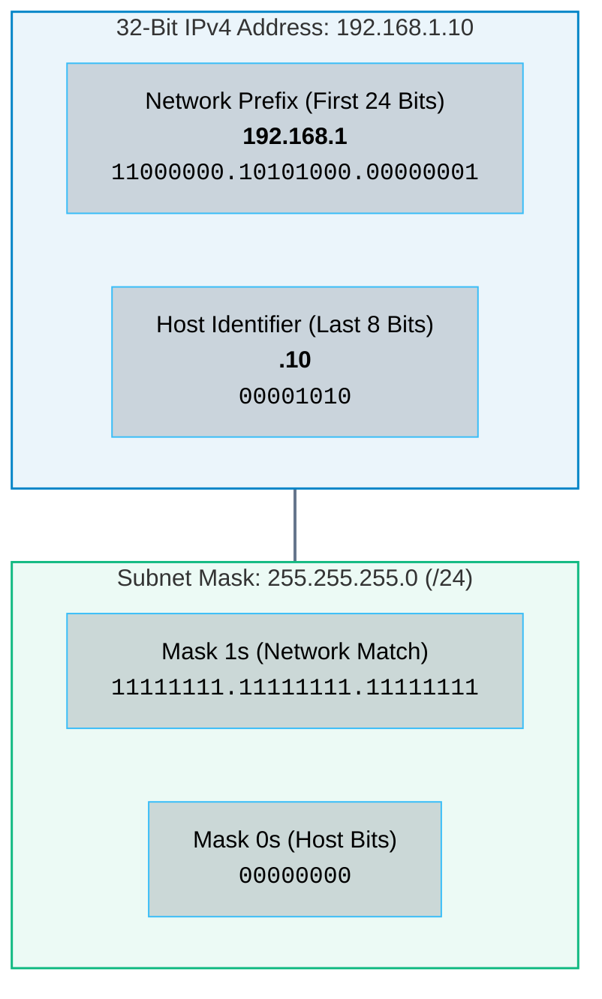
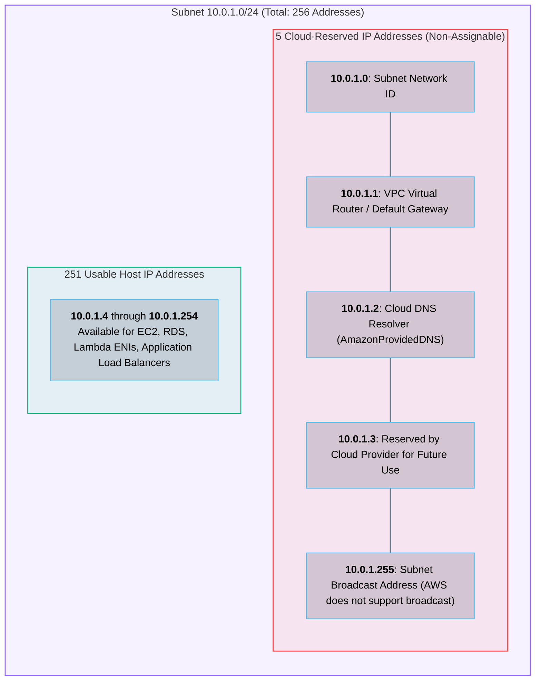

# 02 · IP Addressing, Subnetting, and CIDR Notation

> **Status**: Comprehensive Reference  
> **Parent**: [[Overview|Overview]] | [[00-Foundations/05-networking-fundamentals/README|Networking Index]]  
> **Topics**: IPv4 Architecture, Binary Subnetting, CIDR Notation, RFC 1918 Private IP Spaces, Cloud-Reserved Subnet IPs, IPv6 Foundations

---

## 1. The Anatomy of an IPv4 Address

An **Internet Protocol Version 4 (IPv4)** address is a 32-bit binary number uniquely identifying a host's network interface on a routed network. For human readability, the 32 bits are divided into **four 8-bit octets** separated by periods, expressed in dotted-decimal format:

```
Dotted-Decimal:        192   .    168    .      1    .     10
Binary Octets:       11000000 . 10101000 . 00000001 . 00001010
Bit Positions:       31    24   23    16   15     8   7      0
```

Every IP address consists of two components:
1. **Network Prefix (Network ID)**: Identifies the specific network segment or subnet.
2. **Host Identifier (Host ID)**: Identifies the unique host interface residing within that subnet.

The boundary separating the Network ID from the Host ID is determined strictly by the **Subnet Mask**.



---

## 2. Classless Inter-Domain Routing (CIDR)

Historically (prior to 1993), IP addresses were partitioned into rigid classes (Class A, B, C), which caused massive address space exhaustion. **CIDR (Classless Inter-Domain Routing - RFC 1519)** abolished fixed class boundaries, allowing prefix lengths of arbitrary size.

CIDR specifies the network prefix using a forward slash followed by the count of contiguous binary `1`s in the subnet mask:
- `/24` represents `255.255.255.0` (24 network bits, 8 host bits).
- `/16` represents `255.255.0.0` (16 network bits, 16 host bits).
- `/28` represents `255.255.255.240` (28 network bits, 4 host bits).

### Mathematical Formulas for Subnet Calculation

For a given CIDR prefix length $n$:
- **Host Bits**:
  $$h = 32 - n$$
- **Total IP Addresses**:
  $$N_{\text{total}} = 2^{h} = 2^{(32 - n)}$$
- **Usable Host Addresses (Standard RFC)**:
  $$N_{\text{usable}} = 2^{h} - 2$$
  *(Minus 2 accounts for the Subnet Network Address where host bits are all `0`, and the Subnet Broadcast Address where host bits are all `1`).*

---

## 3. Cloud Provider Subnet Reservations

In traditional on-premises networking, 2 IP addresses are reserved per subnet (Network Address and Broadcast Address). 

However, in hyperscale cloud environments (such as **Amazon Web Services VPC** and **Microsoft Azure VNet**), the cloud provider reserves **5 IP addresses** per subnet for managed infrastructure services:



> [!CAUTION] Cloud Subnet Sizing Constraint
> Because hyperscalers reserve 5 IP addresses in every subnet, the smallest allowed subnet in AWS is a `/28` (16 total IPs, yielding only **11 assignable addresses**). A `/29` or smaller cannot be created in AWS VPC.

---

## 4. Public vs. Private IP Addresses (RFC 1918)

The Internet Assigned Numbers Authority (IANA) designated three blocks of IPv4 space under **RFC 1918** specifically for private corporate intranets. These addresses are **non-routable on the public global Internet**:

| RFC 1918 Block | CIDR Prefix | Total Address Pool | Typical Enterprise Use Case |
| :--- | :--- | :--- | :--- |
| **10.0.0.0 – 10.255.255.255** | `10.0.0.0/8` | 16,777,216 addresses | Large enterprises, standard multi-account cloud VPCs |
| **172.16.0.0 – 172.31.255.255**| `172.16.0.0/12`| 1,048,576 addresses | Mid-sized companies, default Docker container bridge networks |
| **192.168.0.0 – 192.168.255.255**| `192.168.0.0/16`| 65,536 addresses | Home routers, small branch offices, lab environments |

### Non-RFC 1918 Special Purpose Ranges

- **`127.0.0.0/8` (Loopback)**: Internal host-only communications (`127.0.0.1` / `localhost`).
- **`169.254.0.0/16` (Link-Local / APIPA)**: Auto-assigned when DHCP fails.
  - In cloud hyperscalers, `169.254.169.254` serves as the universal **Instance Metadata Service (IMDS)** endpoint accessible to every VM instance.
- **`224.0.0.0/4` (Multicast)**: Reserved for multicast groups (OSPF, RIPv2). Not routed across public VPC gateways.
- **`240.0.0.0/4` (Class E)**: Reserved for experimental research.

---

## 5. Master CIDR Reference Table

| CIDR Prefix | Subnet Mask | Total IPs | On-Prem Usable | Cloud Usable (AWS/Azure) | Common Cloud Application |
| :--- | :--- | :--- | :--- | :--- | :--- |
| `/16` | `255.255.0.0` | 65,536 | 65,534 | 65,531 | Standard VPC / VNet envelope |
| `/18` | `255.255.192.0` | 16,384 | 16,382 | 16,379 | Large regional VPC partition |
| `/20` | `255.255.240.0` | 4,096 | 4,094 | 4,091 | Large Kubernetes pod subnet |
| `/22` | `255.255.252.0` | 1,024 | 1,022 | 1,019 | Standard database / app tier subnet |
| `/24` | `255.255.255.0` | 256 | 254 | **251** | Standard multi-AZ public/private subnet |
| `/26` | `255.255.255.192` | 64 | 62 | 59 | Bastion host or DMZ subnet |
| `/27` | `255.255.255.224` | 32 | 30 | 27 | Small specialized microservice tier |
| `/28` | `255.255.255.240` | 16 | 14 | **11** | Minimum allowed subnet size in AWS VPC |
| `/30` | `255.255.255.252` | 4 | 2 | 0 (Disallowed) | On-Premises point-to-point router link |
| `/32` | `255.255.255.255` | 1 | 1 (Host) | 1 (Single Host) | Specific host rule in Security Group firewall |

---

## 6. IPv6: The 128-Bit Successor

IPv4 provides approximately $4.29 \times 10^9$ unique addresses ($2^{32}$), which were officially exhausted globally by IANA in 2011. **IPv6** expands the address space to 128 bits ($2^{128} \approx 3.4 \times 10^{38}$ unique addresses).

### Key Architectural Differences

```
IPv4:   192.168.1.1                                (32 bits, 4 octets, decimal)
IPv6:   2001:0db8:85a3:0000:0000:8a2e:0370:7334    (128 bits, 8 hextets, hexadecimal)
Compressed: 2001:db8:85a3::8a2e:370:7334          (Leading zeros stripped, :: replaces contiguous zeros)
```

1. **Elimination of NAT**: Every device, container, and sensor can hold a globally unique, publicly routable IPv6 address, eliminating stateful Network Address Translation overhead.
2. **Simplified Headers**: Fixed 40-byte base header allows faster hardware routing switch performance.
3. **No Broadcast**: Replaced entirely by scoped **Multicast** and **Anycast**, drastically reducing network background noise.

---

## 7. Key Takeaways

| Networking Dimension | Core Architectural Rule |
| :--- | :--- |
| **The 32-Bit Divide** | The subnet mask defines the boundary between the network route and host interfaces via binary AND operations. |
| **Cloud 5-IP Reservation** | Cloud providers reserve the first 4 IPs and the last IP in every subnet; plan capacity for $2^{(32-n)} - 5$. |
| **CIDR Non-Overlapping Mandate** | Interconnected VPCs (VPC Peering, Transit Gateway, Direct Connect) **must never possess overlapping CIDR blocks**. |
| **Metadata Security Endpoint** | `169.254.169.254` is the universal link-local endpoint for hypervisor instance metadata across AWS, Azure, and GCP. |

---

## 8. Knowledge Check

1. How many bits comprise an IPv4 address, and how are they divided into octets?
2. What is the mathematical relationship between a CIDR prefix length (e.g., `/20`) and the number of available host addresses?
3. Which five IP addresses are reserved by AWS in a `10.0.2.0/24` subnet, and what is the role of each?
4. What is the smallest subnet CIDR allowed in an AWS Virtual Private Cloud, and how many usable IPs does it provide?
5. Identify the three RFC 1918 private address ranges and explain why they cannot be routed across the public Internet.
6. What is the purpose of the special IP address `169.254.169.254` in cloud virtual machines?
7. What happens if two corporate VPCs with overlapping CIDRs (e.g., both using `10.0.0.0/16`) attempt to establish a VPC Peering connection?
8. How does CIDR notation improve global Internet routing scalability compared to classful networking?
9. How many bits are in an IPv6 address, and how are contiguous blocks of zeros compressed in standard notation?
10. Why does IPv6 eliminate the operational necessity for Network Address Translation (NAT)?

---

## 9. Next Chapter

Continue your networking fundamentals learning journey:

> ➡️ **Next Module**: [[03_Routing_and_Switching|03 · Routing and Switching – Layer 2 vs. Layer 3]]  
> *Exploring MAC address switching, ARP table resolution, IP routing tables, Longest Prefix Match (LPM), VLAN segmentation, and dynamic routing with BGP.*

---

### Authoritative References

- [IETF RFC 1519: Classless Inter-domain Routing (CIDR)](https://datatracker.ietf.org/doc/html/rfc1519)
- [IETF RFC 1918: Address Allocation for Private Internets](https://datatracker.ietf.org/doc/html/rfc1918)
- [IETF RFC 8200: Internet Protocol, Version 6 (IPv6) Specification](https://datatracker.ietf.org/doc/html/rfc8200)
- [AWS VPC Subnet Sizing and Reserved IP Documentation](https://docs.aws.amazon.com/vpc/latest/userguide/configure-subnets.html)
