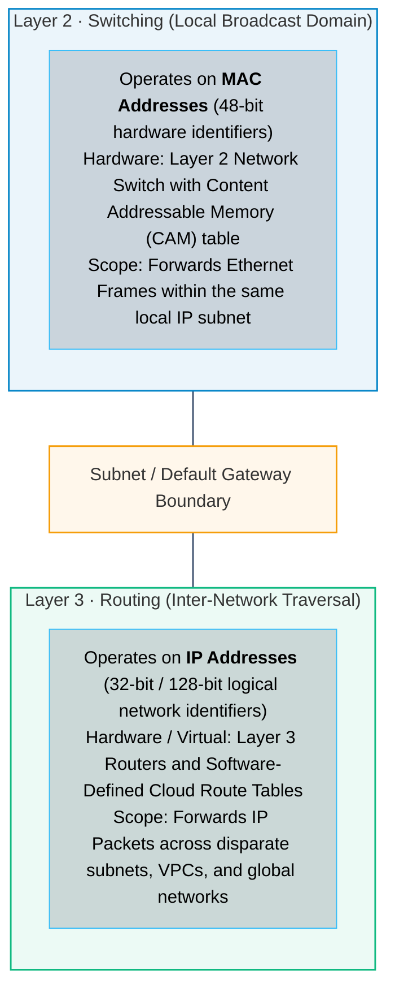
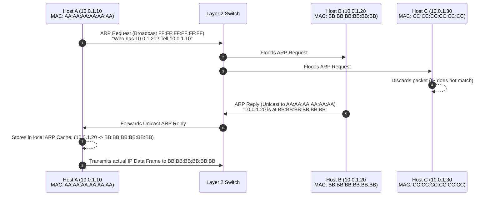
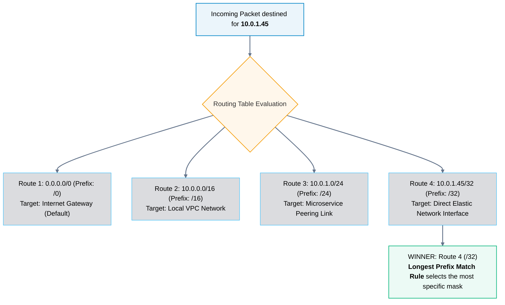
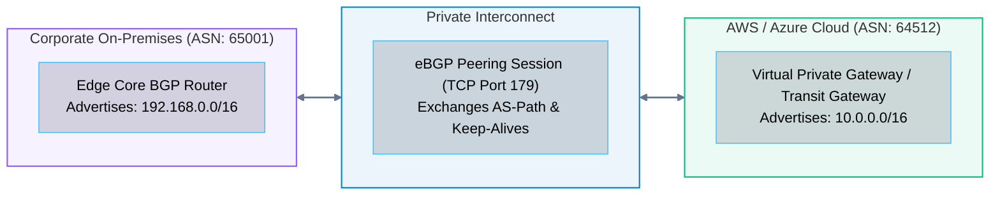

# 03 · Routing and Switching – Layer 2 vs. Layer 3

> **Status**: Comprehensive Reference  
> **Parent**: [[Overview|Overview]] | [[00-Foundations/05-networking-fundamentals/README|Networking Index]]  
> **Topics**: Layer 2 Ethernet Switching, CAM / MAC Tables, Address Resolution Protocol (ARP), VLANs (802.1Q), Layer 3 IP Routing, Longest Prefix Match (LPM), Border Gateway Protocol (BGP), Cloud Route Tables

---

## 1. Layer 2 Switching vs. Layer 3 Routing

Every network packet travels via two primary operational disciplines: **Switching** (local network delivery within a broadcast domain) and **Routing** (inter-network delivery across different subnets and administrative boundaries).



---

## 2. Layer 2 Switching Mechanics

A network switch forwards Ethernet frames between connected physical or virtual ports based on hardware Media Access Control (MAC) addresses.

### How a Switch Learns: The CAM Table
When a frame enters a switch port, the switch inspects the **Source MAC address** and records it in its **Content Addressable Memory (CAM) Table** along with the ingress port number and a timestamp.

```
┌────────────────────────────────────────────────────────┐
│             SWITCH CAM / MAC ADDRESS TABLE             │
├───────────────┬───────────────────┬────────────────────┤
│ Port Number   │ MAC Address       │ VLAN ID            │
├───────────────┼───────────────────┼────────────────────┤
│ Port Gi0/1    │ 00:1A:2B:3C:4D:01 │ VLAN 10 (App Tier) │
│ Port Gi0/2    │ 00:1A:2B:3C:4D:02 │ VLAN 10 (App Tier) │
│ Port Gi0/3    │ 00:1A:2B:3C:4D:03 │ VLAN 20 (DB Tier)  │
└───────────────┴───────────────────┴────────────────────┘
```

1. **Known Unicast**: If the destination MAC address exists in the CAM table, the switch forwards the frame *strictly* out of that specific destination port.
2. **Unknown Unicast Flooding**: If the destination MAC address is not yet in the CAM table, the switch floods the frame out of **all ports** except the port where it arrived.
3. **Broadcast Frames**: Frames addressed to `FF:FF:FF:FF:FF:FF` are flooded out of all ports within the same broadcast domain (VLAN).

---

## 3. Address Resolution Protocol (ARP)

Before Host A (`10.0.1.10`) can send an IP packet to Host B (`10.0.1.20`) on the same subnet, it knows Host B's IP address, but it **does not know Host B's physical MAC address**. It resolves this using **ARP (RFC 826)**:



> [!NOTE] ARP in the Cloud
> Traditional broadcast ARP does not scale in hyperscale multi-tenant data centers because millions of virtual machines generating broadcast traffic would saturate network links. Modern cloud virtualization platforms (e.g., AWS Nitro, Azure VNet SDN) intercept ARP requests at the hypervisor level and respond via software-defined directory lookups, eliminating physical broadcast traffic.

---

## 4. Layer 3 Routing and the Longest Prefix Match (LPM)

When Host A needs to transmit data to an IP address outside its local subnet (e.g., `8.8.8.8`), it does not ARP for `8.8.8.8`. Instead, it delivers the frame to its configured **Default Gateway** (the local Layer 3 router interface).

The router strips the Layer 2 Ethernet header, inspects the Layer 3 Destination IP address, and consults its **Routing Table**.

### The Longest Prefix Match (LPM) Rule
When a router evaluates an incoming packet against multiple matching routes in its routing table, it **always selects the most specific route**—the route with the longest CIDR subnet prefix length (highest number of masked `1`s).



---

## 5. Dynamic Routing & Border Gateway Protocol (BGP)

While small subnets rely on static route entries, large enterprise networks and the global Internet rely on **Dynamic Routing Protocols**:

1. **Interior Gateway Protocols (IGP)**: Operate within a single enterprise network (Autonomous System). Examples: **OSPF (Open Shortest Path First)** using Dijkstra's algorithm, and **IS-IS**.
2. **Exterior Gateway Protocols (EGP)**: Exchange routing information between different Autonomous Systems across the globe. The singular worldwide standard is **BGP (Border Gateway Protocol - RFC 4271)**.

### BGP in Cloud Hybrid Connectivity

BGP is an exterior path-vector protocol that exchanges network reachability between distinct **Autonomous System Numbers (ASNs)**:
- **AWS Direct Connect / Azure ExpressRoute**: When connecting a corporate data center to a public cloud, engineers establish an **eBGP (External BGP)** peering session between the on-premises edge router and the cloud virtual router (e.g., AWS Direct Connect Gateway).
- **Dynamic Failover**: If the primary 10Gbps private fiber connection fails, BGP withdraws the advertised routes or elevates the metric (AS Path Prepending), automatically steering enterprise traffic over the backup IPsec VPN tunnel within seconds.



---

## 6. Cloud Route Tables vs. Traditional Hardware Routers

In cloud computing (AWS VPC, Azure VNet, GCP VPC), routing is completely software-defined. There are no physical router appliances to manage or reboot:

| Feature | Traditional Physical Router | Cloud VPC Route Table |
| :--- | :--- | :--- |
| **Form Factor** | 1U/2U rackmount hardware appliance (Cisco, Juniper) | Declarative software object managed via API / Terraform |
| **Throughput Bottleneck**| Limited by backplane fabric and ASIC throughput | Distributed across hypervisors; virtually unlimited line-rate |
| **Configuration** | Command-Line Interface (Cisco IOS, JunOS) | Web Console, AWS CLI, Terraform (`aws_route_table`) |
| **Broadcast Support** | Supports Layer 2 broadcast within subnets | **No broadcast or multicast**; software-defined unicast only |
| **Target Entities** | Physical interface (e.g., `GigabitEthernet0/0/1`) | Logical cloud targets (`igw-xxx`, `nat-xxx`, `pcx-xxx`, `tgw-xxx`)|

---

## 7. Key Takeaways

| Routing Dimension | Core Architectural Principle |
| :--- | :--- |
| **L2 vs. L3 Boundary** | Switches deliver frames inside a local subnet using MAC addresses; routers forward packets between subnets using IP addresses. |
| **ARP Resolution** | Address Resolution Protocol maps Layer 3 logical IPs to Layer 2 physical MAC addresses via broadcast requests. |
| **The Longest Prefix Match** | Routers always forward traffic according to the most specific matching prefix length (e.g., `/28` beats `/24` beats `/16` beats `/0`). |
| **BGP Dynamic Resilience** | Enterprise cloud interconnects (Direct Connect / ExpressRoute) rely on eBGP dynamic route advertisements to provide automated link failover. |

---

## 8. Knowledge Check

1. What is the fundamental difference between Layer 2 switching and Layer 3 routing?
2. How does an Ethernet switch populate its Content Addressable Memory (CAM) table?
3. What occurs when a switch receives a frame destined for an unknown unicast MAC address?
4. Explain the operational flow of an Address Resolution Protocol (ARP) request and reply.
5. Why do hyperscale cloud providers suppress or virtualize traditional Layer 2 broadcast ARP traffic?
6. What is a "default gateway," and when does an endpoint transmit a frame to it?
7. Explain the "Longest Prefix Match" (LPM) rule and evaluate which route a router will pick for destination `172.16.5.12` given routes `172.16.0.0/16`, `172.16.5.0/24`, and `0.0.0.0/0`.
8. What is the difference between an Interior Gateway Protocol (IGP) like OSPF and an Exterior Gateway Protocol (EGP) like BGP?
9. On which transport-layer protocol and port does BGP operate to exchange routing tables?
10. Name three distinct logical target types that can be configured in an AWS VPC Route Table.

---

## 9. Next Chapter

Continue your networking fundamentals learning journey:

> ➡️ **Next Module**: [[04_Core_Network_Protocols|04 · Core Network Protocols – DNS, DHCP, ARP & ICMP]]  
> *Exploring the Domain Name System hierarchy, DNS record types, recursive vs. authoritative resolution, DHCP DORA lease negotiation, and ICMP network diagnostics.*

---

### Authoritative References

- [IETF RFC 826: An Ethernet Address Resolution Protocol (ARP)](https://datatracker.ietf.org/doc/html/rfc826)
- [IETF RFC 4271: A Border Gateway Protocol 4 (BGP-4)](https://datatracker.ietf.org/doc/html/rfc4271)
- [AWS VPC Route Tables Documentation](https://docs.aws.amazon.com/vpc/latest/userguide/VPC_Route_Tables.html)
- [Microsoft Azure Virtual Network Routing Overview](https://learn.microsoft.com/en-us/azure/virtual-network/virtual-networks-udr-overview)
