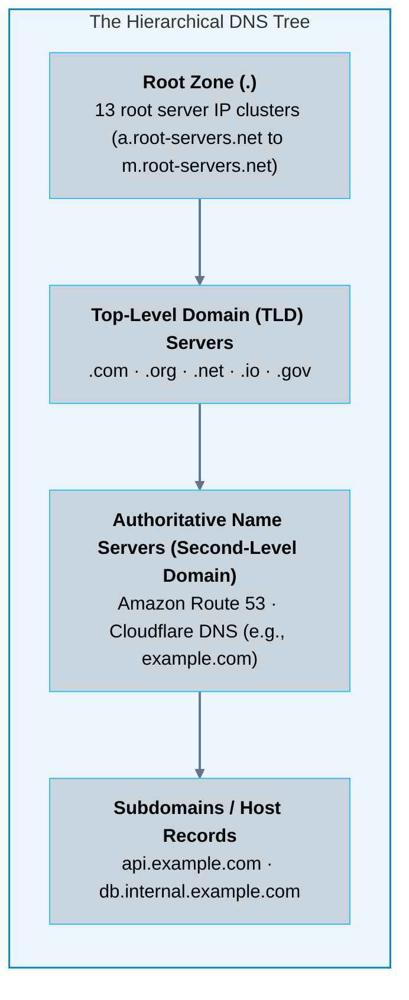
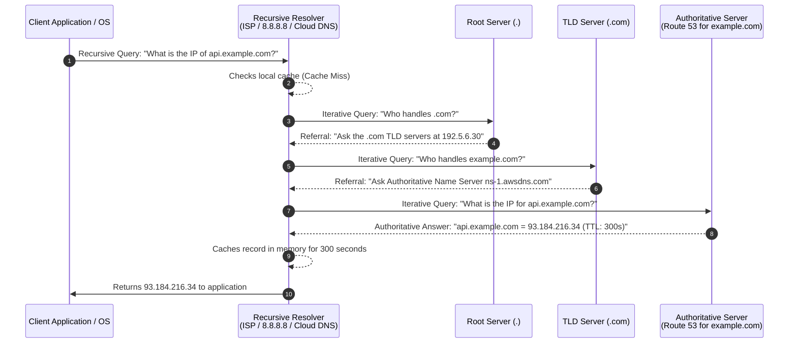
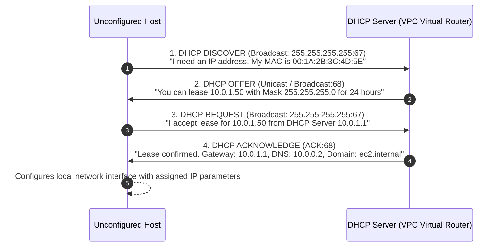

# 04 · Core Network Protocols – DNS, DHCP, and ICMP

> **Status**: Comprehensive Reference  
> **Parent**: [[Overview|Overview]] | [[00-Foundations/05-networking-fundamentals/README|Networking Index]]  
> **Topics**: Domain Name System (DNS) Architecture, Recursive vs. Authoritative Resolution, DNS Record Types, DHCP DORA Process, ICMP Diagnostics, Path MTU Discovery

---

## 1. Domain Name System (DNS): The Phonebook of the Internet

Humans navigate network resources using memorable alphanumeric names (e.g., `api.example.com`), whereas network routers exclusively process numerical IP addresses (e.g., `93.184.216.34` or `2606:2800:220:1:248:1893:25c8:1946`). The **Domain Name System (DNS - RFC 1034/1035)** provides the globally distributed, hierarchical translation service.



---

## 2. The DNS Resolution Process: Step-by-Step

When a client application (browser, curl, or mobile app) resolves a domain name for the first time without a cached record, it executes an **iterative recursive lookup sequence**:



### Essential DNS Record Types

| Record Type | Full Name | Purpose & Syntax | Production Cloud Use Case |
| :--- | :--- | :--- | :--- |
| **A** | Address Record | Maps a hostname to a **32-bit IPv4** address (`api.example.com -> 192.0.2.1`). | Pointing web domain to an Elastic IP or server. |
| **AAAA** | IPv6 Address Record | Maps a hostname to a **128-bit IPv6** address (`api.example.com -> 2001:db8::1`). | Dual-stack cloud workloads and mobile clients. |
| **CNAME** | Canonical Name | Maps a hostname to another hostname alias (`www.example.com -> example.com`). | Pointing vanity subdomains to cloud CDN endpoints. |
| **ALIAS / ANAME** | Virtual Alias (Cloud-native)| Provider-specific record that acts as an `A` record at the zone apex (`example.com`). | Resolving the zone apex directly to an AWS ALB or CloudFront distribution. |
| **MX** | Mail Exchange | Directs email to mail servers with priority weighting (`10 mail.example.com`). | Google Workspace or Microsoft 365 email routing. |
| **TXT** | Text Record | Arbitrary human/machine-readable text metadata. | SPF, DKIM, and DMARC email spoofing security. |
| **PTR** | Pointer Record | Maps an IP address to a canonical hostname (**Reverse DNS**). | Anti-spam validation for outbound mail servers. |
| **NS** | Name Server | Delegates a DNS zone to authoritative servers (`ns-1.awsdns.org`). | Delegating a subdomain to a specialized cloud account. |
| **SOA** | Start of Authority | Metadata specifying zone administrator, serial number, and refresh timers. | Zone transfer synchronization across secondary servers. |

> [!IMPORTANT] The Zone Apex CNAME Limitation
> Standard DNS specifications (RFC 1034) prohibit creating a `CNAME` record at the zone apex (`example.com` without `www`) because a `CNAME` cannot coexist with required `SOA` and `NS` records. Cloud providers solved this by introducing proprietary virtual alias records (such as **AWS Route 53 ALIAS records** or **Azure DNS Alias**), which dynamically synthesize `A` records to track elastic cloud load balancer IP changes.

---

## 3. Dynamic Host Configuration Protocol (DHCP)

Before an operating system or container can transmit packets, it must acquire an IP address, subnet mask, default gateway, and DNS resolvers. The **DHCP protocol (RFC 2131)** automates this via the **DORA sequence** over UDP ports 67 (server) and 68 (client).



### DHCP Lease Lifecycle
- **Lease Duration**: The designated timeframe during which the client may legally use the IP address.
- **T1 Timer (Renewal at 50%)**: When half the lease time elapses, the client sends a unicast `DHCP REQUEST` to the leasing server to renew.
- **T2 Timer (Rebind at 87.5%)**: If the original server does not respond, the client broadcasts a `DHCP REQUEST` to any accessible DHCP server.
- **Lease Expiration**: If unrenewed, the client immediately drops the IP address and halts network activity.

---

## 4. Internet Control Message Protocol (ICMP)

The **Internet Control Message Protocol (ICMP - RFC 792)** operates alongside IPv4 at the Network Layer (IP protocol number 1). Unlike TCP or UDP, ICMP does not carry application payloads; it is used exclusively for **operational signaling, error reporting, and diagnostics**.

### Primary ICMP Message Types

| Type | Code | Message Description | Operational Function |
| :--- | :--- | :--- | :--- |
| **0** | 0 | **Echo Reply** | Response generated when replying to a `ping` command. |
| **8** | 0 | **Echo Request** | Test packet emitted by the `ping` utility to verify reachability. |
| **3** | 4 | **Destination Unreachable (Fragmentation Needed)** | **Critical for Path MTU Discovery (PMTUD)**. Informs sender that packet exceeds next-hop MTU while the Don't Fragment (DF) bit is set. |
| **11**| 0 | **Time Exceeded (TTL Expired in Transit)** | Emitted by routers when an IP packet's Time-to-Live counter hits zero; fundamental to the operation of `traceroute`. |

### How Traceroute Uses ICMP and TTL Expiration

```mermaid
sequenceDiagram
    autonumber
    participant Host as Client Host
    participant R1 as Router Hop 1
    participant R2 as Router Hop 2
    participant Dest as Target Destination

    Host->>R1: Packet 1 (TTL = 1)
    R1-->>R1: Decrements TTL to 0 -> Drops packet
    R1->>Host: ICMP Type 11 (Time to Live Exceeded in Transit) from IP_R1
    Host-->>Host: Records Hop 1: IP_R1 and round-trip time

    Host->>R2: Packet 2 (TTL = 2)
    R1->>R2: Decrements TTL to 1 and forwards
    R2-->>R2: Decrements TTL to 0 -> Drops packet
    R2->>Host: ICMP Type 11 (Time to Live Exceeded in Transit) from IP_R2
    Host-->>Host: Records Hop 2: IP_R2 and round-trip time

    Host->>Dest: Packet 3 (TTL = 3)
    R1->>R2: Forwards (TTL = 2)
    R2->>Dest: Forwards (TTL = 1)
    Dest->>Host: ICMP Type 0 (Echo Reply) or UDP Port Unreachable
    Host-->>Host: Destination reached; trace complete
```

### The "Black Hole Router" Problem: Path MTU Discovery (PMTUD)
Standard Ethernet frames support a Maximum Transmission Unit (MTU) of **1500 bytes**. However, VPN tunnels (such as IPsec or GRE) encapsulate packets, adding 50-70 bytes of overhead, which reduces the effective MTU to 1420 bytes.
- When an application transmits a 1500-byte packet with the **Don't Fragment (DF)** bit set, an intermediary VPN router cannot forward it without exceeding MTU.
- The router drops the packet and emits an **ICMP Type 3, Code 4** ("Fragmentation Needed, but DF bit set") message stating the allowable next-hop MTU.
- **The Pitfall**: If a misconfigured cloud firewall or Security Group blindly drops **all** ICMP traffic, the sender never receives the notification. The TCP connection establishes successfully (small SYN packets pass), but subsequent large data transfers stall indefinitely.

> [!TIP] Firewall Best Practice
> Never drop all ICMP traffic unconditionally. Always permit **ICMP Type 3, Code 4 (Destination Unreachable / Fragmentation Needed)** to allow Path MTU Discovery to function correctly across cloud VPNs and Direct Connect tunnels.

---

## 5. Key Takeaways

| Protocol | Critical Architectural Role |
| :--- | :--- |
| **DNS Hierarchy** | Globally distributes domain name translation across Root, TLD, and Authoritative servers with TTL caching. |
| **Zone Apex Solution** | Traditional `CNAME` records cannot sit at the root domain (`example.com`); cloud providers deploy virtual `ALIAS` records instead. |
| **DHCP DORA** | Automated four-way handshake (Discover, Offer, Request, Acknowledge) assigning IP leases and DNS configuration. |
| **ICMP MTU Health** | Indiscriminately blocking ICMP breaks Path MTU Discovery (PMTUD), causing mysterious TCP hanging over VPN and hybrid links. |

---

## 6. Knowledge Check

1. What is the difference between a recursive DNS resolver and an authoritative DNS name server?
2. What role do the 13 global root DNS server clusters play in domain resolution?
3. What is the fundamental difference between an `A` record and a `CNAME` record?
4. Why does standard RFC 1034 prohibit placing a `CNAME` record at the zone apex (`example.com`), and how do cloud providers solve this?
5. What is the purpose of the DNS Time-to-Live (TTL) parameter, and what are the trade-offs of setting a very low TTL (e.g., 5 seconds)?
6. Walk through the four steps of the DHCP DORA process and identify whether each packet is typically broadcast or unicast.
7. What happens when a DHCP lease reaches its T1 (50%) renewal threshold?
8. How does the `traceroute` utility use the IP header's Time-To-Live (TTL) field and ICMP Type 11 messages to map a network path?
9. Explain how Path MTU Discovery (PMTUD) works and why dropping all ICMP traffic leads to "black hole" connections.
10. Which ICMP message type and code must be permitted through firewalls to ensure large TCP packets can travel across VPN tunnels without stalling?

---

## 7. Next Chapter

Continue your networking fundamentals learning journey:

> ➡️ **Next Module**: [[05_Transport_Protocols_TCP_UDP|05 · Transport Protocols – Deep Dive into TCP, UDP, and QUIC]]  
> *Exploring the TCP 3-way handshake, 4-way connection teardown, TCP sliding window flow control, congestion avoidance algorithms, UDP architecture, and modern HTTP/3 over QUIC.*

---

### Authoritative References

- [IETF RFC 1035: Domain Names – Implementation and Specification](https://datatracker.ietf.org/doc/html/rfc1035)
- [IETF RFC 2131: Dynamic Host Configuration Protocol](https://datatracker.ietf.org/doc/html/rfc2131)
- [IETF RFC 792: Internet Control Message Protocol](https://datatracker.ietf.org/doc/html/rfc792)
- [IETF RFC 1191: Path MTU Discovery](https://datatracker.ietf.org/doc/html/rfc1191)
