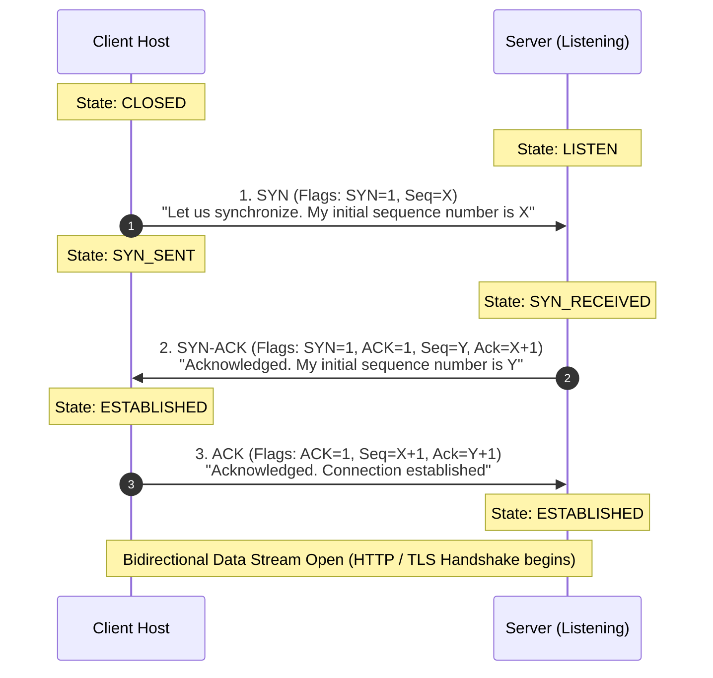
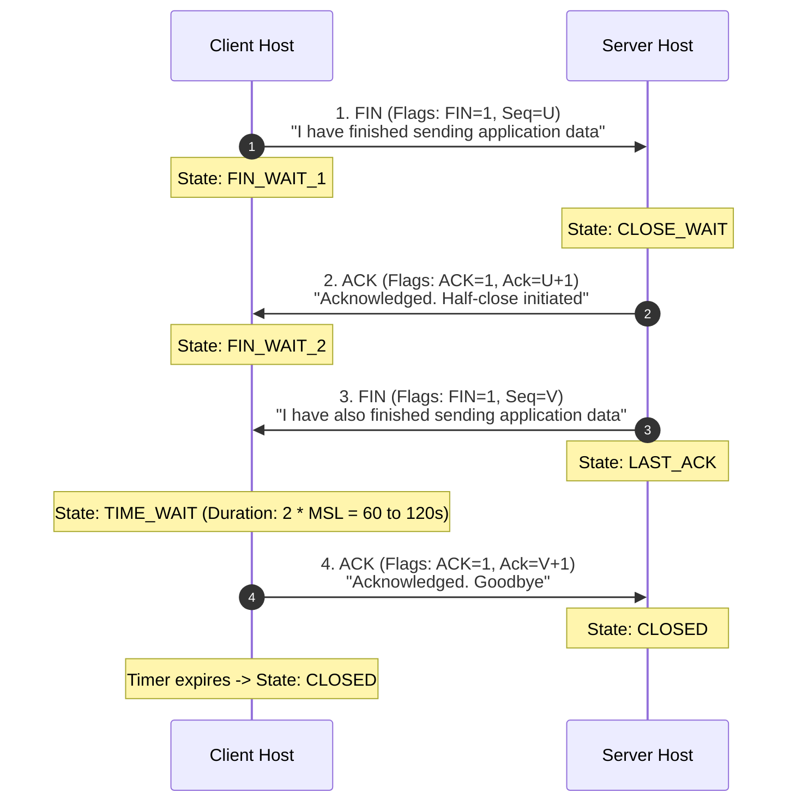
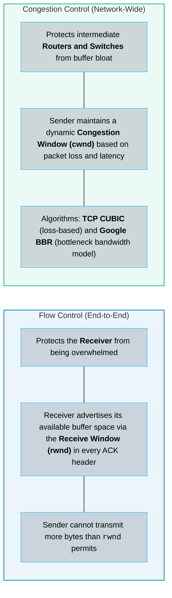
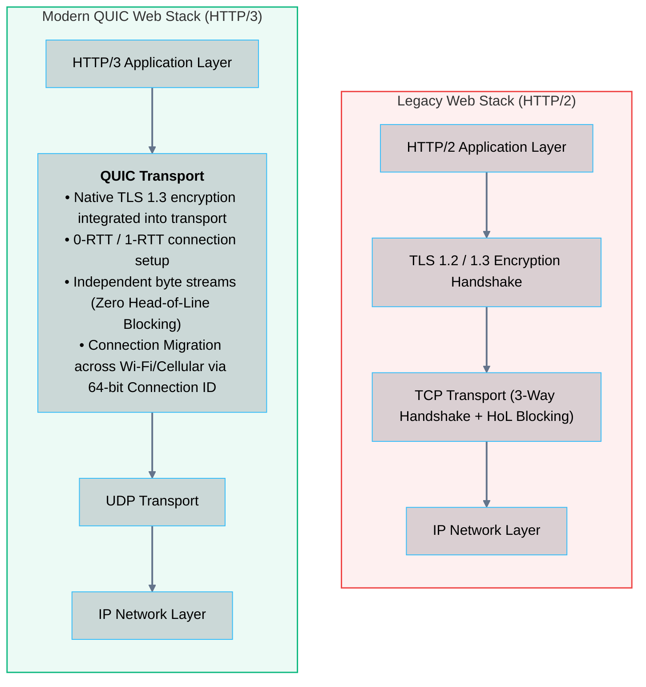

# 05 · Transport Protocols – TCP, UDP, and QUIC

> **Status**: Comprehensive Reference  
> **Parent**: [[Overview|Overview]] | [[00-Foundations/05-networking-fundamentals/README|Networking Index]]  
> **Topics**: Port Multiplexing, TCP Architecture, 3-Way Handshake, 4-Way Teardown, TIME_WAIT State, Sliding Window Flow Control, Congestion Control (CUBIC/BBR), UDP Architecture, QUIC (HTTP/3)

---

## 1. The Role of the Transport Layer

While Layer 3 (IP) delivers packets between **host machines**, Layer 4 (Transport) delivers segments between **specific application processes** running on those machines. It accomplishes this through **Port Multiplexing**.

### Port Number Ranges (0 – 65,535)

```
┌────────────────────────────────────────────────────────────────────────┐
│                        PORT NUMBER ALLOCATION RANGES                   │
├─────────────────────┬──────────────────────┬───────────────────────────┤
│ Well-Known Ports    │   Registered Ports   │ Dynamic / Ephemeral Ports │
│    (0 – 1,023)      │  (1,024 – 49,151)    │    (49,152 – 65,535)      │
├─────────────────────┼──────────────────────┼───────────────────────────┤
│ Reserved for core   │ Vendor and database  │ Assigned dynamically by   │
│ system services:    │ application services:│ client OS for outbound    │
│ 80  -> HTTP         │ 3306 -> MySQL        │ client connections:       │
│ 443 -> HTTPS        │ 5432 -> PostgreSQL   │ (e.g., Chrome opening     │
│ 22  -> SSH          │ 6379 -> Redis        │ random port 52418 to      │
│ 53  -> DNS          │ 8080 -> Web Alt      │ connect to server:443)    │
└─────────────────────┴──────────────────────┴───────────────────────────┘
```

A complete network socket connection is defined as a unique **5-Tuple**:
$$\text{Socket 5-Tuple} = (\text{Source IP}, \text{Source Port}, \text{Protocol}, \text{Destination IP}, \text{Destination Port})$$

---

## 2. Transmission Control Protocol (TCP)

**TCP (RFC 9293)** provides a connection-oriented, reliable, byte-stream delivery service with end-to-end error checking, in-order packet reassembly, flow control, and congestion mitigation.

### The TCP Three-Way Handshake

Before any application payload is exchanged, client and server synchronize sequence numbers:



### The TCP Four-Way Teardown & The TIME_WAIT State

Because TCP is full-duplex (both directions communicate independently), each direction must close gracefully:



> [!IMPORTANT] Why the TIME_WAIT State Exists
> The side that initiates the active close enters the `TIME_WAIT` state, persisting for **$2 \times \text{MSL}$ (Maximum Segment Lifetime)**, typically 60 to 120 seconds. This guarantees:
> 1. If the final ACK is lost in transit, the server can retransmit its FIN and the client can re-ACK rather than generating an erroneous `RST`.
> 2. Prevents delayed duplicate segments from an old connection from corrupting a newly established connection using the same 5-tuple.

---

## 3. Flow Control vs. Congestion Control

TCP safeguards both individual receiver memory and shared intermediate network routing pipes:



Effective transmission limit is strictly bounded by the minimum of both:
$$\text{Max In-Flight Data} = \min(\text{rwnd}, \text{cwnd})$$

---

## 4. User Datagram Protocol (UDP)

**UDP (RFC 768)** is a minimal, connectionless transport protocol providing process multiplexing and basic checksum error detection without any delivery guarantees.

```
┌────────────────────────────────────────────────────────┐
│                   8-BYTE UDP HEADER                    │
├───────────────────────────┬────────────────────────────┤
│ Source Port (16 Bits)     │ Destination Port (16 Bits) │
├───────────────────────────┼────────────────────────────┤
│ Length in Bytes (16 Bits) │ Checksum (16 Bits)         │
└───────────────────────────┴────────────────────────────┘
```

### When Engineers Intentionally Choose UDP
- **Extreme Low Latency**: Zero round trips spent on handshakes. Packets fire immediately.
- **Tolerant of Occasional Loss**: In VoIP (Zoom), video streaming, and multiplayer gaming, an older audio sample is useless by the time a TCP retransmission arrives. Dropping it is better than stalling playback.
- **Lightweight Query/Response**: DNS lookups (`port 53`) and NTP time sync (`port 123`) fit inside a single packet. A 3-way handshake would triple total latency.
- **Telemetry Ingestion**: Systems emitting high-frequency metrics (e.g., StatsD over UDP) prioritize server throughput over 100% metric delivery.

---

## 5. QUIC & HTTP/3: The Next-Generation Transport

Traditional web architectures suffer from **Head-of-Line (HoL) Blocking** under TCP. If a single packet is dropped, the TCP receiver buffers all subsequent packets until the missing packet is retransmitted—even if those packets belong to completely different HTTP requests.

**QUIC (RFC 9000)** is a modern transport protocol implemented on top of **UDP**, powering **HTTP/3**:



---

## 6. Master Technical Comparison Matrix

| Architectural Dimension | TCP | UDP | QUIC (HTTP/3) |
| :--- | :--- | :--- | :--- |
| **Connection State** | Connection-Oriented (3-Way) | Connectionless | Connection-Oriented (Integrated TLS) |
| **Header Size** | 20 – 60 Bytes | Fixed 8 Bytes | Variable (Encrypted) |
| **Delivery Guarantee**| Guaranteed In-Order | Unreliable, Unordered | Guaranteed In-Order per Stream |
| **Retransmission** | Yes (ARQ / Fast Retransmit) | No retransmissions | Yes (Per independent stream) |
| **Flow & Congestion** | Built-in (rwnd & cwnd) | None | Built-in (Pluggable BBR/CUBIC) |
| **Head-of-Line Blocking**| Yes (Entire connection stalls)| No | **No** (Streams are fully isolated) |
| **Handshake Latency** | 1 RTT (TCP) + 1-2 RTT (TLS) | 0 RTT | **0-RTT to 1-RTT total** |
| **Connection Migration**| Fails if client IP changes | Stateless | Seamless via Connection ID |
| **Primary Use Cases** | Web (HTTP/1.1, HTTP/2), SSH, DBs| DNS, DHCP, VoIP, Gaming | Modern Web (HTTP/3), Mobile Apps |

---

## 7. Key Takeaways

| Transport Concept | Core Engineering Principle |
| :--- | :--- |
| **Socket 5-Tuple** | Every connection is uniquely identified by Source IP, Source Port, Destination IP, Destination Port, and Protocol. |
| **Reliability Cost** | TCP guarantees order and delivery at the cost of latency overhead, handshakes, and Head-of-Line blocking. |
| **TIME_WAIT Grace Period** | Sockets persist in `TIME_WAIT` for $2 \times \text{MSL}$ to absorb delayed duplicate segments and allow graceful final ACK delivery. |
| **The QUIC Revolution** | QUIC replaces TCP with UDP-encapsulated streams, eliminating Head-of-Line blocking and merging transport and TLS encryption handshakes into a single round-trip. |

---

## 8. Knowledge Check

1. What components constitute the network socket 5-tuple?
2. Walk through the flags and sequence number changes during a TCP Three-Way Handshake.
3. Why does the active-closing side of a TCP connection enter the `TIME_WAIT` state, and what is its standard duration?
4. What is the difference between TCP Flow Control and TCP Congestion Control?
5. How does the TCP Sliding Window mechanism prevent a fast sender from crashing a slow receiver?
6. What is the header size overhead of UDP compared to a standard TCP header?
7. In what real-world scenarios is UDP technically superior to TCP?
8. Explain the "Head-of-Line Blocking" problem in HTTP/2 running over TCP.
9. How does QUIC eliminate Head-of-Line blocking while maintaining reliable data delivery?
10. What is "Connection Migration" in QUIC, and why does a smartphone switching from Wi-Fi to 5G cellular not drop a QUIC connection?

---

## 9. Next Chapter

Continue your networking fundamentals learning journey:

> ➡️ **Next Module**: [[06_Application_Protocols_HTTP_HTTPS_TLS|06 · Application Protocols – HTTP/1.1, HTTP/2, HTTP/3, and TLS 1.3]]  
> *Exploring HTTP verbs, status codes, keep-alive pipelining, multiplexed binary framing, Public Key Infrastructure (PKI), TLS 1.3 cryptographic handshakes, and Mutual TLS (mTLS).*

---

### Authoritative References

- [IETF RFC 9293: Transmission Control Protocol (TCP)](https://datatracker.ietf.org/doc/html/rfc9293)
- [IETF RFC 768: User Datagram Protocol (UDP)](https://datatracker.ietf.org/doc/html/rfc768)
- [IETF RFC 9000: QUIC – A UDP-Based Multiplexed and Secure Transport](https://datatracker.ietf.org/doc/html/rfc9000)
- [Google BBR Congestion Control Research](https://queue.acm.org/detail.cfm?id=3022184)
