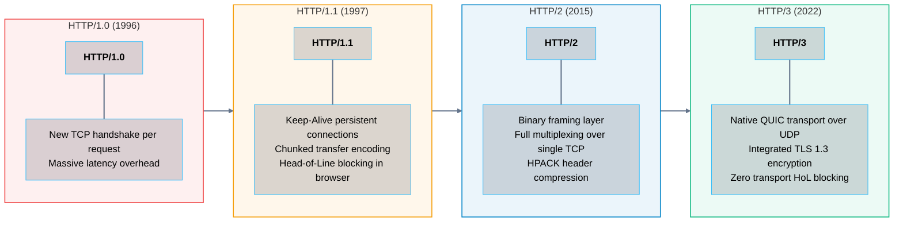
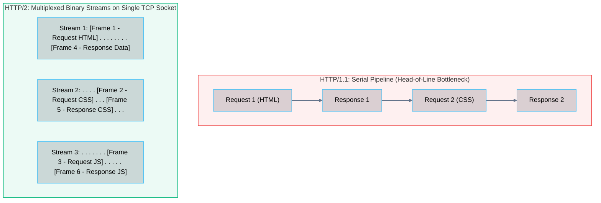
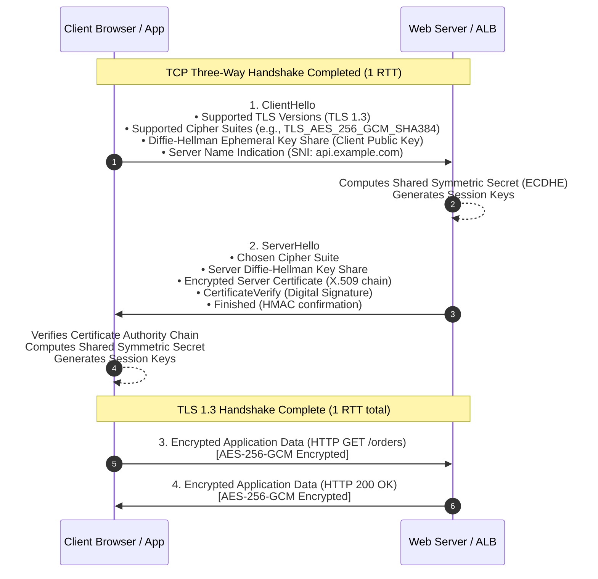
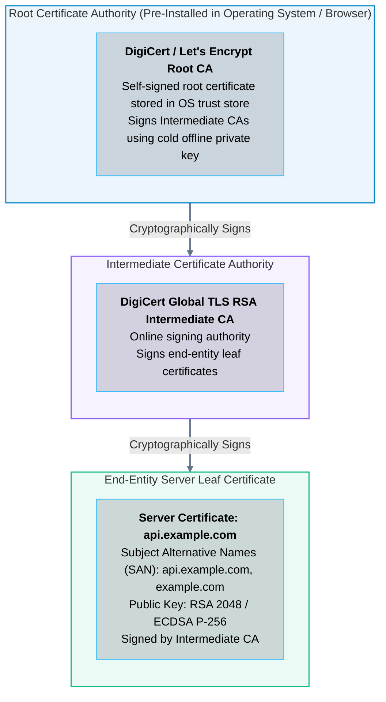

# 06 · Application Protocols – HTTP/1.1, HTTP/2, HTTP/3, and TLS 1.3

> **Status**: Comprehensive Reference  
> **Parent**: [[Overview|Overview]] | [[00-Foundations/05-networking-fundamentals/README|Networking Index]]  
> **Topics**: HTTP Evolution, Request & Response Anatomy, HTTP Status Codes, TLS 1.3 Handshake, Public Key Infrastructure (PKI), Mutual TLS (mTLS), Service Mesh Security

---

## 1. The Evolution of Hypertext Transfer Protocol (HTTP)

The **Hypertext Transfer Protocol (HTTP)** is the foundation of data communication for the World Wide Web, REST APIs, and microservice architectures.

---

## 2. HTTP/1.1 vs. HTTP/2 Multiplexing

In **HTTP/1.1**, requests on a single TCP connection must be processed serially. If Request 1 is a slow database query, Request 2 cannot be transmitted until Request 1 finishes. Browsers attempted to circumvent this by opening up to 6 concurrent TCP connections per domain.

In **HTTP/2 (RFC 7540)**, plaintext text streams are replaced by a **Binary Framing Layer**. Multiple independent requests and responses are interleaved simultaneously as binary frames across a **single persistent TCP connection**:

---

## 3. HTTP Request & Response Anatomy

### Standard HTTP Methods (Verbs)

| HTTP Verb | Semantic Purpose | Idempotent | Safe (Read-Only) |
| :--- | :--- | :--- | :--- |
| **GET** | Retrieve a representation of a resource. | **Yes** | **Yes** |
| **POST** | Create a subordinate resource or trigger state mutation. | **No** | No |
| **PUT** | Replace a resource completely with supplied payload. | **Yes** | No |
| **PATCH** | Apply partial modifications to a resource. | **No** (Varies) | No |
| **DELETE** | Remove a resource. | **Yes** | No |
| **HEAD** | Retrieve response headers identically to GET without body. | **Yes** | **Yes** |
| **OPTIONS**| Inspect allowed HTTP methods (CORS preflight). | **Yes** | **Yes** |

### Standard HTTP Status Code Classes

- **1xx (Informational)**: `100 Continue`, `101 Switching Protocols` (WebSocket upgrades).
- **2xx (Success)**: `200 OK`, `201 Created` (POST success), `204 No Content` (DELETE success).
- **3xx (Redirection)**: `301 Moved Permanently` (SEO redirect), `302 Found` (Temporary), `304 Not Modified` (HTTP caching).
- **4xx (Client Errors)**: `400 Bad Request`, `401 Unauthorized` (Authentication missing), `403 Forbidden` (Authorized but no permissions), `404 Not Found`, `429 Too Many Requests` (Rate-limited).
- **5xx (Server Errors)**: `500 Internal Server Error`, `502 Bad Gateway` (Upstream container crashed), `503 Service Unavailable`, `504 Gateway Timeout`.

---

## 4. Transport Layer Security (TLS 1.3)

**Transport Layer Security (TLS - RFC 8446)** encrypts application protocols (HTTPS, SMTPS, WSS) to ensure **Confidentiality** (eavesdropping prevention), **Integrity** (tamper prevention), and **Authentication** (identity verification).

### The TLS 1.3 1-RTT Handshake

TLS 1.3 eliminated obsolete insecure cryptographic algorithms (MD5, SHA-1, RC4, RSA key exchange) and deprecated the 2-RTT round trips of TLS 1.2, achieving full forward-secret encryption in **1 RTT**:

> [!NOTE] Perfect Forward Secrecy (PFS)
> TLS 1.3 mandates Ephemeral Diffie-Hellman (ECDHE) key exchange. Unlike legacy static RSA key exchange, if an attacker records encrypted traffic today and steals the server's private certificate five years later, **they still cannot decrypt past session traffic** because each session used unique, ephemeral ephemeral keys that were immediately erased from RAM.

---

## 5. Public Key Infrastructure (PKI) & Trust Hierarchy

How does a web browser trust that a server certificate for `example.com` truly belongs to `example.com`? It relies on the **X.509 Public Key Infrastructure (PKI)** chain of trust:

---

## 6. Mutual TLS (mTLS) & Zero-Trust Architecture

In standard public web browsing (one-way TLS), only the server presents a certificate to prove its identity to the client.

In cloud-native microservices and Kubernetes clusters, security standards mandate **Mutual TLS (mTLS)**:
- Both the **client** and the **server** present cryptographic X.509 certificates to each other.
- Service meshes (such as **Istio**, **Linkerd**, or **AWS App Mesh**) deploy sidecar proxies (Envoy) next to each microservice container.
- Envoy proxies automatically vend short-lived x509 certificates (rotated hourly via SPIFFE/SPIRE), authenticate peer service identities cryptographically, and encrypt inter-pod traffic across cluster nodes.

```mermaid
flowchart LR
    subgraph PodA["Microservice Pod A (Order Service)"]
        direction TB
        AppA["Order App Container"] -->|Plaintext HTTP Port 8080| SidecarA["Envoy Proxy Sidecar<br/>(Holds Client Cert A)"]
    end

    subgraph NetworkTransit["Encrypted Kubernetes Overlay Network"]
        direction LR
        Transit["Mutual TLS 1.3 Encrypted Wire<br/>Both sides verify x509 SAN identity"]
    end

    subgraph PodB["Microservice Pod B (Payment Service)"]
        direction TB
        SidecarB["Envoy Proxy Sidecar<br/>(Holds Server Cert B)"] -->|Plaintext HTTP Port 8080| AppB["Payment App Container"]
    end

    SidecarA <===> Transit <===> SidecarB

    style PodA fill:#0284c7,stroke:#0284c7,stroke-width:1.5px,fill-opacity:0.08
    style NetworkTransit fill:#10b981,stroke:#10b981,stroke-width:1.5px,fill-opacity:0.08
    style PodB fill:#8b5cf6,stroke:#8b5cf6,stroke-width:1.5px,fill-opacity:0.08

    classDef nodeStyle fill:#0f172a,stroke:#38bdf8,stroke-width:1px,fill-opacity:0.15,color:inherit;
    class AppA,SidecarA,Transit,SidecarB,AppB nodeStyle;
    linkStyle default stroke:#64748b,stroke-width:2px;
```

---

## 7. Key Takeaways

| Protocol Feature | Core Engineering Principle |
| :--- | :--- |
| **HTTP/2 Multiplexing** | Binary framing interleaves concurrent requests across a single TCP socket, eliminating HTTP/1.1 connection pooling. |
| **HTTP/3 over QUIC** | Shifts the transport layer from TCP to UDP, eliminating Head-of-Line blocking caused by dropped packets. |
| **TLS 1.3 Speed & Security** | Mandates Ephemeral Diffie-Hellman (PFS), removes insecure ciphers, and establishes encryption in a single round-trip (1-RTT). |
| **Mutual TLS (mTLS)** | Establishes zero-trust service-to-service microservice authentication by cryptographically validating identities on both ends. |

---

## 8. Knowledge Check

1. What is the fundamental difference between HTTP/1.1 pipelining and HTTP/2 binary stream multiplexing?
2. What are the key architectural enhancements introduced in HTTP/3?
3. Which HTTP methods are designated as "Idempotent," and why is `POST` non-idempotent?
4. What is the technical difference between HTTP status code `401 Unauthorized` and `403 Forbidden`?
5. How does TLS 1.3 reduce handshake latency to 1 RTT compared to TLS 1.2?
6. Explain the concept of "Perfect Forward Secrecy" (PFS) and how Ephemeral Diffie-Hellman achieves it.
7. What is Server Name Indication (SNI), and why is it necessary when hosting multiple SSL domains on a single IP address?
8. What is the role of an Intermediate Certificate Authority in the X.509 PKI chain of trust?
9. How does Mutual TLS (mTLS) differ from standard one-way TLS?
10. Why do Kubernetes service meshes like Istio use Envoy sidecars to enforce mTLS between microservices?

---

## 9. Next Chapter

Continue your networking fundamentals learning journey:

> ➡️ **Next Module**: [[07_Network_Security_Firewalls_and_NAT|07 · Network Security – Firewalls, NAT, and DMZ Architecture]]  
> *Exploring packet filtering firewalls, stateful inspection, Source NAT (SNAT) vs. Destination NAT (DNAT), Port Address Translation (PAT), DMZ network segmentation, and cloud Security Groups.*

---

### Authoritative References

- [IETF RFC 7540: Hypertext Transfer Protocol Version 2 (HTTP/2)](https://datatracker.ietf.org/doc/html/rfc7540)
- [IETF RFC 9114: HTTP/3](https://datatracker.ietf.org/doc/html/rfc9114)
- [IETF RFC 8446: The Transport Layer Security (TLS) Protocol Version 1.3](https://datatracker.ietf.org/doc/html/rfc8446)
- [SPIFFE: Secure Production Identity Framework for Everyone](https://spiffe.io/)
