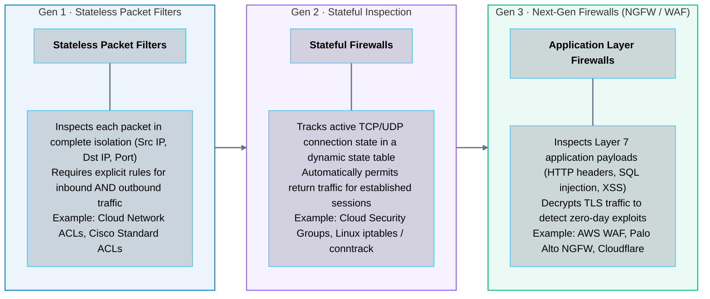
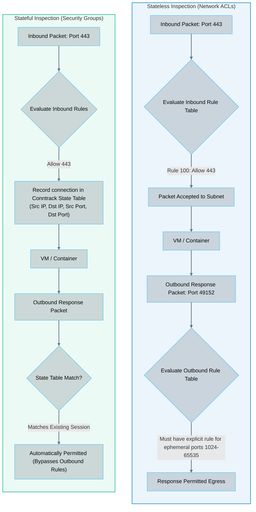
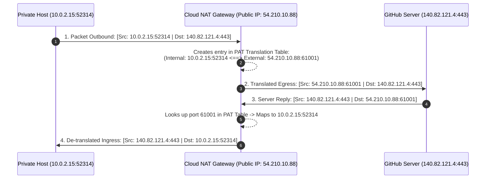
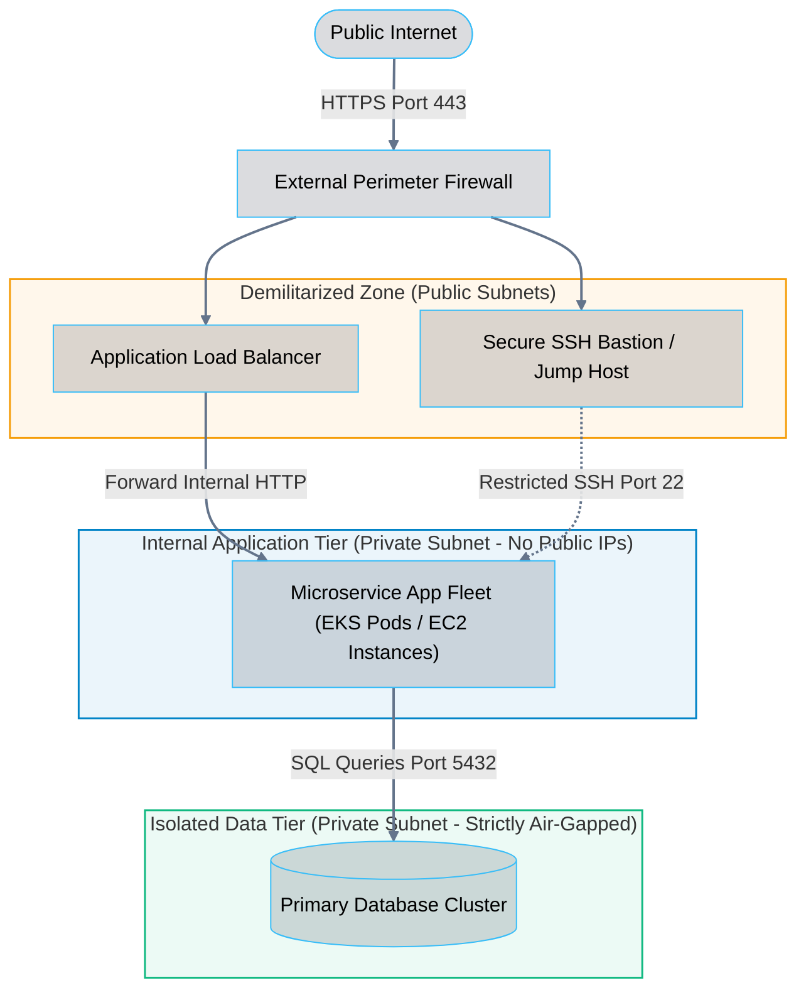

# 07 · Network Security – Firewalls, NAT, and DMZ Architecture

> **Status**: Comprehensive Reference  
> **Parent**: [[Overview|Overview]] | [[00-Foundations/05-networking-fundamentals/README|Networking Index]]  
> **Topics**: Firewall Taxonomies, Stateless vs. Stateful Inspection, Source NAT (SNAT), Destination NAT (DNAT), Port Address Translation (PAT), DMZ Segmentation, Cloud Security Groups vs. NACLs

---

## 1. The Evolution of Network Firewalls

A firewall is a network security control device or software layer that monitors and filters incoming and outgoing network traffic based on an organization's previously established security policies.

---

## 2. Stateless vs. Stateful Filtering in Cloud Architecture

Understanding the mechanics between stateless and stateful inspection is essential for configuring cloud virtual networks correctly:

---

## 3. Network Address Translation (NAT) Mechanics

**Network Address Translation (NAT - RFC 1631 / 3022)** rewrites the source or destination IP addresses in packet headers while in transit through a routing gateway.

### 1. Source NAT (SNAT) & Port Address Translation (PAT)
- **Problem**: Private RFC 1918 addresses (`10.0.0.0/8`, `192.168.0.0/16`) cannot travel across the public Internet.
- **Solution**: As packets exit a private subnet toward the Internet, a **NAT Gateway** translates the private source IP into its own single public IP address, mapping connections to unique **ephemeral source ports**:

### 2. Destination NAT (DNAT / Port Forwarding)
- Translates the public destination IP address and port of an incoming packet to an internal private IP address and port.
- Commonly used in on-premises routers to expose an internal web server (`192.168.1.100:80`) to the public Internet via the router's public IP (`203.0.113.1:80`).
- In cloud architectures, **Application Load Balancers (ALBs)** replace DNAT by proxying incoming TCP/HTTP connections to internal private targets.

---

## 4. Demilitarized Zone (DMZ) Architecture

A **Demilitarized Zone (DMZ)** is a physical or logical subnetwork that exposes an organization's external-facing services to an untrusted network (the Internet), while sequestering and protecting the core private network behind layered perimeters.

---

## 5. Master Comparison: Security Groups vs. Network ACLs

| Architectural Dimension | Security Group (SG) | Network ACL (NACL) |
| :--- | :--- | :--- |
| **Operational Level** | Instance / Virtual Interface (ENI) | Subnet Boundary |
| **Inspection Type** | **Stateful** (Return traffic automatically allowed) | **Stateless** (Inbound & Outbound evaluated independently) |
| **Default Rules** | Denies all inbound; allows all outbound | Default NACL allows all; Custom NACL denies all |
| **Rule Processing** | Evaluates **all rules** before granting access | Evaluates rules in **strict numbered order** (first match wins)|
| **Allow / Deny Capability**| Supports **Allow** rules only (Implicit Deny) | Supports both **Allow** and **Deny** rules |
| **Blocking Specific IPs** | Cannot explicitly block a single offending IP | **Can block specific IPs** via numbered Deny rule |
| **Primary Architectural Role**| Micro-segmentation around individual VMs/DBs | Subnet-wide perimeter defense and geographic/IP blocking |

---

## 6. Key Takeaways

| Security Dimension | Core Architectural Principle |
| :--- | :--- |
| **Stateful Resilience** | Security Groups track active socket sessions in state memory; outbound responses require zero manual firewall opening. |
| **Stateless Ephemeral Requirement**| Network ACLs require opening ephemeral return ports (`1024-65535`) on the outbound rule table to permit response traffic. |
| **NAT Overload (PAT)** | Transforms thousands of internal private host IPs into a single outbound public IP using unique ephemeral source ports. |
| **Multi-Tier Isolation** | Production databases must never reside in a public DMZ subnet; isolate them in deep private subnets accessible only by internal application security groups. |

---

## 7. Knowledge Check

1. What is the fundamental difference between a stateless packet filter and a stateful inspection firewall?
2. If a stateful Security Group allows inbound traffic on port 80, why does the administrator NOT need to configure an outbound response rule?
3. What is the operational consequence of forgetting to add an outbound rule for ephemeral ports in a stateless Network ACL?
4. How does Port Address Translation (PAT) allow 500 virtual machines in a private subnet to access the Internet simultaneously using a single public IP address?
5. What is the difference between Source NAT (SNAT) and Destination NAT (DNAT)?
6. Why are AWS Network ACL rules evaluated in numbered order, and what happens once a packet matches a rule?
7. How can a security engineer use a Network ACL to immediately block a distributed denial-of-service attack originating from a specific malicious IP address?
8. What is the architectural purpose of a Demilitarized Zone (DMZ)?
9. Why should database instances never be assigned public IP addresses, even if they have strong password authentication?
10. What is a Bastion (Jump) host, and how does it protect internal private workloads from direct Internet exposure?

---

## 8. Next Chapter

Continue your networking fundamentals learning journey:

> ➡️ **Next Module**: [[08_Cloud_Software_Defined_Networking_SDN|08 · Cloud Software-Defined Networking (SDN) and Overlay Networks]]  
> *Exploring control plane vs. data plane separation, VXLAN packet encapsulation, Geneve protocols, virtual distributed switches, and cloud VPC virtualization.*

---

### Authoritative References

- [IETF RFC 1631: The IP Network Address Translator (NAT)](https://datatracker.ietf.org/doc/html/rfc1631)
- [IETF RFC 3022: Traditional IP Network Address Translator (Traditional NAT)](https://datatracker.ietf.org/doc/html/rfc3022)
- [AWS Security Groups vs. Network ACLs Documentation](https://docs.aws.amazon.com/vpc/latest/userguide/VPC_Security.html)
- [NIST SP 800-41: Guidelines on Firewalls and Firewall Policy](https://csrc.nist.gov/pubs/sp/800/41/rev1/final)
