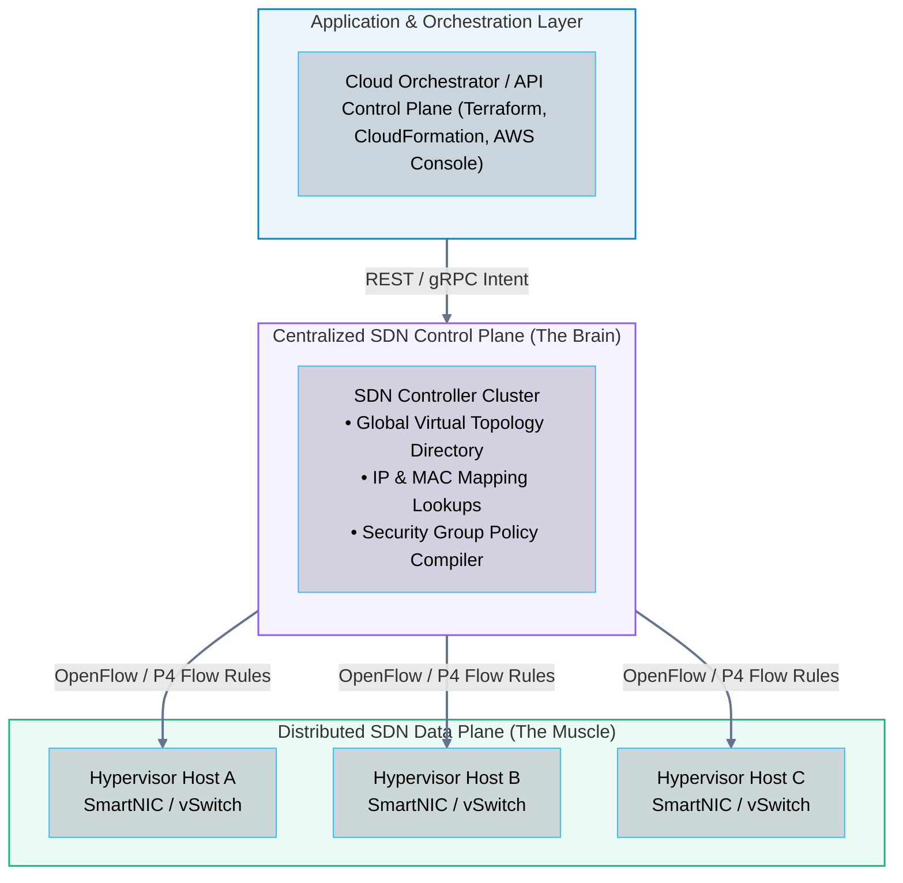
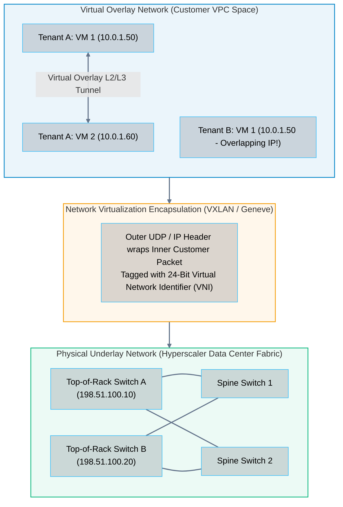

# 08 · Cloud Software-Defined Networking (SDN) and Overlay Networks

> **Status**: Comprehensive Reference  
> **Parent**: [[Overview|Overview]] | [[00-Foundations/05-networking-fundamentals/README|Networking Index]]  
> **Topics**: SDN Control Plane vs. Data Plane, Underlay vs. Overlay Networks, VXLAN (RFC 7348), Geneve Encapsulation, Hardware SmartNIC Offloading (AWS Nitro, Azure FPGA)

---

## 1. The Core Architecture of Software-Defined Networking (SDN)

In traditional network hardware, each physical router and switch houses both its own **Control Plane** (calculating routing tables, running OSPF/BGP algorithms) and its own **Data Plane** (forwarding packets between physical ports).

**Software-Defined Networking (SDN)** fundamentally decouples these two planes:
1. **The Control Plane (The Brain)**: Centralized software controllers maintain a global map of the network, determine forwarding rules, evaluate security policies, and distribute configurations.
2. **The Data Plane (The Muscle)**: High-speed forwarding engines (physical ASICs, virtual switches, SmartNICs) execute line-rate packet switching strictly according to the control plane's instructions.



---

## 2. Underlay vs. Overlay Networks

How do cloud hyperscalers allow two different customer accounts to both use `10.0.1.5` on the same physical data center rack without IP conflicts? By separating the **Physical Underlay** from the **Virtual Overlay**:



- **The Underlay Network**: The physical leaf-spine Clos network, switches, routers, and high-speed optics (100GbE / 400GbE). Routers in the underlay route exclusively on hyperscaler physical IPs and support jumbo frames (e.g., MTU 9001 bytes).
- **The Overlay Network**: The virtual software-defined network (the customer's VPC). Packets generated by virtual machines are wrapped in encapsulation headers, routed over the underlay, and decapsulated at the destination hypervisor.

---

## 3. Network Encapsulation: VXLAN and Geneve

### 1. VXLAN (Virtual Extensible LAN - RFC 7348)
Traditional IEEE 802.1Q VLANs use a 12-bit identifier, restricting a physical data center to **4,096 total VLANs**—insufficient for hyperscalers servicing millions of customer accounts.

**VXLAN** solves this by:
- Wrapping entire Layer 2 Ethernet frames inside standard **Layer 4 UDP packets (destination port 4789)**.
- Expanding the network identifier to a **24-bit Virtual Network Identifier (VNI)**, supporting **16,777,216 isolated virtual networks** over a shared underlay.

```
┌──────────────────────────────────────────────────────────────────────────────────────────────────┐
│                                     VXLAN ENCAPSULATED PACKET                                    │
├─────────────────┬──────────────┬──────────────┬──────────────┬───────────────────────────────────┤
│ Outer MAC Header│ Outer IP Hdr │ Outer UDP Hdr│ VXLAN Header │ Inner Customer Ethernet Frame     │
│ (Underlay)      │ (Src/Dst     │ (Dst Port:   │ (24-Bit VNI: │ (Customer MACs, Customer Private  │
│                 │  Host Hyper) │  4789)       │  VPC ID)     │  IPs, Customer Data Payload)      │
└─────────────────┴──────────────┴──────────────┴──────────────┴───────────────────────────────────┘
```

### 2. Geneve (Generic Network Virtualization Encapsulation - RFC 8926)
While VXLAN uses a fixed 8-byte header, **Geneve** introduces a flexible format supporting variable-length Type-Length-Value (TLV) option fields.
- Used by **AWS Gateway Load Balancer (GWLB)** and VMware NSX-T.
- Allows intermediary network appliances (firewalls, IDS/IPS sensors) to attach session metadata without altering the customer's inner IP packet.

---

## 4. Hardware SmartNIC Offloading (The Nitro Architecture)

In early virtualization systems, every software-defined packet encapsulation, Security Group rule check, and encryption routine consumed hypervisor CPU cycles (known as the **"Virtualization Tax"**, eating up to 30% of server CPU power).

Modern cloud providers offload 100% of SDN processing to dedicated **SmartNIC hardware processors**:

```mermaid
flowchart TD
    subgraph HostServer["Hyperscale Compute Host Chassis"]
        direction TB

        subgraph MainBoard["Main Motherboard (100% Dedicated to Customer)"]
            direction TB
            CPU["Intel Xeon / AMD EPYC / Graviton CPUs"]
            RAM["Host System DDR5 Memory"]
            VMs["Customer Virtual Machines / Containers"]
            CPU --- RAM --- VMs
        end

        subgraph NitroBoard["Dedicated SmartNIC PCIe Card (AWS Nitro / Azure FPGA)"]
            direction TB
            NitroASIC["Custom Nitro / FPGA ASIC Processor"]
            VPC_Engine["VPC Encapsulation Engine (VXLAN/Geneve at 100 Gbps line rate)"]
            SG_Engine["Hardware Security Group Rule Filter (Zero CPU overhead)"]
            Crypto_Engine["Hardware Wire Encryption Engine (Line-rate AES-GCM)"]
            NitroASIC --- VPC_Engine --- SG_Engine --- Crypto_Engine
        end

        MainBoard <== High-Speed PCIe Gen 5 Bus ==> NitroBoard
    end

    NitroBoard <== Fiber Physical Network ==> DC_Fabric[Hyperscale Underlay Fabric]

    style HostServer fill:#0f172a,stroke:#3b82f6,stroke-width:1.5px,fill-opacity:0.08
    style MainBoard fill:#1e293b,stroke:#0284c7,stroke-width:1px,fill-opacity:0.08
    style NitroBoard fill:#10b981,stroke:#10b981,stroke-width:1px,fill-opacity:0.08

    classDef nodeStyle fill:#0f172a,stroke:#38bdf8,stroke-width:1px,fill-opacity:0.15,color:inherit;
    class CPU,RAM,VMs,NitroASIC,VPC_Engine,SG_Engine,Crypto_Engine,DC_Fabric nodeStyle;
    linkStyle default stroke:#64748b,stroke-width:2px;
```



### Advantages of SmartNIC Hardware Offloading
1. **Zero Virtualization Tax**: 100% of host CPU cores and memory are sold directly to the customer.
2. **Deterministic Low Latency**: Hardware-accelerated packet switching reduces inter-instance latency to single-digit microseconds.
3. **Enhanced Security Air-Gap**: The customer operating system has zero access to the network hypervisor control plane; the SmartNIC is an independent physical computer connected via PCIe.

---

## 5. Key Takeaways

| SDN Dimension | Core Engineering Principle |
| :--- | :--- |
| **Plane Separation** | SDN decouples the centralized software control plane (routing decisions) from distributed data planes (forwarding packets). |
| **VPC Multi-Tenancy** | Overlay networks wrap private customer IP frames inside outer UDP packets (VXLAN/Geneve), allowing overlapping private CIDRs across different tenants. |
| **Scale Expansion** | VXLAN expands the 12-bit VLAN limit (4,096 IDs) to a 24-bit VNI (16 million virtual networks). |
| **SmartNIC Offload** | Modern cloud hypervisors offload overlay encapsulation, encryption, and Security Group filtering to dedicated PCIe hardware (AWS Nitro, Azure SmartNIC). |

---

## 6. Knowledge Check

1. What is the fundamental distinction between the Control Plane and the Data Plane in Software-Defined Networking?
2. How does an overlay network enable thousands of distinct cloud customers to use `10.0.0.0/16` simultaneously without IP collisions?
3. What is the difference between an underlay network and an overlay network in a modern data center?
4. How many virtual network identifiers (VNIs) does VXLAN support compared to traditional 802.1Q VLANs?
5. Over which transport layer protocol and destination port does VXLAN encapsulate inner Ethernet frames?
6. Why is Geneve encapsulation preferred over VXLAN in advanced services like AWS Gateway Load Balancer?
7. What was the "Virtualization Tax" in early cloud hypervisors?
8. How does the AWS Nitro System or Azure FPGA SmartNIC eliminate the virtualization tax?
9. Why do cloud underlay networks mandate support for jumbo frames (e.g., MTU 9001 bytes)?
10. From a security standpoint, why does hardware SmartNIC offloading improve hypervisor isolation boundaries?

---

## 7. Next Chapter & Curriculum Index

Continue your foundational cloud learning journey:

> **Networking Curriculum Index**: Return to [[00-Foundations/05-networking-fundamentals/README|Module 05 Index]]  
> ➡️ **Next Foundational Pillar**: [[00-Foundations/06-compute-fundamentals/README|06 · Compute Fundamentals]]  
> *Exploring computer architecture, CPU microarchitectures, memory hierarchies, OS kernels, hypervisors, Linux cgroups/namespaces, and serverless microVMs.*

---

### Authoritative References

- [IETF RFC 7348: Virtual eXtensible Local Area Network (VXLAN)](https://datatracker.ietf.org/doc/html/rfc7348)
- [IETF RFC 8926: Geneve – Generic Network Virtualization Encapsulation](https://datatracker.ietf.org/doc/html/rfc8926)
- [The AWS Nitro System: Architecture and Innovation](https://aws.amazon.com/ec2/nitro/)
- [Microsoft Azure Accelerated Networking and SmartNIC Offloads](https://learn.microsoft.com/en-us/azure/virtual-network/accelerated-networking-overview)
