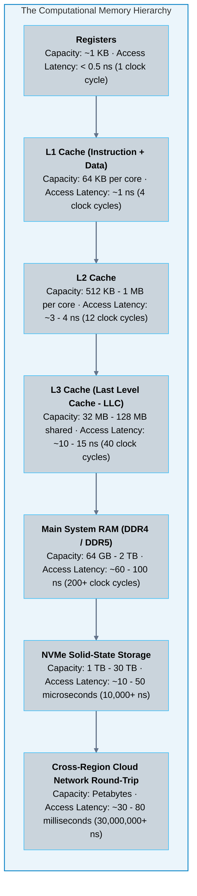
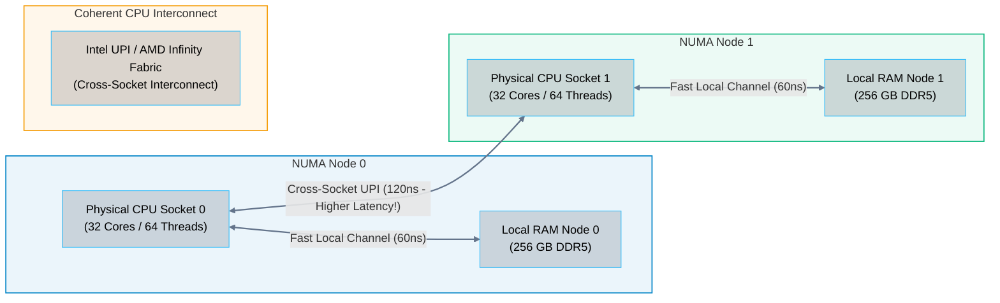

# 01 · Computer Architecture – CPU, Memory Hierarchy, and System Bus

> **Status**: Comprehensive Reference  
> **Parent**: [[Overview|Overview]] | [[00-Foundations/06-compute-fundamentals/README|Compute Index]]  
> **Topics**: von Neumann vs. Harvard Architecture, CPU Execution Engine (ALU, Registers, Pipeline), L1-L3 Cache Hierarchy, Memory Latencies, Non-Uniform Memory Access (NUMA), PCIe Bus Architecture

---

## 1. Classical Computer Architecture: The von Neumann Paradigm

Modern general-purpose cloud servers operate on the foundational **von Neumann architecture**, characterized by three interconnected subsystems:
1. **Central Processing Unit (CPU)**: Contains the Arithmetic Logic Unit (ALU), Control Unit (CU), and internal high-speed Registers.
2. **Main Memory (RAM)**: A unified address space holding both executable machine instructions and active program data.
3. **Input/Output (I/O) System**: Interfaces connecting secondary storage, network interfaces, and peripheral buses.

```mermaid
flowchart TD
    subgraph CPU["Central Processing Unit (CPU Package)"]
        direction TB

        subgraph Core["CPU Execution Core"]
            direction LR
            CU["Control Unit (CU)<br/>Instruction Fetch & Decode"]
            ALU["Arithmetic Logic Unit (ALU)<br/>Math & Bitwise Ops"]
            Regs["Register File<br/>(rax, rbx, rsp, rip - 64-bit)"]
            CU <--> ALU <--> Regs
        end

        subgraph Caches["On-Die Cache Hierarchy"]
            direction LR
            L1["L1 Cache<br/>(32KB-64KB per core, ~1ns)"]
            L2["L2 Cache<br/>(512KB-1MB per core, ~3ns)"]
            L3["L3 Shared Cache<br/>(16MB-64MB shared, ~10ns)"]
            L1 --- L2 --- L3
        end

        Core <==> Caches
    end

    subgraph MemorySystem["System Memory & Interconnect"]
        direction LR
        IMC["Integrated Memory Controller (IMC)"]
        RAM["Main Memory (DDR4 / DDR5 SDRAM)<br/>64GB - 1TB+ (~60-100ns)"]
        PCIe["PCIe Root Complex<br/>Gen 4 / Gen 5 Bus"]
        IMC <== Dual/Octa Channel ==> RAM
    end

    subgraph Peripherals["High-Speed I/O Devices"]
        direction LR
        NVMe["NVMe SSD Disks<br/>(~10-50 microseconds)"]
        NIC["100GbE / 200GbE NICs<br/>(SmartNIC / Nitro)"]
    end

    CPU <== Ultra-Fast Memory Bus ==> IMC
    PCIe <== 64 GB/s per x16 link ==> Peripherals
    MemorySystem --- PCIe

    style CPU fill:#0284c7,stroke:#0284c7,stroke-width:1.5px,fill-opacity:0.08
    style Core fill:#1e293b,stroke:#0284c7,stroke-width:1px,fill-opacity:0.08
    style Caches fill:#8b5cf6,stroke:#8b5cf6,stroke-width:1px,fill-opacity:0.08
    style MemorySystem fill:#10b981,stroke:#10b981,stroke-width:1.5px,fill-opacity:0.08
    style Peripherals fill:#f59e0b,stroke:#f59e0b,stroke-width:1.5px,fill-opacity:0.08

    classDef nodeStyle fill:#0f172a,stroke:#38bdf8,stroke-width:1px,fill-opacity:0.15,color:inherit;
    class CU,ALU,Regs,L1,L2,L3,IMC,RAM,PCIe,NVMe,NIC nodeStyle;
    linkStyle default stroke:#64748b,stroke-width:2px;
```

---

## 2. The CPU Instruction Execution Cycle

Every instruction executed by a cloud virtual machine or container traverses the classical four-stage cycle:
1. **Fetch**: The Control Unit reads the 64-bit instruction from memory (or L1 Instruction Cache) at the memory address currently pointed to by the **Instruction Pointer (`%rip`)**.
2. **Decode**: The Control Unit decodes the binary opcode into micro-operations, identifying source operands, destination registers, and execution flags.
3. **Execute**: The ALU, Floating Point Unit (FPU), or SIMD vector execution unit (e.g., AVX-512, ARM NEON) computes the mathematical or logical result.
4. **Write-Back**: The resulting calculation is written back into an on-die register or cached memory location.

---

## 3. The Memory Hierarchy & Latency Numbers Every Cloud Engineer Must Know

CPUs operate at frequencies exceeding 3 to 4 GHz, completing clock cycles in **sub-nanosecond** timeframes ($0.25 - 0.3 \text{ ns}$). Accessing main system RAM, however, requires **60 to 100 nanoseconds**—equivalent to a CPU waiting hundreds of clock cycles doing nothing (a **CPU Stall** or **Memory Wall**).

To bridge this chasm, modern processor dies incorporate a multi-tiered hierarchy of static RAM (SRAM) caches:

### Human-Scale Latency Analogy (Jeff Dean's Scale)
If 1 CPU clock cycle ($0.3\text{ ns}$) is scaled up to equal **1 second**:
- **L1 Cache Access**: 3 seconds
- **L2 Cache Access**: 12 seconds
- **L3 Cache Access**: 45 seconds
- **Main RAM Access**: **5.5 minutes**
- **NVMe SSD I/O Read**: **1.9 days**
- **Mechanical Hard Drive Seek**: **4.7 months**
- **Cross-Continent Network Round-Trip**: **8.5 years**

---

## 4. Non-Uniform Memory Access (NUMA)

In multi-socket enterprise servers (e.g., dual-socket Intel Xeon or AMD EPYC chassis hosting cloud hypervisors), memory is physically partitioned into **NUMA Nodes**:
- Each physical CPU socket is directly wired to its own local memory channels.
- Sockets are interconnected via ultra-high-speed point-to-point coherent buses (**Intel Ultra Path Interconnect - UPI**, or **AMD Infinity Fabric**).

> [!IMPORTANT] The NUMA Performance Impact
> When a thread running on CPU Socket 0 accesses memory wired to Socket 1, the memory access must cross the UPI bus. This **Remote Memory Access incurs double the latency** (120ns vs 60ns). Cloud hypervisors pin virtual machine vCPUs and RAM to a single NUMA node whenever possible to prevent performance jitter.

---

## 5. System Bus Architecture: PCIe Gen 4 and Gen 5

Peripheral Component Interconnect Express (PCIe) is the point-to-point serial communication backbone connecting the CPU to high-throughput devices:

| PCIe Generation | Raw Transfer Rate | Throughput per Lane (x1) | Throughput for x16 Slot | Typical Cloud Infrastructure Attached |
| :--- | :--- | :--- | :--- | :--- |
| **PCIe 3.0** | 8.0 GT/s | ~1 GB/s | ~16 GB/s | Standard 10GbE NICs, SATA controllers |
| **PCIe 4.0** | 16.0 GT/s | ~2 GB/s | ~32 GB/s | Enterprise NVMe SSDs, 100GbE SmartNICs |
| **PCIe 5.0** | 32.0 GT/s | ~4 GB/s | ~64 GB/s | AI/ML Accelerators (NVIDIA H100 GPUs), 400GbE NICs |
| **PCIe 6.0** | 64.0 GT/s (PAM4) | ~8 GB/s | ~128 GB/s | Next-gen hyperscale AI clusters, CXL memory pools |

---

## 6. Key Takeaways

| Architecture Layer | Core Engineering Principle |
| :--- | :--- |
| **The Memory Wall** | CPUs process data thousands of times faster than RAM can supply it; cache hit ratios (L1/L2/L3) dictate real-world application throughput. |
| **Cache Locality** | Algorithms designed with spatial and temporal cache locality dramatically outperform scattered pointer-chasing data structures. |
| **NUMA Awareness** | In multi-socket servers, accessing remote RAM across the inter-socket bus doubles memory latency; high-performance databases must be NUMA-pinned. |
| **PCIe Bandwidth** | Modern cloud storage (NVMe) and networking (100GbE+) depend on high-speed PCIe Gen 4/5 lanes to eliminate I/O bottlenecks. |

---

## 7. Knowledge Check

1. What are the three primary components of the classical von Neumann computer architecture?
2. Explain the four stages of the CPU instruction execution cycle.
3. Why do CPUs require a tiered cache hierarchy (L1, L2, L3) instead of accessing system RAM directly?
4. What is the typical access latency (in nanoseconds) of L1 cache versus main DDR4/DDR5 RAM?
5. What is the "Memory Wall" or "CPU Stall," and how does it impact cloud application performance?
6. Explain the difference between Uniform Memory Access (UMA) and Non-Uniform Memory Access (NUMA).
7. Why does crossing the inter-socket interconnect (e.g., Intel UPI or AMD Infinity Fabric) degrade database latency?
8. What is the bandwidth of a PCIe 4.0 x16 slot, and what cloud hardware devices utilize it?
9. What is the difference between temporal cache locality and spatial cache locality in software engineering?
10. Why do cloud providers align large virtual machine instance sizes (e.g., AWS `m5.24xlarge`) to exact NUMA socket boundaries?

---

## 8. Next Chapter

Continue your compute fundamentals learning journey:

> ➡️ **Next Module**: [[02_Operating_System_Kernels_and_Processes|02 · Operating System Kernels, Syscalls, and Processes]]  
> *Exploring Ring 0 vs. Ring 3 privilege levels, system calls, process state lifecycles, POSIX threads, context switching overhead, and the Linux Completely Fair Scheduler (CFS).*

---

### Authoritative References

- [Hennessy and Patterson: Computer Architecture – A Quantitative Approach](https://www.elsevier.com/books/computer-architecture/hennessy/978-0-12-811905-1)
- [Ulrich Drepper: What Every Programmer Should Know About Memory](https://people.freebsd.org/~lstewart/articles/cpumemory.pdf)
- [Latency Numbers Every Programmer Should Know (Interactive)](https://gist.github.com/jboner/2841832)
