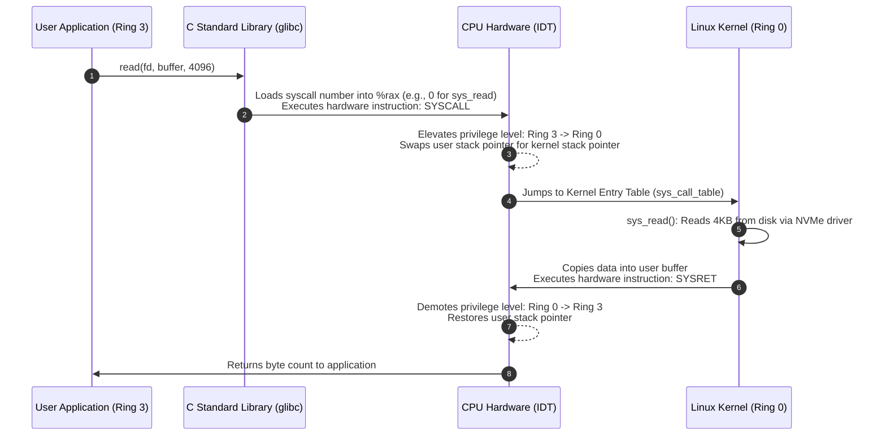
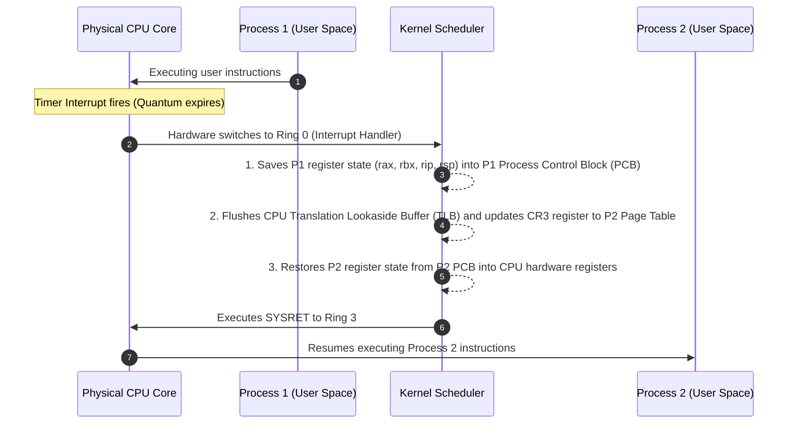

# 02 · Operating System Kernels, Syscalls, and Processes

> **Status**: Comprehensive Reference  
> **Parent**: [[Overview|Overview]] | [[00-Foundations/06-compute-fundamentals/README|Compute Index]]  
> **Topics**: Kernel Space vs. User Space, Ring 0 vs. Ring 3, System Calls (Syscalls), Process Memory Layout, POSIX Threads, Context Switching, Linux CFS Scheduler

---

## 1. Privilege Rings: Kernel Space vs. User Space

Modern computer hardware enforces strict hardware-level execution domains (**Hierarchical Protection Rings** on x86, or **Exception Levels EL0–EL3** on ARM) to guarantee that application bugs or malicious code cannot destabilize the physical machine:

```mermaid
flowchart TD
    subgraph Ring3["Ring 3 · User Space (Least Privileged)"]
        direction TB
        App1["Web Server (Nginx / Node.js)"]
        App2["Relational Database (PostgreSQL)"]
        App3["User Python Script"]
        AppDesc["Direct access to hardware registers and raw memory addresses is <b>STRICTLY PROHIBITED</b><br/>Faults trigger a segmentation fault (SIGSEGV) without crashing the OS"]
    end

    subgraph Ring0["Ring 0 · Kernel Space (Most Privileged)"]
        direction TB
        KernelCore["Linux Kernel Core (Memory Manager, Process Scheduler, VFS)"]
        Drivers["Device Drivers (NVMe, Network Card, GPU)"]
        HardwareCtrl["Direct, uninhibited access to CPU control registers (CR0, CR3), physical RAM, and hardware interrupts"]
    end

    Ring3 ==>|System Call (syscall) / Context Switch| Ring0

    style Ring3 fill:#0284c7,stroke:#0284c7,stroke-width:1.5px,fill-opacity:0.08
    style Ring0 fill:#ef4444,stroke:#ef4444,stroke-width:1.5px,fill-opacity:0.08

    classDef nodeStyle fill:#0f172a,stroke:#38bdf8,stroke-width:1px,fill-opacity:0.15,color:inherit;
    class App1,App2,App3,AppDesc,KernelCore,Drivers,HardwareCtrl nodeStyle;
    linkStyle default stroke:#64748b,stroke-width:2px;
```

- **Ring 3 (User Space)**: Applications run inside isolated virtual memory boundaries. They have no direct access to physical storage, network hardware, or other processes' memory.
- **Ring 0 (Kernel Space)**: The monolithic operating system kernel executes with complete control over physical hardware. A crash in Ring 0 results in an immediate **Kernel Panic** or **Blue Screen of Death (BSOD)**.

---

## 2. System Calls (Syscalls): The Protected Bridge

Whenever an application in User Space needs to perform an I/O operation—such as reading a file from disk, opening a network socket, or spawning a new worker thread—it must invoke a **System Call (Syscall)**:



### Essential Linux System Calls

| Syscall | Subsystem | Operational Function |
| :--- | :--- | :--- |
| `clone()` / `fork()` | Process Management | Spawns a new child process or creates a new kernel thread. |
| `execve()` | Process Management | Replaces current process memory with an entirely new executable binary. |
| `read()` / `write()` | Virtual File System | Reads or writes data buffers to file descriptors (files, sockets, pipes). |
| `mmap()` | Memory Management | Maps physical files or anonymous kernel memory directly into user address space. |
| `socket()` / `bind()`| Networking | Initializes a network communication socket and binds it to an IP/port. |
| `epoll_wait()` | Event-Driven I/O | Monitors thousands of file descriptors simultaneously for readiness (powers Nginx/Node.js). |

---

## 3. The Anatomy of a Process vs. a Thread

```mermaid
flowchart LR
    subgraph ProcessA["Process Memory Space (Isolated 64-Bit Virtual Address Space)"]
        direction TB

        subgraph VirtualMemoryLayout["Virtual Memory Segments"]
            direction TB
            StackSeg["Stack Segment (Local variables, function return addresses - grows downward)"]
            HeapSeg["Heap Segment (Dynamically allocated memory via malloc - grows upward)"]
            BSSSeg["BSS & Data Segments (Global & static variables)"]
            TextSeg["Text Segment (Compiled read-only binary machine code)"]
            StackSeg --- HeapSeg --- BSSSeg --- TextSeg
        end

        subgraph ThreadsInProcess["Execution Threads"]
            direction TB
            T1["Thread 1<br/>• Unique Program Counter (%rip)<br/>• Dedicated Stack Pointer (%rsp)<br/>• Own Registers"]
            T2["Thread 2<br/>• Unique Program Counter (%rip)<br/>• Dedicated Stack Pointer (%rsp)<br/>• Own Registers"]
        end

        VirtualMemoryLayout <== Shared Memory Access ==> ThreadsInProcess
    end

    style ProcessA fill:#0284c7,stroke:#0284c7,stroke-width:1.5px,fill-opacity:0.08
    style VirtualMemoryLayout fill:#1e293b,stroke:#0284c7,stroke-width:1px,fill-opacity:0.08
    style ThreadsInProcess fill:#8b5cf6,stroke:#8b5cf6,stroke-width:1px,fill-opacity:0.08

    classDef nodeStyle fill:#0f172a,stroke:#38bdf8,stroke-width:1px,fill-opacity:0.15,color:inherit;
    class StackSeg,HeapSeg,BSSSeg,TextSeg,T1,T2 nodeStyle;
    linkStyle default stroke:#64748b,stroke-width:2px;
```



### Key Differences Between Processes and Threads

1. **Process**:
   - The fundamental unit of resource allocation in an operating system.
   - Holds its own unique **Page Directory / Page Tables** (CR3 register). Memory is strictly isolated; Process A cannot read Process B's memory without explicit IPC (Inter-Process Communication).
2. **Thread (Lightweight Process)**:
   - The fundamental unit of execution scheduled on a CPU core.
   - Threads belonging to the same process share the same virtual address space, heap, open file descriptors, and socket connections, but maintain their own independent **stack** and CPU register sets.

---

## 4. Context Switching Mechanics & Overhead

A single physical CPU core can only execute instructions for one thread at any given instant. To achieve the illusion of concurrency, the operating system rapidly swaps active threads across cores in a process called a **Context Switch**:



### The True Cost of Context Switching
A raw context switch takes approximately **1 to 2 microseconds** of CPU time. However, the indirect costs are far more punishing:
1. **TLB Cache Flush**: Virtual memory translation lookups are invalidated, forcing the CPU to perform slow physical memory table walks.
2. **CPU L1/L2 Cache Pollution**: The new thread's working data evicts the previous thread's cached data from L1/L2 caches, causing widespread cache misses upon resumption.

---

## 5. Linux CPU Scheduling: The Completely Fair Scheduler (CFS)

Linux schedules general processes using the **Completely Fair Scheduler (CFS)**:
- **Core Philosophy**: Aims to provide each runnable process with a completely equal ("fair") proportion of CPU execution time.
- **The Red-Black Tree Data Structure**: CFS tracks process execution history using a metric called **Virtual Runtime (`vruntime`)**. Processes with the lowest `vruntime` are stored at the leftmost node of a self-balancing red-black tree ($O(\log N)$ insertion, $O(1)$ pick).
- **Nice Values (-20 to +19)**: Modulates how quickly `vruntime` accumulates. A process with nice `-20` (highest priority) accumulates `vruntime` very slowly, granting it vastly more physical CPU time.

---

## 6. Key Takeaways

| OS Dimension | Core Engineering Principle |
| :--- | :--- |
| **Ring Isolation** | User applications run in Ring 3 with virtual memory isolation; hardware access is gated strictly by Ring 0 kernel syscalls. |
| **Syscall Overhead** | System calls require CPU privilege elevation, stack swapping, and cache invalidation; batching syscalls (e.g., `epoll`, `io_uring`) is essential for high-throughput cloud servers. |
| **Process vs. Thread** | Processes have separate virtual memory spaces; threads share memory within a process, trading memory isolation for ultra-fast communication. |
| **Context Switch Tax** | Excessive thread contention degrades throughput via cache pollution and TLB flushes; modern asynchronous architectures (Event Loops, Golang Goroutines) minimize kernel context switches. |

---

## 7. Knowledge Check

1. What is the fundamental difference between User Space (Ring 3) and Kernel Space (Ring 0)?
2. What hardware instruction triggers a transition from Ring 3 to Ring 0 during a system call?
3. What is the role of the C Standard Library (`glibc`) when an application executes a system call like `write()`?
4. Identify the four primary virtual memory segments in a standard compiled process memory layout.
5. Why is memory communication between two threads within the same process dramatically faster than communication between two separate processes?
6. What hardware CPU registers are saved and restored during an operating system context switch?
7. Explain why a context switch causes indirect performance degradation beyond the raw 2-microsecond switch time.
8. What is the Translation Lookaside Buffer (TLB), and why does changing the `CR3` register hurt memory performance?
9. How does the Linux Completely Fair Scheduler (CFS) use a Red-Black Tree and the `vruntime` metric to schedule tasks?
10. How does modern asynchronous I/O (such as Linux `io_uring`) eliminate system call overhead for cloud microservices?

---

## 8. Next Chapter

Continue your compute fundamentals learning journey:

> ➡️ **Next Module**: [[03_Virtualization_and_Hypervisors|03 · Virtualization and Hypervisors – Type-1 vs. Type-2]]  
> *Exploring hardware-assisted virtualization (Intel VT-x / AMD-V), Type-1 bare-metal vs. Type-2 hosted hypervisors, Extended Page Tables (EPT), memory ballooning, and AWS Nitro.*

---

### Authoritative References

- [Robert Love: Linux Kernel Development (3rd Edition)](https://www.oreilly.com/library/view/linux-kernel-development/9780764549083/)
- [Silberschatz, Galvin, Gagne: Operating System Concepts](https://www.os-book.com/)
- [Linux Kernel Documentation: Completely Fair Scheduler](https://docs.kernel.org/scheduler/sched-design-CFS.html)
