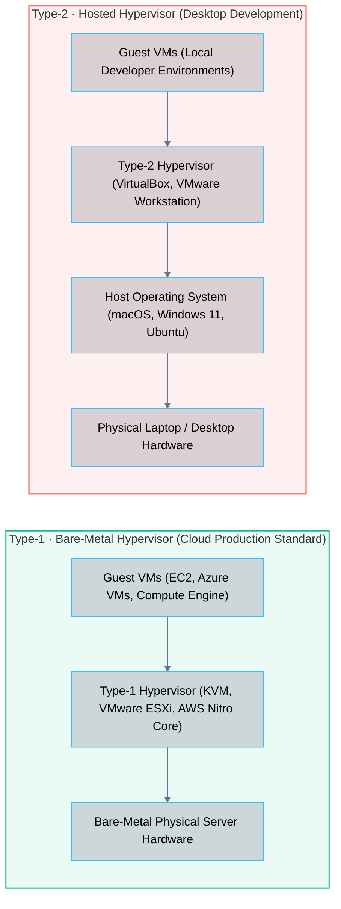
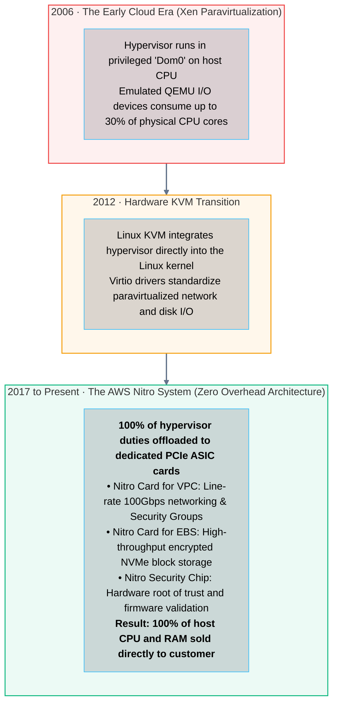

# 03 · Virtualization and Hypervisors – Type-1 vs. Type-2

> **Status**: Comprehensive Reference  
> **Parent**: [[Overview|Overview]] | [[00-Foundations/06-compute-fundamentals/README|Compute Index]]  
> **Topics**: Popek-Goldberg Theorem, Hardware-Assisted Virtualization (Intel VT-x / AMD-V), Second-Level Address Translation (SLAT / EPT), Type-1 vs. Type-2 Hypervisors, Memory Overcommitment, The AWS Nitro Architecture

---

## 1. The Engineering Challenge of Virtualization

Virtualization is the foundational technology that made modern cloud computing possible. It allows multiple independent guest operating systems to execute concurrently on a single physical host while maintaining strict memory and fault isolation.

Historically, the x86 architecture could not be virtualized efficiently because certain sensitive CPU instructions failed silently in User Space without trapping to the hypervisor (violating the **Popek-Goldberg Virtualization Requirements**).

This was resolved by CPU vendors introducing **Hardware-Assisted Virtualization (Intel VT-x in 2005, AMD-V in 2006)**, which introduced two distinct hardware execution modes:
1. **VMX Root Operation**: Fully privileged mode where the hypervisor (Virtual Machine Monitor - VMM) executes with total hardware authority.
2. **VMX Non-Root Operation**: Restricted mode where the guest OS kernel and applications execute. Sensitive operations trigger a hardware trap (**VM-Exit**) back to the hypervisor.

```mermaid
flowchart TD
    subgraph HypervisorMode["VMX Root Operation (Hypervisor Authority)"]
        direction TB
        VMM["<b>Hypervisor / Virtual Machine Monitor (VMM)</b><br/>• Intercepts hardware traps (VM-Exits)<br/>• Coordinates physical resource sharing<br/>• Configures Virtual Machine Control Structures (VMCS)"]
    end

    subgraph GuestMode["VMX Non-Root Operation (Guest Execution Domain)"]
        direction LR

        subgraph VM1["Guest Virtual Machine 1"]
            direction TB
            GuestKernel1["Guest OS Kernel (Ring 0 Non-Root)"]
            GuestApp1["Guest Application (Ring 3 Non-Root)"]
            GuestApp1 --> GuestKernel1
        end

        subgraph VM2["Guest Virtual Machine 2"]
            direction TB
            GuestKernel2["Guest OS Kernel (Ring 0 Non-Root)"]
            GuestApp2["Guest Application (Ring 3 Non-Root)"]
            GuestApp2 --> GuestKernel2
        end
    end

    HypervisorMode ==>|VMLAUNCH / VMRESUME (VM-Entry)| GuestMode
    GuestMode ==>|Hardware Trap on Sensitive Instruction (VM-Exit)| HypervisorMode

    style HypervisorMode fill:#0284c7,stroke:#0284c7,stroke-width:1.5px,fill-opacity:0.08
    style GuestMode fill:#8b5cf6,stroke:#8b5cf6,stroke-width:1.5px,fill-opacity:0.08
    style VM1 fill:#10b981,stroke:#10b981,stroke-width:1px,fill-opacity:0.08
    style VM2 fill:#f59e0b,stroke:#f59e0b,stroke-width:1px,fill-opacity:0.08

    classDef nodeStyle fill:#0f172a,stroke:#38bdf8,stroke-width:1px,fill-opacity:0.15,color:inherit;
    class VMM,GuestKernel1,GuestApp1,GuestKernel2,GuestApp2 nodeStyle;
    linkStyle default stroke:#64748b,stroke-width:2px;
```

---

## 2. Type-1 (Bare-Metal) vs. Type-2 (Hosted) Hypervisors

Hypervisors fall into two distinct architectural categories:



### Technical Comparison

| Architectural Dimension | Type-1 Bare-Metal Hypervisor | Type-2 Hosted Hypervisor |
| :--- | :--- | :--- |
| **Execution Surface** | Executes directly on physical server bare metal | Executes as an application inside a host OS |
| **I/O Latency** | Direct device access via passthrough / SR-IOV | High latency; double context switches through host OS |
| **Resource Efficiency** | Extremely lightweight footprint (< 1% CPU overhead) | Substantial resource overhead of host OS |
| **Security Surface Area** | Minimal microkernel attack surface | Vulnerable to host OS vulnerabilities |
| **Hyperscale Cloud Usage**| **100% of Cloud Hyperscalers** (AWS, Azure, GCP) | Local software testing only |
| **Representative Platforms**| Linux KVM, VMware ESXi, Microsoft Hyper-V | Oracle VirtualBox, VMware Fusion |

---

## 3. Memory Virtualization: Extended Page Tables (EPT)

A guest operating system believes it owns a contiguous block of physical RAM starting at address `0x0`. In reality, the hypervisor maps these guest addresses to scattered chunks of physical server RAM.

Memory translation occurs across two distinct translation planes via **Second-Level Address Translation (SLAT / Intel EPT)**:

```mermaid
flowchart LR
    direction LR
    GVA["Guest Virtual Address (GVA)<br/>Used by guest application"]
    GPA["Guest Physical Address (GPA)<br/>Managed by guest OS page tables"]
    HPA["Host Physical Address (HPA)<br/>Actual physical RAM chips managed by EPT"]

    GVA ==>|Guest Page Tables (CR3)| GPA
    GPA ==>|Intel EPT / AMD NPT (Hardware SLAT)| HPA

    style GVA fill:#0284c7,stroke:#0284c7,stroke-width:1.5px,fill-opacity:0.08
    style GPA fill:#8b5cf6,stroke:#8b5cf6,stroke-width:1.5px,fill-opacity:0.08
    style HPA fill:#10b981,stroke:#10b981,stroke-width:1.5px,fill-opacity:0.08

    classDef nodeStyle fill:#0f172a,stroke:#38bdf8,stroke-width:1px,fill-opacity:0.15,color:inherit;
    class GVA,GPA,HPA nodeStyle;
    linkStyle default stroke:#64748b,stroke-width:2px;
```

---

## 4. Hypervisor Memory Optimization Techniques

1. **Memory Ballooning (`virtio-balloon`)**:
   - The hypervisor installs a cooperative balloon driver inside the guest OS.
   - When the host requires RAM for another VM, it instructs the balloon driver to inflate, requesting memory pages from the guest kernel and releasing the underlying physical frames back to the hypervisor.
2. **Transparent Huge Pages (THP)**:
   - Replaces traditional 4 KB memory pages with **2 MB or 1 GB Huge Pages**, drastically reducing TLB cache misses and accelerating database workloads.
3. **Kernel Samepage Merging (KSM)**:
   - Scans physical memory for identical pages across different virtual machines (e.g., identical copies of the Linux kernel binary) and collapses them into a single read-only physical page using **Copy-on-Write (CoW)**.

---

## 5. The Cloud Hypervisor Evolution: Xen to KVM to AWS Nitro



---

## 6. Key Takeaways

| Virtualization Dimension | Core Architectural Principle |
| :--- | :--- |
| **Hardware Enforced Isolation**| Intel VT-x / AMD-V enforces boundary separation via VMX Root (hypervisor) and VMX Non-Root (guest) execution modes. |
| **Type-1 Dominance** | Type-1 bare-metal hypervisors (KVM, ESXi) provide line-rate throughput and minimal attack surface required for multi-tenant clouds. |
| **SLAT Memory Translation** | Extended Page Tables (EPT) translate Guest Physical Addresses (GPA) to Host Physical Addresses (HPA) in silicon hardware. |
| **Hardware Offload Shift** | Modern cloud hypervisors (AWS Nitro, Azure FPGA) offload storage, networking, and telemetry entirely to dedicated PCIe hardware cards. |

---

## 7. Knowledge Check

1. What was the architectural limitation of early x86 processors that prevented Popek-Goldberg compliant virtualization?
2. What is the difference between VMX Root Operation and VMX Non-Root Operation in Intel VT-x?
3. What is a "VM-Exit" event, and why does frequent VM-Exiting degrade hypervisor performance?
4. Contrast a Type-1 bare-metal hypervisor with a Type-2 hosted hypervisor.
5. Why are Type-2 hypervisors never used in production hyperscale cloud infrastructure?
6. Explain how Extended Page Tables (EPT) perform Second-Level Address Translation (SLAT).
7. How does memory ballooning allow a hypervisor to reclaim unused RAM from a running virtual machine without crashing it?
8. What is Kernel Samepage Merging (KSM), and what security risk (e.g., side-channel attacks) does it introduce in multi-tenant environments?
9. What architectural role did Dom0 play in early Xen hypervisors, and why did it consume significant host CPU resources?
10. How does the AWS Nitro System achieve a "zero virtualization tax" by moving hypervisor components to dedicated PCIe ASIC hardware?

---

## 8. Next Chapter

Continue your compute fundamentals learning journey:

> ➡️ **Next Module**: [[04_Containerization_and_Linux_Primitives|04 · Containerization and Linux Primitives – Namespaces, cgroups, and OverlayFS]]  
> *Exploring the mechanics of containers without hypervisors: Linux namespaces (PID, NET, MNT), Control Groups (cgroups v1/v2), layered filesystems (OverlayFS), and the OCI container runtime architecture.*

---

### Authoritative References

- [Popek and Goldberg: Formal Requirements for Virtualizable Third Generation Architectures (1974)](https://dl.acm.org/doi/10.1145/361011.361073)
- [Intel 64 and IA-32 Architectures Software Developer Manual – Volume 3C: System Programming Guide Part 3 (Virtual Machine Extensions)](https://www.intel.com/content/www/us/en/developer/articles/technical/intel-sdm.html)
- [The AWS Nitro System: Next-Generation EC2 Architecture](https://aws.amazon.com/ec2/nitro/)
