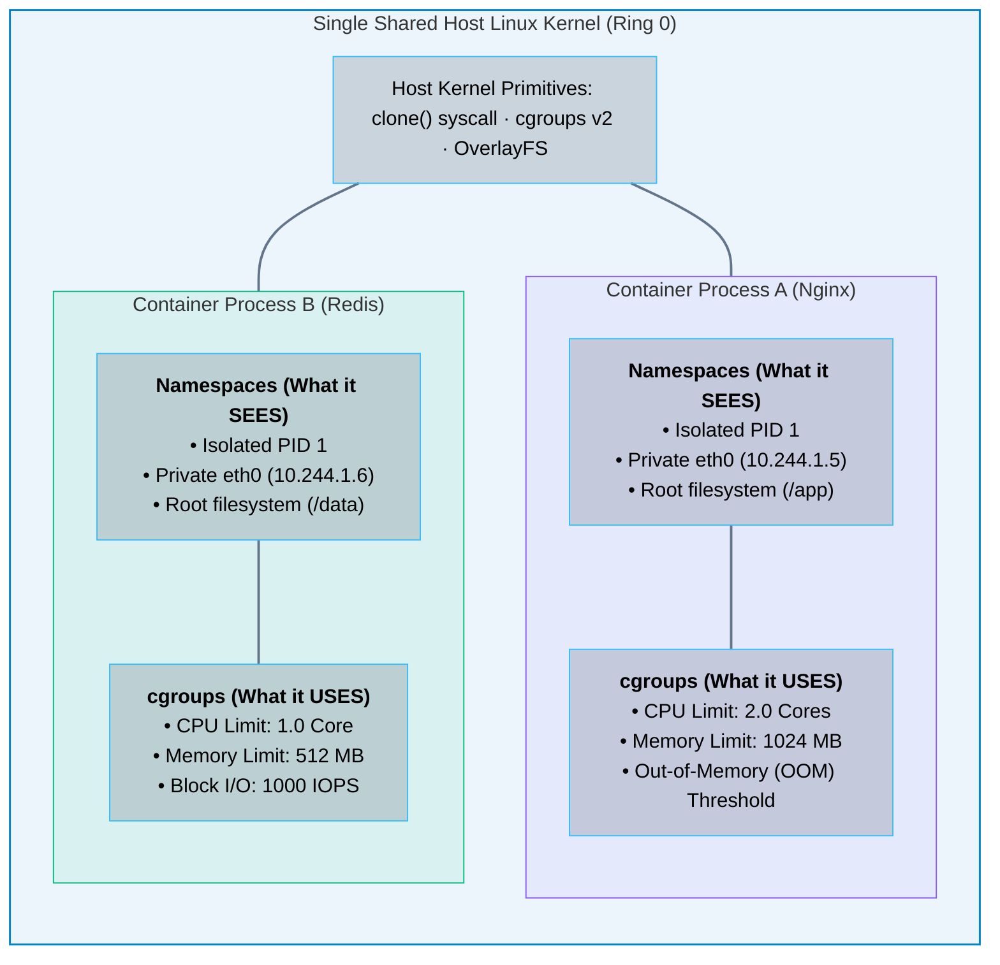

# 04 · Containerization and Linux Primitives – Namespaces, cgroups, and OverlayFS

> **Status**: Comprehensive Reference  
> **Parent**: [[Overview|Overview]] | [[00-Foundations/06-compute-fundamentals/README|Compute Index]]  
> **Topics**: The "No Container" Reality, Linux Namespaces (PID, NET, MNT, IPC, UTS, USER), Control Groups (cgroups v1/v2), OverlayFS Union Mounts, OCI Specifications, containerd & runc

---

## 1. The Core Reality: Containers Are Just Linux Processes

A fundamental misconception in cloud computing is that a container is a "lightweight virtual machine." In reality:

> [!IMPORTANT] The Golden Rule of Container Engineering
> **There is no such thing as a "container" object in the Linux kernel.**  
> A container is simply a standard Linux process running directly on the host kernel, bounded by two native Linux kernel features:
> 1. **Linux Namespaces**: Determines what the process can **SEE**.
> 2. **Control Groups (cgroups)**: Determines how much the process can **USE**.



---

## 2. Linux Namespaces: Isolating What a Process Can See

When a container runtime initiates a process, it calls the `clone()` system call with specific namespace bitmasks (`CLONE_NEWPID`, `CLONE_NEWNET`, etc.), partitioning system resources:

| Namespace | System Call Flag | Isolated Resource | Architectural Impact |
| :--- | :--- | :--- | :--- |
| **PID** | `CLONE_NEWPID` | Process IDs | The container process believes it is `PID 1` (init). Cannot see or kill host processes. |
| **NET** | `CLONE_NEWNET` | Network Stack | Provides a private virtual network interface (`veth`), routing table, and firewall ports. |
| **MNT** | `CLONE_NEWNS` | Filesystem Mounts | Isolates directory mount points; container cannot view host root mounts. |
| **IPC** | `CLONE_NEWIPC` | Inter-Process Comm | Isolates System V IPC and POSIX message queues and shared memory segments. |
| **UTS** | `CLONE_NEWUTS` | Hostname & Domain | Allows each container to possess its own distinct hostname (e.g., pod name). |
| **USER** | `CLONE_NEWUSER` | User and Group IDs | Maps `root` (UID 0) inside container to a non-privileged UID on the host (e.g., UID 10001). |
| **CGROUP** | `CLONE_NEWCGROUP`| cgroup Hierarchy | Hides the host cgroup root directory from container inspection. |

---

## 3. Control Groups (cgroups): Limiting What a Process Can Use

While namespaces hide resources, **Control Groups (cgroups)** enforce strict quotas on physical resource consumption.

### 1. CPU Throttling via the CFS Bandwidth Controller
In Kubernetes, when an engineer sets `resources.limits.cpu: "500m"`, the container runtime writes to the Linux kernel cgroup files:
- `cpu.cfs_period_us`: The evaluation time window (default: $100,000 \mu\text{s}$ or $100\text{ ms}$).
- `cpu.cfs_quota_us`: The total allowed runtime within that window (e.g., $50,000 \mu\text{s}$ for 0.5 CPU).
- If the container consumes its allocated $50\text{ ms}$ before the period ends, the kernel **throttles the process**, refusing to schedule it until the next period.

### 2. Memory Enforcement & The Out-Of-Memory (OOM) Killer
- The kernel tracks memory usage in `memory.current`.
- If memory exceeds `memory.max`, the kernel attempts page reclamation.
- If memory remains exhausted, the kernel invokes the **OOM Killer**, calculating an `oom_score` based on badness and `oom_score_adj`. The process with the highest score receives a **`SIGKILL` (Signal 9)** (Exit Code 137).

---

## 4. Layered Union Filesystems: OverlayFS

Containers launch in hundreds of milliseconds because they do not copy gigabytes of disk files. They utilize **OverlayFS**, a union mount filesystem that stacks read-only layers under a single thin writable layer:

```mermaid
flowchart TD
    subgraph MergedPresentation["Unified Container View (MergedDir)"]
        direction TB
        M_VIEW["Merged Filesystem View presented to running container process (/app, /etc, /bin)"]
    end

    subgraph OverlayStack["OverlayFS Stacking Architecture"]
        direction TB
        UPPER["<b>UpperDir (Thin Writable Layer)</b><br/>Captures new files and modifications during container runtime"]
        WORK["<b>WorkDir</b><br/>Kernel scratch space for preparing atomic file updates"]
        L3["<b>LowerDir 3 (Read-Only)</b>: Application Code (e.g., Node.js App Source)"]
        L2["<b>LowerDir 2 (Read-Only)</b>: Node.js Runtime Dependencies"]
        L1["<b>LowerDir 1 (Read-Only)</b>: Base OS Rootfs (Ubuntu / Alpine)"]

        UPPER --- WORK
        WORK --- L3 --- L2 --- L1
    end

    MergedPresentation <== OverlayFS Kernel Driver ==> OverlayStack

    style MergedPresentation fill:#0284c7,stroke:#0284c7,stroke-width:1.5px,fill-opacity:0.08
    style OverlayStack fill:#8b5cf6,stroke:#8b5cf6,stroke-width:1.5px,fill-opacity:0.08
    style UPPER fill:#10b981,stroke:#10b981,stroke-width:1px,fill-opacity:0.08
    style L3 fill:#1e293b,stroke:#0284c7,stroke-width:1px,fill-opacity:0.08
    style L2 fill:#1e293b,stroke:#0284c7,stroke-width:1px,fill-opacity:0.08
    style L1 fill:#1e293b,stroke:#0284c7,stroke-width:1px,fill-opacity:0.08

    classDef nodeStyle fill:#0f172a,stroke:#38bdf8,stroke-width:1px,fill-opacity:0.15,color:inherit;
    class M_VIEW,UPPER,WORK,L3,L2,L1 nodeStyle;
    linkStyle default stroke:#64748b,stroke-width:2px;
```



### Copy-on-Write (CoW) Mechanics
- When a container reads a file, the kernel fetches it directly from the lowest read-only layer where it exists.
- When a container modifies an existing read-only file, the kernel **copies the file upward into UpperDir** before writing modifications. The underlying base image remains 100% immutable and shared among all containers.

---

## 5. The Container Runtime Architecture: OCI, containerd, and runc

The container ecosystem is governed by standards established by the **Open Container Initiative (OCI)**:
1. **OCI Image Specification**: Formats container images as tar archives containing rootfs and JSON manifests.
2. **OCI Runtime Specification**: Defines how to unpack and execute an OCI image.

```mermaid
flowchart TD
    subgraph HighLevelRuntime["High-Level Container Runtime"]
        direction TB
        K8s["Kubernetes Kubelet / Docker CLI"] -->|Container Runtime Interface (gRPC)| CRI["containerd / CRI-O"]
        CRI["<b>containerd / CRI-O</b><br/>• Pulls images from registry (Docker Hub / ECR)<br/>• Unpacks image layers into OverlayFS directories<br/>• Manages network interfaces (CNI plugins)"]
    end

    subgraph LowLevelRuntime["Low-Level OCI Runtime"]
        direction TB
        RUNC["<b>runc</b><br/>• Lightweight CLI tool written in Go<br/>• Executes clone() with namespace bitmasks<br/>• Writes cgroup resource files<br/>• Pivots root (pivot_root) into MergedDir<br/>• Spawns the container process and terminates"]
    end

    CRI ==>|Executes| RUNC ==>|Launches| Process["Isolated Container Process (Nginx)"]

    style HighLevelRuntime fill:#0284c7,stroke:#0284c7,stroke-width:1.5px,fill-opacity:0.08
    style LowLevelRuntime fill:#8b5cf6,stroke:#8b5cf6,stroke-width:1.5px,fill-opacity:0.08

    classDef nodeStyle fill:#0f172a,stroke:#38bdf8,stroke-width:1px,fill-opacity:0.15,color:inherit;
    class K8s,CRI,RUNC,Process nodeStyle;
    linkStyle default stroke:#64748b,stroke-width:2px;
```

---

## 6. Key Takeaways

| Container Dimension | Core Engineering Principle |
| :--- | :--- |
| **Process Nature** | Containers are not virtual machines; they are standard host processes bounded by kernel namespaces and cgroups. |
| **Namespaces = Visibility** | Namespaces (PID, NET, MNT, IPC, UTS, USER) partition system visibility so processes cannot inspect host assets. |
| **cgroups = Quotas** | Control groups prevent noisy neighbors from exhausting CPU, memory, and disk I/O, triggering CFS throttling or OOM kills. |
| **OverlayFS Immutability** | Image layers are read-only and shared across containers; only modifications are written to a thin, ephemeral UpperDir. |

---

## 7. Knowledge Check

1. Why is the statement "a container is a lightweight virtual machine" architecturally inaccurate?
2. Which Linux system call creates a new process with isolated namespace boundaries?
3. Name six core Linux namespaces and explain what system resource each isolates.
4. How does the PID namespace allow every container to believe its primary process is `PID 1`?
5. What is the difference between Linux Namespaces and Linux Control Groups (cgroups)?
6. How does the Linux CFS Bandwidth Controller enforce a CPU limit of `0.5 cores` in Kubernetes?
7. What Linux kernel mechanism terminates a container when it exceeds its configured memory limit, and what exit code does it return?
8. Explain the four directory components (`LowerDir`, `UpperDir`, `MergedDir`, `WorkDir`) in an OverlayFS union mount.
9. How does Copy-on-Write (CoW) ensure that base container images remain immutable when a container modifies a file?
10. What is the operational distinction between a high-level container runtime (`containerd`) and a low-level OCI runtime (`runc`)?

---

## 8. Next Chapter

Continue your compute fundamentals learning journey:

> ➡️ **Next Module**: [[05_Serverless_Compute_and_MicroVMs|05 · Serverless Compute and MicroVMs – Firecracker, gVisor, and Wasm]]  
> *Exploring the security isolation gap between containers and VMs, microVM architecture, Firecracker sub-5ms boot mechanics, gVisor syscall sandboxing, and WebAssembly.*

---

### Authoritative References

- [Linux Manual Page: namespaces(7) – Overview of Linux Namespaces](https://man7.org/linux/man-pages/man7/namespaces.7.html)
- [Linux Kernel Documentation: Control Group v2](https://docs.kernel.org/admin-guide/cgroup-v2.html)
- [Linux Kernel Documentation: Overlay Filesystem](https://docs.kernel.org/filesystems/overlayfs.html)
- [Open Container Initiative (OCI) Runtime Specification](https://github.com/opencontainers/runtime-spec)
