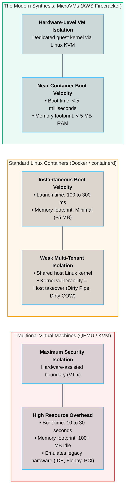
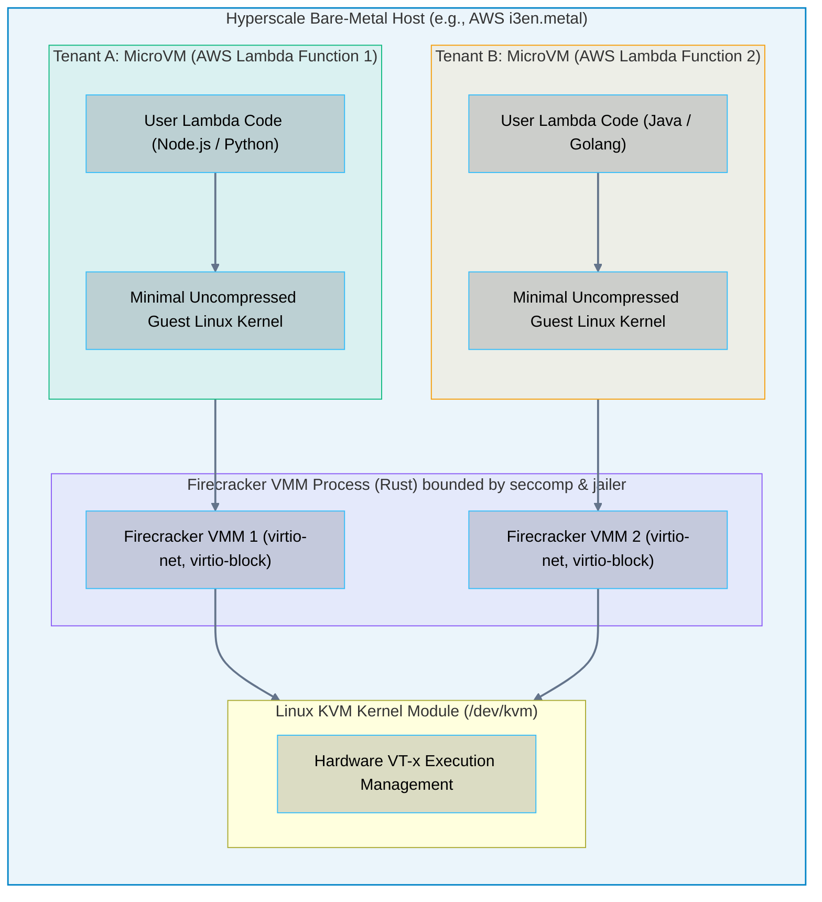

# 05 · Serverless Compute and MicroVMs – Firecracker, gVisor, and Wasm

> **Status**: Comprehensive Reference  
> **Parent**: [[Overview|Overview]] | [[00-Foundations/06-compute-fundamentals/README|Compute Index]]  
> **Topics**: Container Security Dilemma, MicroVM Architecture, AWS Firecracker, Google gVisor, WebAssembly (Wasm), Serverless Cold Start Lifecycle, SnapStart Snapshotting

---

## 1. The Multi-Tenant Security Dilemma

When designing multi-tenant serverless execution platforms (such as **AWS Lambda**, **Google Cloud Functions**, or **Azure Functions**), engineers faced a fundamental trade-off between **Isolation Security** and **Startup Velocity**:

---

## 2. AWS Firecracker: Architecture of a MicroVM

**AWS Firecracker** is an open-source Virtual Machine Monitor (VMM) written in **Rust**, purpose-built by Amazon Web Services to power AWS Lambda and AWS Fargate.

### How Firecracker Achieves Sub-5ms Boot Times
Traditional hypervisors (like QEMU) emulate dozens of legacy physical PC devices (floppy disk drives, PS/2 mice, IDE controllers, complex ACPI power states). Firecracker **stripped out all non-essential hardware emulation**:
- **Only 4 Virtual Devices**: Network interface (`virtio-net`), Block storage (`virtio-block`), Serial console (`virtio-console`), and a minimal timer / entropy source (`virtio-balloon` / `virtio-vsock`).
- **Rust Memory Safety**: Written in Rust, eliminating buffer overflows, use-after-free, and thread race conditions in the hypervisor code itself.
- **Jailer Process**: Enforces a four-layer sandbox around each microVM: Linux cgroups, chroot jail, unprivileged UID/GID, and strict **seccomp-bpf** filtering.

---

## 3. Alternative Sandboxing Paradigms: gVisor & WebAssembly

### 1. Google gVisor (Application Kernel Virtualization)
- **Concept**: Instead of running a full guest OS kernel, **gVisor** implements an application kernel written in Go (called **Sentry**) running in User Space.
- **Mechanics**: When the container process executes a system call (e.g., `open()` or `socket()`), gVisor intercepts it using `ptrace` or KVM, parses the request, and emulates the Linux kernel ABI without ever passing untrusted raw syscalls to the host Linux kernel.
- **Production Usage**: Powers **Google Cloud Run** and **Google Kubernetes Engine (GKE) Sandbox**.

### 2. WebAssembly (Wasm / WASI)
- **Concept**: Compiles C, Rust, or Go source code into compact, platform-independent binary bytecode.
- **Execution**: Runs inside a lightweight Wasm runtime (e.g., **Wasmtime**, **Wasmer**, or **Cloudflare Workers V8 Isolates**).
- **Performance**: Instantaneous cold start in **under 100 microseconds** ($0.1\text{ ms}$) with near-zero memory footprint, making it ideal for distributed edge serverless runtimes.

---

## 4. The Serverless Cold Start Lifecycle

When a serverless function receives an invocation request after idling, it must execute a multi-phase initialization pipeline known as a **Cold Start**:

```mermaid
sequenceDiagram
    autonumber
    participant Invoker as API Gateway / Event Trigger
    participant CloudControl as Serverless Worker Manager
    participant MicroVM as Firecracker MicroVM
    participant AppRuntime as Function Runtime (Node/JVM/Python)
    participant Handler as Application Code Handler

    Invoker->>CloudControl: Invocations arrive (Zero warm instances available)
    
    rect rgb(30, 41, 59)
        Note over CloudControl,MicroVM: Phase 1: Infrastructure Provisioning (~10 - 50ms)
        CloudControl->>MicroVM: Launches Firecracker MicroVM process
        CloudControl->>MicroVM: Attaches VPC ENI & uncompresses code archive
    end

    rect rgb(15, 23, 42)
        Note over MicroVM,AppRuntime: Phase 2: Runtime Initialization (~100 - 800ms)
        MicroVM->>AppRuntime: Boots guest kernel & launches Node.js / JVM engine
        AppRuntime->>Handler: Executes static top-level code (Database pools, SDKs)
    end

    rect rgb(2, 44, 34)
        Note over Handler,Invoker: Phase 3: Function Execution (~5 - 50ms)
        AppRuntime->>Handler: Invokes handler(event, context)
        Handler-->>Invoker: Returns HTTP 200 JSON Response
    end

    Note over CloudControl,MicroVM: Instance remains "Warm" for subsequent invocations (~5 to 15 minutes)
```

### Mitigating Cold Starts: SnapStart Snapshotting
In runtimes with heavy classloading initialization (such as Java or .NET, where runtime startup can take 5+ seconds), cloud providers deploy **Snapshot Restoration (AWS Lambda SnapStart)**:
1. The function is initialized completely during deployment time (running all static constructors and database pools).
2. The hypervisor takes a memory and disk snapshot of the running Firecracker microVM.
3. Upon a cold start, rather than executing initialization from scratch, the system restores the microVM state directly from the cached snapshot memory image in under **200 milliseconds** using Linux `userfaultfd` demand-paging.

---

## 5. Master Comparison: Compute Sandboxing Technologies

| Architectural Dimension | Traditional VM | Docker Container | AWS Firecracker MicroVM | Google gVisor Sandbox | Cloudflare Workers / Wasm |
| :--- | :--- | :--- | :--- | :--- | :--- |
| **Isolation Boundary** | Hardware (VT-x / EPT) | Kernel cgroups/namespaces | Hardware (KVM / VT-x) | User-space Kernel (Sentry)| V8 Engine Isolates / Memory |
| **Startup Latency** | 10 – 30 seconds | 100 – 500 ms | **< 5 milliseconds** | ~50 – 100 ms | **< 1 millisecond** |
| **Memory Footprint** | ~100 MB – 1 GB | ~5 – 20 MB | **< 5 MB** | ~15 – 30 MB | **< 1 MB** |
| **Syscall Attack Surface**| Nil (Hardware trap) | Full Host Kernel (~400 syscalls) | Minimal Guest Kernel | Virtualized in Go (~300)| Zero Host Syscalls |
| **Density (per server)**| Dozens | Hundreds | **Thousands** | Thousands | **Tens of Thousands** |
| **Primary Cloud Service**| AWS EC2, Azure VMs | ECS, EKS, GKE | AWS Lambda, AWS Fargate | Cloud Run, App Engine | Cloudflare Workers, Fastly |

---

## 6. Key Takeaways

| Sandboxing Concept | Core Engineering Principle |
| :--- | :--- |
| **The Container Isolation Risk**| Standard containers share the host Linux kernel; a single kernel zero-day vulnerability allows full multi-tenant breakout. |
| **MicroVM Breakthrough** | Stripping legacy hardware emulation enables Firecracker to launch hardware-isolated virtual machines in under 5 milliseconds. |
| **Cold Start Breakdown** | Cold starts consist of infrastructure provisioning, language runtime startup, and static code execution before the handler runs. |
| **Snapshot Acceleration** | Technologies like AWS SnapStart bypass initialization entirely by restoring microVMs from pre-compiled memory snapshots. |

---

## 7. Knowledge Check

1. Why are standard Docker containers considered insufficient for multi-tenant serverless platforms where untrusted code runs?
2. What hardware virtualization feature allows AWS Firecracker to execute guest code securely?
3. How does Firecracker achieve a boot time under 5 milliseconds while traditional QEMU virtual machines take 20 seconds?
4. In what programming language is Firecracker implemented, and what security benefits does that language provide?
5. How does Google gVisor isolate container processes from the underlying host Linux kernel?
6. What is WebAssembly (Wasm), and how does its startup latency compare to microVMs?
7. Explain the three distinct phases of an AWS Lambda serverless cold start.
8. What is the difference between static code execution (outside the handler) and dynamic execution (inside the handler)?
9. How does AWS Lambda SnapStart eliminate JVM runtime initialization latency?
10. What role does the Linux `userfaultfd` mechanism play in memory snapshot restoration?

---

## 8. Next Chapter

Continue your compute fundamentals learning journey:

> ➡️ **Next Module**: [[06_Scaling_and_Performance_Tuning|06 · Scaling and Performance Tuning – Amdahl's Law and Concurrency]]  
> *Exploring horizontal vs. vertical scaling, Amdahl's Law, Universal Scalability Law (USL), concurrency vs. parallelism, CPU throttling, and thread pool sizing.*

---

### Authoritative References

- [AWS Firecracker: Secure and Fast MicroVMs for Serverless Computing](https://firecracker-microvm.github.io/)
- [Agache et al.: Firecracker – Lightweight Virtualization for Serverless Applications (USENIX NSDI '20)](https://www.usenix.org/conference/nsdi20/presentation/agache)
- [Google Open Source: gVisor Architecture Documentation](https://gvisor.dev/docs/architecture_guide/)
- [Bytecode Alliance: WebAssembly System Interface (WASI)](https://bytecodealliance.org/)
