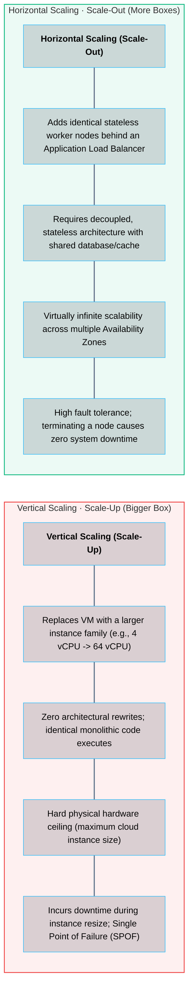
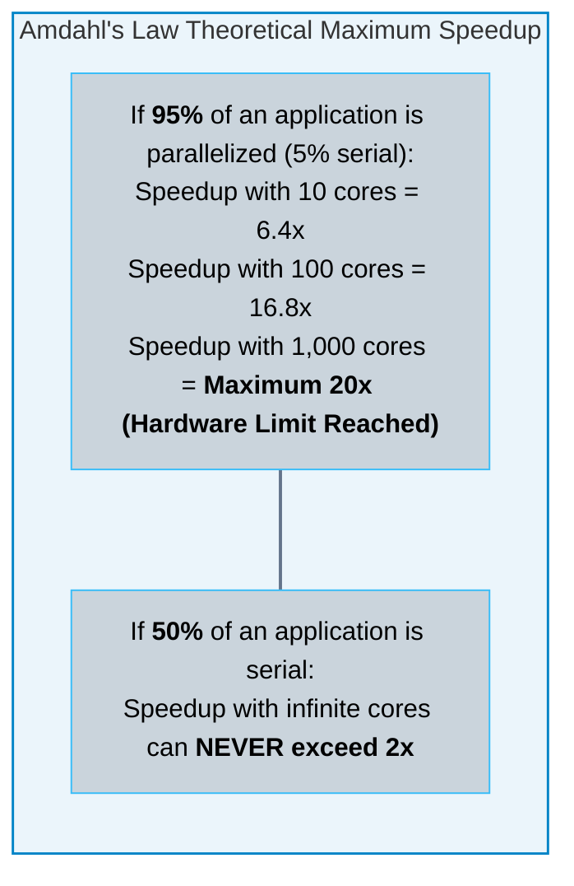
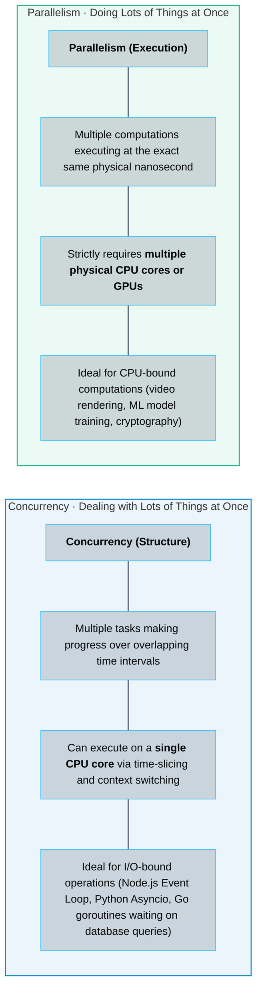

# 06 · Scaling and Performance Tuning – Amdahl's Law and Concurrency

> **Status**: Comprehensive Reference  
> **Parent**: [[Overview|Overview]] | [[00-Foundations/06-compute-fundamentals/README|Compute Index]]  
> **Topics**: Vertical vs. Horizontal Scaling, Amdahl's Law, Universal Scalability Law (USL), Concurrency vs. Parallelism, Thread Pool Sizing, CPU Throttling Diagnostics

---

## 1. Vertical Scaling (Scale-Up) vs. Horizontal Scaling (Scale-Out)

When application demand increases, infrastructure architects have two fundamental methods to expand computational capacity:

---

## 2. Theoretical Limits of Scalability

### 1. Amdahl's Law (Diminishing Returns of Parallelism)
Formulated by computer architect Gene Amdahl, **Amdahl's Law** dictates that the maximum theoretical speedup of an application when adding more CPU cores is strictly constrained by the portion of the program that **cannot be parallelized** (the serial fraction):

$$\text{Speedup}(N) = \frac{1}{(1 - P) + \frac{P}{N}}$$

Where:
- $P$ is the parallel fraction of the program ($0 \le P \le 1$).
- $(1 - P)$ is the strictly serial fraction (e.g., acquiring database locks, sequential file writes).
- $N$ is the number of processing cores or nodes.

### 2. The Universal Scalability Law (USL): Negative Scaling
Amdahl's Law assumes that adding nodes never hurts performance. In real-world distributed systems, adding nodes introduces **inter-node network coordination and cache coherency penalties**.

Neil Gunther's **Universal Scalability Law (USL)** accounts for these real-world penalties:

$$C(N) = \frac{N}{1 + \alpha(N - 1) + \beta N(N - 1)}$$

Where:
- $\alpha$ is the **Contention penalty** (waiting for shared database locks or queue access).
- $\beta$ is the **Coherency penalty** (crosstalk communication overhead to keep nodes in sync).

> [!WARNING] The Retrograde Scaling Trap
> When the coherency parameter $\beta > 0$, adding more nodes eventually causes throughput to **decline** (retrograde scaling). For example, adding node 101 creates so much distributed consensus chatter (raft, gossip, distributed locking) that the system processes fewer total transactions than it did with 50 nodes.

---

## 3. Concurrency vs. Parallelism

A common point of confusion in software and cloud architecture:

---

## 4. Compute Performance Tuning & Thread Pool Sizing

### The Optimal Thread Pool Formula
Configuring too few threads under-utilizes hardware; configuring too many threads destroys CPU throughput via context switching. 

The optimal thread pool size for a backend microservice is calculated using **Goetz's Formula**:

$$N_{\text{threads}} = N_{\text{CPU}} \times U_{\text{CPU}} \times \left(1 + \frac{W}{C}\right)$$

Where:
- $N_{\text{CPU}}$ is the number of available CPU cores.
- $U_{\text{CPU}}$ is the target CPU utilization ($0 \le U_{\text{CPU}} \le 1$).
- $W$ is the average **Wait time** (waiting for database responses, external APIs, disk I/O).
- $C$ is the average **Compute time** (CPU execution doing JSON parsing, serialization, calculations).

#### Practical Calculation:
If an API server runs on a 4-core VM ($N_{\text{CPU}} = 4$), targets 80% CPU ($U_{\text{CPU}} = 0.8$), spends 90ms waiting on database SQL queries ($W = 90$), and spends 10ms processing compute logic ($C = 10$):
$$N_{\text{threads}} = 4 \times 0.8 \times \left(1 + \frac{90}{10}\right) = 3.2 \times (1 + 9) = 32 \text{ threads}$$

---

## 5. Diagnosing Compute Bottlenecks: System Load & CPU Throttling

### Understanding Linux Load Average
When running `uptime` or `top`, Linux outputs three numbers representing the average load over **1, 5, and 15 minutes**:
- Load average measures the number of threads currently **running on a core** plus threads **waiting in the run-queue** or **blocked in uninterruptible disk sleep (D-state)**.
- **Rule of Thumb**: On an 8-core server:
  - Load average = `4.0`: Server is at 50% capacity; 4 cores are idling.
  - Load average = `8.0`: Server is at 100% saturation; perfect utilization.
  - Load average = `24.0`: Severe bottleneck; for every thread executing, two threads are stalled waiting for CPU time.

---

## 6. Key Takeaways

| Scaling Dimension | Core Engineering Principle |
| :--- | :--- |
| **Amdahl's Ceiling** | The non-parallelizable serial fraction of an application establishes a hard mathematical limit on multi-core speedup. |
| **USL Retrograde Trap**| Beyond a certain cluster size, inter-node coordination and coherency gossip will cause total throughput to drop. |
| **Concurrency != Parallelism**| Concurrency is about structure (handling multiple tasks); parallelism is about execution (simultaneous multi-core execution). |
| **Thread Sizing Math** | I/O-bound microservices require higher thread pools proportional to their $\frac{W}{C}$ (Wait-to-Compute) ratio. |

---

## 7. Knowledge Check

1. What is the fundamental difference between vertical scaling (scale-up) and horizontal scaling (scale-out)?
2. Why does horizontal scaling require applications to be designed as stateless services?
3. State Amdahl's Law and explain what the term $(1 - P)$ represents.
4. If an application contains a 10% strictly serial database write phase, what is the maximum theoretical speedup achievable even with 10,000 CPU cores?
5. How does the Universal Scalability Law (USL) differ from Amdahl's Law in real-world distributed clusters?
6. What is the difference between concurrency and parallelism?
7. Can a machine with a single physical CPU core execute concurrent software? Explain how.
8. Using Goetz's thread pool sizing formula, calculate the ideal thread pool count for an 8-core server where $W = 80\text{ ms}$ and $C = 20\text{ ms}$ at 100% target CPU utilization.
9. How should an engineering team interpret a 1-minute Linux load average of `16.0` on a cloud VM configured with 4 vCPUs?
10. What is CFS CPU throttling in Kubernetes, and what metrics indicate that a pod's CPU limit is too restrictive?

---

## 8. Next Chapter & Curriculum Index

Continue your foundational cloud learning journey:

> **Compute Curriculum Index**: Return to [[00-Foundations/06-compute-fundamentals/README|Module 06 Index]]  
> ➡️ **Next Foundational Pillar**: [[00-Foundations/07-storage-fundamentals/README|07 · Storage Fundamentals]]  
> *Exploring the storage triumvirate (Block, File, Object), NVMe SSD internals, RAID vs. Erasure Coding, POSIX filesystems, and distributed cloud object storage architectures.*

---

### Authoritative References

- [Gene Amdahl: Validity of the Single Processor Approach to Achieving Large Scale Computing Capabilities (1967)](https://dl.acm.org/doi/10.1145/1465482.1465560)
- [Neil J. Gunther: Guerrilla Capacity Planning – A Tactical Approach to Practical System Performance](https://www.springer.com/gp/book/9783540261384)
- [Brian Goetz: Java Concurrency in Practice](https://jcip.net/)
- [Brendan Gregg: Systems Performance – Enterprise and the Cloud](https://www.brendangregg.com/systems-performance-2nd-edition-book.html)
