# 01 · Storage Types – Block, File, and Object Storage

> **Status**: Comprehensive Reference  
> **Parent**: [[Overview|Overview]] | [[00-Foundations/07-storage-fundamentals/README|Storage Index]]  
> **Topics**: The Storage Triumvirate, Block Storage (EBS, Managed Disks), File Storage (NFS, SMB, EFS), Object Storage (S3, Blob, GCS), Access Protocols, Latency vs. Scale Spectrum

---

## 1. The Storage Triumvirate: The Three Data Storage Paradigms

Every byte stored in enterprise data centers and public clouds is categorized into one of three architectural storage models: **Block Storage**, **File Storage**, or **Object Storage**.

```mermaid
flowchart LR
    direction TB

    subgraph BLOCK["1. Block Storage · Raw Disk Sectors"]
        direction TB
        B_T["<b>Block Storage</b>"]
        B_D["Data stored as raw, unformatted 512B or 4KB blocks<br/>Accessed via low-level disk protocols (NVMe, iSCSI, FC)<br/>Formatted with a filesystem by a single OS"]
        B_E["AWS EBS · Azure Managed Disks · GCP Persistent Disk"]
        B_P["Sub-millisecond latency · Highest IOPS · Boot volumes & DBs"]
        B_T --- B_D --- B_E --- B_P
    end

    subgraph FILE["2. File Storage · Hierarchical Directory Tree"]
        direction TB
        F_T["<b>File Storage</b>"]
        F_D["Data organized into hierarchical folders, subdirectories, and files<br/>Managed by a centralized server via network protocols (NFS, SMB)<br/>Shared concurrently across multiple client machines"]
        F_E["AWS EFS · Azure Files · NetApp Cloud Volumes"]
        F_P["Low latency (1-5ms) · POSIX compliant · Shared content & legacy apps"]
        F_T --- F_D --- F_E --- F_P
    end

    subgraph OBJECT["3. Object Storage · Flat Key-Value Namespace"]
        direction TB
        O_T["<b>Object Storage</b>"]
        O_D["Data bundled with rich custom metadata into discrete objects<br/>Accessed via HTTP/HTTPS REST APIs (GET, PUT, DELETE)<br/>No hierarchical directories; infinitely scalable flat namespace"]
        O_E["Amazon S3 · Azure Blob Storage · Google Cloud Storage"]
        O_P["Moderate latency (50-100ms) · Petabyte/Exabyte scale · Massive durability"]
        O_T --- O_D --- O_E --- O_P
    end

    style BLOCK fill:#0284c7,stroke:#0284c7,stroke-width:1.5px,fill-opacity:0.08
    style FILE fill:#8b5cf6,stroke:#8b5cf6,stroke-width:1.5px,fill-opacity:0.08
    style OBJECT fill:#10b981,stroke:#10b981,stroke-width:1.5px,fill-opacity:0.08

    classDef nodeStyle fill:#0f172a,stroke:#38bdf8,stroke-width:1px,fill-opacity:0.15,color:inherit;
    class B_T,B_D,B_E,B_P,F_T,F_D,F_E,F_P,O_T,O_D,O_E,O_P nodeStyle;
    linkStyle default stroke:#64748b,stroke-width:2px;
```



---

## 2. Deep Dive: Block Storage

Block storage presents raw, unformatted storage sectors directly to an operating system kernel, exactly like a physical hard drive or SSD plugged into a motherboard.

### Key Characteristics
- **Addressability**: Storage is addressed strictly by **Logical Block Addresses (LBAs)** (e.g., Block 0 to Block 2,097,151).
- **Filesystem Decoupling**: The storage volume itself has zero knowledge of files, directories, or permissions. The guest operating system mounts the block device (e.g., `/dev/xvdf` or `/dev/nvme1n1`) and formats it with its own filesystem (Ext4, XFS, NTFS).
- **Concurrency Limitation**: Typically attached to **a single virtual machine at a time** (Read/Write Single-Attach). *(Note: Multi-Attach exists for specialized clustered filesystems like GFS2 or Oracle RAC, but requires application-level distributed locking).*

```mermaid
flowchart TD
    VM["Virtual Machine (EC2 Instance)"] -->|Formats & Mounts Ext4 Filesystem| OS["OS Kernel /dev/nvme1n1"]
    OS -->|Raw Block Reads/Writes (NVMe over Fabrics / iSCSI)| Volume["Network-Attached Block Volume (Amazon EBS)"]
    Volume --> S1["Block 0x00A1 (4 KB)"]
    Volume --> S2["Block 0x00A2 (4 KB)"]
    Volume --> S3["Block 0x00A3 (4 KB)"]

    style VM fill:#0284c7,stroke:#0284c7,stroke-width:1.5px,fill-opacity:0.08
    style OS fill:#8b5cf6,stroke:#8b5cf6,stroke-width:1.5px,fill-opacity:0.08
    style Volume fill:#10b981,stroke:#10b981,stroke-width:1.5px,fill-opacity:0.08

    classDef nodeStyle fill:#0f172a,stroke:#38bdf8,stroke-width:1px,fill-opacity:0.15,color:inherit;
    class VM,OS,Volume,S1,S2,S3 nodeStyle;
    linkStyle default stroke:#64748b,stroke-width:2px;
```

---

## 3. Deep Dive: File Storage (Network Attached Storage - NAS)

File storage presents a complete, managed hierarchical directory structure (folders, files, paths) accessible concurrently across hundreds of client instances over a local network.

### Key Characteristics
- **Shared Access (ReadWriteMany)**: Hundreds of compute instances can mount the exact same file share simultaneously and perform concurrent read/write operations.
- **POSIX Compliance**: Fully supports standard POSIX filesystem semantics, including file locking (`flock`), user ownership permissions (`chmod`, `chown`), and directory traversing.
- **Protocols**:
  - **NFS (Network File System - NFSv3/NFSv4)**: Standard protocol for Linux / Unix environments.
  - **SMB / CIFS (Server Message Block)**: Standard protocol for Windows Server environments.

```mermaid
flowchart TD
    subgraph Clients["Concurrent Client Compute Instances"]
        direction LR
        VM1["App Worker VM 1"]
        VM2["App Worker VM 2"]
        VM3["App Worker VM 3"]
    end

    subgraph ManagedNAS["Managed Cloud File System (Amazon EFS / Azure Files)"]
        direction TB
        NFS_Svc["NFSv4 / SMB Server Interface<br/>(POSIX File Locks, User Permissions)"]
        Tree["Hierarchical Directory Tree:<br/>/shared_data<br/>├── /media<br/>│   └── banner.png<br/>└── /logs<br/>    └── audit.log"]
        NFS_Svc --- Tree
    end

    Clients ==>|Concurrent NFS Mount: /mnt/shared (Port 2049)| ManagedNAS

    style Clients fill:#0284c7,stroke:#0284c7,stroke-width:1.5px,fill-opacity:0.08
    style ManagedNAS fill:#8b5cf6,stroke:#8b5cf6,stroke-width:1.5px,fill-opacity:0.08

    classDef nodeStyle fill:#0f172a,stroke:#38bdf8,stroke-width:1px,fill-opacity:0.15,color:inherit;
    class VM1,VM2,VM3,NFS_Svc,Tree nodeStyle;
    linkStyle default stroke:#64748b,stroke-width:2px;
```

---

## 4. Deep Dive: Object Storage

Object storage treats data not as blocks or files in a directory tree, but as discrete, autonomous **Objects** residing in a globally unique **Flat Namespace (Bucket)**.

### The Anatomy of an Object
Every object stored in Amazon S3 or Azure Blob Storage contains four elements:
1. **Key (Identifier)**: A unique string identifying the object (e.g., `customers/2026/invoice_4091.pdf`).
2. **Data Payload**: The raw bytes of the file (0 bytes up to 5 Terabytes per object).
3. **System Metadata**: Size, Last-Modified date, MD5/ETag checksum, Storage Class, and Content-Type.
4. **Custom User Metadata**: Arbitrary key-value pairs assigned by the application (e.g., `x-amz-meta-department: finance`, `x-amz-meta-retention: 7years`).

```
┌────────────────────────────────────────────────────────────────────────┐
│                        ANATOMY OF A CLOUD OBJECT                       │
├────────────────────────────────────────────────────────────────────────┤
│ KEY: "production/reports/financial_audit_2026.pdf"                     │
├───────────────────────────────────┬────────────────────────────────────┤
│ SYSTEM METADATA                   │ CUSTOM APPLICATION METADATA        │
│ • Content-Length: 4,194,304 bytes │ • x-amz-meta-author: Alice         │
│ • Content-Type: application/pdf   │ • x-amz-meta-classification: secret│
│ • ETag: 5d41402abc4b2a76b9719d91  │ • x-amz-meta-cost-center: 401      │
│ • Storage-Class: STANDARD         │ • x-amz-meta-retention: 7-years    │
├───────────────────────────────────┴────────────────────────────────────┤
│ DATA PAYLOAD (Raw Binary Stream: 4.0 MB)                               │
└────────────────────────────────────────────────────────────────────────┘
```

> [!NOTE] The Illusion of Folders
> Object storage has no concept of physical directories. The forward slash (`/`) in `images/2026/logo.png` is simply an alphanumeric character within a flat string key. Cloud web consoles parse slashes as virtual delimiters to present a human-friendly folder view.

---

## 5. Master Technical Comparison Matrix

| Architectural Dimension | Block Storage | File Storage (NAS) | Object Storage |
| :--- | :--- | :--- | :--- |
| **Primary Abstraction** | Raw disk blocks (512B / 4KB) | Hierarchical files & folders | Flat key-value objects |
| **Access Protocol** | NVMe, iSCSI, Fibre Channel | NFSv3/NFSv4, SMB/CIFS | HTTP / HTTPS REST APIs |
| **Concurrency** | Single VM attach (RWO) | Hundreds of VMs (RWX) | Millions of web clients |
| **Access Latency** | **Sub-millisecond** (< 1ms) | Low (**1 – 5 ms**) | Moderate (**50 – 100 ms**) |
| **Maximum Storage Scale**| Terabytes (Volume limit ~16TB) | Petabytes (Elastic scaling) | **Virtually Infinite (Exabytes)**|
| **Data Modification** | In-place random byte overwrites| In-place random byte writes | **Immutable** (Atomic whole-file replacement)|
| **POSIX Support** | Full (via OS filesystem) | Full POSIX compliance | **None** (REST API operations) |
| **Cost per Gigabyte** | High ($0.08 - $0.15 / GB-mo) | Medium ($0.15 - $0.30 / GB-mo)| **Lowest ($0.015 - $0.023 / GB-mo)**|
| **Ideal Cloud Use Cases**| VM OS boot disks, databases (PostgreSQL, Oracle, MySQL)| Shared web assets, CMS (WordPress), legacy enterprise apps| Data lakes, backup archives, static media hosting, ML training data |
| **Hyperscale Cloud Services**| AWS EBS, Azure Disks, GCP PD | AWS EFS, Azure Files, Google Filestore | Amazon S3, Azure Blob, Google Cloud Storage (GCS) |

---

## 6. Key Takeaways

| Storage Paradigm | Core Architectural Principle |
| :--- | :--- |
| **Block Storage Speed** | Provides the lowest latency and highest IOPS; required for relational databases and operating system root filesystems. |
| **File Storage Concurrency**| Solves multi-server shared file access using standardized POSIX network protocols (NFS/SMB). |
| **Object Storage Scale** | Eliminates the hierarchical directory scalability ceiling, storing petabytes of immutable data addressable via HTTP APIs. |
| **Cost Hierarchy** | Object storage is an order of magnitude cheaper than block storage; always offload static assets and backups to S3/Blob. |

---

## 7. Knowledge Check

1. What are the three primary cloud storage paradigms, and how do they differ in abstraction?
2. Why is Block Storage required for running high-performance relational databases like PostgreSQL or MySQL?
3. What is the fundamental difference between how an operating system addresses Block Storage versus File Storage?
4. Explain why traditional Block Storage volumes (like Amazon EBS) are typically restricted to single-instance attachment.
5. What does the term "POSIX Compliance" mean, and why is it important when selecting File Storage?
6. Which network file protocols are used for Linux-based and Windows-based shared file storage respectively?
7. Explain why directories in an Object Storage bucket (e.g., `s3://bucket/folder1/subfolder2/file.txt`) are considered an illusion.
8. What four components constitute a cloud object stored in Amazon S3 or Azure Blob Storage?
9. Can an application perform an in-place modification of byte 500 to 600 inside a 10 GB file stored in Object Storage? Explain why.
10. Compare the cost, latency, and scalability characteristics of Amazon EBS versus Amazon S3.

---

## 8. Next Chapter

Continue your storage fundamentals learning journey:

> ➡️ **Next Module**: [[02_Hard_Drives_SSDs_and_NVMe|02 · Storage Media Internals – HDDs, SSDs, and NVMe]]  
> *Exploring physical storage hardware: Magnetic spinning platters, NAND flash memory cells (SLC/MLC/TLC/QLC), wear leveling, the NVMe PCIe protocol, and understanding IOPS vs. Throughput vs. Latency.*

---

### Authoritative References

- [Amazon Web Services: Differences Between Block, File, and Object Storage](https://aws.amazon.com/compare/the-difference-between-block-file-object-storage/)
- [Microsoft Azure: Introduction to Azure Storage](https://learn.microsoft.com/en-us/azure/storage/common/storage-introduction)
- [SNIA (Storage Networking Industry Association): Storage Architectures](https://www.snia.org/education)
