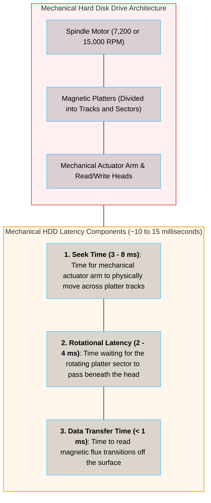
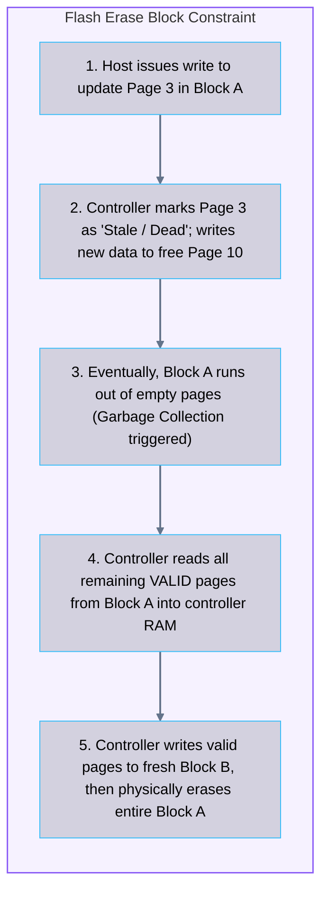
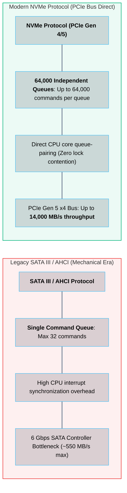

# 02 · Storage Media Internals – HDDs, SSDs, and NVMe

> **Status**: Comprehensive Reference  
> **Parent**: [[Overview|Overview]] | [[00-Foundations/07-storage-fundamentals/README|Storage Index]]  
> **Topics**: Hard Disk Drive (HDD) Mechanics, NAND Flash Physics, SLC vs. MLC vs. TLC vs. QLC, Flash Erase Blocks, Write Amplification, AHCI vs. NVMe Protocol, IOPS vs. Throughput vs. Latency

---

## 1. Mechanical Hard Disk Drives (HDDs): The Legacy Foundation

For over half a century, mechanical **Hard Disk Drives (HDDs)** served as primary enterprise non-volatile storage. HDDs store binary data magnetically on circular spinning platters:



### The HDD Sequential vs. Random Performance Disparity
- **Sequential Access**: When reading contiguous sectors along a single track, the mechanical head remains stationary. Throughput reaches **150 to 250 MB/s**.
- **Random Access**: When reading scattered 4KB blocks across disparate tracks, the mechanical arm must continuously reposition. Performance collapses to **75 to 200 IOPS maximum**.

---

## 2. Solid-State Drives (SSDs) and NAND Flash Physics

**Solid-State Drives (SSDs)** have zero moving parts. Data is stored electrostatically inside silicon **NAND Flash Memory Cells** using floating-gate or charge-trap transistors:

```
┌────────────────────────────────────────────────────────────────────────┐
│                        NAND FLASH CELL TYPES                           │
├───────────────┬──────────────┬───────────────┬─────────────────────────┤
│ Cell Type     │ Bits per Cell│ P/E Endurance │ Primary Application     │
├───────────────┼──────────────┼───────────────┼─────────────────────────┤
│ **SLC**       │ 1 Bit        │ ~100,000      │ Mission-critical cache, │
│ (Single-Level)│              │ Program/Erase │ aerospace, military     │
├───────────────┼──────────────┼───────────────┼─────────────────────────┤
│ **MLC**       │ 2 Bits       │ ~10,000       │ Enterprise boot drives, │
│ (Multi-Level) │              │ Program/Erase │ industrial devices      │
├───────────────┼──────────────┼───────────────┼─────────────────────────┤
│ **TLC**       │ 3 Bits       │ ~3,000        │ **Standard Cloud SSDs** │
│ (Triple-Level)│              │ Program/Erase │ (AWS gp3, Azure SSD)    │
├───────────────┼──────────────┼───────────────┼─────────────────────────┤
│ **QLC**       │ 4 Bits       │ ~1,000        │ High-density bulk read, │
│ (Quad-Level)  │              │ Program/Erase │ archival storage        │
└───────────────┴──────────────┴───────────────┴─────────────────────────┘
```

---

## 3. The Flash Erase Block Asymmetry & Write Amplification

A fundamental architectural constraint governs all NAND flash memory:
- Flash memory can be **Read and Written in Pages** (typically 4 KB to 16 KB).
- Flash memory can **ONLY be Erased in Blocks** (typically 2 MB to 8 MB, containing 128 to 512 pages).
- **Cannot Overwrite in Place**: A flash cell cannot be written with new data until the entire block containing it has been erased.



### Write Amplification Factor (WAF)
Because the SSD controller must move and rewrite valid pages during garbage collection, the physical bytes written to the flash silicon exceed the logical bytes sent by the operating system:

$$\text{Write Amplification Factor (WAF)} = \frac{\text{Bytes Physically Written to NAND Flash}}{\text{Bytes Logically Emitted by Host OS}}$$

A WAF of `1.0` is ideal. Under heavy random write workloads with full disks, WAF can climb to `3.0` or higher, accelerating flash wear.

---

## 4. The Protocol Evolution: SATA AHCI vs. NVMe

Even when flash replaced spinning rust, SSDs remained choked for years by the legacy **SATA AHCI protocol**, which was designed for mechanical disks:



---

## 5. Storage Metrics: IOPS vs. Throughput vs. Latency

Cloud engineers must master the relationship connecting the three core storage performance metrics:

```
┌────────────────────────────────────────────────────────────────────────┐
│                   THE STORAGE PERFORMANCE TRIANGLE                     │
├─────────────────────┬──────────────────────┬───────────────────────────┤
│ Metric              │ Definition           │ Primary Cloud Impact      │
├─────────────────────┼──────────────────────┼───────────────────────────┤
│ **IOPS**            │ Number of read/write │ High transactional DBs    │
│ (I/O Per Second)    │ commands per second  │ (PostgreSQL, MySQL, Redis)│
├─────────────────────┼──────────────────────┼───────────────────────────┤
│ **Throughput**      │ Data volume moved per│ Streaming video, big data │
│ (MB/s or GB/s)      │ second               │ ETL, Kafka logs, analytics│
├─────────────────────┼──────────────────────┼───────────────────────────┤
│ **Latency**         │ Round-trip time for a│ Query response times, lock│
│ (Microseconds / ms) │ single I/O operation │ contention, commit waits  │
└─────────────────────┴──────────────────────┴───────────────────────────┘
```

### The Mathematical Formula Connecting IOPS and Throughput

$$\text{Throughput (Bytes/sec)} = \text{IOPS} \times \text{I/O Block Size (Bytes)}$$

#### Practical Cloud Example:
An application requests 16 KB random database read operations at 10,000 IOPS:
$$\text{Throughput} = 10,000 \times 16,384 \text{ Bytes} = 163,840,000 \text{ Bytes/sec} \approx 156.25 \text{ MB/s}$$

If the cloud volume has a throughput limit of 125 MB/s, the volume will **throttle I/O**, driving up queue depths and latency even if the provisioned IOPS limit (e.g., 10,000) has not been exceeded.

---

## 6. Key Takeaways

| Storage Technology | Core Engineering Principle |
| :--- | :--- |
| **Mechanical Bottleneck** | HDDs are severely limited by mechanical seek times (~10ms) and collapse under random I/O (75-200 IOPS). |
| **NAND Erase Asymmetry** | Flash reads/writes in pages (4-16KB) but erases in blocks (2-8MB), necessitating Garbage Collection and causing Write Amplification. |
| **NVMe Parallelism** | NVMe breaks the SATA AHCI bottleneck by deploying up to 64,000 queues directly over PCIe, aligning with multi-core CPUs. |
| **Throughput vs. IOPS** | Storage performance is constrained by both IOPS and Throughput; exceeding either limit induces I/O throttling and latency spikes. |

---

## 7. Knowledge Check

1. What physical factors contribute to the ~10 millisecond latency of a mechanical hard drive?
2. Why is there a dramatic performance difference between sequential I/O and random I/O on an HDD?
3. What is the difference between SLC, MLC, TLC, and QLC NAND flash memory in terms of bits per cell and write endurance?
4. Explain why NAND flash memory cannot overwrite an existing page of data in place.
5. What is the "Write Amplification Factor" (WAF), and what triggers it inside an SSD?
6. What is the operational purpose of the `TRIM` command sent by an operating system to an SSD?
7. How does the command queuing capacity of the modern NVMe protocol compare to legacy SATA AHCI?
8. Explain the mathematical formula connecting IOPS, I/O block size, and throughput.
9. If an application requires 4,000 IOPS with a 64 KB block size, what minimum storage throughput (in MB/s) must the cloud volume support?
10. Why can high storage queue depth cause application latency to skyrocket even on ultra-fast NVMe SSDs?

---

## 8. Next Chapter

Continue your storage fundamentals learning journey:

> ➡️ **Next Module**: [[03_RAID_and_Storage_Redundancy|03 · RAID and Storage Redundancy – Erasure Coding and Parity]]  
> *Exploring RAID 0, 1, 5, 6, and 10 topologies, parity calculations, Reed-Solomon Erasure Coding math, replication factors, and calculating eleven nines (99.999999999%) of cloud durability.*

---

### Authoritative References

- [NVM Express: Base Specification Revision 2.0](https://nvmexpress.org/specifications/)
- [Micron: NAND Flash 101 – Physical Architecture and Operational Principles](https://www.micron.com/)
- [ACM Queue: Flash Storage Disruption (Grupp et al.)](https://queue.acm.org/detail.cfm?id=2165854)
