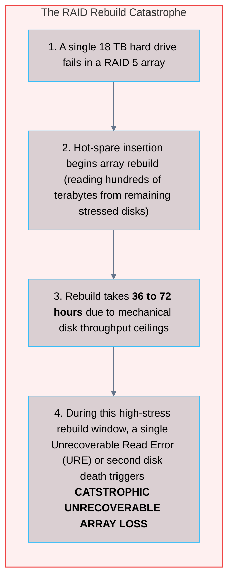
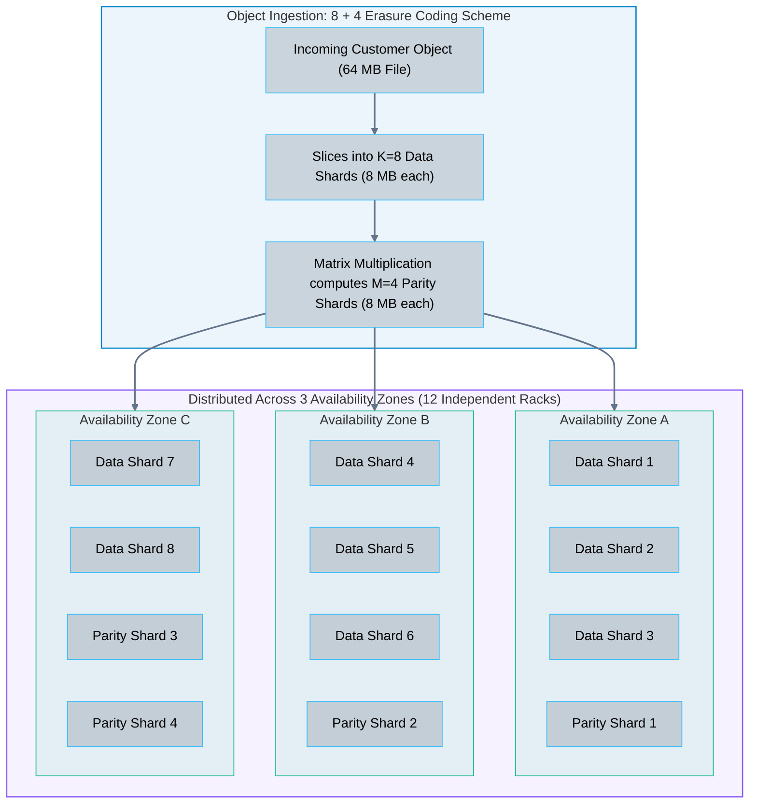

# 03 · RAID and Storage Redundancy – Erasure Coding and Parity

> **Status**: Comprehensive Reference  
> **Parent**: [[Overview|Overview]] | [[00-Foundations/07-storage-fundamentals/README|Storage Index]]  
> **Topics**: Disk Failure Inevitability, RAID Taxonomies (RAID 0, 1, 5, 6, 10), Parity Math, RAID Rebuild Bottlenecks, Erasure Coding (Reed-Solomon), Eleven Nines (99.999999999%) Durability

---

## 1. The Inevitability of Hardware Failure

In enterprise storage engineering, disk failure is not an anomaly; it is a statistical certainty. At hyperscale, with millions of drives operating continuously:
- **Annualized Failure Rate (AFR)**: Commercial enterprise HDDs experience annual failure rates between **1.5% and 4.0%**.
- **Unrecoverable Read Errors (URE)**: Flash memory and magnetic media suffer from random bit flips caused by cosmic radiation and electrical leakage (typically 1 sector per $10^{14}$ to $10^{15}$ bits read).
- **The Redundancy Mandate**: System architectures must survive hardware death without data loss or downtime.

---

## 2. Classical RAID Architectures

**Redundant Array of Independent Disks (RAID)** combines multiple physical disks into a single logical storage unit managed by a hardware RAID controller or software driver:

```mermaid
flowchart TD
    subgraph RAID_Types["Core RAID Architectures"]
        direction LR

        subgraph R0["RAID 0 · Striping"]
            direction TB
            R0_T["<b>RAID 0</b>"]
            R0_D["Data split across disks<br/><b>Zero Redundancy</b><br/>1 failed disk = Total data loss<br/>100% Storage Efficiency"]
            R0_T --- R0_D
        end

        subgraph R1["RAID 1 · Mirroring"]
            direction TB
            R1_T["<b>RAID 1</b>"]
            R1_D["Exact bitwise clone<br/>Survives 1 disk loss<br/>Fast read throughput<br/>50% Storage Efficiency"]
            R1_T --- R1_D
        end

        subgraph R5["RAID 5 · Distributed Parity"]
            direction TB
            R5_T["<b>RAID 5</b>"]
            R5_D["Single XOR parity rotated<br/>Survives 1 disk failure<br/>Severe write penalty (4 I/Os)<br/>Capacity: (N - 1) / N"]
            R5_T --- R5_D
        end

        subgraph R6["RAID 6 · Dual Parity"]
            direction TB
            R6_T["<b>RAID 6</b>"]
            R6_D["Two independent parity blocks<br/>Survives <b>2 concurrent failures</b><br/>High computational write penalty<br/>Capacity: (N - 2) / N"]
            R6_T --- R6_D
        end

        subgraph R10["RAID 10 · 1+0 Striped Mirrors"]
            direction TB
            R10_T["<b>RAID 10</b>"]
            R10_D["Mirrors striped together<br/>Survives multiple disk losses<br/>Maximum IOPS performance<br/>50% Storage Efficiency"]
            R10_T --- R10_D
        end
    end

    style R0 fill:#ef4444,stroke:#ef4444,stroke-width:1.5px,fill-opacity:0.08
    style R1 fill:#0284c7,stroke:#0284c7,stroke-width:1.5px,fill-opacity:0.08
    style R5 fill:#f59e0b,stroke:#f59e0b,stroke-width:1.5px,fill-opacity:0.08
    style R6 fill:#8b5cf6,stroke:#8b5cf6,stroke-width:1.5px,fill-opacity:0.08
    style R10 fill:#10b981,stroke:#10b981,stroke-width:1.5px,fill-opacity:0.08

    classDef nodeStyle fill:#0f172a,stroke:#38bdf8,stroke-width:1px,fill-opacity:0.15,color:inherit;
    class R0_T,R0_D,R1_T,R1_D,R5_T,R5_D,R6_T,R6_D,R10_T,R10_D nodeStyle;
    linkStyle default stroke:#64748b,stroke-width:2px;
```



### The Parity Mathematics: Bitwise XOR Logic
RAID 5 computes parity using binary **eXclusive OR ($\oplus$)**:

```
Data Disk 1 (D1):    1  0  1  1  0
Data Disk 2 (D2):    0  1  1  0  1
Data Disk 3 (D3):    1  1  0  1  0
-----------------------------------
Parity Disk (P):     0  0  0  0  1   (P = D1 ⊕ D2 ⊕ D3)
```

If Disk 2 physically dies, its data is reconstructed by XOR-ing the remaining disks:
$$D2 = D1 \oplus D3 \oplus P = 10110 \oplus 11010 \oplus 00001 = 01101$$

---

## 3. Why Traditional RAID Died in Cloud Hyperscale

As disk capacities exploded from 500 GB to 20+ Terabytes, traditional RAID 5 and RAID 6 broke down due to two critical realities:



---

## 4. Erasure Coding: The Foundation of Cloud Object Storage

Cloud object stores (Amazon S3, Azure Blob, Google Cloud Storage, Ceph) replaced RAID with **Erasure Coding (Reed-Solomon $K + M$)**.

### The Mechanics of Erasure Coding
1. A file or object payload is sliced into **$K$ Data Shards**.
2. An encoder applies Galois field matrix multiplication to compute **$M$ Parity (Coding) Shards**.
3. The resulting $K + M$ shards are distributed across **independent server racks, power zones, and data centers**.
4. **The Mathematical Guarantee**: The original object can be reconstructed from **ANY $K$ SHARDS** out of the total $K + M$ shards. Up to $M$ arbitrary shards can be permanently lost simultaneously without data loss.



### Storage Efficiency: Replication vs. Erasure Coding

| Redundancy Scheme | Durability Resilience | Storage Overhead | Usable Efficiency |
| :--- | :--- | :--- | :--- |
| **3x Replication (3-Way Mirror)**| Survives 2 node losses | **300%** (3x raw storage purchased) | **33.3%** |
| **Erasure Coding (8 + 4)** | Survives **4 node/AZ losses** | **150%** (1.5x raw storage purchased) | **66.7%** |
| **Erasure Coding (16 + 4)**| Survives **4 node/AZ losses** | **125%** (1.25x raw storage purchased) | **80.0%** |

---

## 5. The Mathematics of "Eleven Nines" (99.999999999%) Durability

Amazon S3 and Google Cloud Storage advertise **99.999999999% Annual Durability**. What does this figure mathematically signify?

$$\text{Durability} = 1 - P(\text{Object Loss Within 1 Year})$$

- If an enterprise stores **10,000,000 (10 million) objects** in Amazon S3:
- With 11 nines of durability, the statistical expectation is losing **one single object once every 10,000 years**.

### How Cloud Providers Achieve 11 Nines
1. **Multi-AZ Geographic Slicing**: Erasure coded shards are distributed across minimum 3 physically isolated Availability Zones.
2. **Continuous Active Scrubbing**: Automated background daemons continuously read every stored shard, compute SHA-256 checksums, detect bitrot, and immediately heal decayed shards from surviving peers.
3. **Massive Parallel Rebuilds**: When a storage server dies, shards are reconstructed in parallel across thousands of healthy nodes in minutes, rather than days.

---

## 6. Key Takeaways

| Redundancy Dimension | Core Engineering Principle |
| :--- | :--- |
| **Disk Rebuild Hazard** | Rebuilding massive modern hard drives under RAID 5 takes days, creating unacceptable exposure to catastrophic secondary failures. |
| **Erasure Coding Math** | Reed-Solomon $K+M$ slicing allows reconstruction from ANY $K$ shards, delivering superior durability at a fraction of 3x replication cost. |
| **Geographic Separation** | High durability requires striping shards across physically autonomous Availability Zones separated by metro fiber. |
| **Continuous Scrubbing** | Background checksum verification and automated repair daemons eliminate bitrot before multiple failures can accumulate. |

---

## 7. Knowledge Check

1. What is the difference between storage Availability (uptime) and storage Durability (data survival)?
2. How does RAID 5 compute and distribute parity across its member disks?
3. What is the "Write Penalty" of RAID 5, and why does a single write operation generate four disk I/O operations?
4. Why does an array of multiple 18 Terabyte hard drives make traditional RAID 5 dangerous for enterprise data storage?
5. How does RAID 10 differ from RAID 5 in terms of performance and storage efficiency?
6. Explain the core mechanism of Reed-Solomon $K + M$ Erasure Coding.
7. In an $8 + 4$ Erasure Coding configuration, how many total shards are generated, and what is the maximum number of shards that can fail simultaneously?
8. Why is Erasure Coding far more cost-effective than traditional 3x Replication for cloud object storage?
9. What does "Eleven Nines" (99.999999999%) durability mean in practical statistical terms for 10 million stored files?
10. What is "bitrot," and how do cloud object storage providers detect and remediate it automatically?

---

## 8. Next Chapter

Continue your storage fundamentals learning journey:

> ➡️ **Next Module**: [[04_File_Systems_and_Protocols|04 · File Systems and Protocols – Ext4, XFS, ZFS, NFS, and SMB]]  
> *Exploring POSIX filesystem semantics, inodes, directory trees, journaling, Ext4 vs. XFS vs. ZFS, and network file sharing protocols (NFSv4 vs. SMB/CIFS).*

---

### Authoritative References

- [Patterson, Gibson, Katz: A Case for Redundant Arrays of Inexpensive Disks (RAID) (1988)](https://dl.acm.org/doi/10.1145/62546.62547)
- [Plank: A Tutorial on Reed-Solomon Coding for Fault-Tolerance in RAID-like Systems](https://web.eecs.utk.edu/~jplank/plank/papers/CS-96-332.html)
- [Amazon Web Services: Protecting Data in Amazon S3](https://docs.aws.amazon.com/AmazonS3/latest/userguide/DataDurability.html)
