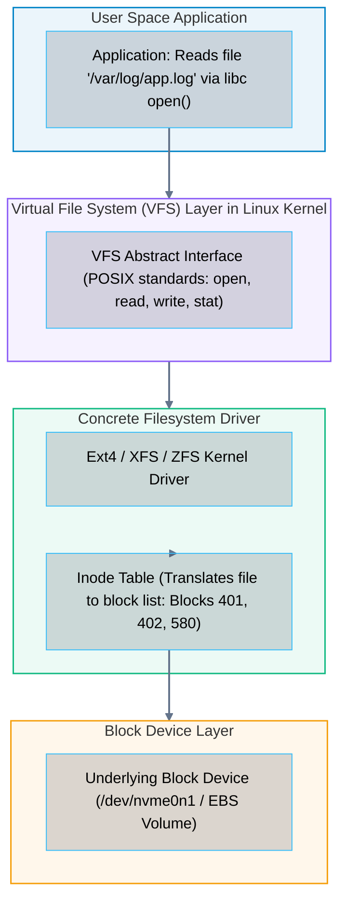
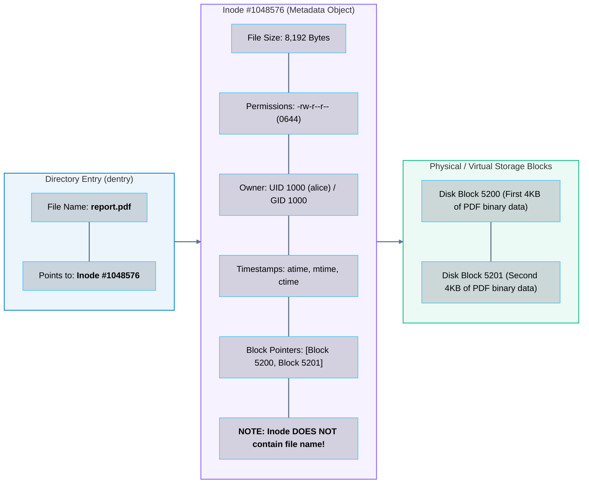
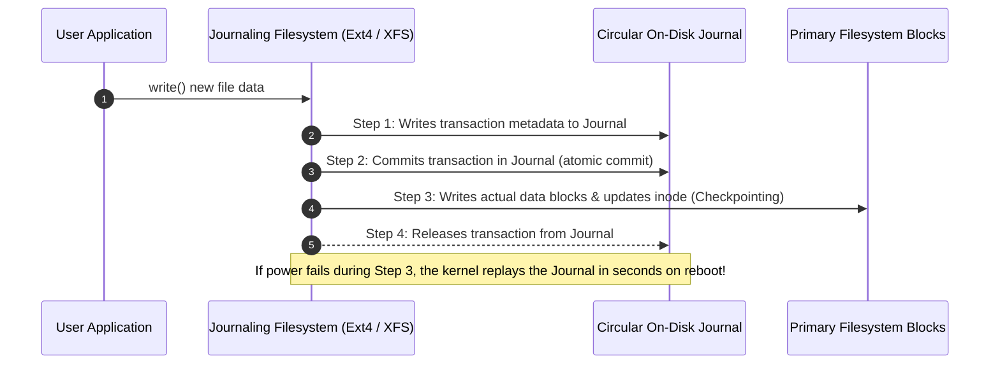
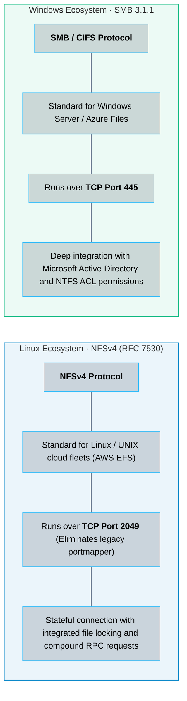

# 04 · File Systems and Protocols – Ext4, XFS, ZFS, NFS, and SMB

> **Status**: Comprehensive Reference  
> **Parent**: [[Overview|Overview]] | [[00-Foundations/07-storage-fundamentals/README|Storage Index]]  
> **Topics**: Filesystem Architecture, Inodes & Superblocks, Dentries, Hard Links vs. Symlinks, Journaling Mechanics, Ext4 vs. XFS vs. ZFS, Network File Protocols (NFSv4 vs. SMB 3)

---

## 1. What Is a File System?

Raw block storage (an NVMe SSD or an EBS volume) is simply an unorganized array of billions of numbered 4 KB sectors. A **File System** is the software subsystem within the operating system kernel that organizes, indexes, protects, and retrieves files across those blocks.

---

## 2. Anatomy of a Linux Filesystem: Inodes, Dentries, and Data Blocks

A common misunderstanding is that a file's name and its data are stored together. In Unix/Linux filesystems, they are strictly separated into three distinct structures:

### Hard Links vs. Symbolic Links (Symlinks)
- **Hard Link (`ln source target`)**: Creates a second Directory Entry (`dentry`) pointing to the **exact same inode number**. The link count in the inode increments. If you delete the original filename, the file data remains intact until all hard links are deleted and the link count hits zero.
- **Symbolic Link (`ln -s source target`)**: Creates an entirely new inode with its own data block that merely contains the string text path to the target file. If the target is deleted, the symlink breaks ("dangling link").

---

## 3. Filesystem Journaling: Preventing Corruption

When saving a file, an operating system must perform three distinct writes:
1. Write the new data to data blocks.
2. Update the inode with the new size and block pointers.
3. Update the directory entry with timestamp modifications.

If power fails between steps 1 and 2, the filesystem enters an inconsistent, corrupt state. **Journaling** solves this using a dedicated **Write-Ahead Log (WAL)**:

---

## 4. Master Comparison: Modern Linux Filesystems

| Feature | Ext4 (Fourth Extended FS) | XFS (Extended Filesystem) | ZFS (Zettabyte Filesystem) |
| :--- | :--- | :--- | :--- |
| **Architectural Model**| Classical Journaled Block FS | High-Performance 64-bit Journaled | Integrated Volume Manager + CoW |
| **Default Inode Allocation**| Fixed at filesystem creation (`mkfs`)| **Dynamic Inodes** (Allocated on demand)| Dynamic (Unlimited) |
| **Large File / Thread Scaling**| Good | **Superior** (Allocation Groups allow parallel multi-threaded writes)| **Superior** (Copy-on-Write) |
| **Max Single File Size**| 16 Terabytes | **8 Exabytes** | **16 Exabytes** |
| **Data Integrity Checking**| Metadata checksums only | Metadata checksums only | **End-to-End Cryptographic Block Checksums** (Fights bitrot) |
| **Snapshots** | No native snapshots | No native snapshots | **Instantaneous CoW Snapshots** |
| **Standard Cloud Role**| Ubuntu root OS volumes | RHEL/CentOS root volumes, high-performance databases | High-end storage appliances, multi-disk NAS arrays |

---

## 5. Network File Sharing Protocols: NFS vs. SMB

To share a filesystem across multiple virtual machines in the cloud, operating systems use network file protocols:

---

## 6. Key Takeaways

| Filesystem Dimension | Core Engineering Principle |
| :--- | :--- |
| **Inode Separation** | Inodes store all file metadata (size, permissions, block pointers) but **never store the file name**, which lives in directory entries (`dentries`). |
| **No Inodes Left Error** | A disk can run out of space even with 50% free disk capacity if millions of tiny files exhaust the fixed inode table (`df -i`). |
| **Journaling Integrity** | Write-Ahead Logging protects against catastrophic filesystem corruption during abrupt power loss. |
| **XFS vs. Ext4 in Cloud** | XFS scales superiorly for high-throughput multi-threaded database workloads due to independent allocation groups. |

---

## 7. Knowledge Check

1. What is the fundamental difference between a block device and a file system?
2. What is an Inode, and what specific attributes does it record?
3. Why is the filename of a file stored in a Directory Entry (`dentry`) rather than inside the inode itself?
4. What happens when an operating system runs out of available inodes even though several gigabytes of disk space remain free?
5. Explain the mechanical difference between a Hard Link and a Symbolic Link (Symlink).
6. What is the operational purpose of filesystem Journaling, and how does it prevent lengthy `fsck` recovery scans on reboot?
7. In what workload scenario does the XFS filesystem significantly outperform Ext4?
8. How does ZFS achieve end-to-end data integrity against silent data corruption (bitrot)?
9. Which transport protocol and port does NFSv4 utilize for cloud shared file access?
10. In what enterprise scenarios would an architect choose SMB 3.1.1 (Azure Files) over NFSv4 (AWS EFS)?

---

## 8. Next Chapter

Continue your storage fundamentals learning journey:

> ➡️ **Next Module**: [[05_Object_Storage_Architecture|05 · Object Storage Architecture – Flat Namespaces, Buckets, and REST APIs]]  
> *Exploring flat key-value object namespaces, HTTP REST operations (GET/PUT/DELETE), multipart chunked uploads, and the transition from eventual consistency to strong read-after-write consistency.*

---

### Authoritative References

- [IETF RFC 7530: Network File System (NFS) Version 4 Protocol](https://datatracker.ietf.org/doc/html/rfc7530)
- [Linux Kernel Documentation: Filesystems in the Linux Kernel](https://docs.kernel.org/filesystems/index.html)
- [McKusick and Neville-Neil: The Design and Implementation of the FreeBSD Operating System (ZFS Chapters)](https://www.pearson.com/)
