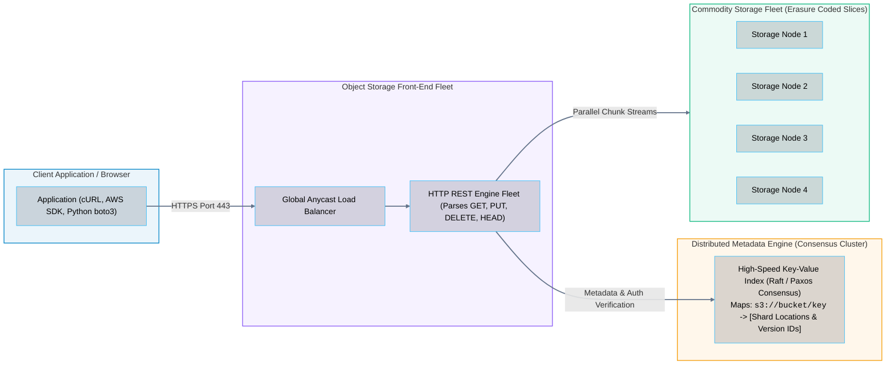
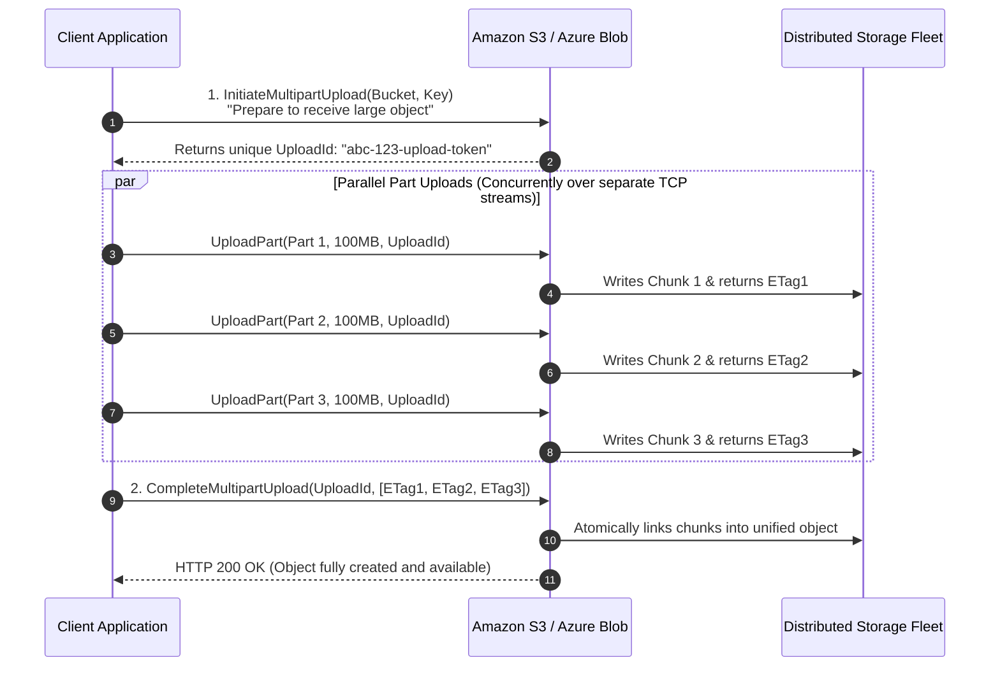
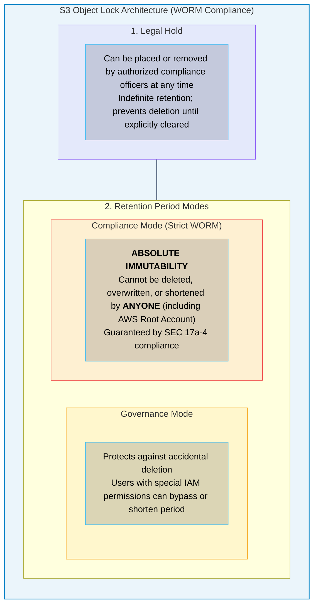

# 05 · Object Storage Architecture – Flat Namespaces, Buckets, and REST APIs

> **Status**: Comprehensive Reference  
> **Parent**: [[Overview|Overview]] | [[00-Foundations/07-storage-fundamentals/README|Storage Index]]  
> **Topics**: Object Storage Philosophy, Buckets & Flat Namespaces, REST API Primitives, Multipart Upload Mechanics, Strong Read-After-Write Consistency, WORM Compliance (Object Lock)

---

## 1. The Object Storage Paradigm

Traditional filesystems collapse when scaled to billions of files because directory tree traversals, file locking mechanisms, and inode lookups create severe disk I/O bottlenecks.

**Cloud Object Storage** abandons hierarchical directories entirely in favor of an **infinitely scalable, flat key-value store** accessible globally via standard **HTTP/HTTPS REST APIs**.



---

## 2. Core REST API Primitives

Every interaction with an object storage system maps directly to standard HTTP methods:

| HTTP Verb | S3 / Blob API Action | Operational Function |
| :--- | :--- | :--- |
| **`PUT`** | `PutObject` | Uploads a new object or completely overwrites an existing object with the supplied payload. |
| **`GET`** | `GetObject` | Downloads the full binary payload of the object. Supports **Byte-Range Requests** (`Range: bytes=0-1048575`). |
| **`HEAD`** | `HeadObject` | Retrieves object metadata headers (Content-Length, ETag, Last-Modified) **without transferring payload bytes**. |
| **`DELETE`**| `DeleteObject`| Removes the specified object key (or inserts an immutable Delete Marker if versioning is active). |
| **`POST`** | `CompleteMultipartUpload`| Coordinates complex multi-chunk ingestion workflows. |

---

## 3. High-Throughput Ingestion: Multipart Uploads

Attempting to upload a single 50 GB video or database backup over a standard HTTP `PUT` connection is brittle: a single network hiccup forces the application to restart the upload from byte zero.

Object storage solves this via **Multipart Upload**:



### Key Advantages of Multipart Upload
1. **Parallelism**: Ingest chunks concurrently, saturating 10Gbps or 100Gbps network interfaces.
2. **Fault Isolation**: If Part 2 fails due to a network timeout, **only Part 2 is retransmitted**, rather than the entire 50 GB file.
3. **Mandatory Standard**: Recommended for objects larger than 100 MB; required for any object exceeding 5 GB.

---

## 4. The Data Consistency Revolution: Eventual to Strong Consistency

Historically (prior to December 2020), Amazon S3 operated under an **Eventual Consistency** model to prioritize high availability during distributed network partitions (CAP Theorem):
- Creating a new object provided immediate read-after-write consistency.
- However, **updating or deleting an existing object** exhibited eventual consistency: reading an updated key might return the old data for several seconds while replica synchronization settled.

### Modern Cloud Object Storage: Strong Read-After-Write Consistency
Modern cloud hyperscalers (Amazon S3, Azure Blob Storage, Google Cloud Storage) now deliver **Strong Read-After-Write Consistency for ALL operations (PUT, UPDATE, DELETE)** with zero performance penalty:
- When a client receives an `HTTP 200 OK` response to a `PUT` or `DELETE`, **any subsequent `GET` or `LIST` request immediately sees the update**.
- Achieved by integrating distributed consensus protocols (Raft/Paxos) into the metadata indexing plane, ensuring that metadata commits synchronously before the HTTP response is sent.

```
┌────────────────────────────────────────────────────────────────────────┐
│               STRONG READ-AFTER-WRITE CONSISTENCY GUARANTEE            │
├────────────────────────────────────────────────────────────────────────┤
│ 1. Client uploads:   PUT s3://bucket/config.json (Payload: {"v": 2})   │
│ 2. S3 responds:      HTTP 200 OK                                       │
│ 3. Client executes:  GET s3://bucket/config.json                      │
│ 4. Result:           GUARANTEED to return {"v": 2} (NEVER {"v": 1})    │
└────────────────────────────────────────────────────────────────────────┘
```

---

## 5. Regulatory Compliance & Immutability: WORM and Object Lock

Certain regulated industries (financial services SEC Rule 17a-4, healthcare HIPAA) mandate that audit logs and customer records be stored in a **Write Once, Read Many (WORM)** format that cannot be deleted or overwritten by anyone—not even the AWS root account holder.



---

## 6. Key Takeaways

| Object Storage Dimension | Core Architectural Principle |
| :--- | :--- |
| **Flat Namespace Scalability**| Abandoning hierarchical directories allows object storage to scale to trillions of files without inode or path bottlenecks. |
| **Multipart Ingestion Speed**| Multipart uploads split large files into parallel chunks, providing resilience against network drops and maximizing bandwidth. |
| **Strong Consistency Modernity**| Cloud object stores now guarantee strong read-after-write consistency across all PUTs, updates, and deletes. |
| **WORM Immutability** | Compliance-mode Object Lock ensures stored data cannot be destroyed by ransomware or rogue root administrators. |

---

## 7. Knowledge Check

1. Why does an object storage system scale to trillions of items far more easily than a traditional hierarchical filesystem?
2. What are the four core HTTP methods used to interact with cloud object storage?
3. What is the operational purpose of an `HTTP HEAD` request in object storage?
4. How do Byte-Range Requests (`Range: bytes=X-Y`) enable video streaming platforms like Netflix or YouTube to stream video efficiently from S3?
5. Walk through the three phases of an S3 Multipart Upload.
6. What is the minimum recommended file size for initiating a Multipart Upload?
7. Explain the difference between legacy Eventual Consistency and modern Strong Read-After-Write Consistency in Amazon S3.
8. How does distributed consensus (e.g., Paxos or Raft) enable strong consistency across geographically replicated metadata clusters?
9. What is the difference between Governance Mode and Compliance Mode in S3 Object Lock?
10. Can an AWS root account user delete a file locked under S3 Object Lock in Compliance Mode during its retention window?

---

## 8. Next Chapter

Continue your storage fundamentals learning journey:

> ➡️ **Next Module**: [[06_Storage_Tiering_Lifecycle_and_Backup|06 · Storage Tiering, Lifecycle Management, and Disaster Recovery]]  
> *Exploring Hot vs. Cool vs. Archive storage economics, automated lifecycle transitions, snapshot copy-on-write mechanics, Recovery Point Objective (RPO), and Recovery Time Objective (RTO).*

---

### Authoritative References

- [Amazon Web Services: Amazon S3 Architecture and Performance Guidelines](https://docs.aws.amazon.com/AmazonS3/latest/userguide/optimizing-performance.html)
- [Amazon Web Services: Amazon S3 Strong Consistency Announcement](https://aws.amazon.com/blogs/aws/amazon-s3-update-strong-read-after-write-consistency/)
- [Microsoft Azure: Azure Blob Storage Architecture Guide](https://learn.microsoft.com/en-us/azure/storage/blobs/storage-blobs-introduction)
