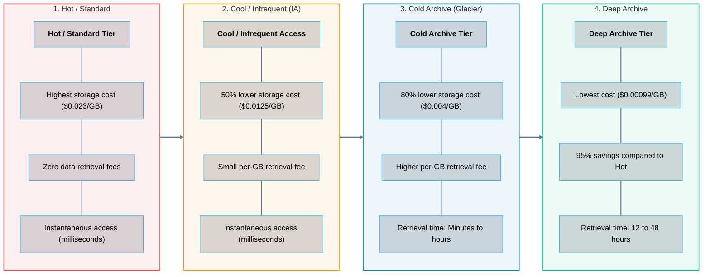
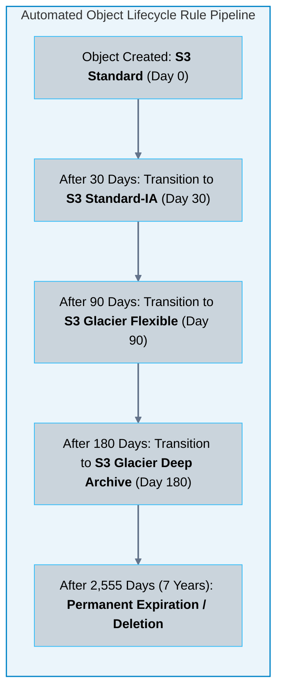
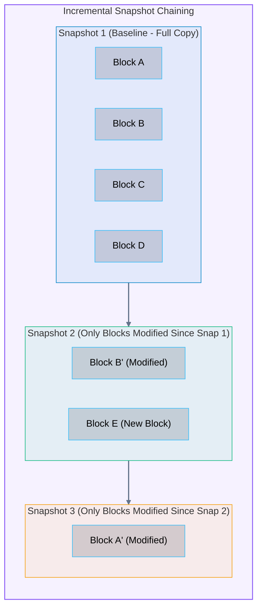
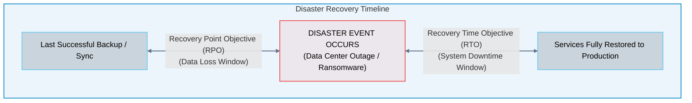

# 06 · Storage Tiering, Lifecycle Management, and Disaster Recovery

> **Status**: Comprehensive Reference  
> **Parent**: [[Overview|Overview]] | [[00-Foundations/07-storage-fundamentals/README|Storage Index]]  
> **Topics**: Cloud Storage Tiering Spectrum, Automated Lifecycle Policies, Incremental Snapshot Mechanics, Copy-on-Write (CoW), Recovery Point Objective (RPO), Recovery Time Objective (RTO)

---

## 1. Storage Economics & The Tiering Spectrum

Not all enterprise data possesses equal business value over time. Data value follows a steep decay curve:
- **Day 1 to 30**: Heavily accessed, queried, and updated (active logs, recent transactions, hot media).
- **Day 31 to 90**: Infrequently accessed, referenced only for monthly audits or support tickets.
- **Year 1 to 7**: Cold regulatory archive; rarely or never queried, but legally mandated to be preserved.

To minimize storage bills, cloud providers offer a **tiered storage spectrum**:

---

## 2. Automated Lifecycle Management

Rather than managing storage tiers manually, architects define **Automated Lifecycle Policies** that transition or purge objects based on age:

> [!CAUTION] Hidden Minimum Duration Traps
> Cloud providers enforce **minimum storage duration billings** on cold tiers:
> - **S3 Standard-IA**: 30-day minimum billing. If deleted after 5 days, you are still billed for 30 days.
> - **S3 Glacier Flexible**: 90-day minimum billing.
> - **S3 Glacier Deep Archive**: 180-day minimum billing.  
> *Do not transition fast-expiring temporary files into deep archive tiers.*

---

## 3. Storage Snapshots: Incremental Chaining & Copy-on-Write

Point-in-time snapshots of cloud block volumes (e.g., Amazon EBS or Azure Managed Disks) are stored directly inside durable cloud object storage (S3) using **Incremental Block Chaining**:

### Snapshot Restoration & Lazy Loading
- When restoring a new EBS volume from Snapshot 3, the volume becomes available **immediately within seconds**.
- The hypervisor points to Snapshot 3's metadata map. Blocks are loaded lazily on demand from S3.
- If the application requests Block D (which was not modified since Snapshot 1), the system traces back the incremental chain to Snapshot 1 and loads it transparently.

---

## 4. Disaster Recovery (DR): RPO vs. RTO

Every enterprise data protection architecture is defined by two fundamental business continuity metrics:

1. **Recovery Point Objective (RPO)**: The maximum acceptable amount of data loss measured backward in time from the moment of disruption.
   - *Example*: An RPO of **15 minutes** mandates that database transaction logs must replicate off-site at least every 15 minutes.
2. **Recovery Time Objective (RTO)**: The maximum acceptable duration of system downtime before business operations must be restored.
   - *Example*: An RTO of **1 hour** mandates that cloud infrastructure must fail over and resume servicing user traffic within 60 minutes.

---

## 5. Master Comparison: Cloud Disaster Recovery Strategies

| DR Strategy | Operational Mechanics | RPO (Data Loss) | RTO (Downtime) | Cost Factor |
| :--- | :--- | :--- | :--- | :--- |
| **Backup & Restore** | Daily snapshots written to cloud object storage. | 24 Hours | 12 – 24 Hours | **Lowest ($)** |
| **Pilot Light** | Core database continuously replicates to standby region; compute servers kept offline as AMIs/templates. | Minutes | 10 – 30 Minutes | **Moderate ($$)** |
| **Warm Standby** | Scaled-down fleet running 24/7 in secondary region; autoscales to full capacity on disaster. | **Seconds** | **2 – 5 Minutes** | **High ($$$)** |
| **Multi-Region Active-Active**| Traffic actively load-balanced across multiple regions simultaneously using Anycast DNS. | **Zero (Near-instant)**| **Zero (Near-instant)**| **Highest ($$$$)** |

---

## 6. Key Takeaways

| Storage & DR Dimension | Core Engineering Principle |
| :--- | :--- |
| **Data Aging Reality** | 80% of data becomes inactive after 30 days; automated lifecycle rules into cold archive tiers slash storage spend by up to 95%. |
| **Minimum Retention Guardrail**| Cold storage classes enforce minimum duration billings (30 to 180 days); deleting cold files prematurely incurs penalty charges. |
| **Incremental Snapshots** | EBS block snapshots save only modified delta blocks, minimizing cloud storage consumption while maintaining full point-in-time point recovery. |
| **RPO & RTO Alignment** | Lowering RPO/RTO from hours to zero requires shifting from basic snapshot backups to continuous multi-region active replication, increasing architectural cost. |

---

## 7. Knowledge Check

1. What is the business and financial rationale for implementing tiered cloud storage?
2. Compare the storage cost versus retrieval cost of S3 Standard against S3 Glacier Deep Archive.
3. What is the minimum billing duration for S3 Standard-IA, and what happens if a file is deleted 10 days after creation?
4. How does AWS S3 Intelligent-Tiering optimize costs without requiring manual lifecycle transition rules?
5. What is the operational danger of failing to configure an "Abort Incomplete Multipart Upload" lifecycle rule?
6. Explain how incremental block snapshot chaining works for Amazon EBS or Azure Managed Disks.
7. If Snapshot 2 is deleted from a chain of three snapshots, is the modified data in Snapshot 3 lost? Explain why.
8. Define Recovery Point Objective (RPO) and Recovery Time Objective (RTO) with real-world examples.
9. Explain the architectural difference between a "Pilot Light" and a "Warm Standby" disaster recovery strategy.
10. What trade-offs must an engineering leadership team evaluate when deciding between a Pilot Light DR plan versus a Multi-Region Active-Active topology?

---

## 8. Next Chapter & Module Completion

Congratulations on completing **Module 07: Storage Fundamentals**!

> **Storage Curriculum Index**: Return to [[00-Foundations/07-storage-fundamentals/README|Module 07 Index]]  
> **Master Cloud Overview**: Return to [[Overview|Master Cloud Computing Architecture & Overview]]  
> **Interactive Architecture Blueprint**: Explore the full visual system in [cloud_architecture_service_models.html](file:///home/vikram/learning/cloud/Cloud_Learning/Overview/cloud_architecture_service_models.html)

---

### Authoritative References

- [AWS Storage Tiering and S3 Lifecycle Documentation](https://docs.aws.amazon.com/AmazonS3/latest/userguide/object-lifecycle-mgmt.html)
- [AWS Well-Architected Framework: Reliability Pillar – Disaster Recovery (DR)](https://docs.aws.amazon.com/wellarchitected/latest/reliability-pillar/disaster-recovery-dr.html)
- [Microsoft Azure: Disaster Recovery Architecture Guide](https://learn.microsoft.com/en-us/azure/architecture/resiliency/disaster-recovery-azure-applications)
