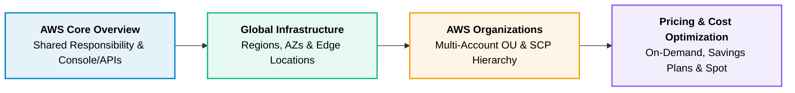

# 00 · AWS Introduction & Core Foundations

> **Module**: Introduction  
> **Focus**: AWS Platform ecosystem, global physical footprint, organizational account isolation, and financial models.

---

## Module Overview

---

## Documents in this Section

1. **[[overview|Overview]]** — The AWS ecosystem, management planes, and shared responsibility model.
2. **[[global-infrastructure|Global Infrastructure]]** — Regions, Availability Zones (AZs), Local Zones, and Edge PoPs.
3. **[[accounts-and-organizations|Accounts and Organizations]]** — Multi-account architectures, OUs, and Service Control Policies (SCPs).
4. **[[pricing-model|Pricing Model]]** — On-Demand vs Savings Plans vs Spot instances, and cost allocation.
