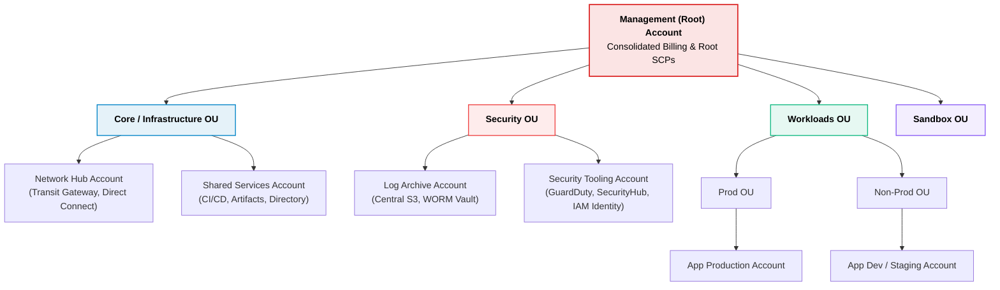
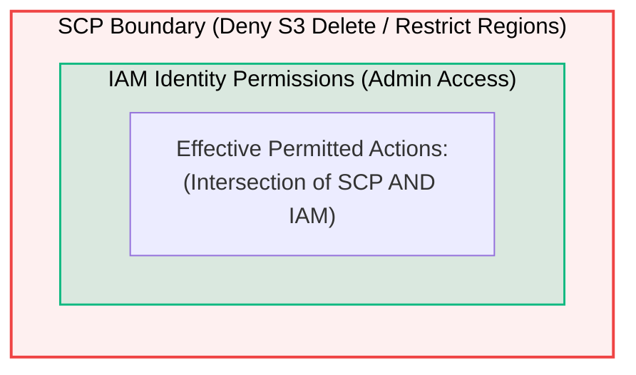

# AWS Accounts & Organizations Architecture

> **Focus**: Multi-account security boundaries, organizational units (OUs), and Service Control Policies (SCPs).

---

## 1. Enterprise Multi-Account Topology

A single AWS account is an administrative, blast-radius, and billing boundary. Enterprise environments organize accounts under **AWS Organizations**.

---

## 2. Service Control Policy (SCP) Guardrails

SCPs define the maximum allowed permissions for member accounts. They act as **guardrails**, not grants.

> [!IMPORTANT] SCP Golden Rules
> 1. An explicit **Deny** in an SCP overrides any IAM policy in member accounts (even the Root user).
> 2. The Management Account is **not** restricted by SCPs.
> 3. Use SCPs to enforce compliance (e.g., restrict allowed AWS regions, prevent disabling CloudTrail).
