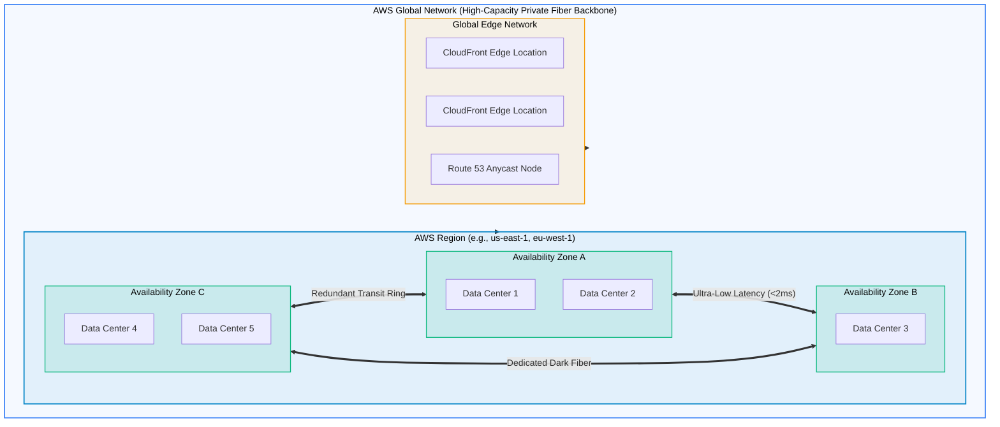
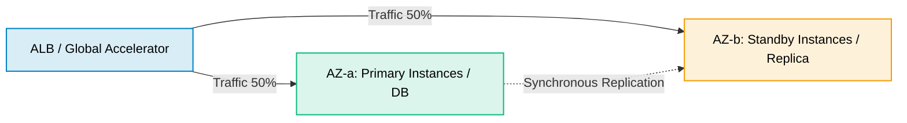

# AWS Global Infrastructure

> **Focus**: Physical topology, failure domains, low-latency interconnection, and edge distribution.

---

## 1. Physical Infrastructure Hierarchy

AWS physical topology is designed to provide complete fault isolation across distinct failure domains.

---

## 2. Infrastructure Comparison Matrix

| Component | Definition | Latency Characteristics | Fault Boundary |
| :--- | :--- | :--- | :--- |
| **Region** | Geographic area containing multiple isolated AZs | Independent geographic disaster domain | Regional disaster / legal jurisdiction |
| **Availability Zone (AZ)** | 1+ physical data centers with redundant power & cooling | `< 2 ms` round-trip between AZs | Flood, fire, local grid power failure |
| **Edge Location (PoP)** | Caching endpoint for CloudFront CDN & Route 53 | Nearest millisecond to internet end-user | Local ISP link or PoP hardware failure |
| **Local Zone** | Extension of AWS Region into metro areas | Single-digit ms to local users | Metro-level dependency on parent Region |
| **AWS Outposts** | Physical AWS-managed rack installed in on-prem DC | Sub-millisecond to on-prem workloads | Physical rack hardware and WAN uplink |

---

## 3. High-Availability Multi-AZ Design Rule

- Always deploy stateless compute across **at least 2 AZs**.
- Rely on AWS managed replication for stateful data layers across AZs.
