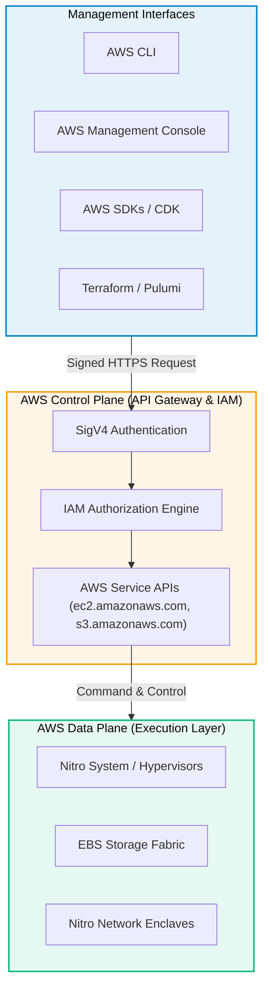
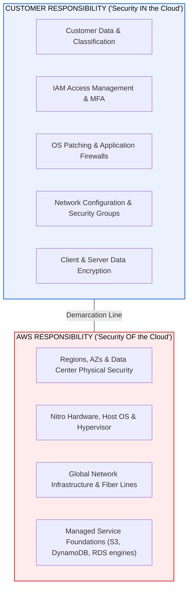

# AWS Overview & Platform Architecture

> **Focus**: The core operating model of Amazon Web Services (AWS), unified API planes, and security accountability.

---

## 1. Unified Control Plane vs Data Plane

Every AWS resource is provisioned, mutated, and inspected through a unified, authenticated REST API control plane.

---

## 2. AWS Shared Responsibility Model

Security and compliance are a shared effort between AWS and the customer.

---

## 3. Core Architectural Pillars

- **Zero-Trust by Default**: No resource has permissions until explicitly granted by IAM policies.
- **Microsecond Nitro Hypervisor**: Custom ASIC chips offload storage, network, and security processing from host CPUs.
- **Multi-Tenant Isolation**: Cryptographic network isolation inside the Amazon VPC network fabric.
