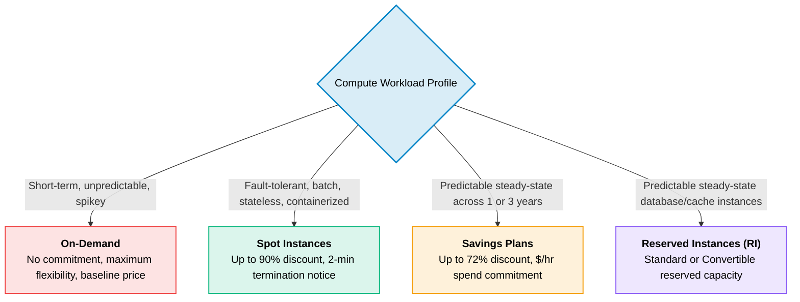
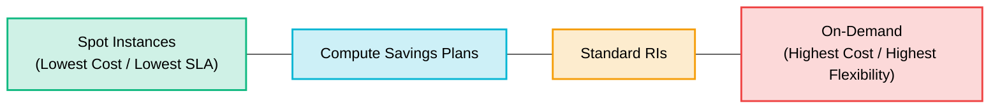

# AWS Pricing & Financial Models

> **Focus**: Compute purchasing options, commitment models, and cost optimization decision logic.

---

## 1. Compute Purchasing Models

AWS provides 4 primary purchase vehicles balancing commitment, flexibility, and cost.

---

## 2. Cost vs. Flexibility Spectrum

---

## 3. Financial Optimization Matrix

| Tier | Commitment | Discount | Ideal Workload |
| :--- | :--- | :--- | :--- |
| **On-Demand** | None (per-second billing) | 0% | Dev/testing, unpredictable traffic, first 30 days |
| **Compute Savings Plans** | 1 or 3 Years ($/hr commit) | Up to 66% | General compute (EC2, Fargate, Lambda) |
| **EC2 Instance Savings Plans**| 1 or 3 Years (specific family)| Up to 72% | Static instance family in a specific region |
| **Spot Instances** | None (Spare capacity bidding)| Up to 90% | Stateless microservices, CI builds, big data / ML |
