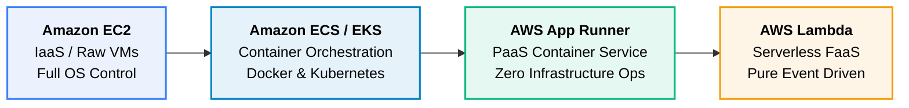
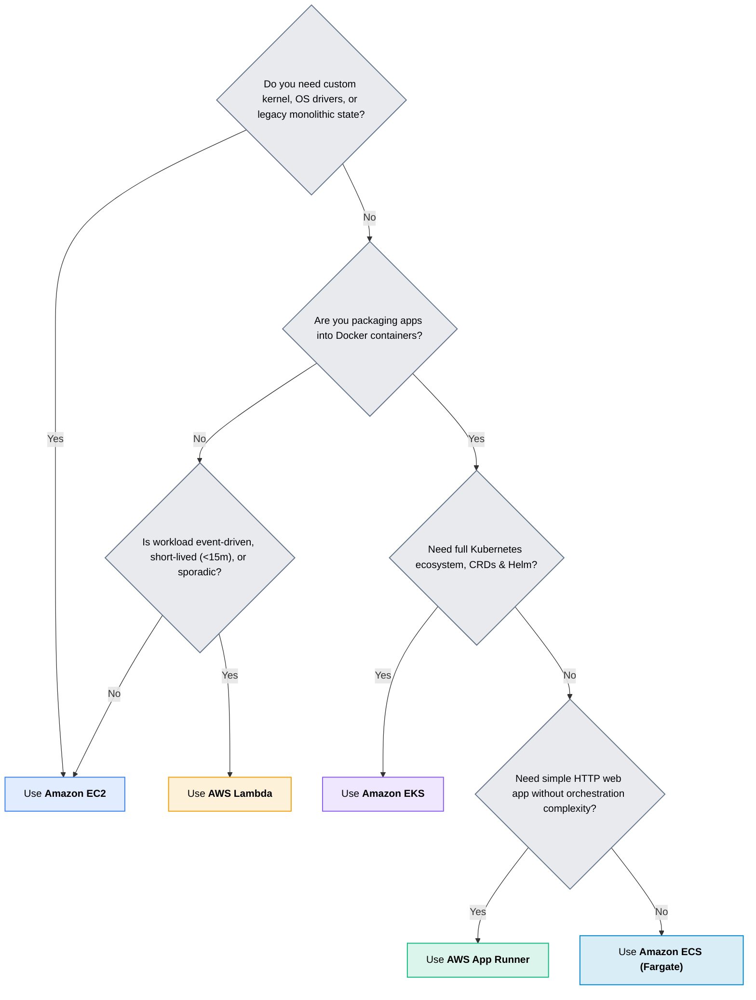

# 01 · AWS Compute Services

> **Module**: Compute  
> **Focus**: Workload execution models from virtual machines to serverless containers and event-driven functions.

---

## Compute Abstraction Spectrum

AWS offers a spectrum of compute abstractions balancing operational control against automated management.

---

## Service Decision Matrix

---

## Compute Directory Index

- **[[ec2/README|EC2]]** — Elastic Compute Cloud instances, AMIs, storage attachment, and Auto Scaling.
- **[[lambda/README|Lambda]]** — Serverless Function-as-a-Service, lifecycle, execution environments, and concurrency.
- **[[ecs/README|ECS]]** — Elastic Container Service, Task Definitions, and Fargate serverless execution.
- **[[eks/README|EKS]]** — Elastic Kubernetes Service, managed control plane, and node groups.
- **[[app-runner/README|App Runner]]** — Fully managed container application runner from code or image.
