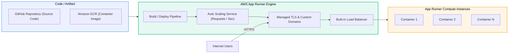

# AWS App Runner

> **Focus**: Fully managed containerized web applications and APIs with zero infrastructure orchestration.

---

## 1. App Runner Operating Model

Developers provide a source repository (GitHub) or container image (ECR). App Runner provisions load balancers, auto-scalers, TLS certificates, and health checks automatically.



---

## 2. App Runner vs ECS Fargate Comparison

| Feature | AWS App Runner | Amazon ECS on Fargate |
| :--- | :--- | :--- |
| **Primary Use Case** | Web applications, REST APIs | Complex microservices, background queues, batch |
| **Networking Setup** | Managed automatic endpoint & TLS | Requires manual VPC, Subnets, ALB, Target Groups |
| **Scaling Metric** | Concurrent incoming HTTP requests | CPU / Memory utilization or custom CloudWatch metrics |
| **Operational Overhead**| Near-Zero | Low-to-Medium |

---

## 3. Infrastructure as Code & SDK Implementations

### CDK (TypeScript)

```typescript
import * as cdk from 'aws-cdk-lib';
import * as apprunner from 'aws-cdk-lib/aws-apprunner';
import { Construct } from 'constructs';

export class PaaSStack extends cdk.Stack {
  constructor(scope: Construct, id: string, props?: cdk.StackProps) {
    super(scope, id, props);

    new apprunner.CfnService(this, 'PaaSWebService', {
      serviceName: 'order-api-service',
      sourceConfiguration: {
        authenticationConfiguration: {
          accessRoleArn: 'arn:aws:iam::123456789012:role/AppRunnerECRAccessRole',
        },
        imageRepository: {
          imageIdentifier: '123456789012.dkr.ecr.us-east-1.amazonaws.com/order-api:latest',
          imageRepositoryType: 'ECR',
          imageConfiguration: {
            port: '8080',
            runtimeEnvironmentVariables: [
              { name: 'NODE_ENV', value: 'production' },
            ],
          },
        },
        autoDeploymentsEnabled: true,
      },
      instanceConfiguration: {
        cpu: '1 vCPU',
        memory: '2 GB',
      },
    });
  }
}
```

### CDK (Python)

```python
import aws_cdk as cdk
from aws_cdk import aws_apprunner as apprunner
from constructs import Construct

class PaaSStack(cdk.Stack):
    def __init__(self, scope: Construct, construct_id: str, **kwargs) -> None:
        super().__init__(scope, construct_id, **kwargs)

        apprunner.CfnService(
            self, "PaaSWebService",
            service_name="order-api-service",
            source_configuration=apprunner.CfnService.SourceConfigurationProperty(
                authentication_configuration=apprunner.CfnService.AuthenticationConfigurationProperty(
                    access_role_arn="arn:aws:iam::123456789012:role/AppRunnerECRAccessRole"
                ),
                image_repository=apprunner.CfnService.ImageRepositoryProperty(
                    image_identifier="123456789012.dkr.ecr.us-east-1.amazonaws.com/order-api:latest",
                    image_repository_type="ECR",
                    image_configuration=apprunner.CfnService.ImageConfigurationProperty(
                        port="8080",
                        runtime_environment_variables=[
                            apprunner.CfnService.KeyValuePairProperty(name="NODE_ENV", value="production")
                        ]
                    )
                ),
                auto_deployments_enabled=True
            ),
            instance_configuration=apprunner.CfnService.InstanceConfigurationProperty(
                cpu="1 vCPU",
                memory="2 GB"
            )
        )
```

### YAML (CloudFormation)

```yaml
AWSTemplateFormatVersion: '2010-09-09'
Description: AWS App Runner Managed Container Service

Resources:
  AppRunnerService:
    Type: AWS::AppRunner::Service
    Properties:
      ServiceName: order-api-service
      SourceConfiguration:
        AutoDeploymentsEnabled: true
        AuthenticationConfiguration:
          AccessRoleArn: arn:aws:iam::123456789012:role/AppRunnerECRAccessRole
        ImageRepository:
          ImageIdentifier: 123456789012.dkr.ecr.us-east-1.amazonaws.com/order-api:latest
          ImageRepositoryType: ECR
          ImageConfiguration:
            Port: '8080'
            RuntimeEnvironmentVariables:
              - Name: NODE_ENV
                Value: production
      InstanceConfiguration:
        Cpu: 1 vCPU
        Memory: 2 GB
```

### SDK (TypeScript)

```typescript
import { AppRunnerClient, CreateServiceCommand } from '@aws-sdk/client-apprunner';

const client = new AppRunnerClient({ region: 'us-east-1' });

async function createService() {
  const command = new CreateServiceCommand({
    ServiceName: 'order-api-service',
    SourceConfiguration: {
      AutoDeploymentsEnabled: true,
      AuthenticationConfiguration: {
        AccessRoleArn: 'arn:aws:iam::123456789012:role/AppRunnerECRAccessRole',
      },
      ImageRepository: {
        ImageIdentifier: '123456789012.dkr.ecr.us-east-1.amazonaws.com/order-api:latest',
        ImageRepositoryType: 'ECR',
        ImageConfiguration: {
          Port: '8080',
          RuntimeEnvironmentVariables: { NODE_ENV: 'production' },
        },
      },
    },
    InstanceConfiguration: {
      Cpu: '1 vCPU',
      Memory: '2 GB',
    },
  });

  const response = await client.send(command);
  console.log('App Runner Service ARN:', response.Service?.ServiceArn);
}

createService();
```

### SDK (Python)

```python
import boto3

apprunner = boto3.client('apprunner', region_name='us-east-1')

def create_service():
    response = apprunner.create_service(
        ServiceName='order-api-service',
        SourceConfiguration={
            'AutoDeploymentsEnabled': True,
            'AuthenticationConfiguration': {
                'AccessRoleArn': 'arn:aws:iam::123456789012:role/AppRunnerECRAccessRole'
            },
            'ImageRepository': {
                'ImageIdentifier': '123456789012.dkr.ecr.us-east-1.amazonaws.com/order-api:latest',
                'ImageRepositoryType': 'ECR',
                'ImageConfiguration': {
                    'Port': '8080',
                    'RuntimeEnvironmentVariables': {'NODE_ENV': 'production'}
                }
            }
        },
        InstanceConfiguration={
            'Cpu': '1 vCPU',
            'Memory': '2 GB'
        }
    )
    print("Service ARN:", response['Service']['ServiceArn'])

create_service()
```
