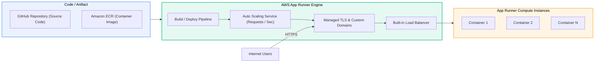

# AWS App Runner

> **Focus**: Fully managed containerized web applications and APIs with zero infrastructure orchestration.

---

## 1. App Runner Operating Model

Developers provide a source repository (GitHub) or container image (ECR). App Runner provisions load balancers, auto-scalers, TLS certificates, and health checks automatically.

---

## 2. App Runner vs ECS Fargate Comparison

| Feature | AWS App Runner | Amazon ECS on Fargate |
| :--- | :--- | :--- |
| **Primary Use Case** | Web applications, REST APIs | Complex microservices, background queues, batch |
| **Networking Setup** | Managed automatic endpoint & TLS | Requires manual VPC, Subnets, ALB, Target Groups |
| **Scaling Metric** | Concurrent incoming HTTP requests | CPU / Memory utilization or custom CloudWatch metrics |
| **Operational Overhead**| Near-Zero | Low-to-Medium |
