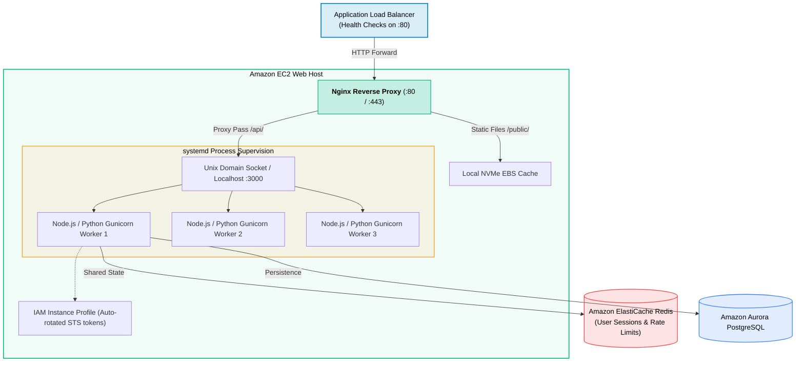
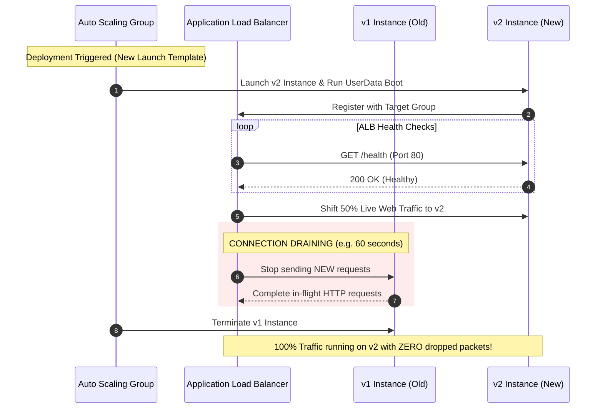
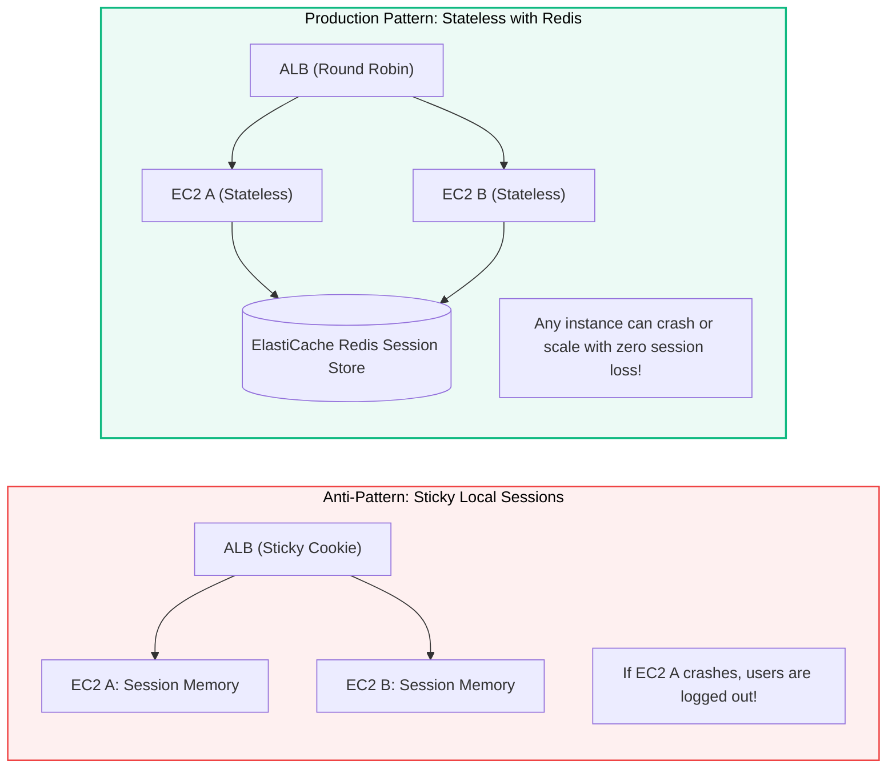

# Amazon EC2 for Web Development

> **Focus**: Production web server setup, Nginx reverse proxy, systemd process management, zero-downtime rolling updates, and stateless session scaling.

---

## 1. Production Host Architecture (Nginx + Node/Python Backend)

A production EC2 web instance runs **Nginx** as a high-performance reverse proxy for TLS termination, gzip compression, and static asset caching, forwarding dynamic requests to internal web application processes via Unix sockets or localhost ports.



---

## 2. Zero-Downtime Rolling Deployment with ALB

When deploying new code across an Auto Scaling Group (ASG), the Application Load Balancer coordinates with **Connection Draining (Deregistration Delay)** so active HTTP requests finish before instances terminate.



---

## 3. Stateless Web Tier vs Sticky Sessions



---

## 4. Production Web Server User Data Script

```bash
#!/bin/bash
# Amazon Linux 2023 - Web Server Automated Bootstrap
dnf update -y
dnf install -y nginx git nodejs

# Configure Nginx Reverse Proxy
cat << 'CONF' > /etc/nginx/conf.d/webapp.conf
server {
    listen 80;
    server_name _;

    location / {
        proxy_pass http://127.0.0.1:3000;
        proxy_http_version 1.1;
        proxy_set_header Upgrade $http_upgrade;
        proxy_set_header Connection 'upgrade';
        proxy_set_header Host $host;
        proxy_set_header X-Real-IP $remote_addr;
        proxy_set_header X-Forwarded-For $proxy_add_x_forwarded_for;
        proxy_cache_bypass $http_upgrade;
    }
}
CONF

systemctl restart nginx
systemctl enable nginx
```

---

## 5. Infrastructure as Code & SDK Implementations

### CDK (TypeScript)

```typescript
import * as cdk from 'aws-cdk-lib';
import * as ec2 from 'aws-cdk-lib/aws-ec2';
import { Construct } from 'constructs';

export class IaaSStack extends cdk.Stack {
  constructor(scope: Construct, id: string, props?: cdk.StackProps) {
    super(scope, id, props);

    const vpc = ec2.Vpc.fromLookup(this, 'DefaultVpc', { isDefault: true });

    const securityGroup = new ec2.SecurityGroup(this, 'WebServerSG', {
      vpc,
      description: 'Allow HTTP and SSH',
      allowAllOutbound: true,
    });
    securityGroup.addIngressRule(ec2.Peer.anyIpv4(), ec2.Port.tcp(80), 'Allow HTTP');
    securityGroup.addIngressRule(ec2.Peer.anyIpv4(), ec2.Port.tcp(22), 'Allow SSH');

    new ec2.Instance(this, 'ComputeWorker', {
      vpc,
      instanceType: ec2.InstanceType.of(ec2.InstanceClass.T3, ec2.InstanceSize.MICRO),
      machineImage: ec2.MachineImage.latestAmazonLinux2023(),
      securityGroup,
      blockDevices: [
        {
          deviceName: '/dev/xvda',
          volume: ec2.BlockDeviceVolume.ebs(20, {
            volumeType: ec2.EbsDeviceVolumeType.GP3,
            encrypted: true,
          }),
        },
      ],
    });
  }
}
```

### CDK (Python)

```python
import aws_cdk as cdk
from aws_cdk import aws_ec2 as ec2
from constructs import Construct

class IaaSStack(cdk.Stack):
    def __init__(self, scope: Construct, construct_id: str, **kwargs) -> None:
        super().__init__(scope, construct_id, **kwargs)

        vpc = ec2.Vpc.from_lookup(self, "DefaultVpc", is_default=True)

        security_group = ec2.SecurityGroup(
            self, "WebServerSG",
            vpc=vpc,
            description="Allow HTTP and SSH",
            allow_all_outbound=True
        )
        security_group.add_ingress_rule(ec2.Peer.any_ipv4(), ec2.Port.tcp(80), "Allow HTTP")
        security_group.add_ingress_rule(ec2.Peer.any_ipv4(), ec2.Port.tcp(22), "Allow SSH")

        ec2.Instance(
            self, "ComputeWorker",
            vpc=vpc,
            instance_type=ec2.InstanceType.of(ec2.InstanceClass.T3, ec2.InstanceSize.MICRO),
            machine_image=ec2.MachineImage.latest_amazon_linux2023(),
            security_group=security_group,
            block_devices=[
                ec2.BlockDevice(
                    device_name="/dev/xvda",
                    volume=ec2.BlockDeviceVolume.ebs(
                        volume_size=20,
                        volume_type=ec2.EbsDeviceVolumeType.GP3,
                        encrypted=True
                    )
                )
            ]
        )
```

### YAML (CloudFormation)

```yaml
AWSTemplateFormatVersion: '2010-09-09'
Description: Amazon EC2 Instance with GP3 EBS Volume and Security Group

Parameters:
  VpcId:
    Type: AWS::EC2::VPC::Id
  SubnetId:
    Type: AWS::EC2::Subnet::Id

Resources:
  WebServerSecurityGroup:
    Type: AWS::EC2::SecurityGroup
    Properties:
      GroupDescription: Allow HTTP and SSH
      VpcId: !Ref VpcId
      SecurityGroupIngress:
        - IpProtocol: tcp
          FromPort: 80
          ToPort: 80
          CidrIp: 0.0.0.0/0
        - IpProtocol: tcp
          FromPort: 22
          ToPort: 22
          CidrIp: 0.0.0.0/0

  ComputeWorkerInstance:
    Type: AWS::EC2::Instance
    Properties:
      InstanceType: t3.micro
      ImageId: ami-0c101f26f147fa7fd
      SubnetId: !Ref SubnetId
      SecurityGroupIds:
        - !Ref WebServerSecurityGroup
      BlockDeviceMappings:
        - DeviceName: /dev/xvda
          Ebs:
            VolumeSize: 20
            VolumeType: gp3
            Encrypted: true
```

### SDK (TypeScript)

```typescript
import { EC2Client, RunInstancesCommand } from '@aws-sdk/client-ec2';

const client = new EC2Client({ region: 'us-east-1' });

async function launchInstance() {
  const command = new RunInstancesCommand({
    ImageId: 'ami-0c101f26f147fa7fd',
    InstanceType: 't3.micro',
    MinCount: 1,
    MaxCount: 1,
    SecurityGroupIds: ['sg-0123456789abcdef0'],
    SubnetId: 'subnet-0123456789abcdef0',
    BlockDeviceMappings: [
      {
        DeviceName: '/dev/xvda',
        Ebs: {
          VolumeSize: 20,
          VolumeType: 'gp3',
          Encrypted: true,
        },
      },
    ],
    TagSpecifications: [
      {
        ResourceType: 'instance',
        Tags: [{ Key: 'Name', Value: 'ComputeWorker' }],
      },
    ],
  });

  const response = await client.send(command);
  console.log('Instance ID:', response.Instances?.[0].InstanceId);
}

launchInstance();
```

### SDK (Python)

```python
import boto3

ec2_client = boto3.client('ec2', region_name='us-east-1')

def launch_instance():
    response = ec2_client.run_instances(
        ImageId='ami-0c101f26f147fa7fd',
        InstanceType='t3.micro',
        MinCount=1,
        MaxCount=1,
        SecurityGroupIds=['sg-0123456789abcdef0'],
        SubnetId='subnet-0123456789abcdef0',
        BlockDeviceMappings=[
            {
                'DeviceName': '/dev/xvda',
                'Ebs': {
                    'VolumeSize': 20,
                    'VolumeType': 'gp3',
                    'Encrypted': True
                }
            }
        ],
        TagSpecifications=[
            {
                'ResourceType': 'instance',
                'Tags': [{'Key': 'Name', 'Value': 'ComputeWorker'}]
            }
        ]
    )
    print("Launched Instance ID:", response['Instances'][0]['InstanceId'])

launch_instance()
```
