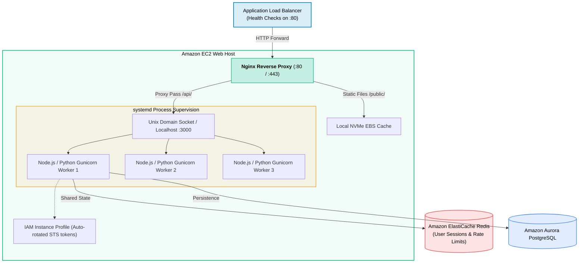
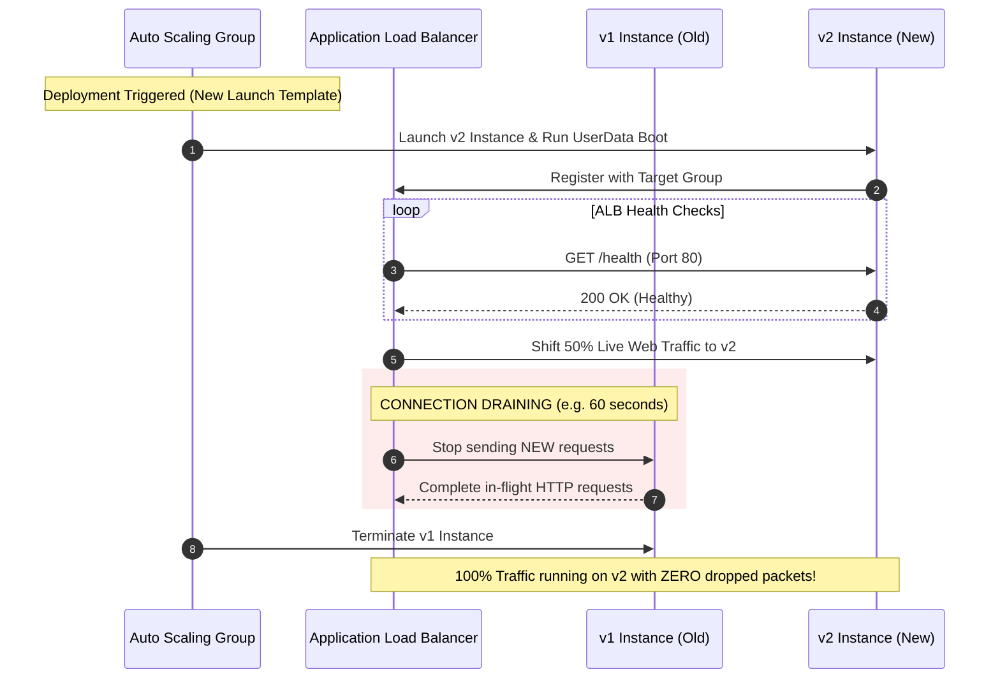
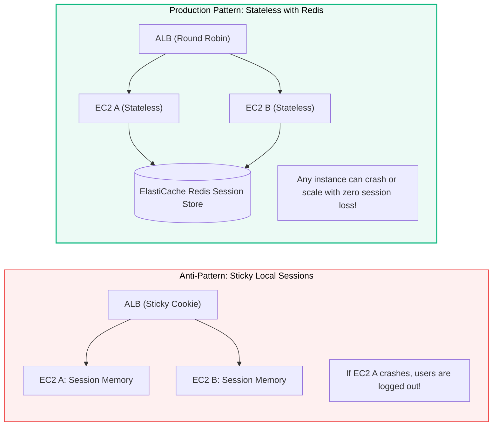

# Amazon EC2 for Web Development

> **Focus**: Production web server setup, Nginx reverse proxy, systemd process management, zero-downtime rolling updates, and stateless session scaling.

---

## 1. Production Host Architecture (Nginx + Node/Python Backend)

A production EC2 web instance runs **Nginx** as a high-performance reverse proxy for TLS termination, gzip compression, and static asset caching, forwarding dynamic requests to internal web application processes via Unix sockets or localhost ports.



---

## 2. Zero-Downtime Rolling Deployment with ALB

When deploying new code across an Auto Scaling Group (ASG), the Application Load Balancer coordinates with **Connection Draining (Deregistration Delay)** so active HTTP requests finish before instances terminate.



---

## 3. Stateless Web Tier vs Sticky Sessions



---

## 4. Production Web Server User Data Script

```bash
#!/bin/bash
# Amazon Linux 2023 - Web Server Automated Bootstrap
dnf update -y
dnf install -y nginx git nodejs

# Configure Nginx Reverse Proxy
cat << 'CONF' > /etc/nginx/conf.d/webapp.conf
server {
    listen 80;
    server_name _;

    location / {
        proxy_pass http://127.0.0.1:3000;
        proxy_http_version 1.1;
        proxy_set_header Upgrade $http_upgrade;
        proxy_set_header Connection 'upgrade';
        proxy_set_header Host $host;
        proxy_set_header X-Real-IP $remote_addr;
        proxy_set_header X-Forwarded-For $proxy_add_x_forwarded_for;
        proxy_cache_bypass $http_upgrade;
    }
}
CONF

systemctl restart nginx
systemctl enable nginx
```
