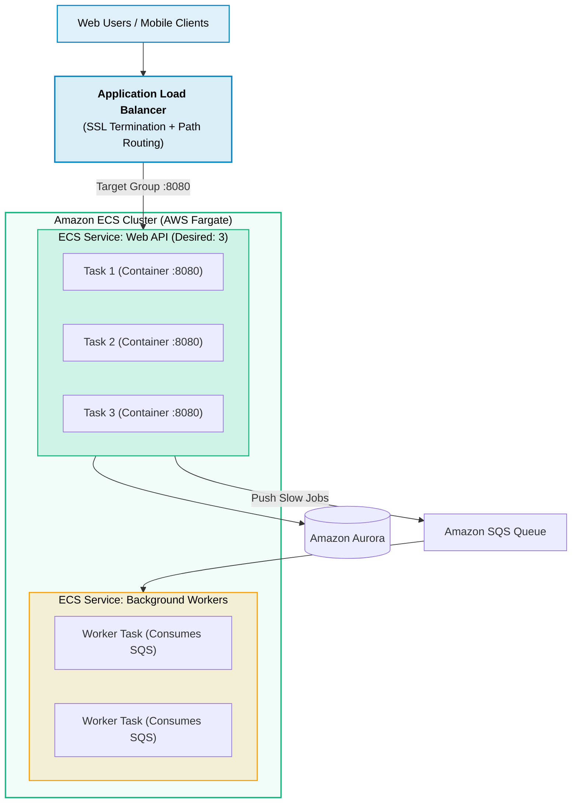
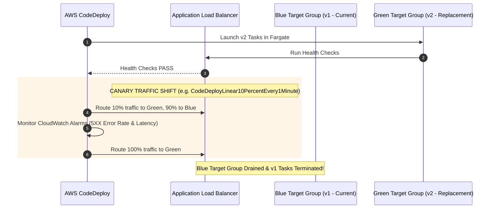
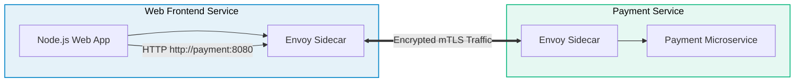

# Amazon ECS (Elastic Container Service) for Web Development

> **Focus**: Containerized web applications on AWS Fargate, ALB target groups, Blue/Green CodeDeploy traffic shifting, and internal microservice discovery.

---

## 1. Production Fargate Web Architecture

AWS Fargate executes Docker containers without provisioning or managing virtual machines, perfectly isolating web frontends, backend APIs, and background queue processors.



---

## 2. Blue/Green Canary Deployments with AWS CodeDeploy

Zero-downtime updates are achieved by spinning up replacement containers on a green target group and gradually shifting ALB listener traffic.



---

## 3. ECS Service Connect: Microservice-to-Microservice Communication

Internal web services (e.g., `checkout-service` calling `payment-service`) resolve each other using human-readable names without public internet exposure or custom DNS.



---

## 4. Production Task Definition JSON Structure

```json
{
  "family": "web-api-task",
  "networkMode": "awsvpc",
  "requiresCompatibilities": ["FARGATE"],
  "cpu": "512",
  "memory": "1024",
  "executionRoleArn": "arn:aws:iam::123456789012:role/ecsTaskExecutionRole",
  "taskRoleArn": "arn:aws:iam::123456789012:role/webApiTaskRole",
  "containerDefinitions": [
    {
      "name": "web-container",
      "image": "123456789012.dkr.ecr.us-east-1.amazonaws.com/web-app:v2.1",
      "portMappings": [{ "containerPort": 8080, "protocol": "tcp" }],
      "secrets": [
        { "name": "DB_PASSWORD", "valueFrom": "arn:aws:secretsmanager:...:db_pass" }
      ],
      "logConfiguration": {
        "logDriver": "awslogs",
        "options": {
          "awslogs-group": "/ecs/web-api",
          "awslogs-region": "us-east-1",
          "awslogs-stream-prefix": "ecs"
        }
      }
    }
  ]
}
```
