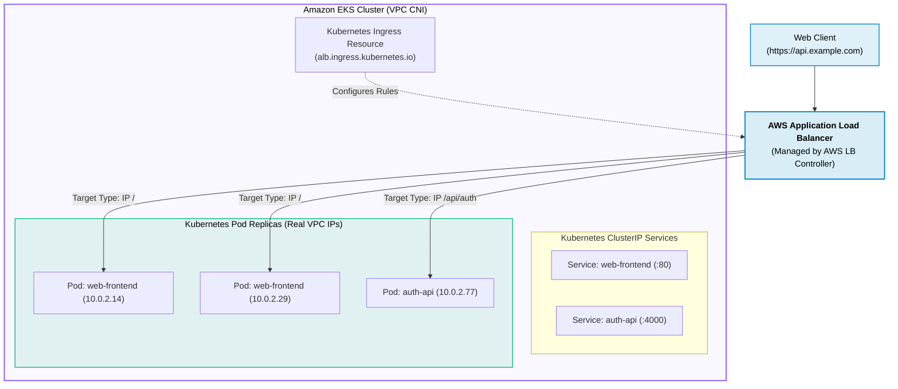
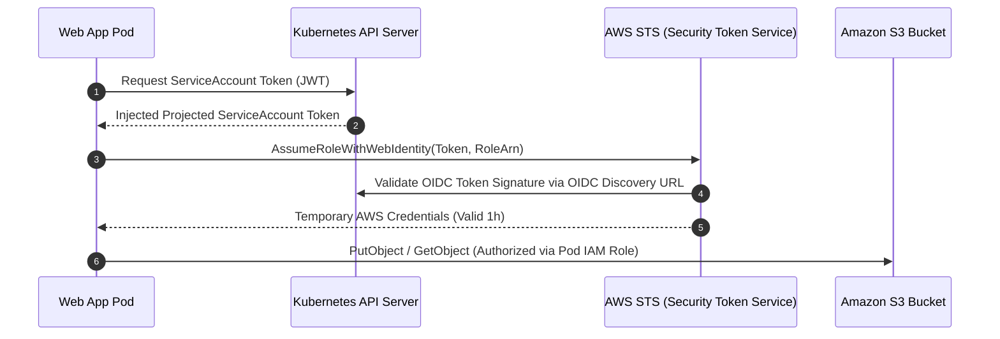
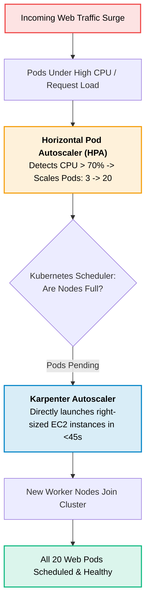

# Amazon EKS (Elastic Kubernetes Service) for Web Development

> **Focus**: Cloud-native web applications on Kubernetes, AWS Load Balancer Controller Ingress, Pod IAM (IRSA), and Karpenter autoscaling.

---

## 1. Kubernetes Web Ingress Architecture with AWS ALB Controller

In production, the **AWS Load Balancer Controller** automatically provisions and configures an AWS Application Load Balancer when developers apply standard Kubernetes `Ingress` manifests.



---

## 2. Pod Security: IAM Roles for Service Accounts (IRSA)

Instead of granting broad IAM permissions to the EC2 worker node, **IRSA** uses OpenID Connect (OIDC) federation to give each web pod its own fine-grained IAM Role.



---

## 3. High-Traffic Web Scaling: HPA + Karpenter



---

## 4. Production Kubernetes Web Ingress Manifest

```yaml
apiVersion: networking.k8s.io/v1
kind: Ingress
metadata:
  name: web-app-ingress
  namespace: production
  annotations:
    kubernetes.io/ingress.class: alb
    alb.ingress.kubernetes.io/scheme: internet-facing
    alb.ingress.kubernetes.io/target-type: ip
    alb.ingress.kubernetes.io/certificate-arn: arn:aws:acm:us-east-1:123456789012:certificate/abc-123
    alb.ingress.kubernetes.io/listen-ports: '[{"HTTP": 80}, {"HTTPS": 443}]'
    alb.ingress.kubernetes.io/ssl-redirect: '443'
spec:
  rules:
    - host: api.example.com
      http:
        paths:
          - path: /
            pathType: Prefix
            backend:
              service:
                name: web-api-service
                port:
                  number: 8080
```
