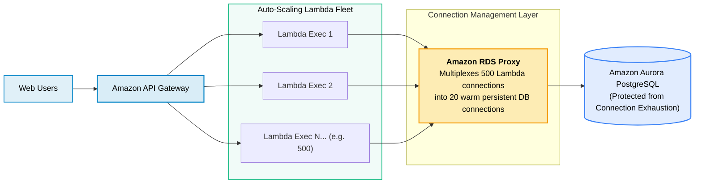
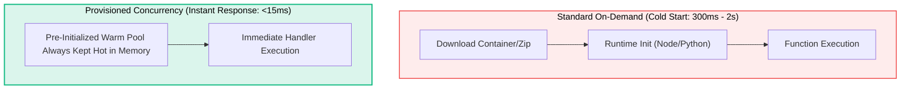

# AWS Lambda for Web Development

> **Focus**: Serverless web APIs, HTTP payload format 2.0, cold start optimization, RDS Proxy database pooling, and Lambda Function URLs for webhooks.

---

## 1. Serverless Web API Architecture with RDS Proxy

When hundreds of concurrent Lambda functions open direct database connections, traditional relational databases (PostgreSQL/MySQL) run out of connection slots. **Amazon RDS Proxy** pools and shares DB connections across serverless functions.



---

## 2. Cold Start Elimination for Interactive Web APIs



> [!TIP] Web Developer Cold Start Optimization Rules
> 1. **Keep Packages Lean**: Tree-shake imports (e.g., `import { S3Client } from '@aws-sdk/client-s3'` instead of the entire `aws-sdk`).
> 2. **Global Connection Reuse**: Initialize DB clients, HTTP clients, and AWS SDKs **outside** the handler function so warm microVMs reuse open sockets.
> 3. **ARM64 Architecture (Graviton2/3)**: Select ARM64 for 20% lower cost and faster execution times.

---

## 3. Lambda Function URLs for Webhooks (Stripe / GitHub)

For third-party webhook receivers that do not require API Gateway features, **Lambda Function URLs** provide a direct HTTPS endpoint with built-in CORS.

```mermaid
flowchart LR
    STRIPE["Stripe Webhook Event<br/>(payment_intent.succeeded)"] -->|HTTPS POST| FURL["<b>Lambda Function URL</b><br/>https://abc123xyz.lambda-url.us-east-1.on.aws/"]
    FURL --> HANDLER["Lambda Handler Function"]
    HANDLER --> SQS["Amazon SQS Queue (Async Fulfillment)"]
    HANDLER -->> STRIPE["200 OK (Instant Receipt)"]

    style STRIPE fill:#0284c7,fill-opacity:0.12,stroke:#0284c7,stroke-width:1.5px,color:inherit
    style FURL fill:#0284c7,fill-opacity:0.15,stroke:#0284c7,stroke-width:2px,color:inherit
    style HANDLER fill:#10b981,fill-opacity:0.15,stroke:#10b981,stroke-width:2px,color:inherit
```

---

## 4. Production Web Handler (Payload Format 2.0)

```javascript
// Node.js 20 - API Gateway HTTP API Proxy Handler
export const handler = async (event) => {
  const method = event.requestContext.http.method;
  const path = event.requestContext.http.path;

  // Read Claims from Cognito / JWT Authorizer
  const userId = event.requestContext.authorizer?.jwt?.claims?.sub;

  if (method === 'GET' && path === '/api/user') {
    return {
      statusCode: 200,
      headers: { 'Content-Type': 'application/json' },
      body: JSON.stringify({ userId, status: 'active' }),
    };
  }

  return { statusCode: 404, body: JSON.stringify({ error: 'Not Found' }) };
};
```
