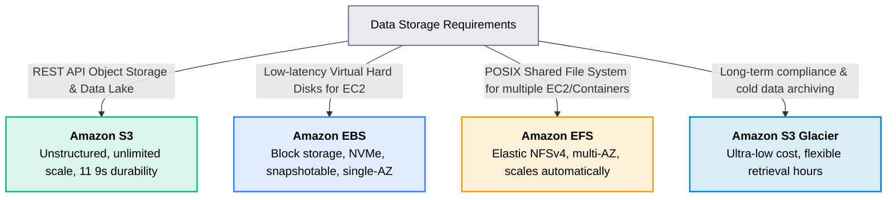

# 02 · AWS Storage Services

> **Module**: Storage  
> **Focus**: Data persistence models: Object, Block, File, and Long-Term Cold Archive.

---

## Storage Types Spectrum

---

## Storage Comparison Matrix

| Service | Paradigm | Protocol | Concurrency | Durability |
| :--- | :--- | :--- | :--- | :--- |
| **Amazon S3** | Object (Key-Value) | HTTPS / REST | Millions concurrent | 99.999999999% (11 9s) |
| **Amazon EBS** | Block Storage | NVMe / FC | Single EC2 (or Multi-Attach) | 99.8% – 99.999% |
| **Amazon EFS** | Network File (POSIX) | NFSv4.1 | Thousands of instances | 99.999999999% (11 9s) |
| **S3 Glacier** | Archive Object | HTTPS / REST | Batch / Async job | 99.999999999% (11 9s) |

---

## Storage Directory Index

- **[[s3/README|S3]]** — Simple Storage Service, storage classes, lifecycle policies, and bucket security.
- **[[ebs/README|EBS]]** — Elastic Block Store, volume types (`gp3`, `io2`), and snapshot management.
- **[[efs/README|EFS]]** — Elastic File System, multi-AZ POSIX mounting, and throughput modes.
- **[[glacier/README|Glacier]]** — Deep archival, retrieval tiers, and compliance Vault Locks.
