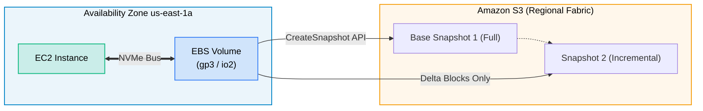
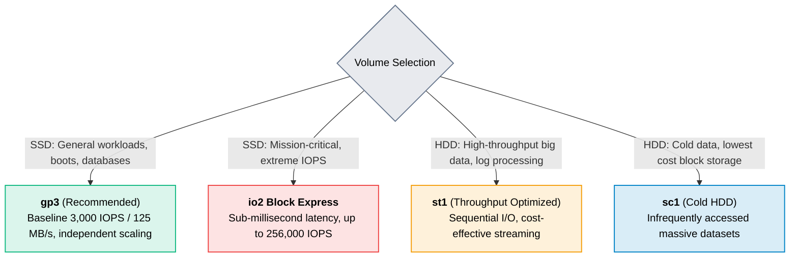

# Amazon EBS (Elastic Block Store)

> **Focus**: Persistent block storage volumes, performance tiering, and snapshot mechanisms.

---

## 1. EBS Volume Attachment & Snapshots

EBS volumes are bound to a specific Availability Zone and attach to EC2 instances via high-speed NVMe protocols.

---

## 2. EBS Volume Types Breakdown

> [!TIP] gp2 vs gp3
> Migrate legacy `gp2` to `gp3` to save 20% on storage costs while decoupling IOPS and throughput provisioning from disk capacity.
