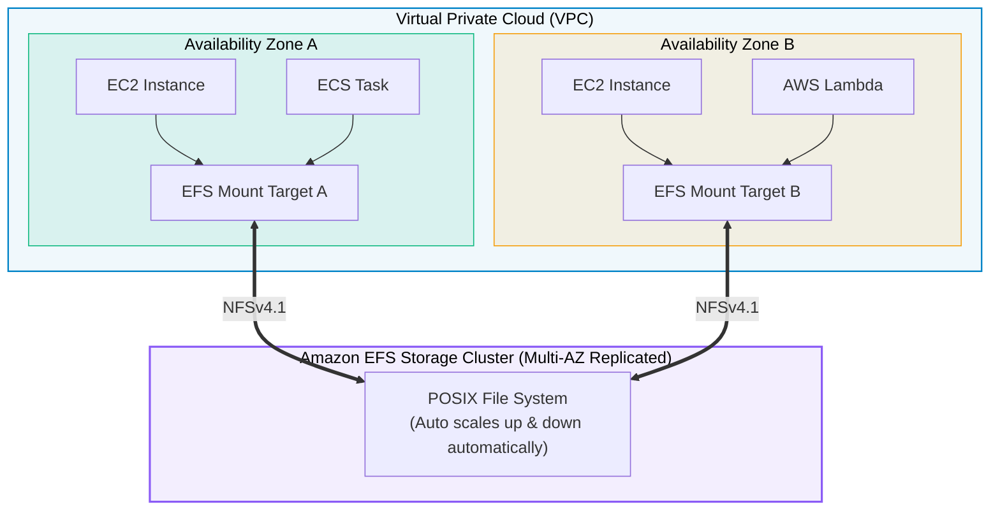

# Amazon EFS (Elastic File System)

> **Focus**: Serverless, elastic, POSIX-compliant shared network file storage (NFSv4).

---

## 1. Multi-AZ Shared File System Architecture

Amazon EFS provides concurrent read/write file access to thousands of instances across multiple Availability Zones simultaneously.

---

## 2. EFS Performance & Storage Tiers

- **Storage Classes**: Standard (Active) & Infrequent Access (EFS-IA) with automated lifecycle management.
- **Throughput Modes**:
  - **Elastic**: Automatically scales throughput to match workload demand (recommended).
  - **Provisioned**: Dedicated throughput regardless of stored volume size.
