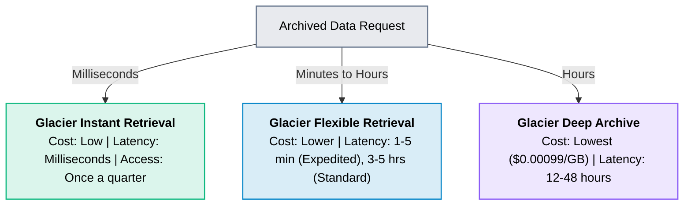
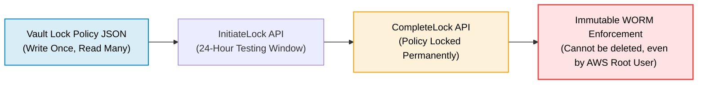

# Amazon S3 Glacier

> **Focus**: Cold data archiving, compliance retention, retrieval tiers, and Vault Lock policies.

---

## 1. Glacier Retrieval Tiers & Latency

---

## 2. S3 Glacier Vault Lock (WORM Compliance)

> [!NOTE] Regulatory Compliance
> Glacier Vault Lock enforces SEC Rule 17a-4(f), FINRA, and HIPAA data retention compliance where audit records must never be modified or erased before a retention term expires.
