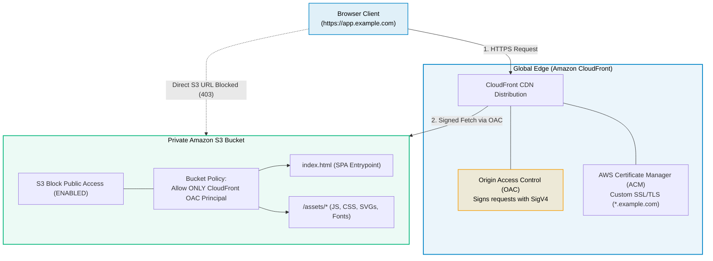
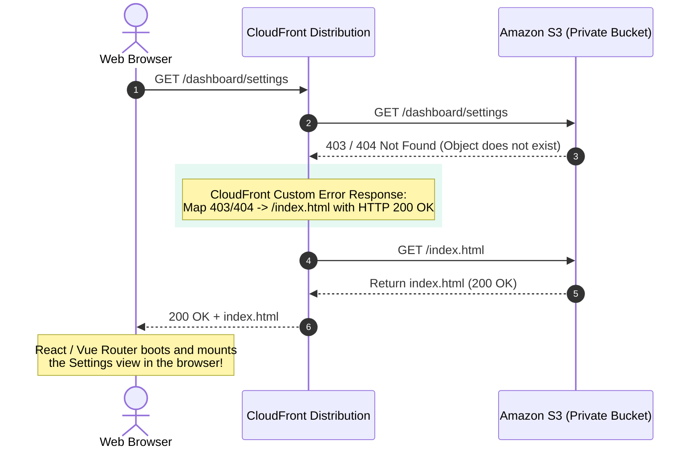
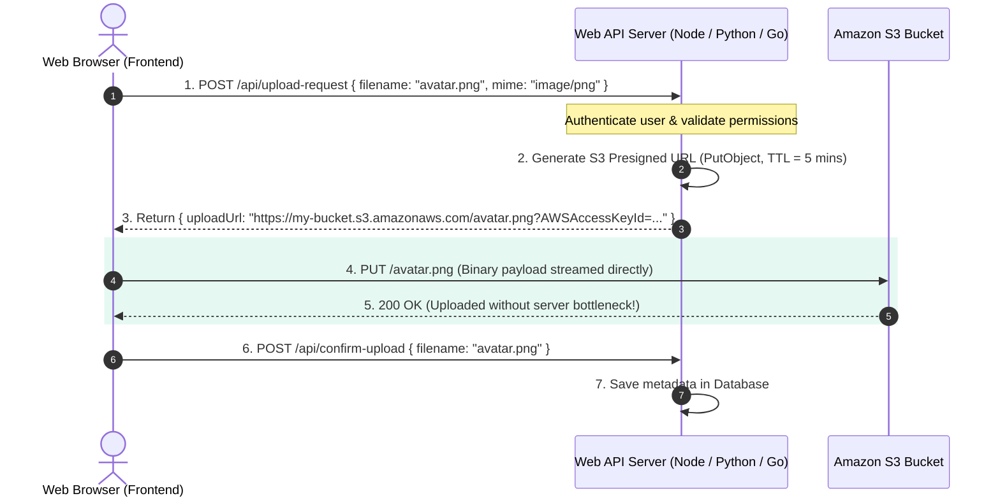
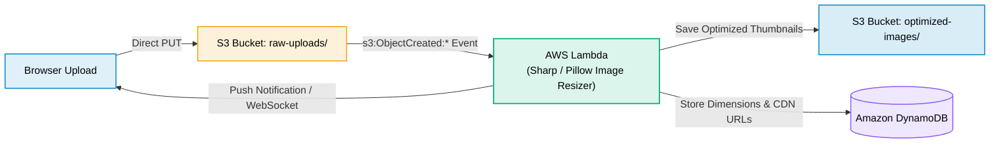

# Amazon S3 (Simple Storage Service) for Web Development

> **Focus**: Static web hosting, Single Page Application (SPA) routing, Origin Access Control (OAC), Presigned URLs, and event-driven media processing.

---

## 1. Single Page Application (SPA) Hosting Architecture

Hosting modern frontend applications (React, Vue, Angular, Next.js static export) on AWS pairs S3 for asset storage with CloudFront for global caching, SSL/TLS, and Origin Access Control (OAC).

---

## 2. SPA Client-Side Routing & 404 Fallback

Client-side routers (React Router, Vue Router) use HTML5 `history.pushState()`. When a user refreshes `/dashboard/settings`, S3 does not have a physical key named `dashboard/settings`. CloudFront custom error responses rewrite `403/404` to `index.html` with a `200 OK`.

---

## 3. Presigned URLs: Direct Browser-to-S3 Uploads

Traditional web architectures funnel user file uploads through web backend servers, saturating CPU, memory, and bandwidth. With **Presigned URLs**, the web server simply generates a temporary signed cryptographic URL; the browser uploads directly to S3.

---

## 4. Asynchronous Event-Driven Media Processing

Once an object lands in S3, **S3 Event Notifications** trigger background serverless workers without holding up web users.

---

## 5. Web Developer Production Checklist

| Feature | Production Setting | Why it Matters |
| :--- | :--- | :--- |
| **Origin Access Control (OAC)** | Enabled on S3 Bucket Policy | Prevents bypassing CloudFront, forces WAF & CDN inspection |
| **Block Public Access** | All 4 checkboxes **ON** | Prevents data leaks; S3 is only readable via CloudFront |
| **CORS Configuration** | Allow origin `https://app.example.com`, Methods: `GET, PUT, HEAD` | Allows SPA to download fonts & make direct PUT uploads |
| **Cache-Control Headers** | `max-age=31536000, immutable` for hashed assets (`/assets/*.js`) | Browsers & CDN cache hashed assets forever |
| **index.html Caching** | `max-age=0, must-revalidate` for `index.html` | Ensures users immediately get new app deployments |
