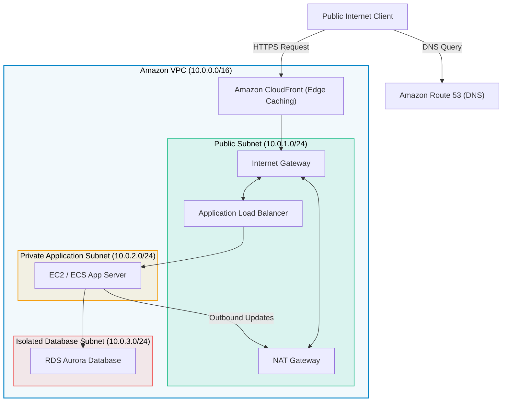

# 03 · AWS Networking & Content Delivery

> **Module**: Networking  
> **Focus**: Software-Defined Networking (SDN), VPC topologies, secure routing, traffic distribution, CDN, and DNS.

---

## VPC End-to-End Traffic Blueprint

---

## Networking Directory Index

- **[[vpc/README|VPC]]** — Virtual Private Cloud isolation, CIDR design, and VPC Peering / PrivateLink.
- **[[subnets/README|Subnets]]** — Public, Private, and Isolated tier segmentation.
- **[[route-tables/README|Route Tables]]** — Packet destination lookup and longest-prefix-match rules.
- **[[internet-gateway/README|Internet Gateway]]** — Bidirectional 1:1 NAT public ingress and egress.
- **[[nat-gateway/README|NAT Gateway]]** — Outbound-only internet egress for private workloads.
- **[[load-balancers/README|Load Balancers]]** — ALB (Layer 7), NLB (Layer 4), and Gateway Load Balancer.
- **[[cloudfront/README|CloudFront]]** — Global CDN, edge caching, and Origin Shield.
- **[[route53/README|Route 53]]** — 100% SLA DNS resolution and active-passive failover routing.
