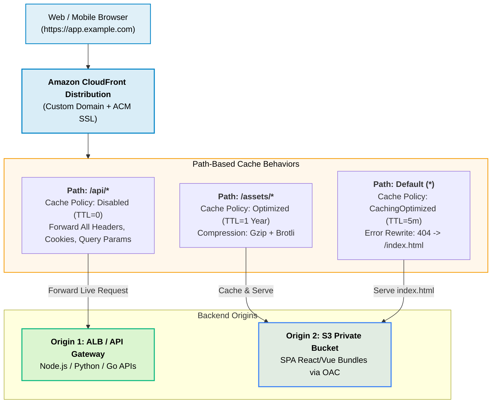
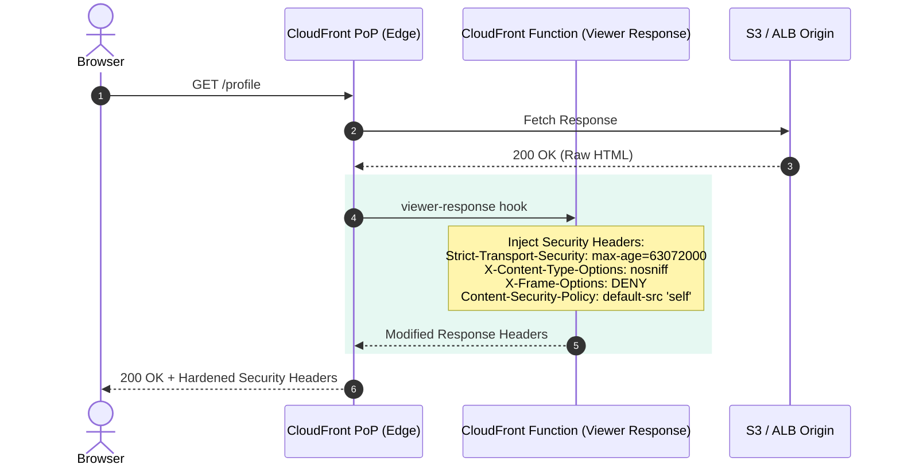
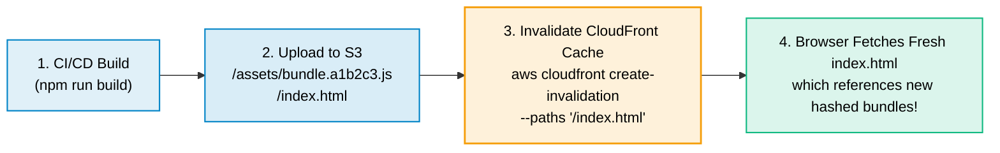

# Amazon CloudFront for Web Development

> **Focus**: Global edge acceleration, single-domain frontend + backend routing, security headers with edge compute, and cache invalidation.

---

## 1. Unified Multi-Origin Web Application Architecture

Modern web applications avoid Cross-Origin Resource Sharing (CORS) complexity by using CloudFront to serve both the frontend SPA and the dynamic backend APIs under a **single domain** (`https://app.example.com`).

---

## 2. Edge Security & Header Manipulation with CloudFront Functions

CloudFront Functions run lightweight JavaScript at **218+ edge PoPs** in `< 1 millisecond`. In web development, they inject critical security headers (HSTS, CSP, X-Frame-Options) and normalize URLs.

---

## 3. Cache Invalidation & Zero-Downtime Deployment Lifecycle

When deploying a new frontend build, never delete the bucket. Use content hashing and an automated cache invalidation step in your CI/CD pipeline.

> [!TIP] FinOps & Cache Invalidation Best Practice
> Only invalidate `"/index.html"` during deployments. Because JavaScript and CSS bundles contain unique content hashes (`main.[hash].js`), they never need invalidation and can be cached by browsers indefinitely.
